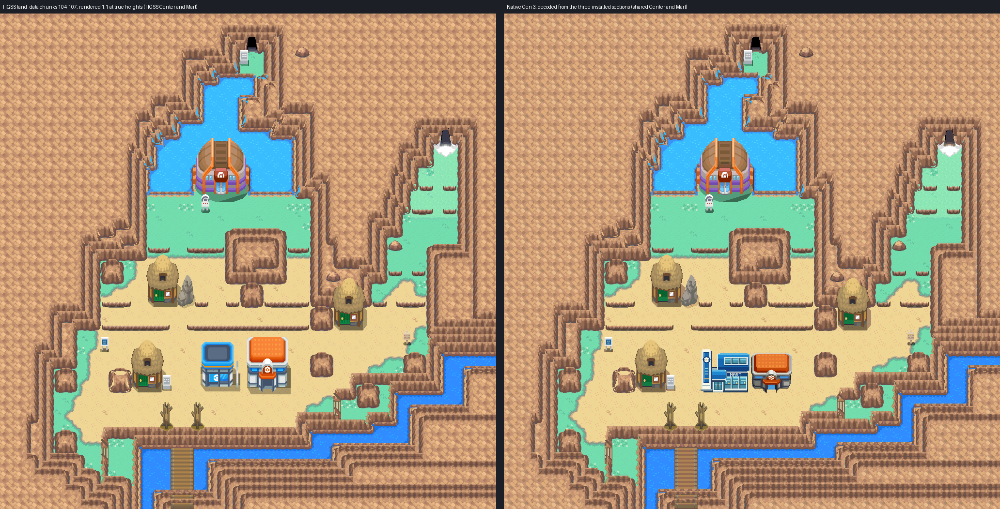
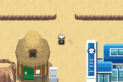

# Blackthorn City: first native exterior

Native Gen 3 Blackthorn built from HeartGold/SoulSilver's own map data, not an
overview screenshot. Editable source is in
[engine PR #26](https://github.com/Davisfox5/pokeemerald-expansion/pull/26)
against `apocrypha`, commit `aab405c5c90c38b47954c2cdca7b517d77005cd3`.
Owner visual acceptance is pending.



## Reference: decoded HGSS data

`tools/gba/maps/blackthorn/hgss_render.py` reads pret/pokeheartgold's packed
archives (revision `9d8b7591`, hashes in `source/hgss/hgss-render.json`):

| Data | Archive | Use |
| --- | --- | --- |
| land_data chunks 104-107 (map matrix cells x 20-21, z 4-5) | `a/0/6/5` | terrain NSBMD, 32x32 permission grids, 20 building placements |
| area data bank 9 | `a/0/4/2` | map texture set 9, building texture set 8 |
| map textures | `a/0/4/4` | terrain NSBTX |
| exterior building models | `a/0/4/0` | Gym, houses, signs, gate trees, rock (textures embedded) |
| zone events T30 | `zone_event/086_T30.json` | doors, signs and NPC cells (`source/hgss-events.json`) |

It software-renders the four chunks 1:1 at 16 px per tile. Ground faces land on
their own cells (so they register with the permission grid); cliff and ledge
fronts rise from their base; buildings rise from theirs. Every HGSS door, sign
and warp lands on its decoded event cell. `source/hgss/hgss-reference-true-heights.png`
is the review reference; `hgss-render.png` is the build input.

Collision, water, ledges and doors are the **decoded HGSS permissions**, cell for
cell (`evidence/reference-grid.png`). HGSS behaviour codes match Emerald's:
`0x10` pond, `0x15` ocean, `0x3B` jump south, `0x69` door, `0x6E` deep south warp.

## Deliberate adaptations

- **Cliff and ledge fronts** are stretched to whole 8 px rows (HGSS bands are 14.4 px,
  ledges 5.7 px), so every band edge sits on a tile boundary the way Gen 3 cliffs do.
  Compare `hgss-reference-true-heights.png` with `hgss-render.png`.
- **Shared buildings.** The approved Violet Center and Johto Mart replace HGSS's own.
  Their doors sit on the HGSS warps (34,48) and (27,48). Ground beneath is the real
  HGSS terrain, since HGSS's Center and Mart were never rendered into it. The shared
  Mart is wider than HGSS's, so it closes the one-cell passage between the two
  buildings (x 30-31, y 44-48); the town stays connected around them. All 13,958
  shared pixels keep their exact colours; the Center keeps Cherrygrove's bank-8 palette.
- **Unbuilt destinations are solid**: the Gym, three houses, Ice Path (57,16) and
  Dragon's Den (32,4). The ledger marks each one.
- **Signs**: city, Gym and Dragon's Den signs read their HGSS text, minus Clair's name
  on the Gym sign. The tutor-house and trainer-tips signs stay unscripted props.
- **Palette.** HGSS uses about 258 distinct colours here; Gen 3 gives 150 learned
  slots (13 banks, three of them fixed for the Center, Mart and the five tiles where
  they touch). Terrain and buildings get separate bank sets, and the fit is chosen
  for the most even loss across materials. 97.5% of pixels are within one 5-bit
  level of HGSS, 99.6% within two; the worst pixel is 10 levels off. Small materials
  (bridge planks, slopes, boulders) lose the most. No tile was merged or approximated.

## Why three sections

The HGSS art at 1:1 needs 1,884 distinct 8x8 tiles; one tileset pair holds 1,008.
Merging tiles to fit was tried and rejected: it moved sand flecks into a grid,
lightened blocks of river and cross-hatched cliff faces. Instead the city is three
ordinary Porymap maps, each with a private tileset pair inside the hardware limits
and all sharing one palette set:

| Section | Rows | Tiles | Metatiles |
| --- | --- | --- | --- |
| BlackthornCity01 | 0-23 (Dragon's Den, pond, Gym, Ice Path mouth) | 779 / 1008 | 294 / 1024 |
| BlackthornCity02 | 24-43 (Gym lawn, west and east houses, central rocks) | 749 / 1008 | 306 / 1024 |
| BlackthornCity03 | 44-63 (Center, Mart, tutor house, river, bridge) | 891 / 1008 | 379 / 1024 |

The engine's new `apocrypha_city_view.c` streams each section's own native tiles as
the camera moves, so neighbouring sections draw with their own art across the
connections. The worst camera window needs 469 of 1,007 streaming slots; the cache
uses 11.9 KB of heap. The camera margin beyond the city continues open rock, and the
river and bridge where they run off the edge (`evidence/camera-margin.png`). This
follows Goldenrod's approach but is data-driven, so other sectioned cities can
register in the same table. Section moves do not reopen the name banner.

## Verification

- **Native audit** (`check.py`, `evidence/native-audit.json`): installed sections decode
  identically to the build; all 4,096 cells match the ledger's behaviour, collision,
  elevation and layer type; all 876 open cells are reachable (868 on foot, 8 by Surf:
  the Dragon's Den ledge, as in HGSS); existing map ids unchanged; changed files within
  scope.
- **Headless mGBA 0.10.2** (`runtime.py`, `evidence/gameplay/results.json`): both section
  lines crossed both ways; two ledges jumped and not climbed; Mart body, cliffs, pond
  edge and both cave mouths block; three signs read; Center in, upstairs, back and out;
  Mart in and out; ordinary flash save, cold reload in a new process, title Continue.
- **Rendering parity**: for all 40 captures, including a Cherrygrove regression check and
  the return trip, the map layers BG1-BG3 were rebuilt from dumped VRAM, palettes and BG
  registers and match the decoded native image pixel for pixel (`gameplay/bg-*.png`).
  Zero cache overflows.
- The engine's own `make` runs `tools/city_view/check.py`, which fails if a section is
  edited without regenerating the view tables. A fresh clone of the branch passes it.

Local ROM SHA-256 `f2e6c8d097592dabfe1086a26960d98ce5f74eafbe34ec0897eb883a24b4d2e8`
(Ubuntu Arm GNU 13.2.1). Provenance: `evidence/preservation.json`. No ROM, save,
toolchain or emulator binary is committed.



Region pairs for close review: `evidence/review/`. Coordinate grids:
`evidence/reference-grid.png` (HGSS with permissions) and `evidence/native-grid.png`.

## Not verified or not built

- Porymap was not available in this session: no open, export or save round trip.
- No interiors for the Gym or houses; no Ice Path, Dragon's Den or Route 45. The bridge
  reaches the south edge with no connection.
- No sectioned city connects to an ordinary map yet; such a connection would also need
  primary tiles, palettes and BG buffers reloaded (`tools/city_view/README.md` in the engine).
- Center nurse and Mart shop scripts are Cherrygrove's copies, not exercised. The Mart
  stock is Cherrygrove's placeholder list. Music is a placeholder (`MUS_FALLARBOR`).
- No NPCs, trainers, encounters or story events.

## Editing and reproduction

Edit the three sections natively in Porymap. Then regenerate only the view tables from
this hub and commit both together:

```sh
python3 tools/gba/maps/blackthorn/stream.py /path/to/engine
```

First-authoring provenance (never replay over owner edits; `install.py` refuses):

```sh
python3 tools/gba/maps/blackthorn/hgss_render.py /path/to/pokeheartgold gba/art/blackthorn-city/source/hgss
python3 tools/gba/maps/blackthorn/build.py /path/to/engine
python3 tools/gba/maps/blackthorn/install.py /path/to/engine
python3 tools/gba/maps/blackthorn/stream.py /path/to/engine
# after make:
python3 tools/gba/maps/blackthorn/check.py /path/to/engine
python3 tools/gba/maps/blackthorn/runtime.py /path/to/engine /tmp/blackthorn-run
python3 tools/gba/maps/blackthorn/review.py /path/to/engine
```

`MGBA_FLAGS` and `ARM_NM` select a non-system libmgba or toolchain.

Original map geography, models and textures: Game Freak / Nintendo / Creatures
(HeartGold/SoulSilver), read-only derivation under the repository's existing asset practice.
