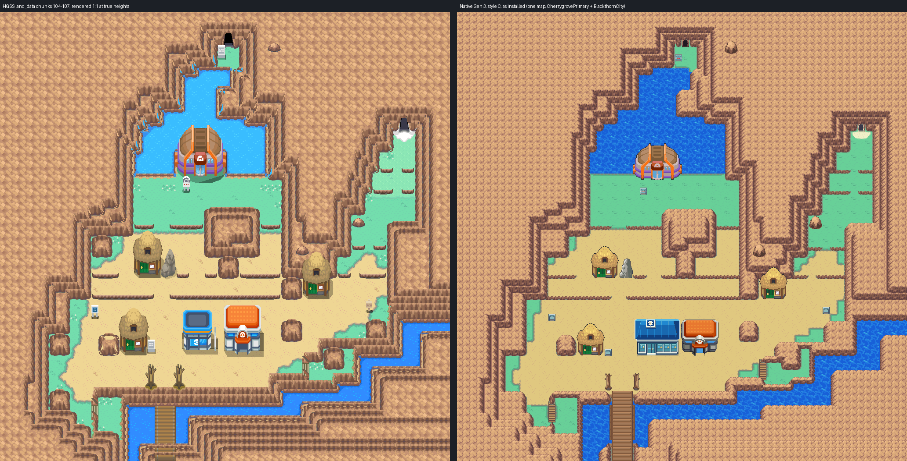
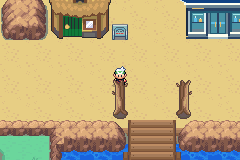

# Blackthorn City: native exterior built from Gen 3 elements

Blackthorn as one native Gen 3 map, laid out cell for cell from HeartGold/SoulSilver's
own map data but drawn with Gen 3 pieces: each HGSS element (rock terraces, ground,
water, ledges, props, buildings) is replaced by a Gen 3 element that does the same job,
styled with Blackthorn's HGSS colours. Editable source is in
[engine PR #26](https://github.com/Davisfox5/pokeemerald-expansion/pull/26) against
`apocrypha`, branch `claude/blackthorn-city`. Owner visual acceptance is pending.



## The map

| | |
| --- | --- |
| Map | `BlackthornCity`, 64x64, `gMapGroup_Cherrygrove` id 43 (Center 44, Center upstairs 45, Mart 46) |
| Primary | `gTileset_CherrygrovePrimary` (accepted Johto primary: ground, animated water, signs, Center) |
| Secondary | `gTileset_BlackthornCity`: 465 of 496 tiles (16 kept for door animation), 345 of 512 metatiles |
| Palettes | banks 0-5 the primary's; 8 Cherrygrove's Center palette; 9 the shared Mart's; 10 the Center/Mart junction; 6, 7, 11, 12 learned |

## Reference: decoded HGSS data

`tools/gba/maps/blackthorn/hgss_render.py` reads pret/pokeheartgold's packed archives
(revision `9d8b7591`, hashes in `source/hgss/hgss-render.json`): land_data chunks
104-107 (terrain model, 32x32 permission grids, building placements), area data bank 9,
the map and building textures, and zone events T30 (`source/hgss-events.json`). Its 1:1
render at true heights (`source/hgss/hgss-reference-true-heights.png`) is the review
reference. Collision, water, ledges and doors are the decoded HGSS permissions, cell for
cell. HGSS behaviour codes match Emerald's: `0x10` pond, `0x15` ocean, `0x3B` jump south,
`0x69` door, `0x6E` deep south warp.

## Element ledger

`elements.py` labels every cell from a flat top-down HGSS height map and the
permissions (`source/elements/ledger.json`, `ledger.png`): rock top or face (with its
downhill direction), ledge, boulder, other blocked, water, open, plus the ground under
it. A rock cell's terrace level is its HGSS peak height minus the town floor, so each
HGSS layer becomes one Gen 3 terrace and each face one metatile.

## Rock: three treatments

HGSS's Blackthorn cliff layers are about 1.5 tiles tall. Three ways of turning them
into one-tile Gen 3 terraces were built and compared (`evidence/elements/styles.png`,
`rock-compare.png`, `rock-detail.png`):

| Style | Rock pieces | Secondary tiles |
| --- | --- | --- |
| A | HGSS's own rock top, face band and side, compressed to one layer per metatile | 582: over the 496 budget, render only |
| B | Emerald's General rock pieces recoloured to Blackthorn's ramp | 455 |
| **C (installed)** | FRLG's General mountain set (the Gen 3 counterpart of HGSS's Kanto/Johto rock) recoloured to Blackthorn's ramp | 465 |

Style C uses FRLG's nine-slice (corners, rims, sides, front face) in both of FRLG's
versions, one for an edge over ground and one for an edge over a lower terrace, plus its
four inner corners. A cell whose only lower neighbour is diagonal takes the whole
inner-corner piece, which turns the face into the side as one continuous L; every other
cell is composed per 8x8 quadrant from the piece its two edges call for, using the
over-rock version where that quadrant faces a lower terrace, so stacked terraces run as
unbroken bands. As in FRLG the rock is a top-layer overlay over
plain ground: clear pixels show what lies past the edge (the lower terrace's top, or the
flattest primary block of that ground), and the cast shadow is Cherrygrove's border
grey, so cliff tiles don't multiply with the ground texture. Terrain rising toward the
south faces away from the Gen 3 camera, so those steps show as rims, the way FRLG draws
the far side of a mountain.

## Other elements

- **Ground and water**: Cherrygrove's own tiles, chosen per 8-neighbour configuration and
  texture phase (the accepted Johto vocabulary, animated sea included). Grass-water edges
  use Route 30's accepted pond rim (`source/elements/route30-native.png`, decoded from the
  engine at `apocrypha`): its grey lip and grass, with every water pixel taken from
  Blackthorn's lake at the lake's own 32 px phase, so a shore is the same water as the open
  lake. Route 30 puts the lip on the grass side, so straight-edge water stays plain lake;
  its mirror images give grass north of water, which its pond never shows. Where a shore
  meets a cliff (the Dragon's Den landing, both ends of the Gym's shore) the rock's clear
  pixels take part in the rim, so the lip runs on to the rock.
- **Ledges**: FRLG's jump ledge in Blackthorn's ramp, with rounded ends where it stops on
  open ground. Where a ledge meets a cliff it runs straight into it: FRLG's join piece (a
  mountain side with the ledge built into its foot) on a plain side, and the ledge carried
  on under the rock's clear and shadow pixels where it meets a corner.
- **Caves**: FRLG's cave mouth on the Dragon's Den and Ice Path warp cells; Ice Path's arch
  is rimmed with frost and a snow drift spills onto the grass in front.
- **Props and buildings** as Gen 3 sprites (`sprites.py`, `source/elements/sprites/`,
  `source/elements/sprites.png`): the Gym and the three thatched houses from HGSS's own
  models (below), the two dead-trunk gate posts (16 px wide, inside their own cell column)
  and the standing stone (from HGSS's stone model through HGSS's field camera: a broad
  rounded stone with lumps, a lobe at its lower left and etched cracks, in the grey ramp of
  the Center palette; `stone-reference.png`).
  HGSS's boulder is kept as a 2x2 prop in Blackthorn's rock ramp. The bridge and
  stairs are element pieces. Bridge, stairs and gate posts use CherrygrovePrimary's own
  wood ramp (bank 2), the stone the Center palette's greys (bank 8) and the Ice Path snow
  the primary's whites (bank 0), so none of their tiles need a learned palette; the bridge
  railing sits on the top layer over plain water, so no tile mixes wood and water.
- **Houses and Gym**: HGSS's own models and textures (the house 132 with its door 133, the
  Gym 139 with its door 16) rendered at the owner-locked C06 Center's angle
  (`hgss_camera.view`: orthographic at 38 degrees, 16 px per tile up the screen, squeezed
  across to fit the footprint as C06 is), so their roofs and doors match the Center and
  Mart beside them; HGSS's own field camera (48.7 degrees, `house-reference.png`,
  `gym-reference.png`) draws them steeper. Each roof is mirrored on an 8 px axis so its
  halves share tiles, C06's outline colour runs round each silhouette, and tiles that
  differ only by a one-pixel edge shift are folded together.
  - House: 64 x 75, the rounded crown, the bulging thatch skirt with the dormer, the
    posts, the window and the stone footing, in 14 colours of its own. HGSS's straw
    (`fu_h01`) is a muted tan that reads grey on the GBA, so it is lifted toward the golden
    straw of the first Gen 3 huts; the green door's planks (`fu_door1`, a dark stripe every
    4 texels) are drawn back one pixel wide, the plank gaps on its dark upper half in the
    outline colour.
  - Gym: 112 x 85, in 14 colours picked by family from its own render (roof wood, the
    purple bands, the hall's greys, the beams, one rust for the beams' shadow side and the
    emblem's face, the emblem's top and underside, the door glass). The roof shells' two
    plank seams (`en_gyma`, rows 7-8 and 23-24) are drawn back one pixel wide, one step
    darker on the roof's ramp. Its foot is on the bottom of the door row (y 23); the beam
    tips reach 5 px into row 18, over the water HGSS's collision blocks behind the hall.
  - `evidence/elements/buildings-before-after.png` sets them against the first Gen 3
    drawings.
- **Depth (walk-behind)**: props and rock sit on the top layer. A Gen 3 player is two
  cells tall, feet in its own cell and head in the cell above, so the packer decides each
  cell by the depth of the object its art belongs to (`pack.above_player`): a walkable cell
  draws its art above the player (layer type normal, every tile on the top layer, opaque
  ones included) only when that object's base row lies further south, as with a roof or
  crown the player walks behind. Door cells and every other cell on an object's base row,
  and all blocked cells, draw below the player (covered). The player walks behind the
  gate posts, the houses' crowns (two cells each) and the Mart's roof row, and stands in front of every
  door with its head drawn over the building. The shared buildings' wall rows are solid
  wherever they cover a cell, so no wall edge hangs over a walkable cell. The Gym and the
  stone stand within their own blocked rows.
- **Shared buildings**: the Violet Center and the owner-locked shared Johto Mart
  (`gba/art/johto-mart`, art revision `e53f3450`, review id M01 in
  `gba/art/johto-common/approved-buildings.json`, both on branch `codex/violet-city`), on
  the HGSS warps (34,48) and (27,48). The Mart's wall rows 1-5 are solid across its width,
  as its manifest sets them. All 14,414 shared pixels keep their exact colours.

## Deliberate adaptations

- **Unbuilt destinations are solid**: the Gym door, three house doors, Ice Path (57,16) and
  Dragon's Den (32,4). The bridge reaches the south edge with no connection.
- The shared Mart is wider than HGSS's and closes the one-cell passage between the two
  buildings (x 30-31, y 44-48); the town stays connected around them.
- Rock-labelled slivers beside the bridge deck are its railing posts. The Gym's island is
  water under the roof and grass under the hall's foot, kept inside the hall's outline so
  the pond's south shore runs straight up to the Gym on both sides (visual only; the island
  cells are solid either way).
- **Signs**: city, Gym and Dragon's Den signs read their HGSS text, minus Clair's name on the
  Gym sign. The tutor-house and trainer-tips signs are unscripted props.
- **Colour**: the native map holds every one of the composed element art's 1,048,576
  pixels exactly in 5-bit colour. Each building keeps to one bank (14 colours and the
  outline) so the learned banks fit 46 colours (`evidence/elements/pack-C.json`).

## Verification

- **Native audit** (`check_elements.py`, `evidence/elements/native-audit.json`): the installed
  files decode identically to the packer; all 4,096 cells match the traversal ledger's
  behaviour, collision, elevation and layer type; all 872 open cells are reachable (864 on
  foot, 8 by Surf: the Dragon's Den ledge, as in HGSS); the layer type of every cell
  follows the depth rule above (walk-behind cells listed in the audit, both doors below
  the player); Center bank 8 and Mart bank 9
  palettes identical to the shared sources; existing map ids unchanged; changed files
  within scope. Coordinate grid: `evidence/elements/native-grid.png`.
- **Headless mGBA 0.10.2** (`runtime_elements.py`, `evidence/elements/gameplay/results.json`):
  views across the town; standing behind both gate posts, the west house and the Mart's
  roof row; standing in front of the Mart, Center, Gym and all three houses; two ledges
  jumped and not climbed; Mart body, cliffs, the standing stone, pond edge and both cave
  mouths block; three signs read; Center in, upstairs, back and out; Mart in and out; Cherrygrove
  and back; ordinary flash save, cold reload in a new process, title Continue.
- **Rendering parity**: for all 36 captures the map layers BG1-BG3 rebuilt from dumped VRAM,
  palettes and BG registers match the decoded native image pixel for pixel, apart from
  CherrygrovePrimary's animated sea tiles. In the walk-behind captures BG1 covers the
  player's own cell (81 px at each gate post, 101 at the house's crown, 64 at the Mart's
  roof row); in front of every building BG1 covers none of the player's two cells.
- **Porymap 6.3.1** (`porymap.py`, `evidence/porymap/results.json`), built from source and run
  under Xvfb on a fresh clone: the city and its three interiors open with no errors;
  Porymap's export of the city matches the native decode pixel for pixel; saving the maps
  and the city's tilesets rewrote 21 Blackthorn files, all byte-identical. The only lines a
  save changes predate Blackthorn: key order in a Route 110 layout entry and three `é`
  escapes in Kanto MAPSEC names.

Engine commit `64a8b9e8ce6dd4d4c89ccbc0e118aed8670e8d39`, local ROM SHA-256
`45b126c745a0cfeebe48bf62d854aa193d94e885a1cdf9f3db2e574de213f570` (Ubuntu Arm GNU 13.2.1).
No ROM, save, toolchain or emulator binary is committed.



Region pairs for close review: `evidence/elements/review/`.

## Not verified or not built

- No interiors for the Gym or houses; no Ice Path, Dragon's Den or Route 45 connection.
- Center nurse and Mart shop scripts are Cherrygrove's copies, not exercised. The Mart stock
  is Cherrygrove's placeholder list. Music is a placeholder (`MUS_FALLARBOR`).
- No NPCs, trainers, encounters or story events.

## Editing and reproduction

Edit `BlackthornCity` natively in Porymap; it is an ordinary single map. First-authoring
provenance (never replay over owner edits; `install_elements.py` refuses if the maps exist):

```sh
python3 tools/gba/maps/blackthorn/hgss_render.py /path/to/pokeheartgold gba/art/blackthorn-city/source/hgss
python3 tools/gba/maps/blackthorn/hgss_camera.py /path/to/pokeheartgold gba/art/blackthorn-city/evidence/elements/hgss-house-camera.png
python3 tools/gba/maps/blackthorn/hgss_camera.py /path/to/pokeheartgold gba/art/blackthorn-city/evidence/elements/hgss-stone-camera.png 235
python3 tools/gba/maps/blackthorn/hgss_camera.py /path/to/pokeheartgold gba/art/blackthorn-city/evidence/elements/hgss-gym-camera.png 139 16
python3 tools/gba/maps/blackthorn/sprites.py /path/to/pokeheartgold
python3 tools/gba/maps/blackthorn/elements.py /path/to/engine /path/to/pokeheartgold
python3 tools/gba/maps/blackthorn/pack.py /path/to/engine C
python3 tools/gba/maps/blackthorn/budget.py /path/to/engine C        # tiles and colours per element
python3 tools/gba/maps/blackthorn/install_elements.py /path/to/engine C
# after make:
python3 tools/gba/maps/blackthorn/check_elements.py /path/to/engine C
python3 tools/gba/maps/blackthorn/runtime_elements.py /path/to/engine /tmp/blackthorn-run C
python3 tools/gba/maps/blackthorn/review_elements.py C
python3 tools/gba/maps/blackthorn/porymap.py /path/to/engine /path/to/porymap C
```

`MGBA_FLAGS` and `ARM_NM` select a non-system libmgba or toolchain.

## Prior draft

The first build rendered HGSS 1:1 and needed about 1,900 tiles, so it split the city into
three connected sections and streamed their tiles with an engine city view. It is
superseded by this one and kept for reference: its tools (`build.py`, `install.py`,
`stream.py`, `check.py`, `runtime.py`, `review.py`) and evidence (`evidence/sections-draft/`),
and its engine commits on the branch before `b166fa1d`.

Original map geography, models and textures: Game Freak / Nintendo / Creatures
(HeartGold/SoulSilver); FRLG mountain pieces from the engine's `general_frlg` tileset.
Read-only derivation under the repository's existing asset practice.
