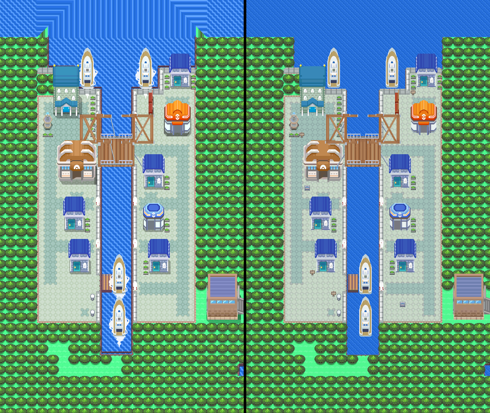

# Canalave City from Platinum's own map data

November 10, 2026. A first build, not yet seen by the owner. Engine branch `claude/pensive-johnson-jpkszw`
(commit 009c2f1f), stacked on `claude/routes-30-31-catalog` (PR #39). Visual acceptance stays with the owner.



## How to play it

Build the engine branch, start a game, hold R and press START for the debug menu, then warp to
`CanalaveCity`. There is no route into the city yet. The debug menu is on in ordinary (non-release) builds.

## Method

1. **Reference** (`cn_reference.py`): pret/pokeplatinum 62bdaacd, `res/field`. Canalave is TownsAndRoutes
   matrix cells (1, 22) and (1, 23), rendered at 16 px per cell by the HGSS renderer. Native cell = Platinum
   cell + (7, 7); the map is 46 x 78. The seven-cell margin is Platinum's own surroundings: sea north, forest
   west, south and east, and the first seven columns of Route 218 with its gatehouse front.
2. **Layers** (`cn_compose.py`): the bottom layer is Platinum's terrain; the top layer is its buildings and
   props. A top layer over a walkable cell is drawn over the player (roofs), except on decks.
3. **Water**: every sea pixel is Emerald's animated deep water in Platinum's four sea blues. Canal-wall
   pixels in part-water tiles sit on the top layer so the water under them still animates.
4. **Cleanup** (`cn_cleanup.py`), each one a declared difference from Platinum:
   - No soft cast shadows and no ship wakes. Platinum blends both into the ground. Leaving them out is what
     brings the map inside the tile budget (1,311 tile patterns with them, 976 without).
   - The drawbridge's west half is the east half mirrored about the canal's centre line. Platinum's halves
     share no tiles (268 patterns).
   - The fountain statue's stone is drawn with alpha in Platinum; it comes back from the full render.
   - Platinum's signs are overworld objects. Emerald's own wooden and town signs stand on their six cells.
5. **Pack** (`cn_pack.py`, `cn_quant.py`): 13 banks of 15 colours fitted to the art, tiles shared in any
   flip and under any bank. 21 tiles free, 632 metatiles. Secondary tiles 1008-1023 are left for door frames.
6. **Traversal**: Platinum's permission grid, cell for cell. Water is surfable ocean at elevation 1.
   Seven cells differ, all listed in `source/trace/adaptations.json`: the six sign cells are blocked, and
   the Harbor Inn door stays shut, as it is in Platinum before its event.
7. **Events** (`install.py`): eight doors, six residents and the Psyduck on Platinum's cells with Platinum's
   default lines (re-wrapped for the GBA text box), six signs, the shut-door notice, a notice at the gate.

## Checks

| Check | Result |
| --- | --- |
| ROM builds | yes, sha256 93757ba1... (`evidence/build.json`) |
| Every walkable land cell away from wandering residents, one step in each direction (`runtime.py`) | 2,988 steps, 0 differ from the native grid |
| Doors | all eight lead inside and back out below the door |
| Center stairs, nurse, Mart clerk, six signs, shut door, gate notice, Sailor Eldritch | all answer |
| Save, cold reload | passes |
| 36 gameplay frames against the native decode, outside the player, residents and water | 100% identical |

Review: [sheets 1-4](evidence/review/) (Platinum left, native right, numbered cells),
[gameplay](evidence/review/gameplay.png), [walking under roofs and on decks](evidence/review/layering.png),
[material grid](source/trace/material-grid.txt), [traversal](source/trace/traversal.txt).

## Limits

- **Interiors are stand-ins.** The Center is the shared Sinnoh Center. The Mart, Gym, library and four
  houses use existing Emerald layouts (stock Mart, Rustboro Gym, Rustboro school, House 1-4) with no residents
  beyond the nurse and clerk. None is built from its Platinum room. The Mart's stock is a placeholder.
- **Doors do not animate.** They are walk-in doors.
- **Route 218 is not built.** The gatehouse is art in the margin; the gate cells show a notice.
- **No surfing under the drawbridge.** The deck is at walking height. A surfer is stopped at its edge.
- **Not placed:** TM89, the hidden Big Pearl, the rival, Rowan and the story scenes. They need flags and
  variables, which are budgeted.
- **Walk-behind hides the player** behind tall roofs for up to three cells; Platinum's buildings are taller
  than Gen 3's.
- Thirty-one walkable cells carry a 15-pixel sliver of tree crown that the player walks over.
- Music (`MUS_LILYCOVE`) and the map section's region-map position are placeholders.
- This is Platinum's Canalave as it was. No ten-years-on changes are designed.
- Not run: Porymap open/export, and the `apocrypha build` action (it runs only for PRs against `apocrypha`).

## Reproduce

```sh
PLAT=path/to/pokeplatinum python3 tools/gba/maps/canalave_city/cn_reference.py CACHE
python3 tools/gba/maps/canalave_city/install.py CACHE ENGINE
(cd ENGINE && make -j1 generated && make -j4)
python3 tools/gba/maps/canalave_city/runtime.py CACHE ENGINE OUT
python3 tools/gba/maps/canalave_city/review.py CACHE ENGINE OUT
```

The installer is provenance. Do not run it over later owner edits of the layout.

Original designs and textures: Game Freak / Nintendo / Creatures.
