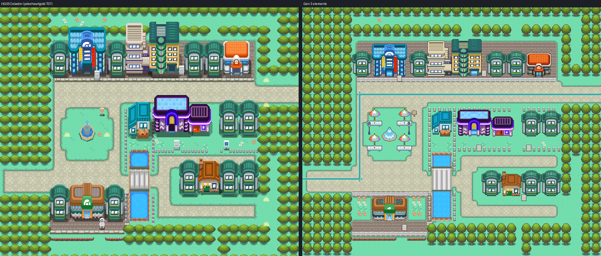
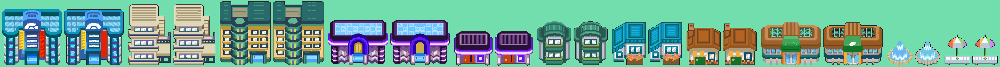

# Celadon City (Kanto, GBA): HGSS's Celadon as Gen 3 elements

Status: third round built and installed (engine branch `claude/celadon-city`, on
`claude/saffron-city`; hub branch `claude/celadon-city`). The owner turned it down. Rounds 4
and 5 were plans the owner revised; round 6 (`evidence/v6/`: `plot.png`, `concept.png`,
`art.png`) waits on the owner's approval before it is built. Round 6 keeps round 5's plan
(64 x 52 cells, the straight canal and its pond, the cycleway from Route 7 to Route 16, the
stall-framed square, the Arboretum) and changes its art: every building is its HGSS Celadon
model brought down to Gen 3 at 45 degrees (`tools/gba/maps/celadon_elements/hgss_gen3.py`),
the houses HGSS Celadon's own in terraces, the Dept Store's banners in kana, no English text
on any building; grass, trees and flowers are the games' own (`nature.py`) and every grass
join takes FireRed's path edge; the stalls are drawn at the buildings' pitch. Its second pass
(owner, 2026-10-27): the bridges Route 104's boardwalk, the Game Corner its HGSS model at the
same pitch with round 5's marquee and lights on it, every overlap between objects cleared,
the trees the repo's whole cut-out crowns in staggered rows.

The owner turned down two rounds: FireRed's Celadon with the changes painted on, then HGSS's
plan drawn in FireRed's own pieces ("a slightly updated version of the FRLG maps", its palette
and features "horribly, horribly boring"). Asked to choose, the owner picked HGSS's own look,
made the way Olivine was, and kept the approved story plan (`evidence/plan.png`). This round is
HGSS's Celadon (pokeheartgold header 55, area bank 15, zone T07) converted element by element
(AGENTS.md, "Converting a Gen 4 map" and "Kanto towns"): its layout cell for cell, its ground
textures at 1:1 on the Gen 3 grid, every building rendered from its own HGSS model at C06's
angle. `evidence/compare.png` puts HGSS beside the build.



## The map

| | |
| --- | --- |
| Map | `KantoCeladonCity`, 60x50 (HGSS's 64x64 block less the forest at columns 60-63 and rows 50-63), `gMapGroup_Kanto` id 6, `MAPSEC_CELADON_CITY`, `MUS_RG_CELADON` |
| Primary | `gTileset_KantoCeladonPrimary`: 512 tiles (tile 0 blank), 512 metatiles, banks 0-5; nothing borrowed |
| Secondary | `gTileset_KantoCeladonCity`: 480 of 504 tiles (the last 8 slots kept for a 1x1 door animation), 50 metatiles, banks 6-12 |
| Palettes | one exact fit, each bank seeded with a job (`pack.bank_seeds`): lawn and paving; terrace, kerb, bridge and posts; canal and ledges; flower beds; trees; six building groups; C06 over two |
| Border | the west forest's 2x2 tree block (4, 44) |

## HGSS's elements and what each became

| HGSS | Gen 3 |
| --- | --- |
| Lawns (`grass01gs`) | one 16 px quadrant of the texture, so a lawn repeats every cell |
| Hexagon paving (`tama_yuka`) | the texture at 32 px, in the world's phase |
| Lawn edge (`tama_fuch`) | its bands on the lawn side of the join (grey-olive lip, dark line, ragged dark-teal fringe, dither), the cell mask blurred so corners round and straight runs stay on the cell edge |
| Terraces under the north row and the Gym (`tama_yuka2`) | the brick at 32 px |
| Terrace kerbs (`tama_br`) | the texture turned to run along the edge: stones, grey lip, dark face; flipped on a terrace's back edge |
| Canal (`pond_on`, `pond_edge`, `pond_line`) | the sparkling water, a deeper band down both sides, the brick lip at each end, the sandy rim; `MB_POND_WATER` |
| Footbridge | dark rails, kerb stones, one grey plank a cell north-south, rope posts |
| Fence posts (`tama_f`) | the post, one to a fence cell |
| Jump ledges (`allpeak`) | the strip with its rounded ends; `MB_JUMP_SOUTH` |
| Flower beds (`flower01-03`) | at HGSS's cells |
| Trees (`tree01gs`, `tree01_un`) | Celadon's own tree: the round crown resampled to 32 px across on its own nine colours, the trunk and shade under it, on HGSS's 2x2 grid |
| Buildings | HGSS's models at C06's angle (`buildings.py`), each fitted to its model's width in whole cells |

The stone, the water and the earth share one ramp each (greys, browns, water), so the ground
draws in 47 colours. HGSS's nine grass tufts stay out (four tiles each).

## Buildings and the story

`evidence/sprites-vs-hgss.png` puts each HGSS render, unquantized, beside its sprite.



| HGSS | Celadon now (DESIGN.md Chapter 6, `evidence/plan.png`) |
| --- | --- |
| Dept Store (242, door 15) | the market's services (its sign); mirrored but for its red banner |
| Condominiums (244, door 15) and the tower beside them (238) | the Pokemon Hotel (its sign), the tower an apartment block |
| Game Corner (241), prize corner (240) | kept |
| Teal houses (237, eleven), the teal house by the plaza (236) | kept |
| Restaurant (243, door 133) | the cafe (a new sign) |
| Gym (245, door 16) | the Botanical Gardens: its two roof panels glazed with the Gym's own window glass, leaves behind it; the Gym emblem cut from its canopy and a leaf drawn there; its two flanking houses' lots planted as flower beds on a lawn |
| Fountain plaza (78) | the market: four stalls under rainbow parasols (the Olivine parasol bench, 115, its cloth red to violet west to east), Goldenrod's lamps (95) where HGSS has its two lawn lights; the city sign a cell east, clear of a stall |
| Main road, west avenue, west road | the bike lane in Celadon's teal from Route 7 to Route 16 |
| Center (40) | the owner-locked C06 Center, its door on HGSS's (47, 13) |

Signs: the city ("The City of Rainbow Colors. Rebuilt by its people."), the services, the hotel,
the Game Corner, trainer tips, the Gardens, the cafe.

## Interiors

The Center and its upstairs are cloned from Cherrygrove's. Seven rooms are FireRed's own,
repurposed (Chapter 6: "Repurpose interiors, don't rebuild"), each on gTileset_Building with a
secondary of its own (`interiors.py`):

| Map | FireRed room | City door |
| --- | --- | --- |
| KantoCeladonMarketServices | Dept Store 1F (both its exit mats lead to the one door) | (17, 13) |
| KantoCeladonHotelLobby, KantoCeladonHotelUpstairs | Condominiums 1F, 2F (stairs between them) | (34, 13) |
| KantoCeladonGameCorner, KantoCeladonPrizeRoom | Game Corner, prize room | (34, 25), (39, 25) |
| KantoCeladonGardens | Celadon Gym | (17, 42) |
| KantoCeladonCafe | Restaurant | (41, 37) |

## Pipeline

```
python3 tools/gba/maps/celadon_elements/hgss_source.py PATH/TO/pokeheartgold   # HGSS reference (source/hgss/)
python3 tools/gba/maps/celadon_elements/ledger.py PATH/TO/pokeheartgold        # cell ledger, cached textures
python3 tools/gba/maps/celadon_elements/buildings.py PATH/TO/pokeheartgold     # HGSS models at C06's angle
python3 tools/gba/maps/celadon_elements/compose.py                             # ground, objects, two layers
python3 tools/gba/maps/celadon_elements/pack.py ENGINE                         # seeded exact fit, traversal
python3 tools/gba/maps/celadon_elements/interiors.py ENGINE                    # the seven rooms
python3 tools/gba/maps/celadon_elements/install.py ENGINE                      # first authoring only
make -j$(nproc)
python3 tools/gba/maps/celadon_elements/check.py ENGINE                        # native audit
python3 tools/gba/maps/celadon_elements/runtime.py ENGINE gba/art/celadon-elements/evidence/gameplay
python3 tools/gba/maps/celadon_elements/porymap.py ENGINE PORYMAP              # after committing the engine
python3 tools/gba/maps/celadon_elements/review.py
```

## Evidence

- Pack (`evidence/pack.json`): 991 tiles of 1015, 562 metatiles, 192 colours in 13 banks,
  every pixel its exact 5-bit colour, C06 exact
- Audit (`evidence/native-audit.json`): installed map = compose = packer decode; the ledger's
  behaviour, collision, elevation and layer type on all 3000 cells; every door, sign, the market,
  the Gardens' beds and forecourt, both ends of the footbridge, below the ledges and both road
  ends reachable on foot; no open cell walled in (the teal house's fenced garden by the canal is
  reached by Surf, as in HGSS); canal water surfable, the deck walkable; rooms both ways; scope
- Headless run (`evidence/gameplay/`): 46 frames, no background mismatch; behind the hotel's,
  the Game Corner's, the Gardens', the cafe's and a house's roofs; nothing over the player in
  front of any door; across the footbridge both ways; the canal's fence solid; the Gardens'
  ledge jumped; every sign read; every room in and out, the hotel up and down its stairs; save,
  cold reload, Continue; ROM sha256 `75755731…`
- Porymap 6.3.1 round trip (`evidence/porymap/`): 0 of 768,000 city pixels differ; saving
  rewrites no Celadon file's content
- Determinism: ledger, buildings, compose, pack and interiors rebuild byte for byte
- `evidence/review/*.png`: each area, HGSS beside the build, with cell numbers

## Not built yet

NPCs and scripts, the Route 7 and Route 16 connections and the Cycling Road gate, door
animations (as Olivine's: the doors warp without one).
