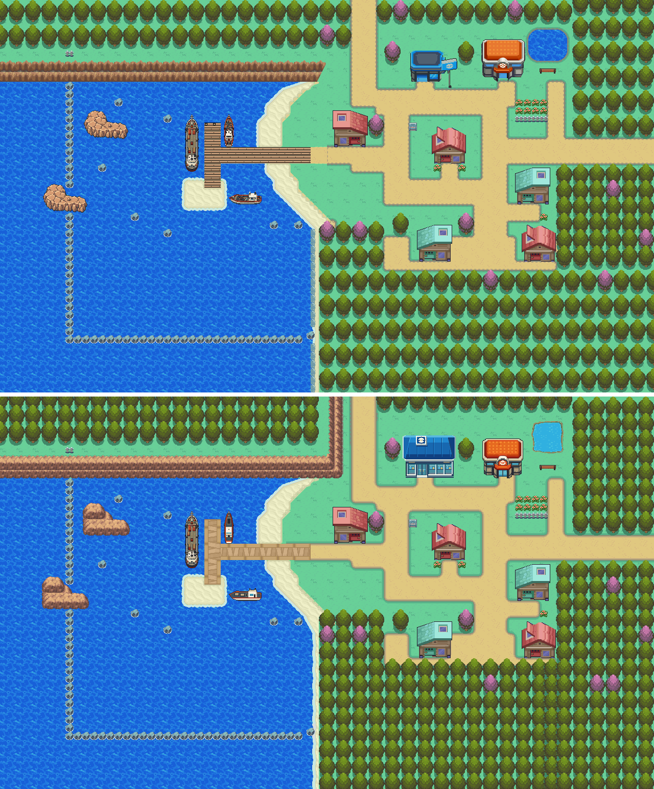

# Cherrygrove City, cleaned up to AGENTS.md's native visual rules

2026-10-26, engine branch `claude/routes-30-31-catalog` (PR #39). The owner-approved town keeps its
layout, collision, elevation, behaviours, warps and every untouched cell's metatile id. What changed is the
art of its elements, redrawn in Johto's shared vocabulary and checked against HGSS Cherrygrove (rendered
from pokeheartgold's own data).



## What changed

- **North edge**: the sea cliff is Johto rock (Mahogany's FRLG terraces in the HGSS ramp, `rock.py`) and
  turns north into Route 30's west wall; rock tops meeting same-height lawn take the soft grass fringe
  ([Route 30's README](../route30-catalog/README.md#cherrygroves-north-edge)).
- **Forests**: every woods block is the route's overlapping tree lattice (2x2 roots, the crown in the row
  above, crowns overlapping so no gap opens). Blossoms stay where the town had them. Crowns over a walkable
  cell draw above the player.
- **Islands**: the bay's two islands are Johto rock in the cliff's ramp, two terraces as HGSS's islands
  are (the upper plateau to the north-west, the lower ledge south and east), the sea animating under each
  rim. The grey boulders and the buoy line stay.
- **Pond**: Route 30's pond treatment (Route 43's method: HGSS freshwater texture, a rough mud and grass
  bank about two pixels inside the water cells). The old stone rim is lawn again. The pond is still
  surfable ocean water, as the owner's town has it.
- **Beach edges**: old tile reuse had left darker sand wedges (222, 206, 148) along the beach's diagonal
  lawn edges, 18 cells. They are beach sand again with the ground painter's beach and lawn rim.
- **Houses**: unchanged. They are the owner's accepted Cherrygrove architecture.

The Pokemon Center (C06) and the Mart are owner-locked and unchanged.

## Tilesets and banks

- Cherrygrove draws on its own copy of CherrygrovePrimary, `cherrygrove_town`, as Routes 30 and 31 have
  theirs. The copy keeps every id and tile the town's camera draws (its kept cells, its border, Route 29's
  window, Route 30's band, the sea's animated tiles 1-92) and frees the rest. It runs CherrygrovePrimary's
  sea animation. Crossing to Route 29 now loads another primary; the engine redraws the view (PR #39).
- Route 29 draws Cherrygrove's last 8 columns with CherrygrovePrimary. New cells there take primary ids no
  map draws, defined the same in both primaries, from tile slots free in both (10) or secondary slots free in
  both Cherrygrove's and Route 29's sheets (21). Every other map on CherrygrovePrimary draws exactly as before.
- Cells Route 30 can see take the ids its pack gave them, from 596 (`../route30-catalog/source/pack/mirror-ids.json`).
- Banks: 0 lawn, 3 trees, 10 blossoms (both with the lawn's tones in three free slots), 5 rock, 12 the pond.
- New tiles: 126 in Cherrygrove's sheet, 193 in the copy, 10 in both primaries, 21 shared with Route 29.
  Left: 17 copy slots, no secondary slots. The installer never reuses a tile from slots 1-92: the sea
  animation rewrites them.

## Checks

| Check | Result |
| --- | --- |
| Every town cell draws as composed (`town.py --install`) | 0 cells differ |
| Collision, elevation and behaviour against the base town | unchanged on every cell |
| Other maps on CherrygrovePrimary (Route 29, New Bark, Violet entrance, both previews) | 0 pixels differ |
| Route 29's window on the town, drawn with CherrygrovePrimary | identical to the town's own |
| Seams with Route 30 and Route 31 (`seams.py`) | clean in all four directions |
| Porymap 6.3.1 export vs native decode | 0 pixels differ (Cherrygrove, Route 30, Route 31) |
| Town runtime (`runtime.py`): seven doors in and out, the walk to Route 29 and back, the pond | passes; frames match the decode outside sprites and the sign popup (`evidence/runtime-summary.json`) |
| Route 30 and Route 31 runtimes | pass |

## Limits

- The transplant house's warp (42, 32) sits inside the south forest, as it does in the base town.
- Owner visual acceptance.

## Reproduce

```sh
python3 tools/gba/maps/cherrygrove_town/town.py ENGINE --preview   # draw the town (evidence/preview.png)
```

The install runs inside Route 30's pipeline ([its README](../route30-catalog/README.md#reproduce)):
`--render` and `--primary` before `pair_pack.py --install`, `--install` after it. Every run starts from
Cherrygrove at the engine's base revision (`base.py` BASE_REV). Treat the tools as provenance: once the owner
edits the town in Porymap, edit the native files and don't replay the generator over them.
