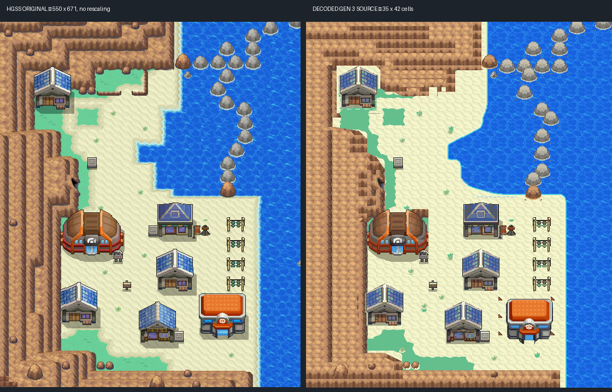
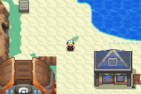
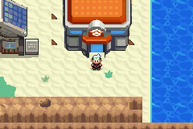

# Cianwood City — first native exterior

Native exterior proposal based on the HeartGold/SoulSilver overview. Editable
source is in [engine PR #25](https://github.com/Davisfox5/pokeemerald-expansion/pull/25),
against `apocrypha`; reviewed source commit
`4e3b27c1a15ed52a81ee1f28285cf8cebcbf294c`.
Owner visual acceptance is pending. No existing Cianwood draft was replaced.



## Scope and geography

The 35×42 exterior retains the western cliff-backed settlement, north residence
and clearing, northern inlet, offshore barrier, Gym forecourt, photo studio,
central and southwest residences, pharmacy, four flower stands and southeast
Pokémon Center. The dark western cliff entrance and the small north offshore
pebble remain identifiable. Southern rim rocks are individual foreground details.
There is no Pokémart in the HGSS town, so none was added.

The accepted shared Center is used directly: **6,238 opaque foreground pixels
retain their original native indices, with its original bank-8 palette**.
Both Center floors are wired, with the established nurse script and ordinary
entry, exit and stair transitions. The other interiors, Gym gameplay, pharmacy
service and photo interactions are not implemented. Route 41 and the western
continuation are unwired; the map is accessible through the existing map-proof
entry helper, index 43. The western entrance is currently solid. No campaign
connection, badge gate, actor role or reward was invented.

## Reference and deliberate adaptations

Source: [HGSS Cianwood overview](https://archives.bulbagarden.net/media/upload/8/8a/Cianwood_City_HGSS.png),
retrieved 2026-10-21; 550×671 pixels, SHA-256
`90d704336f51f868b0b5103bb4a66bc45a305e7a3e7ff163c5a72c50c205d8e1`.
Original designs/textures: Game Freak / Nintendo / Creatures. This is reference
derivation under the repository's existing asset practice, not an original-art
or open-license claim.

Registration uses origin (0,0), scale 1 and native 16×16 squares. Ten pixels of
ocean complete the rightmost cell; one pixel completes the bottom row. This is
an **overview trace**, not extracted HGSS map, event, elevation or collision data.

- Cliff caps and front/side courses use compact original texture modules over
  traced planes. Fine irregular facets and the northern cliff outline are
  approximations; the cap, exposed face and inner western course stay distinct.
- Three ordinary blue-roof houses share a complete cell-aligned module. Roofs
  use mirrored construction to fit the tile budget. The pharmacy shares its
  blue roof but retains its shop front. Small pixel offsets within the receiving
  footprints are adaptations, not claims of exact original building pixels.
- Offshore boulders share a complete gray silhouette and warm endpoint ramp.
  Their small shape differences are approximated. The separate small pebble
  beneath the northern endpoint is retained.
- The beach uses a phase-aligned original sand core, with a continuous foam lip
  and locally rounded shore corners. The original inlet and coastal extent guide
  the silhouette; this is a native reconstruction rather than a screenshot tile
  for every source pixel.
- Foreground footprints and traversal are independent. Roof-obscured ground,
  hidden original collision and inaccessible off-map areas are unverified. The
  current footprint/collision choices are explicit in the ledger and remain
  subject to owner review.

## Native inspection and corrections

See the coordinate-labelled [original grid](evidence/reference-grid.png),
[native grid](evidence/native-grid.png), and the editable
[1,470-cell material/traversal ledger](evidence/material-traversal-ledger.json).
The ledger records mixed materials separately from foot access and elevation.
It describes the proposed native reconstruction; it is not an independent
extracted original-game collision oracle.

Reviewed areas: northern cliffs/cove (x0–20, y0–12), western cliff courses and
entrance (x0–9, y12–38), inlet/shore (x15–30, y9–41), offshore rocks (x20–34,
y0–20), every building footprint and approach, flower stands, and southern rim.
Corrections included contaminated ground donors, lawn speckle, pale roof-edge
holes, missing west entrance, a flattened inner cliff course, omitted pebble/rim
rocks, and preserving the shared Center as a separate transparent foreground.
No runtime frame or whole-map render is presented as owner acceptance.

## Verification

- ROM build passed with Arm GNU 14.2.1, Debian newlib 4.5 and Poryscript 3.6.1.
- **993 / 1,008 graphics patterns**, **427 / 1,024 used metatiles**, 12 palette
  banks; original native tile data, palettes and both layers decode successfully.
- All 1,470 cells checked against the ledger's actual native behavior/collision;
  455 foot-accessible cells and all eight listed approaches are connected.
- Existing map/layout IDs and unrelated map/art sources are preserved.
- Actual **Porymap 6.3.1** (`139eda9`, Qt 5.15.15) opened/exported all three maps.
  Its Cianwood export matches the separate decoded renderer pixel for pixel.
  A narrow read-only export harness is supplied; no desktop session or UI save
  round-trip is claimed. Optional charts were unavailable; parser warnings from
  expansion expressions did not prevent these maps loading/exporting.
- **mGBA 0.10.5**: central beach walk/return, cliff and sea blocking, three signs,
  Center entry/exit, both stair directions, ordinary 128 KiB flash save, a fresh
  process loading that flash, and title-screen Continue all passed.
- GitHub Actions produced no run when checked. The engine PR remains a draft;
  local build success is not described as green CI.

Local final ROM SHA-256:
`b9593ef67ed7294c1e2e3b07f7a469b3eb2338477e4b6fb9619367ce7c5941d3`.
No ROM, save, toolchain, emulator or editor binary is committed.




Detailed results: [native audit](evidence/native-audit.json),
[headless phases](evidence/gameplay/results.json),
[Porymap exports](evidence/porymap/CianwoodCity.png), and
[source preservation manifest](evidence/preservation.json).

## Reproduction and editing

Open the engine branch directly in Porymap; edit its native files. The checked-in
`porymap.project.cfg` establishes Emerald defaults. Do not replay this generator
over owner-edited layouts. Initial authoring/provenance lives in
`tools/gba/maps/cianwood/{build,install}.py` in the hub; it uses the existing native
compiler approach and indexed PNG/binary source formats. Porytiles was not run.
The `--update-initial-draft` option was used only while producing this unreviewed
new map, not on an accepted or owner-edited layout.

For an installed source checkout, with the usual compiler/mGBA development tools:

```sh
make -j1 generated
make -j8
python3 ../pokemon-apocrypha/tools/gba/maps/cianwood/check.py "$PWD"
python3 ../pokemon-apocrypha/tools/gba/maps/cianwood/runtime.py "$PWD" /tmp/cianwood-review
```

`ARM_NM` and `MGBA_FLAGS` can select a non-system toolchain/libmgba. The exact
reference, accepted Center asset and native source manifest identify the inputs.
For Porymap export, replace only a disposable 6.3.1 checkout's `src/main.cpp` with
`porymap_review.cpp`, build normally, then run offscreen with arguments
`ENGINE_CHECKOUT OUTPUT_DIRECTORY`. It opens the project and renders the three
layouts through Porymap's own code; it does not edit/save map source.
