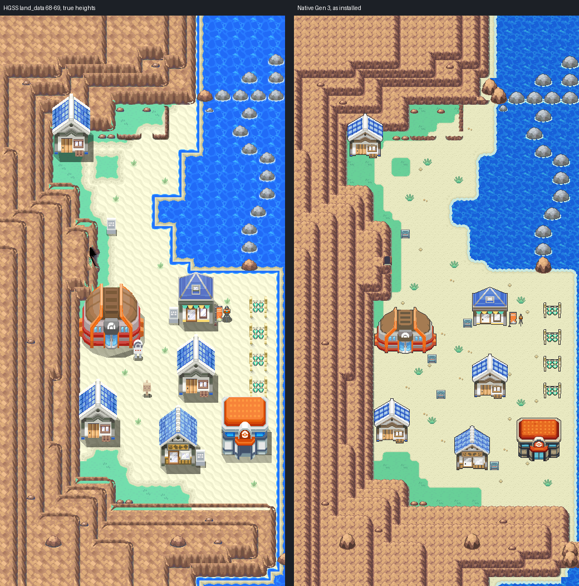
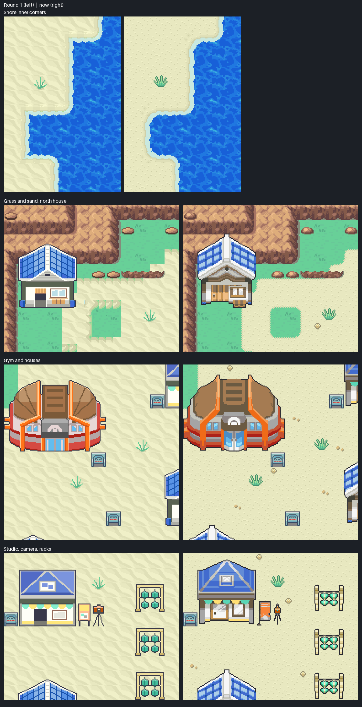
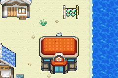

# Cianwood City: native exterior built from Gen 3 elements

Cianwood as one native Gen 3 map, laid out cell for cell from HeartGold/SoulSilver's own
map data and drawn with Gen 3 pieces, by the same method as
[Blackthorn](../blackthorn-city/README.md): each HGSS element (rock terraces, beach, surf
strip, sea, ledges, props, buildings) becomes a Gen 3 element that does the same job, in
Cianwood's HGSS colours. Editable source is in
[engine PR #27](https://github.com/Davisfox5/pokeemerald-expansion/pull/27), branch
`claude/cianwood-city`, which builds on `claude/blackthorn-city` (#26). Owner visual
acceptance is pending. This replaces nothing: Codex's attempt (engine PR #25, hub PR #22,
`gba/art/cianwood-city` and `tools/gba/maps/cianwood` on `codex/cianwood-city-evidence`)
is left as it is. The two install the same map names, so only one of the two engine
branches can be merged.



## After the first review

The owner's notes on round 1, and what changed:

- **Shore corners**: the sea's inner corners met the beach square. They now curve into the
  sand with the same radius as the sandbar's outer corners; the curve starts in the two
  edge cells beside each corner (`elements.shore`).
- **Grass and sand**: the grass edge was a hard border. Grass now meets sand on rounded
  corners with a dithered rim on the sand side, the way Emerald's Route 104 does it.
- **Buildings**: the houses looked steep and generic. Every building is now HGSS's own
  model with its own textures, rendered at C06's angle, so roof pitch, walls and doors
  match the Center (`evidence/elements/c06-angle.png`).
- **Sand**: the flat Cherrygrove sand is now a Gen 3 beach: scattered grains with shade
  pixels and occasional decals (a second scatter, a ripple, a shell, pebbles).
- **Props**: the tufts, stones and sea rocks were redrawn: a hand-drawn tuft in
  Cherrygrove's greens, HGSS's own stone and sea-rock textures in Gen 3 ramps.



## The map

| | |
| --- | --- |
| Map | `CianwoodCity`, 32x64, `gMapGroup_Cherrygrove` id 47 (Center 48, Center upstairs 49) |
| Primary | `gTileset_CherrygrovePrimary` (accepted Johto primary: ground, beach, animated sea, signs) |
| Secondary | `gTileset_CianwoodCity`: 495 of 496 tiles (16 kept for door animation), 303 of 512 metatiles |
| Palettes | banks 0-5 the primary's; 6-12 one exact fit: C06's 21 colours over 8 and 9, then a bank each for the houses with the Pharmacy (6), the Gym (7), the studio (10) and the racks with the camera (11); the cliffs, stones and tufts share 12, the sea rocks fill 9 |
| Border | open sea (Cherrygrove's animated sea metatiles, in the sea's 32 px phase) |

## Reference: decoded HGSS data

`hgss_render.py` reads pret/pokeheartgold's packed archives (revision `9d8b7591`, hashes in
`source/hgss/hgss-render.json`): land_data chunks 68-69, area data bank 7, the map and
building textures, and zone events T24 (`source/hgss-events.json`: warps, signs, objects).
Its 1:1 render at true heights (`source/hgss/hgss-reference-true-heights.png`) is the review
reference. Collision, sea, surf strip, ledges and doors are the decoded HGSS permissions,
cell for cell: `0x21` sand, `0x17` the walkable shallow strip, `0x15` ocean, `0x38` jump
east, `0x3B` jump south, `0x3E` the corner where both ledges meet, `0x63`/`0x6D` the Cliff
Edge Gate mouth and its warp step, `0x69` doors.

## Element ledger

`elements.py` labels every cell from a flat top-down HGSS height map, its materials and the
permissions (`source/elements/ledger.json`, `ledger.png`): rock top or face (with its
downhill direction), ledge, boulder, sea rock, other blocked, sea, surf strip, open, and
the ground under it (grass against sand read from the cell's own top-down colour, since
HGSS paints the grass at the cliff foot with the beach's edge material). A rock cell's
terrace level is its HGSS peak height minus the beach floor. HGSS's small stones
(material `etc_a`) are blocked bumps: they are labelled props on the lawn or rock top on
the plateau and take the height of the ground round them, so they never read as a cliff
face or a one-cell terrace.

## Elements

- **Rock**: FRLG's General mountain set in Cianwood's rock ramp (Cianwood's `cliff01gs` uses
  Blackthorn's colours), composed per 8x8 quadrant as a top-layer overlay over plain
  ground, exactly as Blackthorn's style C.
- **Beach**: a Gen 3 beach in CherrygrovePrimary bank 0's creams (`elements.SAND_BASE`):
  one 16 px cell of flat sand with scattered light grains, each with a shade pixel under
  it, and a few darker grains. On open beach about half the cells carry one 8 px decal in
  a quarter (a second scatter, a ripple, a shell, pebbles), picked by a fixed hash of the
  cell, so the repeat does not read as a grid and each decal costs one tile. A shell or
  pebbles keeps two cells clear of another; cells beside an edge or under an object keep
  the plain cell.
- **Grass**: Cherrygrove's lawn. Its edge against the sand is a blurred cell mask, so every
  corner rounds while straight runs stay on the cell edge, and the sand side carries the
  transition: a row where grass and a darker rim alternate, then a dithered rim row.
- **Sea**: Cherrygrove's animated sea, in its 32 px phase.
- **Shore**: HGSS's walkable surf strip is drawn as Cherrygrove's sandbar shore, cell for
  cell (`elements.shore`): a strip cell beside land on one side is the sandbar's edge cell
  for that side (its wet sand, the foam's wavy lip, in phase along the coast), and a cell
  beside land on a diagonal only is the sandbar's rounded corner. At an inner corner (land
  on two sides) the sea's edge is a quarter circle of 10 px (the sandbar's outer corners
  curve about 12) and every band keeps its distance from it; the curve starts in the two
  edge cells beside the corner. One even wet-sand band runs within 2 px of the tide line,
  and the shore keeps to the sea's own bank (bank 1), so its tiles cost no secondary
  colours. Sea pixels take the map's own sea at its phase. Boulders at the water's edge
  keep the strip under them.
- **Sea rocks**: HGSS's 16 rocks (two cells wide, from the `sea_rock` material) from
  HGSS's own `sea_rock` texture, 32 x 24, in Cherrygrove's sea-rock greys and slate outline
  with a foam ring, plus the lone pebble north of the line. The rock line's collision is
  HGSS's own.
- **Ledges**: FRLG's jump ledge in the rock ramp, south-facing along row 13, and the same
  strip turned on its side for the east-facing ledge at x 18.
- **Cave**: FRLG's cave mouth in the cliff's east face at (10,27), the Cliff Edge Gate.
- **Ground details**: HGSS's 14 small stones (HGSS's own `etc_a` stone, 16 x 8, in the
  cliffs' rock ramp so it shares their bank) and 11 sand tufts (drawn by hand the way Gen 3
  draws plants: dark outline, light blade edges, in Cherrygrove's grass greens), snapped
  to the 8 px grid so every copy shares the same tiles. Both are flat ground in HGSS and
  always draw below the player. Over rock no player reaches, the rock's top-layer overlay
  drops to the bottom layer under an object, so a stone on a cliff top and the north
  house against the cliff keep the same tiles as their copies on open ground.
- **Buildings and props** (`sprites.py`, `source/elements/sprites.png`): HGSS's own models
  and textures, rendered at C06's angle (`hgss_camera.view`): orthographic at 38 degrees,
  16 px per tile up the screen, each squeezed across to fit its footprint, as C06 is.
  That angle is fitted from HGSS's own Center model (40 with door 15), which this view
  turns into C06's silhouette (overlap 0.943, `evidence/elements/c06-angle.png`); HGSS's
  own field camera is steeper (48.7 degrees, `evidence/elements/hgss-camera.png`), which is
  why round 1's houses looked steep. The three glass-roofed houses (102 with door 103), the
  Pharmacy (104, door 116), Cameron's photo studio (105, door 116) with its poster board,
  the camera on its tripod (90), the four herb racks (106) and the Gym (108, door 16). Each
  palette group (the houses and Pharmacy share one) is quantized to 14 colours plus C06's
  outline colour, and each roof is mirrored on an 8 px axis so its halves share tiles. The
  houses' and Pharmacy's glass is laid back on an 8 px pane lattice from HGSS's own roof
  texture, so the plane repeats every two tiles; texture cutouts, HGSS's ground shadow quad
  and faces lying on the ground (painted shadows) are left out. A building tile that
  differs from a more common one only by a one-pixel edge shift is folded into it
  (6 tiles).
- **Center**: the owner-locked shared Johto Center C06 (`gba/art/johto-center`, sha256
  `89034027`, `gba/art/johto-common/approved-buildings.json`, branch `codex/violet-city`),
  door (2,4) on the HGSS Center door (27,49). Rows 1-4 are solid; its top row is a walkable
  roof overhang, as the master's manifest sets it. All 5,679 Center pixels keep their exact
  colours.
- **Depth (walk-behind)**: the packer's rule from Blackthorn (`pack.above_player`). A
  walkable cell draws its art above the player only when that art's object stands further
  south; door cells, every cell on an object's base row and all blocked cells draw below
  the player. The player walks behind the Center's roof row, the herb racks, the photo
  board, the camera, the Gym's roof tips and the houses' ridges, and stands in front of
  every building with its head drawn over it.

## Deliberate adaptations

All 34 are listed per cell in `evidence/elements/pack-C.json`.

- **Unbuilt destinations are solid**: the Gym, Pharmacy, the three houses and the studio
  doors, and the Cliff Edge Gate mouth. Its warp step (11,27) is plain ground.
- **Taller HGSS models**: HGSS blocks cells its 3D buildings cover in perspective. Where the
  Gen 3 sprite does not reach a blocked cell, or only its roof's top edge reaches the
  cell's lower half, the cell is open ground and the player walks behind that edge: the
  row north of the Gym (y 32) and its two top corners, the row north of the Center (y 44),
  and the corners beside the houses' and the Pharmacy's roof peaks. The Center's own top
  row is its walkable overhang.
- **The ledge corner** (18,13): HGSS's south-east jump has no Gen 3 behaviour (Gen 3 jumps
  only straight), so it is the south ledge's end. It cannot be reached in either game except
  diagonally.
- **Signs**: the five readable HGSS signs (city, Gym, Pharmacy, photo studio, Safari Zone
  road) in Cherrygrove's accepted sign metatile, with HGSS's text. The two hidden items and
  the camera's script are not built.
- **Not placed**: NPCs, Suicune and Eusine, and the Rock Smash rocks (HGSS object events).
- **Colour**: the native map holds every one of the composed art's 524,288 pixels exactly in
  5-bit colour (`evidence/elements/pack-C.json`). Cherrygrove's sandbar carries a few
  light-green pixels on its tide line (from its own secondary bank); in Cianwood's shore
  they take the tide colour, so the shore stays in the sea's bank.

## Verification

- **Native audit** (`check_elements.py`, `evidence/elements/native-audit.json`): the installed
  files decode identically to the packer; all 2,048 cells match the traversal ledger's
  behaviour, collision, elevation and layer type; all 656 open cells are reachable on foot;
  every building door approach and sign is reachable; every cell's layer type follows the
  depth rule; the Center master's hash matches the registry and its pixels are exact;
  existing map ids unchanged; changed files within scope. Coordinate grid:
  `evidence/elements/native-grid.png`.
- **Headless mGBA 0.10.2** (`runtime_elements.py`, `evidence/elements/gameplay/results.json`):
  views across the town and beach; the surf strip walked; south and east ledges jumped and
  not climbed; Center body, Gym, a herb rack, the cliff, the sea (no Surf) and the cave
  block; standing behind the Center's roof row, a herb rack, the photo board, the camera,
  the Gym's roof and a house's ridge; standing in front of all seven buildings; five
  signs read; Center in, upstairs, back and out; Cherrygrove and Blackthorn and back;
  ordinary flash save, cold reload in a new process, title Continue.
- **Rendering parity**: for all 36 map captures, BG1-BG3 rebuilt from dumped VRAM, palettes
  and BG registers match the decoded native image pixel for pixel, apart from
  CherrygrovePrimary's animated sea tiles; the Cherrygrove and Blackthorn captures match
  their own decodes. Walk-behind captures put object pixels on BG1 over the player's cell
  (224 at the Center's roof, 128 at a rack, 156 at the board, 43 at the camera, 26 at the
  Gym's roof tip, 3 at a house's ridge); in front of every building BG1 covers none of the
  player's two cells.
- **Porymap 6.3.1** (`porymap.py`, `evidence/porymap/results.json`), built from source and run
  under Xvfb on a fresh clone of the engine commit: the city and both Center floors open
  with no errors; Porymap's export of the city matches the native decode pixel for pixel;
  saving the maps and the city's tilesets rewrote 20 Cianwood files, all byte-identical.
  The only lines a save changes predate Cianwood: key order in a Route 110 layout entry
  and three `é` escapes in Kanto MAPSEC names (the same as on Blackthorn).

Engine commit `3f3b439011ef662fa2152f97b66071d137e20bc0`, local ROM SHA-256
`34d2a423b878d9ef171704381e56c390076a889609b994e8285b066bbe285736` (Ubuntu Arm GNU 13.2.1).
No ROM, save, toolchain or emulator binary is committed.



Region pairs for close review: `evidence/elements/review/`.

## Not verified or not built

- No interiors for the Gym, Pharmacy, houses or studio; no Cliff Edge Gate; no Route 40/41
  or Route 47 connection.
- Center nurse scripts are Cherrygrove's copies, not exercised. Music is a placeholder
  (`MUS_DEWFORD`).
- No NPCs, trainers, encounters or story events.

## Editing and reproduction

Edit `CianwoodCity` natively in Porymap; it is an ordinary single map. First-authoring
provenance (never replay over owner edits; `install_elements.py` refuses if the maps exist):

```sh
python3 tools/gba/maps/cianwood_elements/hgss_render.py /path/to/pokeheartgold gba/art/cianwood-elements/source/hgss
python3 tools/gba/maps/cianwood_elements/hgss_events.py /path/to/pokeheartgold gba/art/cianwood-elements/source/hgss-events.json
python3 tools/gba/maps/cianwood_elements/hgss_camera.py /path/to/pokeheartgold /tmp/house.png 102 103
python3 tools/gba/maps/cianwood_elements/hgss_camera.py /path/to/pokeheartgold gba/art/cianwood-elements/evidence/elements/c06-angle.png --c06
python3 tools/gba/maps/cianwood_elements/sprites.py /path/to/pokeheartgold
python3 tools/gba/maps/cianwood_elements/elements.py /path/to/engine /path/to/pokeheartgold
python3 tools/gba/maps/cianwood_elements/pack.py /path/to/engine C
python3 tools/gba/maps/cianwood_elements/budget.py /path/to/engine C        # tiles and colours per element
python3 tools/gba/maps/cianwood_elements/install_elements.py /path/to/engine C
# after make:
python3 tools/gba/maps/cianwood_elements/check_elements.py /path/to/engine C
python3 tools/gba/maps/cianwood_elements/runtime_elements.py /path/to/engine /tmp/cianwood-run C
python3 tools/gba/maps/cianwood_elements/review_elements.py C
python3 tools/gba/maps/cianwood_elements/porymap.py /path/to/engine /path/to/porymap C
```

`MGBA_FLAGS` and `ARM_NM` select a non-system libmgba or toolchain.

Original map geography, models and textures: Game Freak / Nintendo / Creatures
(HeartGold/SoulSilver); FRLG mountain pieces from the engine's `general_frlg` tileset;
grass, sea and shore from the engine's accepted Cherrygrove. Read-only derivation under the
repository's existing asset practice.
