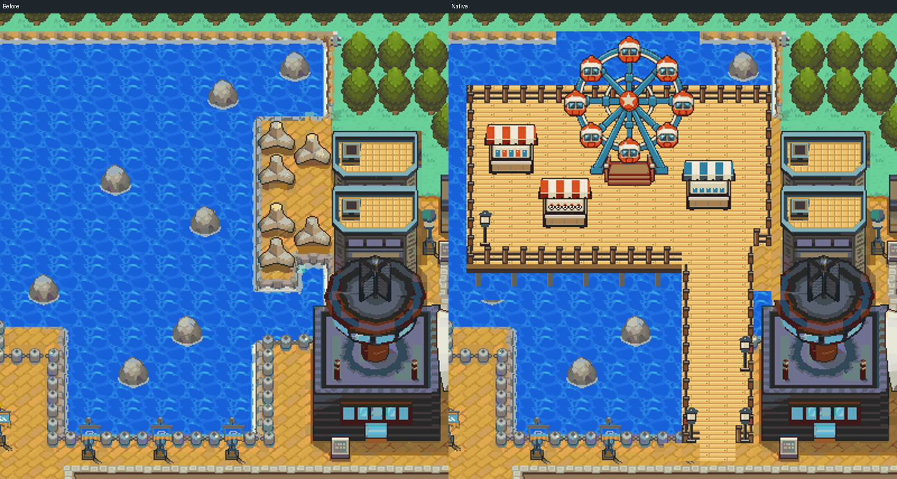

# Goldenrod Boardwalk — native exterior implementation

The owner-approved carnival concept is built in editable native Gen 3 source, engine `eb63c24cb7e28c7de1eddd7db0b693a6510b29d4`, on draft PR #20. This is actual Porymap/game output, not the generated concept image. Visual acceptance remains with the owner.

[Whole native city](../native-map.png) · [Actual gameplay gallery](gameplay-gallery.png) · [Concept/native comparison](concept-native-comparison.png)

[Walk onto the pier](../boardwalk-arrival-walk.gif) · [Walk the market](../boardwalk-market-walk.gif) · [Wheel at normal game zoom](../gameplay/wheel-and-railing.png)

The rocky northwest inlet becomes a timber pier with a Ferris wheel, three market counters, lanterns, perimeter rails and visible piles. A continuous two-metatile-wide gangway joins the existing waterfront avenue; a water channel separates it from the Radio Tower peninsula. Existing buildings and the map extent remain in place. The rear deck is one row deeper than the concept to provide a walkable position from which the complete wheel fits the normal game camera. Boarding and all three counters are reachable without crossing rails or blocked supports.

The station gets a facade-mounted departure display and a separate ticket kiosk beside its real entrance. A compact broadcast display and bench refresh the Radio Tower plaza. Selected fence spans become complete masonry planting beds with matching cap/end posts and retaining walls; the old posts and underlying rail legs are removed across their full bounds. The south beds form retaining sections at the existing map-edge fence. Bikes remain absent; no Department Store enlargement is made.

[Station before/after](station-comparison.png) · [Radio plaza beds](rail-planters-comparison.png) · [Southern retaining beds](south-garden-comparison.png)

This pass implements scenery, traversal and six read-only examine messages. You can inspect the wheel, three counters, broadcast sign and station terminal. The wheel is static, and no ride operation, vendors, item trading or train service is implemented. No inventory, campaign flags or save format changes are made.

## Placement and art

Coordinates use the existing 84×56 metatile /1344×896 pixel city registration. This shoreline expansion is an explicit owner-authorized ten-year development, rather than an HGSS reconstruction claim. The rest of the HGSS city stays the geographic authority.

| Feature | Native pixels / approach |
| --- | --- |
| Pier deck | `(352,96)–(624,240)`, plus south apron and gangway |
| Gangway | `(544,240)–(608,416)`, clear columns35/36 and a two-cell landing |
| Wheel | Transparent128×144 master at `(432,48)`; supports blocked, approach `(30,12)` |
| Full-wheel camera view | Walkable world `(29,7)` |
| Snack / prize / souvenir stall |48×48 at `(368,128)`, `(416,176)`, `(544,160)` |
| Departures / kiosk |64×24 at `(768,376)`;16×32 at `(848,400)` |
| Radio planting beds |32×32 at `(144,568)` and `(336,568)` |
| Southern retaining beds |48×40 at `(1040,856)` and `(1120,856)` |

[Native masters and recorded layout](../../source/boardwalk/) · [Asset provenance](../../source/boardwalk/provenance.json)

The retained generated wheel input is reduced and cleaned into an existing native palette; its gondolas remain upright, with complete spoke openings and a cleaned star hub. Stalls, deck, rails, lighting, kiosk, bench and planter modules are authored separately at native size. Ground, transparent foreground and collision stay separate. Native glyph reuse includes orientation flags; no approximate geometry substitution is used.

Only four unused entries in Goldenrod's foliage palette 10 are extended, after proving no old native quadrant used them. All existing tree colors and other palette entries remain unchanged; the total stays at 13 BG banks. All 49 tree contexts, the canonical Center's 5,679 opaque pixels and the recently cleaned Radio equipment remain exact. There are zero native pixel changes outside the recorded development/public-space regions. Existing map IDs, twelve section dimensions and earlier-area assets are preserved.

## Verification

Local Arm GNU build and actual Porymap equality pass over all 4,704 native cells. The avatar walks from the city to the wheel and each counter, returns through both access columns, and is blocked by counter/support footprints, safety rails and planter walls. All six messages open and close. Ordinary save, fresh-process reload, title Continue and a copy of the previous build's ordinary proof save pass; no owner save was supplied or modified.

All 91 unobscured gameplay BG captures match native source across 3,494,400 pixels, with zero errors and zero cache overflows. The six dialogue captures are separate UI checks, not counted as native-background parity. Updated continuous clips include pier arrival and the market. Maximum buffered-view use is 904 of 1,008 glyph slots, including decorative camera borders. Build/source/ROM identity is retained in the area evidence.

[Traversal](traversal.json) · [Visual preservation](visual-preservation.json) · [Native edit record](native-edit.json) · [Reproduction](reproduction.json) · [Prior-save check](prior-save.json) · [VRAM parity](../gameplay-background-parity.json)

`boardwalk.py` is a guarded one-shot edit from engine `fdaf387b` and immutable hub metadata `bcfb58b5`; it rejects existing native edits. Do not replay it over current maps. `boardwalk_art.py --reproduce` checks the retained art hashes before rebuilding the exact masters; native/atlas reproduction uses a separate baseline worktree. `boardwalk_review.py` independently checks traversal and unchanged contexts. Fresh-checkout hashes pass, including CRLF palette handling. After ordinary Porymap edits, regenerate only `stream.py`.

GitHub Actions remains disabled; hosted CI is blocked. Exterior review remains with the owner. Original Pokémon geography/art: Game Freak / Nintendo / Creatures; generated concept/wheel and authored native additions are recorded in the provenance file.
