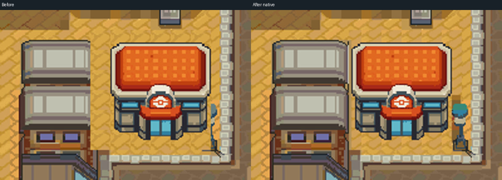
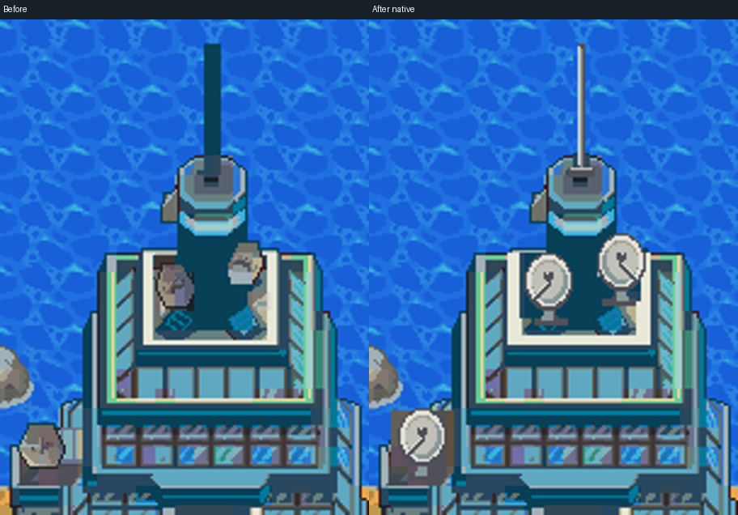

# Radio Tower equipment and Center placement correction

Engine `fdaf387b1ef1b0704e4f6a2f4ac0c24444d900a7` on the existing draft PR #20. The owner accepted the overall city and requested these two focused fixes; this revision awaits visual review.

[Radio Tower before/after](radio-before-after.png) · [Center before/after](center-before-after.png) · [Updated whole map](../native-map.png)

The canonical Center image already has a transparent silhouette. The defect was the first placement step's 96×96 pavement replacement: it erased the western building's right edge and part of the lamp. This fix restores the original neighborhood, removes the superseded source Center, and repairs only the necessary paving beneath the replacement. The unchanged 80×80 building is placed at `(792,576)`, eight pixels left of the prior placement, so its right wing clears the lamp. All 5,679 opaque canonical RGB5 pixels remain exact; 721 pixels remain transparent. Ground is independent of the building master.

[Transparent building PNG](../../source/masters/center.png) · [Checkerboard preview](center-transparent-preview.png) · [Placement metadata](../../source/center-placement.json)

The western roof/facade edge and the full lamppost come from the registered HGSS neighborhood. The exposed house edge uses the same native residential palette as its adjoining facade. The front walkway remains open; the restored lamp's base blocks walking. Center collision/roof coverage follows its corrected visible footprint. The `(52,41)` approach remains reachable; no interior warp is added.

Three complete satellite dishes reuse one transparent 24×30 bowl/support master, with the rear-facing copy mirrored. The roof beneath them is separate from the silver foreground fixtures, preserving their exact native colors. The broad antenna bar is replaced with a straight three-pixel metal mast and clean mounting foot, with the vacated water restored. Existing building geometry, roof panels and facade remain in place.

[Dish master](../../source/masters/radio-dish.png) · [Equipment overlay](../../source/masters/radio-equipment.png)

Validation: Arm GNU build; actual Porymap equality over all 4,704 cells; 78 captured BG views / 2,995,200 pixels with zero mismatches or cache overflows; Center front/side walking and lamp-base collision; closed entrance; ordinary save, cold reload and Continue. Actual close-up rooftop capture uses a stationary inspection fixture, rather than claiming a walkable roof. Native pixels outside the two recorded correction regions are unchanged. The change is 15 engine files local to sections 01/09 and their derived atlas; existing palettes, stable IDs and other maps are preserved. Original-source colors are fitted to existing native banks; canonical Center and all equipment pixels are checked exactly after conversion.

[Actual Center/lamp view](../gameplay/Center-lamp-join.png) · [Left building join](../gameplay/Center-left-building-join.png) · [Radio inspection view](../gameplay/Radio-equipment-close.png) · [Coordinate review](review.json) · [Independent reproduction](reproduction.json)

`finish.py` is a guarded one-shot native edit for engine baseline `bb54d528`, with immutable hub metadata from `19c90579`. It never replays the first-authoring generator; do not apply it over later map edits. Separate-worktree source/atlas reproduction is byte-exact, and a fresh checkout passes the source hash guard. GitHub Actions remains disabled; hosted CI is blocked. Interiors, services, routes and animation remain outside this correction.
