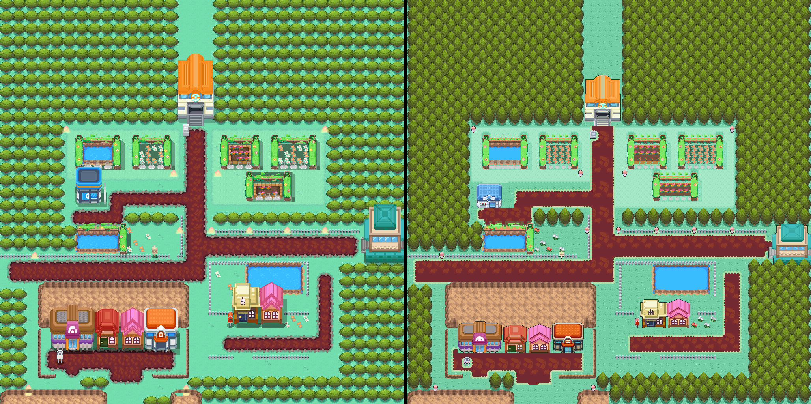
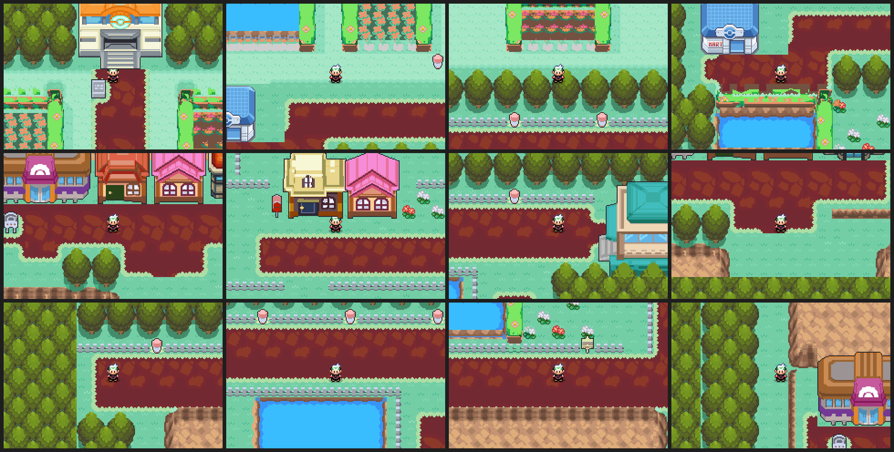

# Fuchsia City (Kanto, GBA)

HGSS's Fuchsia (`MAP_FUCHSIA`, header 56) as Gen 3 elements: `KantoFuchsiaCity`, 64 x 64, on a tileset pair of
its own. Plan, sourcing table, gate result and self-review: [gba/maps/plans/KantoFuchsiaCity.md](../../maps/plans/KantoFuchsiaCity.md).





## Rebuild

```sh
python3 tools/gba/maps/fuchsia_city/hgss_render.py PHG gba/art/kanto-fuchsia/source/hgss
python3 tools/gba/maps/fuchsia_city/reference.py PHG            # trace: material grid, traversal, trees, sheets
python3 tools/gba/maps/fuchsia_city/sprites.py PHG              # HGSS models at 45 degrees
python3 tools/gba/maps/fuchsia_city/compose.py ENGINE           # two layers, evidence/compose.png
python3 tools/gba/maps/fuchsia_city/pack.py ENGINE              # tilesets, layout, evidence/native.png, pack.json
python3 tools/gba/maps/map_gate.py ENGINE KantoFuchsiaCity --phg PHG --porymap PORYMAP_EXPORT --build
MGBA_FLAGS=-lmgba python3 tools/gba/maps/fuchsia_city/runtime.py ENGINE OUT
```

The map's registration (map.json, layouts.json, map group, tileset headers) is in the engine PR; `pack.py`
rewrites only the two tileset folders and the layout.
