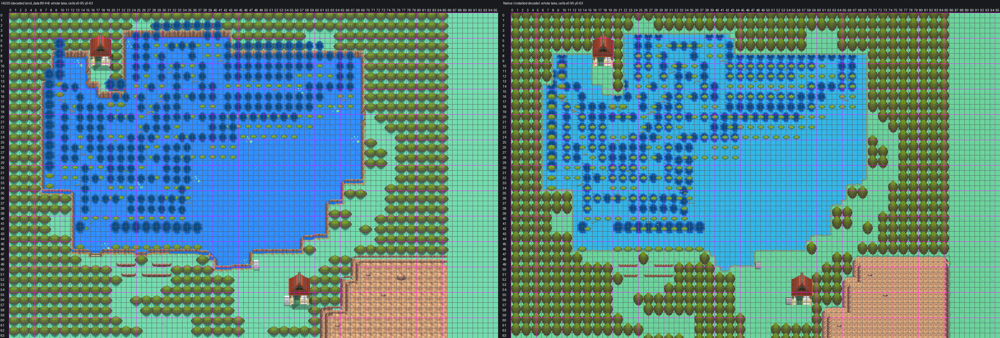

# Lake of Rage: reconstruction guide, Mahogany and Route 43's process

Lake of Rage as one native Gen 3 map, north of Route 43, built strictly to `AGENTS.md` and
[the map reconstruction workflow](../../../docs/GBA_MAP_RECONSTRUCTION.md) by the process the owner
accepted for Mahogany and Route 43: decoded HGSS trace, shared Johto catalog art, Blackthorn's FRLG
rock terraces, the Cherrygrove ground painter, the natural water banks approved on Route 43, lossless
pack. Joined to Route 43 by a map connection, as HGSS joins them (no gatehouse). Engine branch
`claude/lake-of-rage` (stacked on `claude/route-43`). Owner visual review pending.



Detail sheets (HGSS beside native, numbered by cell):
[north-west house and pond](evidence/review3/north-west-house-pond.png) · [north lake](evidence/review3/north-lake.png) ·
[east shore and clearing](evidence/review3/east-shore-clearing.png) · [west lake](evidence/review3/west-lake.png) ·
[south lake and outlet](evidence/review3/south-lake-outlet.png) · [south-west ledges](evidence/review3/south-west-ledges.png) ·
[guru's house and cliffs](evidence/review3/guru-house-cliffs.png)

## The map

| | |
| --- | --- |
| Map | `LakeOfRage`, 96x64, `gMapGroup_Cherrygrove` id 49, `MAPSEC_LAKE_OF_RAGE` |
| Tilesets | shared primary `gTileset_Route43Primary` (512 tiles, palettes 0-5, 82 metatiles, written for both maps) + own secondary `gTileset_LakeOfRage` (272 tiles, 367 metatiles) |
| Colour | 11 banks, each colour exact: all 1,572,864 native pixels equal the assembled art in RGB555 |
| Material audit | 5,833 of 6,144 cells show HGSS's material, 0 mismatches, 311 cells where a foreground object differs (below) |

## 1. Reference (`trace.py`, `elements.ledger`)

- Authority: HGSS land_data chunks 89-94 (3 x 2) decoded from pret/pokeheartgold (header 88, area bank 8,
  matrix origin [15,1]), events zone T29 (`source/hgss-events.json`). Registration exact: HGSS tile (x, z)
  is native cell (x, y), 16 px, origin (0,0). The lake joins Route 43 at Lake x = Route 43 x + 32.
- Lake ledger (`elements.lake_labels`): every water cell (type 0x10, open or blocked) `~`; a blocked cell
  holding a flooded tree's crown `C`; the lake's blocked bank ring `X` (blocked lawn), except where HGSS
  draws it at least 40% water, which is blocked water; the tree-shadow models' huge footprints are left
  out of building ownership.
- Trees: the largest set of non-overlapping 2x2 roots on the woods cells (integer program, trunk-detected
  roots preferred, then roots covering the map edge): 524. A one-row strip of woods on the bottom edge
  gets trees rooted below the map (their crowns fill it), and Route 43's 11 top-row trees reach across
  the seam with their crowns in the Lake's bottom row, as HGSS draws them. The 90 woods cells no root fits
  (HGSS's offset crown overhang) are open lawn, as on Route 43; none joins two areas.

## 2. Art (`assemble.py`)

Shared masters copied byte for byte into `source/shared-art/` with hashes (`provenance.json`):

| Part | Art | Placement |
| --- | --- | --- |
| Lawn, road | Cherrygrove/Route 36 painter | per 8 px quadrant from HGSS's flat ground colours |
| Water | Route 30's installed HGSS freshwater (pond-15) | HGSS's water and flooded-tree cells |
| Banks | Route 43's owner-approved natural bank (local, `source/local-art/lake-banks.png`) | the lake's edge; along each edge the shore noise repeats every 64 px (for the tile budget) |
| Flooded trees | HGSS's own crowns (tree_water and tree_w textures, local, `flooded-tree-*.png`) | 248, each on HGSS's position snapped to the cell grid (at most 2 px) |
| Tree shadows | HGSS's tree_kage shadow blobs (local, `flooded-tree-shadow-*.png`) | 248 at their own HGSS positions (at most 4 px), kept to open water |
| Driftwood | HGSS's sticks and leaves (local, `driftwood.png`), exact pixels, top layer | HGSS's own positions |
| Trees | T01 | as above |
| Houses | Mahogany's owner-accepted house (HGSS model 134 + door 135); each Lake cut equals Mahogany's exactly | HGSS's two houses |
| Signs | P13 grey plaque (model 31), as in Mahogany | (48,50) lake sign, (54,57) guru's house |
| Ledges, rock | L11-L13; Blackthorn's FRLG terraces in the Johto ramp | HGSS's ledges; the south-east cliffs |

Local tone reductions (`source/local-art/reductions.json`, closest tones merge, shapes untouched): the
shadows to their 6 main tones (HGSS anti-aliased them over its water), crowns and driftwood to 15.

## 3. Shared primary with Route 43 (`pack_pair.py`)

A Gen 3 connection draws the neighbouring map with the current map's tilesets. So Route 43 and the Lake
are packed together: the seam strips (Route 43 rows 0-6; Lake rows 56-63, x 24-71, wider than the
camera's reach across the seam) use only the shared primary (tiles 0-511, palettes 0-5, metatiles
0-511), as Emerald's connected routes do with its General tileset; each map keeps its own secondary.
The packer proves each map decoded with its own pair equals its assembled art, and each seam strip
decoded with the other map's pair equals its own art. Route 43 keeps every pixel (check3 compares it
with its own earlier native decode). Both maps take the Lake's seamless woods block as their border
(shared-primary metatiles): after a player crosses a connection the tiles already on screen stay until
scrolled away, so the world beyond either edge must look the same from both maps.

## Deliberate adaptations

- **Banks.** HGSS's rim walls (wall01_g, a short brown face) are drawn as the natural bank the owner
  approved on Route 43 (owner review: water meets grass with a rough bank, not a park rim). The material
  audit counts them as bank.
- **Flooded trees and shadows.** HGSS's reference composites the shadow models over some crowns; in the
  game the crowns stand above the water, so here every crown is drawn and the shadows lie on the water
  beneath them.
- **Woods overhang.** 90 cells HGSS blocks under its offset crowns are open lawn (listed per cell in
  `source/pair/traversal.json`, `adaptation`).
- **Steps.** HGSS's three short slopes into the water ((16-17,47), (15,12-13), (69,20-21)) are bank like
  the rest of the shore; Surf starts from any shore cell in Gen 3.
- **Foreground.** T01 and the flooded crowns differ in size and offset from HGSS's; these are the 311
  "foreground differs" cells in `evidence/pair/material-audit.json`.

## Verification

- **Build**: engine `claude/lake-of-rage`, ROM sha256
  `f5a07931ec164c9258baf933a2530e259374fa21debe530e7f384f3b9fdbcd7f` (not committed).
- **Audit** (`check3.py`, `evidence/pair/native-audit.json`): both installed maps equal the pair decode and
  their assembled art; Route 43's pixels are unchanged; behaviour, collision, elevation and layer type
  match the ledgers on every cell of both maps; both seam strips are exact under the other map's installed
  tilesets; connections both ways; foot access matches across the seam (Route 43 columns 2-3 and 14-18);
  every approach reachable from the seam; the north and north-east clearings, the west house's island
  and two west-shore pockets reachable with Surf, as in HGSS; walk-behind layering; budgets; shared
  masters byte-identical; only Lake of Rage and Route 43 files changed.
- **Material audit**: 5,833 match, 0 mismatch, 311 foreground differences.
- **Headless mGBA** (`runtime3.py`, `evidence/pair/runtime/`): 29 captures with map layers rebuilt from
  VRAM equal to the native decodes, the connected map beyond the seam included; Route 43 walked north into
  the Lake and back at both openings; BG1 covers the player behind the guru's house and both signs and
  leaves the player clear in front of the house; both ledges jump and refuse the climb back; the house
  door, a tree and the lake's edge block a player on foot; both signs read; ordinary flash save, cold
  reload and title Continue.
- **Porymap 6.3.1** (`evidence/pair/porymap/`): opens, exports and saves the Lake and Route 43 on a fresh
  clone of the engine commit; both exports equal the native decodes with 0 differing pixels; saving
  rewrites no Lake or Route 43 line.

## Remaining

- Not placed: HGSS's object events (the red Gyarados, Lance and Dragonite, Pryce, fishermen, trainers,
  six item balls, three Cut trees) and the three hidden items; no wild encounter table.
- The two house interiors (Hidden Power house, Fishing Guru's house) are not built; their doors are solid.
- Surf on the lake checked from the map data only (no Surf party in the headless run).
- Map ids collide with Blackthorn's PR #26 (both append to `gMapGroup_Cherrygrove`).

## Reproduction

```sh
python3 tools/gba/maps/lake_of_rage/hgss_render.py PHG_CHECKOUT gba/art/lake-of-rage/source/hgss
python3 tools/gba/maps/lake_of_rage/hgss_events.py PHG_CHECKOUT gba/art/lake-of-rage/source/hgss-events.json
python3 tools/gba/maps/lake_of_rage/trace.py PHG_CHECKOUT
python3 tools/gba/maps/lake_of_rage/assemble.py PHG_CHECKOUT CATALOG_CHECKOUT ENGINE_CHECKOUT   # catalog: codex/violet-city
python3 tools/gba/maps/lake_of_rage/pack_pair.py ENGINE_CHECKOUT PHG_CHECKOUT   # Route 43 + Lake, shared primary
python3 tools/gba/maps/lake_of_rage/install.py ENGINE_CHECKOUT
make -C ENGINE_CHECKOUT -j8
python3 tools/gba/maps/lake_of_rage/check3.py ENGINE_CHECKOUT PHG_CHECKOUT
python3 tools/gba/maps/lake_of_rage/review3.py
python3 tools/gba/maps/lake_of_rage/runtime3.py ENGINE_CHECKOUT OUT_DIR
python3 tools/gba/maps/lake_of_rage/porymap.py ENGINE_CHECKOUT PORYMAP_BINARY    # needs the engine change committed
```

Route 43's tilesets and map.bin are now written by this installer (`tools/gba/maps/route43/install.py`
refuses to run over them). Generators are provenance: once the owner edits either map, edit its
committed native source in Porymap.
