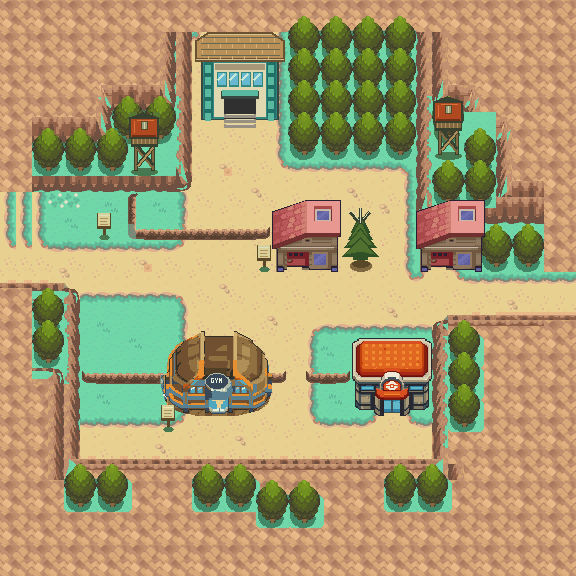

# Mahogany Town — fresh native Gen 3 rebuild

2026-10-24 proposal, awaiting owner visual review. This starts from shared
`apocrypha` base `2722eaf7601ec02dc5a684fa8cdef9206c0dc377`, before either
Mahogany draft. The rejected map's layout, tile atlases, palettes, layers and
building cutouts are not inputs. Generic read-only HGSS/native decoders and
test/editor adapters were retained.



[Original/native comparison](evidence/original-native.png) ·
[Numbered original/native grids](evidence/original-native-grid.png) ·
[Receiving ground and final placement](evidence/receiving-native.png) ·
[Source and decoded native](evidence/source-native.png) ·
[Rejected draft and fresh rebuild](evidence/rejected-current.png) ·
[Actual mGBA gameplay](evidence/gameplay.png) ·
[Center door animation](evidence/door-animation.png)

## Geography, materials and construction

Geographic authority is the original HGSS binary map, pinned to
[`Davisfox5/pokeheartgold@9d8b7591`](https://github.com/Davisfox5/pokeheartgold/tree/9d8b7591f09b65804da2fb2dfd56f320633e0d36).
Mahogany is land-data chunk 85, header 87, area bank 8, matrix origin (16,5).
One original cell becomes one 16×16 native metatile. The original 32×32 cells
sit at native offset **(2,2)** inside a 36×36 map. The added apron completes
canopies; only the existing west/east road ends extend across it. Grey in the
reference comparisons means outside the original chunk, not missing native art.

`reference/topdown.npz` keeps original material masks, height, behavior types and
collision separately. `source/material-traversal-ledger.json` records all 1,296
native cells, including 1,024 registered original cells, actual metatile IDs,
collision, elevation, behavior, layer, foreground owners and decoded RGB5 hashes.
Authoring labels are not counted as proof of a material match: the full editable
atlas is independently compared with the decoded engine pixels, followed by
the coordinate review in [REVIEW.md](REVIEW.md).

Original path, lawn, flower patch, cliff/ledge faces, top texture and terrace
structure remain the reference. The original terrain's texture coordinates and
faces are reconstructed; original tree meshes and every building model are
excluded from composition. Complete receiving grass/rock/dirt is repaired first,
then native foreground art is placed. Explicit repairs are in
`source/receiving-repairs.json`; this includes exposed forest floor, root beds,
two north-facing rock rims (high side south), and ground under the antenna tree.
These receiving surfaces are interpretations of hidden ground, not extracted
original pixels under opaque models.

Forty complete shared Cherrygrove trees occupy distinct 2×2 root footprints.
The compact Cherrygrove houses replace both tall HGSS houses, with their doors
on the original columns. The locked C06/Violet Center is copied without changing
any opaque RGB5 pixel. The Gym uses the established Goldenrod master with a
traced transparent silhouette, removed captured lawn/neighbor fragment, blue
facade bands, a fitted native footprint and a small GYM sign. That adaptation,
the new gate, watchtowers, signs and antenna tree are creative proposals.
No conventional Mart is added: Mahogany has its souvenir shop.

## Native source and validation

Engine local commit: `e218eafac05c8cbcbfd399698599585a5e71b601`.
Exact tree: `663a71e6226e173ed717b5d4074e5e73e9468698`.
The published commit and PR are recorded in [evidence/publication.json](evidence/publication.json).
ROM SHA-256: `eef5a62dfc8db3ae460404f363210bcb43f85b82c5d85425f77d952ca0f9cebb`.
See [identity.json](evidence/identity.json) and [asset provenance](source/assets.json).

- `make -j1 generated` and the complete ROM build pass with ARM GCC 14.2.1 and
  Poryscript 3.6.1; committed generated scripts remain current.
- Porytiles 2.0.0 legacy CLI compiles separate primary/secondary editable layer
  atlases. Counts are 224/152 metatiles; highest referenced tile is 897, below
  the 1008 limit reserving the final 16 tiles for door animation scratch.
- [Native audit](evidence/native-audit.json): all 1,296 cells checked;
  source-vs-decoded RGB5 pixel differences **0**; locked Center identity passes;
  forty tree footprints are disjoint; all existing map IDs retain their positions.
- [Actual Porymap 6.3.1 round trip](evidence/porymap/results.json): exterior and
  both Center exports match the native decoder, **0 differing pixels** each.
  Saving in an isolated clone changes JSON key order and Unicode representation
  only. Native binary map/tileset contents stay unchanged. The editor reports
  missing optional Qt Charts and unfamiliar shallow history; no editor errors.
- [mGBA 0.10.5 results](evidence/runtime/results.json): twenty outdoor background
  views match actual VRAM/palettes with **0 pixel differences**. Open/blocked
  approaches, south/west one-way ledges, sign scripts, Center door, both sides of
  the upstairs transition and exterior return pass. The player is occluded by
  the Center roof; the building body blocks walking.
- The ROM writes an ordinary 131,072-byte flash save, closes the emulator,
  reloads it in a new process and reaches Mahogany through title-screen Continue.
  No savestate is required. ROM/save/tool binaries are excluded from Git.

The walkthrough and captures use fixed noon lighting. An earlier night run was
not used for pixel parity because the engine's day/night palette changes colors.
Local checks establish integration, not owner visual approval or a green CI run.

## Deliberate adaptations and remaining limits

The shared Center is shorter than its HGSS counterpart. Original cells
x20..24/y18..19 are open beneath/behind the roof, and its visible door (22,23)
is open. All coordinates here are original; add (2,2) for native coordinates.
Original gate cells (12,5) and (13,5) are blocked until Route 43 exists. These
thirteen cell changes are explicitly audited rather than called exact parity.
The shop, east house and Gym entrances retain original blocked permission cells
and have no warps. West/east route connections, Route 43/gate interior, those
building interiors, town NPCs, battles, story and encounter content are unbuilt.
The Center and upstairs use the established shared engine interior template.
This task makes no ten-years-later canon changes.

The supplied review save starts outside the Center at native (24,27). Open the
ROM and choose **Continue**. New Game still follows the project's Cherrygrove
opening. Keep existing saves backed up; compatibility of arbitrary earlier
development saves was not tested. Earlier branches, drafts and saves remain intact.

## Reproduction and editing

Open the published engine branch directly in Porymap; edit its native maps and
tilesets. The scripts below are provenance for a fresh isolated checkout. Do not
replay the installer or compiler over owner-edited layouts. The installer refuses
an existing Mahogany registration. No other map uses the private new tilesets.

Reference inputs are the five hashed files in `reference/provenance.json` from
the pinned HGSS repository. Python dependencies: NumPy, Pillow and SciPy. Tools:
Porytiles 2.0.0 **legacy** CLI, Porymap 6.3.1, Poryscript 3.6.1, ARM GCC 14.2.1,
mGBA 0.10.5 development library; Xvfb, xdotool and ImageMagick for editor proof.
From the hub root, with a fresh engine checkout at the base above:

```sh
export HGSS_SOURCE=/path/to/pinned/pokeheartgold
export PORYTILES=/path/to/porytiles-legacy
python3 tools/gba/maps/mahogany_rebuild/reference.py "$HGSS_SOURCE"
python3 tools/gba/maps/mahogany_rebuild/build.py /path/to/engine "$HGSS_SOURCE"
python3 tools/gba/maps/mahogany_rebuild/compile.py /path/to/engine
python3 tools/gba/maps/mahogany_rebuild/install.py /path/to/engine
python3 tools/gba/maps/mahogany_rebuild/door.py /path/to/engine
```

Build the engine using its documented toolchain, then run:

```sh
python3 tools/gba/maps/mahogany_rebuild/check.py /path/to/engine
python3 tools/gba/maps/mahogany_rebuild/runtime.py /path/to/engine /tmp/mahogany-proof
# Porymap's isolated clone needs the engine changes committed locally first.
python3 tools/gba/maps/mahogany_rebuild/porymap.py /path/to/engine /path/to/porymap
python3 tools/gba/maps/mahogany_rebuild/evidence.py /path/to/engine /tmp/mahogany-proof
```

The optional final `evidence.py` argument is the old rejected image, solely for
the labelled historical comparison. Reference designs/textures and original
Pokémon art: Game Freak / Nintendo / Creatures. Shared native art provenance is
recorded separately; no independent reuse license is asserted here.
