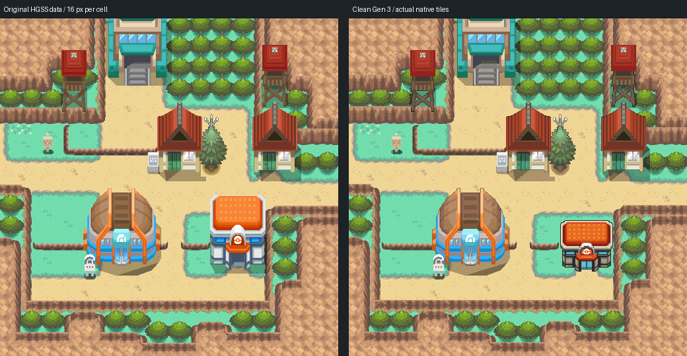
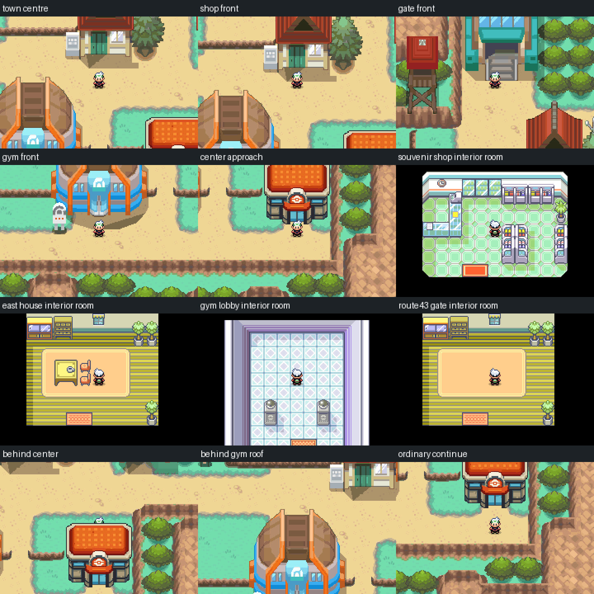

# Mahogany Town — clean native Gen 3 review build

Editable source: [engine PR #30](https://github.com/Davisfox5/pokeemerald-expansion/pull/30),
branch `codex/mahogany-town-clean`, commit `dec8f907713d2652ba00a0d272dcdcf5ee234428`.
Owner visual acceptance is pending. The earlier Claude drafts and their evidence
are preserved; this work starts from their decoded HGSS draft `b37519e7`.



The 32×32 exterior retains the original HGSS terrain, heights, materials, tree
footprints, paths, low walls, ledges, building silhouettes and contact shadows.
It uses a conventional native tileset pair, with no custom background renderer.
The locked shared C06 Center and all palettes are unchanged. A local inward
contour pass cleans 1,528 pixels on the two houses, Gym, gate and lookout towers;
it changes no terrain pixel or receiving ground. Review pairs are under
`evidence/clean/*-review.png`.

The souvenir shop, east house, Gym foyer and gatehouse vestibule now have
visitable native rooms. Both visible gate entrances return to their own cells.
The Center, shop, house and Gym have facade-specific opening/closing frames.
The four new room layouts are **proposals built from Gen 3 interior modules**,
not reconstructions of the original HGSS interiors. No donor story scripts,
trainers, item rewards, merchandise or progression flags were copied.



## Source and geographic authority

Reference provenance remains in `source/hgss/hgss-render.json` and
`source/hgss-events.json`: HGSS land_data chunk 85, original textures/building
models and the T28 event data. The reference is rendered at 16 pixels per cell,
with true heights and the existing recorded 8-pixel face snapping. Its
coordinate grid is `evidence/clean/reference-grid.png`; the native grid is
`evidence/clean/native-grid.png`. The Bulbagarden field-camera overview is a
secondary comparison, not an extracted collision source.

`source/clean-traversal.json` records all 1,024 cells with their independent
original material label and actual native behavior/collision/elevation/layer.
Only (16,14), (25,14), (11,23), (12,5), (13,5) change traversal from the prior
draft: these visible entrances are now wired. HGSS's gate behavior 110 must be
translated to Emerald `MB_NON_ANIMATED_DOOR` (96); otherwise return travel walks
north into the gate. That defect was caught and corrected in actual gameplay.

Existing map, layout and event IDs remain stable. New rooms append as maps
46–49 in `gMapGroup_Cherrygrove`. The inherited shared Center footprint
adaptations and the original enclosed open cells (8,7)/(8,8) remain documented
in the earlier draft; the two enclosed cells remain unreachable.

## Verification

- Arm GNU 14.2.1 local build passes. Poryscript 3.6.1 is installed by the project.
  ROM SHA-256: `0fa2996b36045c4678a504b3feff28527e5a1a268d13d7986d1bc9571efe21e6`.
- Actual native audit: 1,024 cells; materials, behavior, collision, elevation,
  layer, budgets, C06 pixels, palette values, stable IDs and warp references.
  All 343 reachable open/door cells connect; only the two original enclosed
  cells are unreachable. Highest used tile is 1001; tiles 1008–1023 remain
  reserved for door animation. Secondary metatiles: 227/512.
- mGBA 0.10.5: all six exterior warp squares and returns; Center stairs both
  ways; normal walks inside every new room; three one-way ledges; original
  blocked paths; signs; seven roof/prop/wall occlusions; Cherrygrove renderer
  regression; ordinary flash save; fresh-process cold reload; title Continue.
  All 36 outdoor VRAM/background reconstructions match native pixels. Foreground
  covers the player behind roofs/caps and clears the player in front of buildings.
- Four 90-frame door sequences were inspected. Readable frame sheets are
  `evidence/clean/door-*-frames.png`; the raw full sequences and ordinary save
  remain local rather than being committed.
- Porymap 6.3.1 opened, exported and saved all seven maps. Every export matches
  its actual clone's native decode with zero differing pixels. Saving changed
  JSON key order/Unicode escaping only. The checked source was `f795a1b0`;
  final source differs solely in the two gate behavior bytes above. Final native
  and runtime checks verify that correction. Exact identities and reuse limits
  are in `evidence/clean/preservation.json`.

GitHub's check suites are queued; no completed CI run is claimed. The PR stays
draft until CI and owner visual review. No ROM, save, emulator, toolchain or
credential is committed.

## Reproduce and edit

Open the engine branch directly in Porymap. Native files are authoritative.
The two authoring scripts are narrowly scoped provenance: `clean_native.py`
refuses any input differing from the preserved draft; `finish_entrances.py`
refuses to overwrite installed rooms. Do not replay them over owner edits.

```sh
# In the engine checkout, with the documented GBA toolchain/dependencies:
make -j1 generated
make -j6
# In this hub checkout:
python3 tools/gba/maps/mahogany/check_clean.py /path/to/engine
python3 tools/gba/maps/mahogany/runtime_clean.py /path/to/engine /tmp/new-mahogany-run
python3 tools/gba/maps/mahogany/porymap.py /path/to/engine /path/to/porymap clean
```

## Limits and review package

Route 42/43/44 connections, the Gym puzzle/battles, residents, story scenes and
shop inventory are not built. The gatehouse is a vestibule with no northern
route exit. Existing town music and the region-map square remain placeholders.
The inherited Center nurse interaction was not exercised by these checks.

The local review ZIP contains the ROM, an ordinary flash save in Mahogany,
overview, gameplay sheet and instructions. Keep the `.gba` and `.sav` together
and choose Continue. New Game retains the existing Cherrygrove opening.

Original geography, designs and textures: Game Freak / Nintendo / Creatures.
Shared C06 and the previous HGSS conversion retain their existing provenance.
