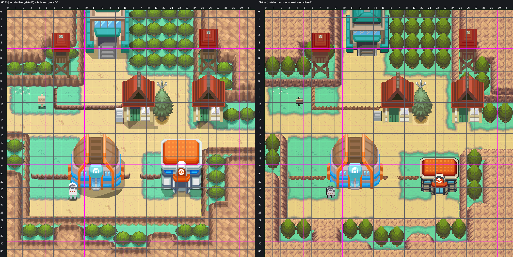
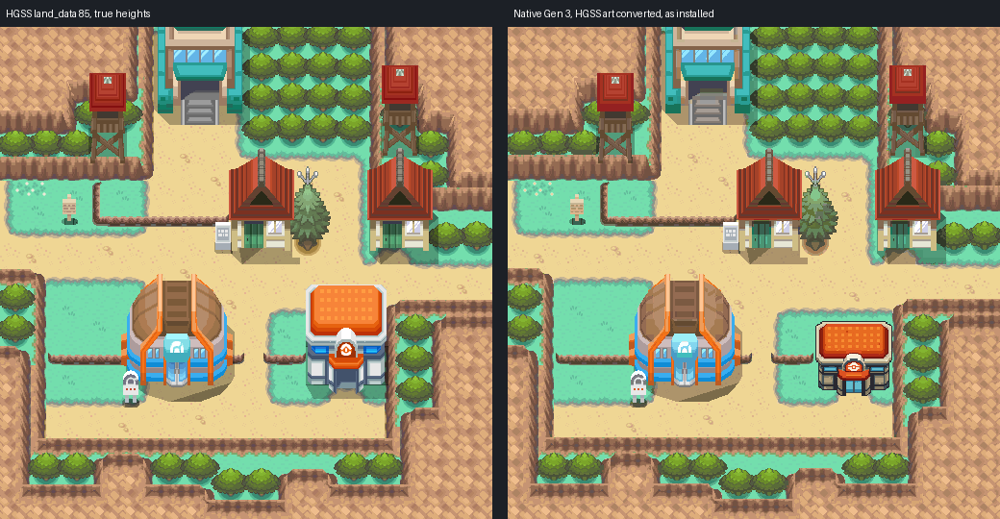
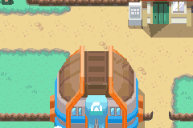

# Mahogany Town: reconstruction-guide draft with Blackthorn's rock

**Owner-accepted 2026-10-24** ("SO much better. We can lock that in"), engine `02dc6b15`, hub
`fbad5b2d`. Treat this map as locked: edit its committed native source in Porymap, never
regenerate it from these tools.

**Route 43 wiring (2026-10-24, engine branch `claude/route-43`)**: the gate doorway (12,5)/(13,5) is
now a door into `Route43MahoganyGatehouse` (two warp events; the two cells' collision cleared and
their single-use metatiles given `MB_NON_ANIMATED_DOOR`), a native-source edit by
`tools/gba/maps/route43/install.py`. No pixel changed. The traversal and audit evidence below predate
it. See [Route 43](../route-43/README.md).

Mahogany as one native Gen 3 map, rebuilt strictly to `AGENTS.md` and
[the map reconstruction workflow](../../../docs/GBA_MAP_RECONSTRUCTION.md). The owner rejected the
element build ("done from scratch": flat textures, wrong houses, wrong rock depth) and the direct
HGSS conversion ("does not follow the guide in agents.md"). On the third draft the owner found the
rock faces still not right and named Blackthorn as the reference, so the rock is now built the way
Blackthorn's is. Engine branch `claude/mahogany-town` at `02dc6b15` (draft PR #28 against
`apocrypha`).



[Every draft beside HGSS](evidence/review3/drafts.png) ·
[gameplay frames](evidence/review3/gameplay.png) ·
[review findings by coordinate](evidence/review3/findings.json)

## The map

| | |
| --- | --- |
| Map | `MahoganyTown`, 32x32, `gMapGroup_Cherrygrove` id 43 (Center 44, upstairs 45) |
| Tilesets | private pair `gTileset_MahoganyPrimary` + `gTileset_MahoganyTown`: 901 of 1,008 tiles (1008-1023 left for door animation), 210 + 160 metatiles |
| Colour | 13 banks, each colour exact: all 262,144 native pixels equal the assembled art in RGB555 |
| Material audit | 929 of 1,024 cells show HGSS's material, 0 mismatches, 95 cells where a foreground object differs (below) |

## 1. Reference (`trace.py`, `elements.ledger`)

- Authority: HGSS land_data chunk 85 decoded from pret/pokeheartgold (header 87, area bank 8, matrix
  origin [16,5]), events zone T28. Registration is exact: HGSS tile (x, z) is native cell (x, y), 16 px,
  origin (0,0), no crop or expansion. Not a screenshot trace.
- Numbered sheets: `evidence/trace/hgss-numbered-1..4.png`; material grid over HGSS:
  `evidence/trace/grid-over-hgss-1..4.png`; traversal ledger `source/trace/traversal.json` (HGSS type
  and collision bits per cell); tree roots `trees.json` (40 trees, 2x2); buildings `buildings.json`.
- Flat cell decode (`elements.ledger`): rock cells (HGSS cliff and wall cells, by slope and
  collision), ledges, trees, ground height per cell (under crowns and roofs, the cell's lowest point).

## 2. Rock: Blackthorn's method

Blackthorn's installed rock (style C) is FRLG General's mountain set recoloured to the Johto rock
ramp, one face per metatile. Mahogany now uses the same code (`elements.rock_frlg`, Blackthorn's
`rock_frlg`) on HGSS's own height layers:

- Every HGSS height layer is one terrace: town floor 0, the raised lawns 1, the mountain 2
  (`source/assemble/terrace-grid.txt`, one line per row). A rock cell stands at its rock peak, every
  other cell at its ground height, so a low wall is the face of the lawn terrace above it and the
  mountain beside a raised lawn steps twice.
- FRLG's nine-slice composes each rock cell per 8x8 quadrant from the edges that drop; its over-rock
  pieces where an edge drops to lower rock and its four inner corners where only a diagonal drops.
- The rock is a top-layer overlay: its clear pixels show the plainest block of the ground beyond the
  edge, and its cast shadow is Cherrygrove's border grey. Rock that rises toward the south faces away
  from the camera and shows as a rim, as in Blackthorn.

## 3. Shared and local art (`assemble.py`)

Shared masters are copied byte for byte into `source/shared-art/` with hashes and the catalog commit
(`codex/violet-city` `de5d8cf`) in `provenance.json`:

| Part | Shared art | Placement |
| --- | --- | --- |
| Lawn, road, rims | Cherrygrove/Route 36 painter (`claude_cherrygrove/ground.py`), unchanged | lawn or road per 8 px quadrant from HGSS's own flat ground colours |
| Ledges | L11 / L12 / L13 | HGSS's 17 jump-south cells; run ends rounded |
| Trees | T01 | on each of HGSS's 40 roots, crown one row behind |
| Signs | P12 signpost, P13 plaque, P15 Gym marker | on HGSS's sign cells and bases |
| Center | C06 | origin (20,19), door on HGSS's (22,23) |
| Gate | G01a | origin (10,-2), door column on HGSS warp (13,5) |

Local assets (`source/local-art/`, only what the catalog lacks): the houses, Gym, two lookout towers and
antenna tree, cut exactly from HGSS's own models and textures (`*-hgss.png`), transparent, no baked
ground; the white flowers at (1,10)-(2,10) from HGSS's flower03 texture; the west-facing ledge
(6,10)-(6,11), Emerald's native jump-west ledge (general metatile 0x85) recoloured onto the ledge ramp,
and its corner (6,12).

## 4. Native pack (`pack_lossless.py`)

No k-means, no nearest-colour tile merging. Banks are exact colour sets (an integer program places
every tile's colour set in a bank), tiles dedupe only when identical under a flip, and the only
compaction is bottom-layer pixels hidden under opaque top-layer art. The packer asserts that every
native pixel equals the assembled art.

## Deliberate adaptations

All listed with coordinates in `evidence/review3/findings.json`.

- **Rock.** Blackthorn's FRLG terraces replace HGSS's 27-43 px projected faces with one-metatile faces;
  steps rising toward the south show as rims.
- **Local buildings.** Moved to the nearest 8 px corner (2-3 px). Houses and towers share 15 tones
  (from 45), the antenna tree 15 (from 24), the Gym 20 (from 37, the fewest merges that fit two banks);
  closest tones merge, warm and cool never together, shapes untouched (`source/local-art/reductions.json`).
- **Foreground.** T01 is 48 px tall to HGSS's 32 px bushes, so crowns rise one row higher; C06 is shorter
  than HGSS's Center and the road shows where HGSS's roof stood. These are the 95 "foreground differs"
  cells in `evidence/pack3/material-audit.json`.
- **Collision.** HGSS's own, except the ten cells at (20-24,18-19) that HGSS's taller Center blocked:
  walkable here, row 19 drawn above the player (C06's roof edge), row 18 open road. Gate warps
  (12,5)/(13,5), the Gym door, the shop and the east house stay solid until their interiors exist.

## Verification

- **Build**: engine `02dc6b15`, ROM sha256 `2d186bc204858c246b7aaa48bb892cbb58a56c021bcec69f44b05e9b00a54e97`
  (not committed).
- **Native audit** (`check3.py`, `evidence/pack3/native-audit.json`): installed decode equals the packer's
  and the assembled art pixel for pixel; behaviour, collision, elevation and layer type match the ledger
  on all 1,024 cells; every approach reachable; walk-behind layering matches the objects' base rows;
  shared masters byte-identical to the catalog; only Mahogany files changed; budgets met.
- **Material audit** (`evidence/pack3/material-audit.json`, magenta/cyan boxes in `native-grid.png`):
  native classes from decoded colours against the masters' own colour vocabularies (the FRLG pieces in
  the rock ramp for rock), HGSS classes from the flat decode. 929 match, 0 mismatch, 95 foreground
  differences as above.
- **Headless mGBA** (`runtime3.py`, `evidence/pack3/runtime/`): 31 captures, map layers rebuilt from VRAM
  equal the native decode in all of them; BG1 covers the player behind the Center, Gym roof, shop roof,
  antenna tree and town sign and leaves the player clear in front of all six buildings; both ledge
  directions jump and refuse the climb back; Center, Gym, shop, house and gate doors, a tree, a wall and the
  mountain block; both signs read; Center and upstairs round trip; Cherrygrove and back; ordinary flash
  save, cold reload and title Continue. No desktop game opened.
- **Porymap 6.3.1** (`evidence/pack3/porymap/`): opens, exports and saves the map on a fresh clone of
  `02dc6b15`; its own map export equals the native decode with 0 differing pixels.

## Remaining

- Cells (8,7)-(8,8) behind the west tower are open but walled in, as in HGSS.
- Not built: Route 43 gatehouse, Gym, souvenir shop and east house interiors, connections, NPCs.

## Reproduction

```sh
python3 tools/gba/maps/mahogany/trace.py PHG_CHECKOUT
python3 tools/gba/maps/mahogany/assemble.py PHG_CHECKOUT CATALOG_CHECKOUT ENGINE_CHECKOUT   # catalog: codex/violet-city
python3 tools/gba/maps/mahogany/pack_lossless.py ENGINE_CHECKOUT PHG_CHECKOUT
python3 tools/gba/maps/mahogany/install_convert.py ENGINE_CHECKOUT pack3    # replaces the earlier Mahogany install only
make -C ENGINE_CHECKOUT -j8
python3 tools/gba/maps/mahogany/check3.py ENGINE_CHECKOUT PHG_CHECKOUT
python3 tools/gba/maps/mahogany/review3.py
python3 tools/gba/maps/mahogany/runtime3.py ENGINE_CHECKOUT OUT_DIR
python3 tools/gba/maps/mahogany/porymap.py ENGINE_CHECKOUT PORYMAP_BINARY pack3
```

Generators are provenance: edit the committed native map in Porymap; never replay them over owner edits
(the installer refuses if a Mahogany file carries a commit it did not make).

## Third draft rock (replaced 2026-10-24)

The third draft (engine `8c60a820`, hub `0e8c15a7`) drew rock from the shared R02/R12 courses
resampled onto HGSS's projected faces, with a 16 px Route 31 plateau core. The owner found those faces
still not right; its native image is the fourth panel of `evidence/review3/drafts.png`. Everything else
in this README describes the current build.

## Second draft: HGSS art converted (rejected 2026-10-23)

Mahogany as one native Gen 3 map, converted from HeartGold/SoulSilver's own map data and
art. The owner rejected the first (Gen 3 element build, below) on
2026-10-23: "done from scratch", flat textures, house textures not right, rock ledges and
depth wrong. This draft draws HGSS's own ground, grass, road, cliffs, low walls, ledges,
trees, houses, Gym, Route 43 gate, lookout towers, antenna tree and signposts, at HGSS's
heights. Only the Pokemon Center is replaced, by the owner-locked shared C06. Editable source
is the engine branch `claude/mahogany-town` (draft PR #28 against `apocrypha`). Owner visual
acceptance is pending.



### The map

| | |
| --- | --- |
| Map | `MahoganyTown`, 32x32, `gMapGroup_Cherrygrove` id 43 (Center 44, Center upstairs 45) |
| Primary | `gTileset_MahoganyPrimary`: 512 of 512 tiles, 249 metatiles, banks 0-5 (HGSS Mahogany's ground, cliffs, walls, trees) |
| Secondary | `gTileset_MahoganyTown`: 488 of 496 tiles (16 kept for door animation), 222 metatiles, banks 6-12 (the rest of HGSS's art; C06 exact in banks 8-9) |
| Colour | 214,953 of 262,144 pixels exact in 5-bit colour, 257,957 within 2 levels, 261,735 within 4, worst 9; all 5,679 C06 pixels exact |

Map ids are appended to `gMapGroup_Cherrygrove`; Blackthorn (engine PR #26) and Cianwood also
append there, and whichever merges second takes the next ids.

### How it is made (`tools/gba/maps/mahogany/convert.py`)

- **Art**: `hgss_render.py` renders HGSS land_data chunk 85 with its own textures and building
  models, 16 px per tile. Anything above the town floor rises up the screen by its height, the
  way Gen 3 draws fronts and roofs; cliff and ledge fronts are snapped to whole 8 px rows. Ground
  (terrain, lifted fronts, contact shadows) is the bottom layer. Buildings and signposts are the
  top layer.
- **Depth**: where a walkable cell holds art lifted from something further south (a wall cap, a
  roof, a crown), that art moves to the top layer and the bottom shows the ground from straight
  above, so the player walks behind it. Each cell's layer type follows the art's base row
  (`pack.above_player`). Walk-behind cells: the three wall caps (32 cells), both houses' roofs,
  the antenna tree, the Gym's roof and sides, the Center's roof row, the west tower and both signposts.
- **Colour**: C06 keeps its exact colours in banks 8 and 9. The rest is fitted to the other
  eleven banks by k-means per bank; every 8x8 tile takes the bank that loses least.
- **Tiles**: the map needed 1,162 distinct tiles at first. Tiles hidden under fully opaque roof
  and wall pixels reuse one plain ground tile (they are never seen), and 71 near-identical
  texture tiles share one tile each, cheapest first: same bank, same transparent pixels, no
  pixel moving more than 6 levels. Result: 1,000 of 1,008.

### Deliberate adaptations

All listed with reasons in `evidence/convert/pack.json`:

- Unbuilt destinations are solid: the Gym door (11, 23), the souvenir shop (16, 14), the east
  house (25, 14) and both Route 43 gate warps (12..13, 5).
- C06 is shorter than HGSS's Center. Its top row (20..24, 19) is a walkable roof overhang as its
  manifest sets it, and the row north of it (20..24, 18), which HGSS blocks only because its
  taller Center rises over it, is open. Every other cell keeps HGSS's collision exactly.
- (8, 7) and (8, 8) behind the west tower are open in HGSS and walled in there too; they stay
  open and unreachable.
- Signs: the town sign and Gym sign read HGSS's text, the Gym sign without the leader's name
  (DESIGN.md has no Mahogany section yet). The souvenir shop's signpost is a prop.
- The C06 door has no door-animation entry for this tileset pair, so it opens without the
  sliding animation (the warp works). Music is a placeholder (`MUS_VERDANTURF`); the region map
  square is a placeholder.

### Verification

- **Native audit** (`check_convert.py`, `evidence/convert/native-audit.json`): the installed files
  decode identically to the packer; all 1,024 cells match the traversal ledger's behaviour,
  collision, elevation and layer type; 338 of 340 open cells are reachable on foot (the other two
  are the enclosed pair above), including every door, sign, the gate front and both road ends;
  walk-behind cells follow the depth rule; C06's master hash and pixels are exact; existing map
  ids unchanged; changed files within scope. Grid: `evidence/convert/native-grid.png`.
- **Headless mGBA 0.10.2** (`runtime_convert.py`, `evidence/convert/gameplay/results.json`):
  thirteen views; standing behind the Center's roof row, the Gym's roof, the shop's roof, the
  antenna tree, the town signpost and two wall caps; in front of the Center, Gym, shop, east
  house and gate; the south ledges at y 12 and y 21 and the west ledge at x 6 jumped and not
  climbed; Center body, Gym, shop and house doors, gate, a tree, a wall and the south cliff block;
  both signs read; Center in, upstairs, back and out; Cherrygrove and back; ordinary flash save,
  cold reload in a new process, title Continue.
- **Rendering parity**: all 31 town captures rebuild BG1-BG3 from dumped VRAM, palettes and
  registers and match the decoded native map pixel for pixel. Behind each object BG1 covers the
  player's cell (80 to 256 px); in front of every building it covers none of the player's two
  cells.
- **Porymap 6.3.1** (`porymap.py ... converted`, `evidence/convert/porymap/results.json`): the town
  and both Center floors open with no errors; Porymap's export matches the native decode pixel
  for pixel; saving rewrote 35 Mahogany files, all byte-identical. The two non-Mahogany files a
  save touches change only lines that predate Mahogany (Route 110 key order, three `é` escapes).

Engine commit `b37519e732ddc7d13f4412a796419308583d6bc8`, local ROM SHA-256
`379f2f00d4ef684cbce537fbe5ff95beb48a09de9f91834fca92dc490c418fb3` (Ubuntu Arm GNU 13.2.1).
No ROM, save, toolchain or emulator binary is committed. Close-up pairs: `evidence/convert/review/`.



### Not built

- Gym, souvenir shop, east house and Route 43 gatehouse interiors; Route 42, 43 and 44
  connections. No NPCs, trainers, encounters or story events (HGSS's four townspeople are
  recorded in `source/hgss-events.json`).

### Reproduction

The map is regenerated from these tools each round until the owner edits or accepts it.
`install_convert.py` removes the agent's earlier Mahogany install (it refuses if any Mahogany
file carries a commit that is not a Mahogany generator commit) and installs fresh.

```sh
python3 tools/gba/maps/mahogany/hgss_render.py /path/to/pokeheartgold gba/art/mahogany-town/source/hgss
python3 tools/gba/maps/mahogany/hgss_events.py /path/to/pokeheartgold gba/art/mahogany-town/source/hgss-events.json
python3 tools/gba/maps/mahogany/convert.py /path/to/engine /path/to/pokeheartgold
python3 tools/gba/maps/mahogany/install_convert.py /path/to/engine
# after make:
python3 tools/gba/maps/mahogany/check_convert.py /path/to/engine
python3 tools/gba/maps/mahogany/runtime_convert.py /path/to/engine /tmp/mahogany-run
python3 tools/gba/maps/mahogany/porymap.py /path/to/engine /path/to/porymap converted
```

Original map geography, models and textures: Game Freak / Nintendo / Creatures
(HeartGold/SoulSilver). Read-only derivation under the repository's existing asset practice.

## First draft: Gen 3 elements (rejected 2026-10-23)

Kept for reference: tools `elements.py`, `sprites.py`, `pack.py`, `install_elements.py`,
`check_elements.py`, `runtime_elements.py`, `review_elements.py`; evidence `evidence/elements/`,
`evidence/porymap/`; engine commit `eeee9e22`.

Mahogany as one native Gen 3 map, laid out cell for cell from HeartGold/SoulSilver's own map
data and drawn with Gen 3 pieces, by the method AGENTS.md calls "Converting a Gen 4 map:
convert elements, not pixels" (Blackthorn City, Cianwood City). Each HGSS element (rock
terraces, low walls, ground, ledges, trees, buildings) is replaced by a Gen 3 element that
does the same job. Editable source is in the engine PR against `apocrypha`, branch
`claude/mahogany-town`. Owner visual acceptance is pending.


### The map

| | |
| --- | --- |
| Map | `MahoganyTown`, 32x32, `gMapGroup_Cherrygrove` id 43 (Center 44, Center upstairs 45) |
| Primary | `gTileset_CherrygrovePrimary` (accepted Johto primary: ground, trees, signs) |
| Secondary | `gTileset_MahoganyTown`: 387 of 496 tiles (16 kept for door animation), 258 of 512 metatiles |
| Palettes | banks 0-5 the primary's; 6-12 one exact fit: C06's 21 colours over two banks, then a bank each for the houses, the Gym, the Route 43 gate, and the towers with the antenna tree; rock, ledges and flattened overlaps fill the slots left |

Map ids are appended to `gMapGroup_Cherrygrove`. Blackthorn (engine PR #26) and Cianwood also
append there; whichever merges second takes the next ids. Nothing else is renumbered.

### Reference: decoded HGSS data

`tools/gba/maps/mahogany/hgss_render.py` reads pret/pokeheartgold's packed archives
(revision in `source/hgss/hgss-render.json`, with archive hashes): land_data chunk 85
(terrain model, 32x32 permission grid, 15 building placements), area data bank 8, the map
and building textures, and zone events T28 (`source/hgss-events.json`: six warps, three
signs, four NPCs). Its render at true heights (`source/hgss/hgss-reference-true-heights.png`)
is the review reference. Collision, ledges and doors are the decoded HGSS permissions, cell
for cell; HGSS behaviour codes match Emerald's (`0x3B` jump south, `0x39` jump west, `0x69`
door, `0x6E` warp into a gatehouse, `0x06` tree).

The Bulbagarden overview (`File:Mahogany Town HGSS.png`) was checked first and rejected as
the authority: it is a field-camera screenshot, 16 px per cell across but 12 px per cell
down, so it cannot be read on a 16x16 grid. The decoded land_data replaces it.

### Element ledger

`elements.py` labels every cell from a flat top-down HGSS height map and the permissions
(`source/elements/ledger.json`, `ledger.png`): tree, rock top or face (with its downhill
direction), jump-south ledge, jump-west ledge, the blocked ledge corner where they meet,
other blocked, open, plus the ground under it. HGSS Mahogany has three ground heights: the
town floor (4), the raised lawns behind low walls (5) and the mountain tops (6). A rock
cell's height counts only its rock-texture pixels, since the tree crowns beside a wall stand
higher than the wall.

### Elements

- **Rock**: FRLG's General mountain set (nine-slice, over-rock variants, inner corners,
  ledge-into-cliff joins) recoloured to the HGSS rock ramp. Mahogany's `cliff01gs` is the
  same texture and palette as Blackthorn's (decoded from both area texture sets), so the
  ramp is Blackthorn's, and the two neighbouring towns share one rock. The mountain is two
  one-tile terraces.
- **Low walls round the raised lawns**: HGSS draws them as thick walls with a brown cap.
  Each is a one-cell ridge in the same rock set: rim on the lawn side, face on the floor
  side, lawn on both sides. (A first pass kept the lawn as a higher terrace, which turned
  the south wall into a band of mountain top; a second kept only FRLG's rim over lawn,
  which left speckle. Both were rejected on inspection.)
- **Ground**: Cherrygrove's lawn and sand path with its grey border, tile for tile from the
  accepted town, chosen per 8-neighbour configuration and texture phase. Every
  configuration Mahogany needs exists in Cherrygrove.
- **Trees**: Cherrygrove's standalone tree (32 x 48, the accepted HGSS-style tree west of
  its Mart), one on each of the 40 HGSS tree footprints (2 x 2), its base on the
  footprint's lower row. Drawn in base-row order, so each crown covers the trunk of the tree
  behind it, as HGSS's forest does.
- **Ledges**: FRLG's jump ledge in the rock ramp: the south runs at y 12 and y 21 with
  rounded ends, the short west-facing run at (6, 10..11) as the same strip turned to face
  west, and the blocked corner at (6, 12) carrying both.
- **Buildings and props**: HGSS's own models and textures rendered at C06's angle
  (`hgss_camera.view`: orthographic, 38 degrees, 16 px per tile up the screen, squeezed
  across to the footprint) and finished as Gen 3 sprites (`sprites.py`,
  `source/elements/sprites.png`): the souvenir shop and the east house (model 134 with door
  135, 64 px, not mirrored because the chimney sits off centre), the Gym (138 with door 16,
  112 px, mirrored, the `en_gyma` roof seams drawn back), the Route 43 gate (35, 96 px), the
  two lookout towers (249, 32 px) and the antenna tree (136, 48 px). C06's outline colour
  runs round each silhouette.
- **Center**: the owner-locked shared Johto Center C06 (`source/shared-art/provenance.json`),
  pixel exact, its door (2, 4) on the HGSS Center door (22, 23).
- **Signs**: Cherrygrove's accepted town sign on the three HGSS sign cells.
- **One bank per tile**: where a tile's top layer would hold two colour families (a crown
  over a cliff, a roof over a crown), the frontmost family stays on the top layer and the
  rest is composited into the bottom layer (`elements.flatten`). The picture does not change.

### Deliberate adaptations

Twenty-six cells differ from HGSS's permissions, each listed with its reason in
`evidence/elements/pack-C.json`:

- **Unbuilt destinations are solid**: the Gym door (11, 23), the souvenir shop (16, 14), the
  east house (25, 14) and both Route 43 gate warps (12..13, 5).
- **C06's top row** (20..24, 19) is a walkable roof overhang, as its manifest sets it; HGSS's
  taller Center blocks it.
- **Cells HGSS blocks only because its taller models rise over them** and the shorter Gen 3
  sprite misses or only edges into (the player walks behind that edge): the row north of the
  Center (20..24, 18), the row north of the Gym (8..14, 18) and its two top corners
  (8, 19), (14, 19), and the souvenir shop's two roof corners (15, 10), (18, 10). The rule
  applies only within two rows north of an HGSS building footprint; the fenced lawn south of
  the town (18..21, 28) stays blocked as in HGSS.
- **Open in HGSS, enclosed**: (8, 7) and (8, 8) on the raised lawn behind the west tower are
  open in HGSS and walled in on every side there too. They stay open and unreachable.
- **Colour**: 262,141 of 262,144 composed pixels decode to their exact 5-bit colour. The three
  others, each within 3 levels, are tree shadow in one tile behind the east house's roof
  (26, 10), where that shadow's green and the lawn need a bank that has no slot left.
- **Placement**: the antenna tree sits 4 px east of HGSS's centre so it stays clear of the
  shop's wall; the C06 Center and the Gen 3 houses and Gym are shorter than HGSS's 3D
  models, so their roofs start lower, bases unchanged.
- **Region map**: `MAPSEC_MAHOGANY_TOWN` takes the last section's map square as a placeholder.

### Verification

- **Native audit** (`check_elements.py`, `evidence/elements/native-audit.json`): the installed
  files decode identically to the packer; all 1,024 cells match the traversal ledger's
  behaviour, collision, elevation and layer type; 349 of 351 open cells are reachable on foot
  from the Center door (the other two are the enclosed pair above), including every door,
  sign, the gate front and both road ends; walk-behind cells follow the depth rule (Center
  roof row 5, Gym roof edge 4, antenna tree 3, shop roof corners 2); C06's master hash and
  all 5,679 of its pixels are exact; existing map ids unchanged; changed files within scope.
  Coordinate grid: `evidence/elements/native-grid.png`.
- **Headless mGBA 0.10.2** (`runtime_elements.py`, `evidence/elements/gameplay/results.json`):
  thirteen views across the town; standing behind the Center's roof row, the Gym's roof
  edge, the shop's roof corner and the antenna tree; standing in front of the Center, Gym,
  shop, east house and gate; the south ledges at y 12 and y 21 and the west ledge at x 6
  jumped and not climbed; Center body, Gym, shop and house doors, gate, a tree, a low wall
  and the south cliff block; both signs read; Center in, upstairs, back and out; Cherrygrove
  and back; ordinary flash save, cold reload in a new process, title Continue.
- **Rendering parity**: for all 28 town captures the map layers BG1-BG3 rebuilt from dumped
  VRAM, palettes and BG registers match the decoded native map pixel for pixel. Behind the
  roofs BG1 covers the player's own cell (224 px at the Center, 132 at the antenna tree, 26
  at the Gym, 1 at the shop's corner); in front of every building BG1 covers none of the
  player's two cells.
- **Porymap 6.3.1** (`porymap.py`, `evidence/porymap/results.json`), built from source and
  run under Xvfb on a fresh clone of the engine commit: the town and both Center floors open
  with no errors; Porymap's export of the town matches the native decode pixel for pixel;
  saving the maps and the town's tilesets rewrote 23 Mahogany files, all byte-identical. The
  only lines a save changes predate Mahogany: key order in a Route 110 layout entry and three
  `é` escapes in Kanto MAPSEC names.

Engine commit `eeee9e2259d9ba08b8f52a5dd1bb661aeb0900db`, local ROM SHA-256
`c0e142d8d585c59b84798710c34a8caf3ed4b1bc504dd4dccb282731671e298f` (Ubuntu Arm GNU 13.2.1).
No ROM, save, toolchain or emulator binary is committed.


Region pairs for close review: `evidence/elements/review/`.

### Not verified or not built

- No interiors for the Gym, the souvenir shop or the east house, and no Route 43 gatehouse:
  their doors are solid. No Route 42 or Route 44 connection: the west and east road ends
  meet the map edge.
- Center nurse scripts are Cherrygrove's copies, not exercised. Music is a placeholder
  (`MUS_VERDANTURF`).
- No NPCs, trainers, encounters or story events. HGSS's four townspeople are recorded in
  `source/hgss-events.json` only.
- HGSS's two white flowers at (1..2, 10) and the antenna tree's ground shadow are not drawn.

### Editing and reproduction

Edit `MahoganyTown` natively in Porymap once the owner edits or accepts it. Until then it is
regenerated from these tools each round (AGENTS.md, "Converting a Gen 4 map").
`install_elements.py` refuses to run if the maps exist.

```sh
python3 tools/gba/maps/mahogany/hgss_render.py /path/to/pokeheartgold gba/art/mahogany-town/source/hgss
python3 tools/gba/maps/mahogany/hgss_events.py /path/to/pokeheartgold gba/art/mahogany-town/source/hgss-events.json
python3 tools/gba/maps/mahogany/sprites.py /path/to/pokeheartgold
python3 tools/gba/maps/mahogany/elements.py /path/to/engine /path/to/pokeheartgold
python3 tools/gba/maps/mahogany/pack.py /path/to/engine C
python3 tools/gba/maps/mahogany/budget.py /path/to/engine C        # tiles and colours per element
python3 tools/gba/maps/mahogany/install_elements.py /path/to/engine C
# after make:
python3 tools/gba/maps/mahogany/check_elements.py /path/to/engine C
python3 tools/gba/maps/mahogany/runtime_elements.py /path/to/engine /tmp/mahogany-run C
python3 tools/gba/maps/mahogany/review_elements.py C
python3 tools/gba/maps/mahogany/porymap.py /path/to/engine /path/to/porymap C
```

`MGBA_FLAGS` and `ARM_NM` select a non-system libmgba or toolchain.

Original map geography, models and textures: Game Freak / Nintendo / Creatures
(HeartGold/SoulSilver); FRLG mountain pieces from the engine's `general_frlg` tileset;
Cherrygrove ground, tree and sign from the accepted Johto source. Read-only derivation under
the repository's existing asset practice.
