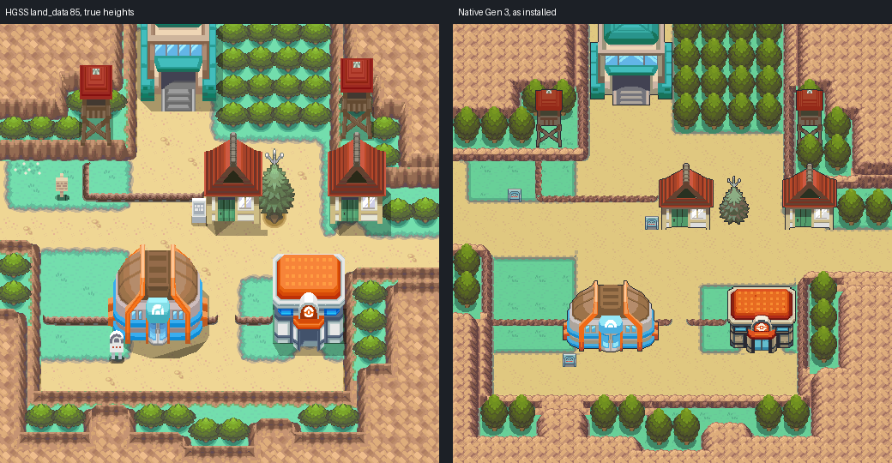
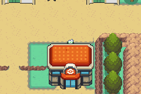

# Mahogany Town: native exterior built from Gen 3 elements

Mahogany as one native Gen 3 map, laid out cell for cell from HeartGold/SoulSilver's own map
data and drawn with Gen 3 pieces, by the method AGENTS.md calls "Converting a Gen 4 map:
convert elements, not pixels" (Blackthorn City, Cianwood City). Each HGSS element (rock
terraces, low walls, ground, ledges, trees, buildings) is replaced by a Gen 3 element that
does the same job. Editable source is in the engine PR against `apocrypha`, branch
`claude/mahogany-town`. Owner visual acceptance is pending.



## The map

| | |
| --- | --- |
| Map | `MahoganyTown`, 32x32, `gMapGroup_Cherrygrove` id 43 (Center 44, Center upstairs 45) |
| Primary | `gTileset_CherrygrovePrimary` (accepted Johto primary: ground, trees, signs) |
| Secondary | `gTileset_MahoganyTown`: 387 of 496 tiles (16 kept for door animation), 258 of 512 metatiles |
| Palettes | banks 0-5 the primary's; 6-12 one exact fit: C06's 21 colours over two banks, then a bank each for the houses, the Gym, the Route 43 gate, and the towers with the antenna tree; rock, ledges and flattened overlaps fill the slots left |

Map ids are appended to `gMapGroup_Cherrygrove`. Blackthorn (engine PR #26) and Cianwood also
append there; whichever merges second takes the next ids. Nothing else is renumbered.

## Reference: decoded HGSS data

`tools/gba/maps/mahogany/hgss_render.py` reads pret/pokeheartgold's packed archives
(revision in `source/hgss/hgss-render.json`, with archive hashes): land_data chunk 85
(terrain model, 32x32 permission grid, 15 building placements), area data bank 8, the map
and building textures, and zone events T28 (`source/hgss-events.json`: six warps, three
signs, four NPCs). Its render at true heights (`source/hgss/hgss-reference-true-heights.png`)
is the review reference. Collision, ledges and doors are the decoded HGSS permissions, cell
for cell; HGSS behaviour codes match Emerald's (`0x3B` jump south, `0x39` jump west, `0x69`
door, `0x6E` warp into a gatehouse, `0x06` tree).

The Bulbagarden overview (`File:Mahogany Town HGSS.png`) was checked first and rejected as
the authority: it is a field-camera screenshot, 16 px per cell across but 12 px per cell
down, so it cannot be read on a 16x16 grid. The decoded land_data replaces it.

## Element ledger

`elements.py` labels every cell from a flat top-down HGSS height map and the permissions
(`source/elements/ledger.json`, `ledger.png`): tree, rock top or face (with its downhill
direction), jump-south ledge, jump-west ledge, the blocked ledge corner where they meet,
other blocked, open, plus the ground under it. HGSS Mahogany has three ground heights: the
town floor (4), the raised lawns behind low walls (5) and the mountain tops (6). A rock
cell's height counts only its rock-texture pixels, since the tree crowns beside a wall stand
higher than the wall.

## Elements

- **Rock**: FRLG's General mountain set (nine-slice, over-rock variants, inner corners,
  ledge-into-cliff joins) recoloured to the HGSS rock ramp. Mahogany's `cliff01gs` is the
  same texture and palette as Blackthorn's (decoded from both area texture sets), so the
  ramp is Blackthorn's, and the two neighbouring towns share one rock. The mountain is two
  one-tile terraces.
- **Low walls round the raised lawns**: HGSS draws them as thick walls with a brown cap.
  Each is a one-cell ridge in the same rock set: rim on the lawn side, face on the floor
  side, lawn on both sides. (A first pass kept the lawn as a higher terrace, which turned
  the south wall into a band of mountain top; a second kept only FRLG's rim over lawn,
  which left speckle. Both were rejected on inspection.)
- **Ground**: Cherrygrove's lawn and sand path with its grey border, tile for tile from the
  accepted town, chosen per 8-neighbour configuration and texture phase. Every
  configuration Mahogany needs exists in Cherrygrove.
- **Trees**: Cherrygrove's standalone tree (32 x 48, the accepted HGSS-style tree west of
  its Mart), one on each of the 40 HGSS tree footprints (2 x 2), its base on the
  footprint's lower row. Drawn in base-row order, so each crown covers the trunk of the tree
  behind it, as HGSS's forest does.
- **Ledges**: FRLG's jump ledge in the rock ramp: the south runs at y 12 and y 21 with
  rounded ends, the short west-facing run at (6, 10..11) as the same strip turned to face
  west, and the blocked corner at (6, 12) carrying both.
- **Buildings and props**: HGSS's own models and textures rendered at C06's angle
  (`hgss_camera.view`: orthographic, 38 degrees, 16 px per tile up the screen, squeezed
  across to the footprint) and finished as Gen 3 sprites (`sprites.py`,
  `source/elements/sprites.png`): the souvenir shop and the east house (model 134 with door
  135, 64 px, not mirrored because the chimney sits off centre), the Gym (138 with door 16,
  112 px, mirrored, the `en_gyma` roof seams drawn back), the Route 43 gate (35, 96 px), the
  two lookout towers (249, 32 px) and the antenna tree (136, 48 px). C06's outline colour
  runs round each silhouette.
- **Center**: the owner-locked shared Johto Center C06 (`source/shared-art/provenance.json`),
  pixel exact, its door (2, 4) on the HGSS Center door (22, 23).
- **Signs**: Cherrygrove's accepted town sign on the three HGSS sign cells.
- **One bank per tile**: where a tile's top layer would hold two colour families (a crown
  over a cliff, a roof over a crown), the frontmost family stays on the top layer and the
  rest is composited into the bottom layer (`elements.flatten`). The picture does not change.

## Deliberate adaptations

Twenty-six cells differ from HGSS's permissions, each listed with its reason in
`evidence/elements/pack-C.json`:

- **Unbuilt destinations are solid**: the Gym door (11, 23), the souvenir shop (16, 14), the
  east house (25, 14) and both Route 43 gate warps (12..13, 5).
- **C06's top row** (20..24, 19) is a walkable roof overhang, as its manifest sets it; HGSS's
  taller Center blocks it.
- **Cells HGSS blocks only because its taller models rise over them** and the shorter Gen 3
  sprite misses or only edges into (the player walks behind that edge): the row north of the
  Center (20..24, 18), the row north of the Gym (8..14, 18) and its two top corners
  (8, 19), (14, 19), and the souvenir shop's two roof corners (15, 10), (18, 10). The rule
  applies only within two rows north of an HGSS building footprint; the fenced lawn south of
  the town (18..21, 28) stays blocked as in HGSS.
- **Open in HGSS, enclosed**: (8, 7) and (8, 8) on the raised lawn behind the west tower are
  open in HGSS and walled in on every side there too. They stay open and unreachable.
- **Colour**: 262,141 of 262,144 composed pixels decode to their exact 5-bit colour. The three
  others, each within 3 levels, are tree shadow in one tile behind the east house's roof
  (26, 10), where that shadow's green and the lawn need a bank that has no slot left.
- **Placement**: the antenna tree sits 4 px east of HGSS's centre so it stays clear of the
  shop's wall; the C06 Center and the Gen 3 houses and Gym are shorter than HGSS's 3D
  models, so their roofs start lower, bases unchanged.
- **Region map**: `MAPSEC_MAHOGANY_TOWN` takes the last section's map square as a placeholder.

## Verification

- **Native audit** (`check_elements.py`, `evidence/elements/native-audit.json`): the installed
  files decode identically to the packer; all 1,024 cells match the traversal ledger's
  behaviour, collision, elevation and layer type; 349 of 351 open cells are reachable on foot
  from the Center door (the other two are the enclosed pair above), including every door,
  sign, the gate front and both road ends; walk-behind cells follow the depth rule (Center
  roof row 5, Gym roof edge 4, antenna tree 3, shop roof corners 2); C06's master hash and
  all 5,679 of its pixels are exact; existing map ids unchanged; changed files within scope.
  Coordinate grid: `evidence/elements/native-grid.png`.
- **Headless mGBA 0.10.2** (`runtime_elements.py`, `evidence/elements/gameplay/results.json`):
  thirteen views across the town; standing behind the Center's roof row, the Gym's roof
  edge, the shop's roof corner and the antenna tree; standing in front of the Center, Gym,
  shop, east house and gate; the south ledges at y 12 and y 21 and the west ledge at x 6
  jumped and not climbed; Center body, Gym, shop and house doors, gate, a tree, a low wall
  and the south cliff block; both signs read; Center in, upstairs, back and out; Cherrygrove
  and back; ordinary flash save, cold reload in a new process, title Continue.
- **Rendering parity**: for all 28 town captures the map layers BG1-BG3 rebuilt from dumped
  VRAM, palettes and BG registers match the decoded native map pixel for pixel. Behind the
  roofs BG1 covers the player's own cell (224 px at the Center, 132 at the antenna tree, 26
  at the Gym, 1 at the shop's corner); in front of every building BG1 covers none of the
  player's two cells.
- **Porymap 6.3.1** (`porymap.py`, `evidence/porymap/results.json`), built from source and
  run under Xvfb on a fresh clone of the engine commit: the town and both Center floors open
  with no errors; Porymap's export of the town matches the native decode pixel for pixel;
  saving the maps and the town's tilesets rewrote 23 Mahogany files, all byte-identical. The
  only lines a save changes predate Mahogany: key order in a Route 110 layout entry and three
  `é` escapes in Kanto MAPSEC names.

Engine commit `eeee9e2259d9ba08b8f52a5dd1bb661aeb0900db`, local ROM SHA-256
`c0e142d8d585c59b84798710c34a8caf3ed4b1bc504dd4dccb282731671e298f` (Ubuntu Arm GNU 13.2.1).
No ROM, save, toolchain or emulator binary is committed.



Region pairs for close review: `evidence/elements/review/`.

## Not verified or not built

- No interiors for the Gym, the souvenir shop or the east house, and no Route 43 gatehouse:
  their doors are solid. No Route 42 or Route 44 connection: the west and east road ends
  meet the map edge.
- Center nurse scripts are Cherrygrove's copies, not exercised. Music is a placeholder
  (`MUS_VERDANTURF`).
- No NPCs, trainers, encounters or story events. HGSS's four townspeople are recorded in
  `source/hgss-events.json` only.
- HGSS's two white flowers at (1..2, 10) and the antenna tree's ground shadow are not drawn.

## Editing and reproduction

Edit `MahoganyTown` natively in Porymap once the owner edits or accepts it. Until then it is
regenerated from these tools each round (AGENTS.md, "Converting a Gen 4 map").
`install_elements.py` refuses to run if the maps exist.

```sh
python3 tools/gba/maps/mahogany/hgss_render.py /path/to/pokeheartgold gba/art/mahogany-town/source/hgss
python3 tools/gba/maps/mahogany/hgss_events.py /path/to/pokeheartgold gba/art/mahogany-town/source/hgss-events.json
python3 tools/gba/maps/mahogany/sprites.py /path/to/pokeheartgold
python3 tools/gba/maps/mahogany/elements.py /path/to/engine /path/to/pokeheartgold
python3 tools/gba/maps/mahogany/pack.py /path/to/engine C
python3 tools/gba/maps/mahogany/budget.py /path/to/engine C        # tiles and colours per element
python3 tools/gba/maps/mahogany/install_elements.py /path/to/engine C
# after make:
python3 tools/gba/maps/mahogany/check_elements.py /path/to/engine C
python3 tools/gba/maps/mahogany/runtime_elements.py /path/to/engine /tmp/mahogany-run C
python3 tools/gba/maps/mahogany/review_elements.py C
python3 tools/gba/maps/mahogany/porymap.py /path/to/engine /path/to/porymap C
```

`MGBA_FLAGS` and `ARM_NM` select a non-system libmgba or toolchain.

Original map geography, models and textures: Game Freak / Nintendo / Creatures
(HeartGold/SoulSilver); FRLG mountain pieces from the engine's `general_frlg` tileset;
Cherrygrove ground, tree and sign from the accepted Johto source. Read-only derivation under
the repository's existing asset practice.
