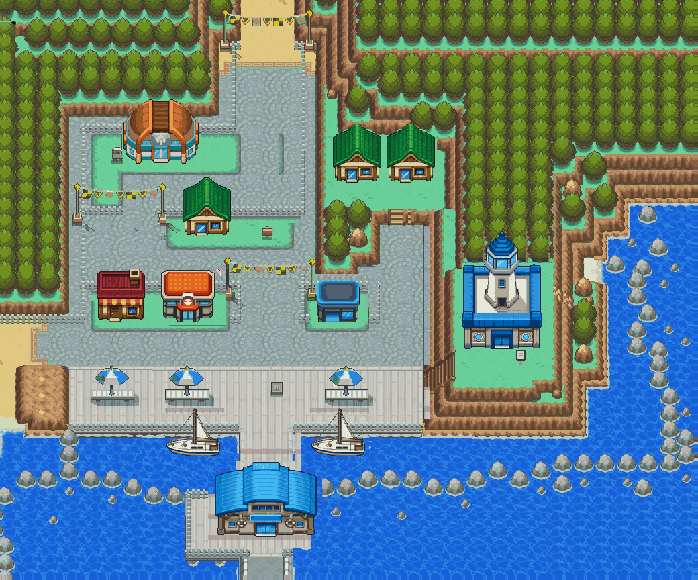

# Olivine City — HGSS terrain with repaired receiving contexts

The owner clarified the target after two rejected passes: keep the detailed HGSS
terrain and polished buildings, but remove superseded objects completely and
reconstruct everything hidden behind them before placing replacements.

[Updated walking tour: clean transparent flag masks](evidence/flag-alpha-cleanup/README.md).



The retained HGSS streets, cliffs, groves and shoreline provide the city's material
character. Transparent Gym, residence, café, lighthouse, terminal and boat masters
are retained from the architecture pass; the shared Center and Mart are exact.
This is a carefully repaired HGSS-based background, not wholly independently
drawn terrain. Original groves are retained; the rejected 144-tree layout is gone.

Receiving repairs include full hidden west-house and service-building fences,
the Gym rear railing, quay rails behind both boats, old building contact shadows,
lighthouse lawn/sign spacing, terminal deck versus water, path shoulders and the
original Mart-side lamp. The Mart moves five pixels right to clear that lamp.
Ground, transparent architecture, roof coverage and collision remain separate.
Matching original forest/paving courses are reused inside compatible surfaces to
fit native tile limits; their contours and surrounding boundaries are retained.

See [source / clean ground / native comparisons](evidence/middle-ground/README.md),
[the full cleaned background](source/middle-ground/cleaned-ground.png), and
[the updated city playbook](../../../docs/GBA_CITY_BUILDING_PLAYBOOK.md).
Earlier `evidence/rebuild/` records rejected terrain history, not current artwork.

## Source and evidence

Engine branch: `codex/olivine-goldenrod-playbook-20261019`,
[draft PR23](https://github.com/Davisfox5/pokeemerald-expansion/pull/23).
Thirteen Porymap sections retain IDs63–75 and their dimensions. Previous cities
and their native source remain untouched. `source/rebuilt/` holds generated
original architecture, converted native masters, independently drawn modules,
placement contours and provenance. The assembly is native tile art, not a
runtime screenshot. Its derived atlas uses 8,085 glyphs; the largest buffered
16×16 view needs959 of1,008 slots, with a24,300-byte cache.

`evidence/rebuild/` retains the rejected before image, isolated native asset sheet,
reference/before/after building and terrain contexts and historical source/build
identities. Current repair records are in `source/middle-ground/repairs.json`;
current verification is in the main evidence folder. The main evidence
folder contains numbered grids, a cell ledger, actual Porymap exports, gameplay,
walking clips and ordinary-save tests. Native/functional success does not imply
owner visual acceptance.

A pre-existing remote `codex/olivine-city` branch (`506860f6`) with other
Ecruteak/Olivine work remains unchanged. This separate pass must be reconciled
with it before merging; it does not supersede that work.

## Scope

Exterior art/traversal review only. No interiors, Lighthouse floors, Gym mechanics,
healing/shop services, NPCs, encounters, operational ferry or route/destination
connections. Doors and route mouths remain closed. Water, flags and boats are
static. HGSS overview projection and hidden ground are interpreted, not extracted
DS collision/elevation. Cliff contours and partial squares are adapted to the
native grid and documented. Hosted Actions remains disabled; verification is local.

## Editing and reproduction

Current native source is authoritative. Never replay the rejected `author.py`
or first registration over committed maps. `middle_ground.py` is a guarded receiving-context edit from engine `81697bbe`;
run it only in an isolated clean baseline worktree. `rebuild.py` is a historical guarded reconstruction
patch from engine `c996146b` and hub `8fb82f73`, meant for an isolated baseline
worktree only. It records the rejected generic terrain pass. Current ordinary edits must
preserve the newer native work.

After native edits:

```sh
python3 tools/gba/maps/olivine_city/stream.py ENGINE
python3 tools/gba/maps/olivine_city/review.py ENGINE ACTUAL_PORYMAP_EXPORTS
make -C ENGINE -j8 TOOLCHAIN=TOOLCHAIN
python3 tools/gba/maps/olivine_city/runtime.py ENGINE NEW_OUTPUT --toolchain TOOLCHAIN
python3 tools/gba/maps/olivine_city/verify_frames.py NEW_OUTPUT
python3 tools/gba/maps/olivine_city/film.py ENGINE NEW_FILM_OUTPUT TOOLCHAIN
```

Use the established ARM14.2.1/newlib, Porymap6.3.1 and mGBA0.10.5 setup.
No ROM, save, toolchain or emulator binary is committed. Historical
`source/reference-ground.png` belongs to the rejected first pass and is not an
input to current reconstruction or native rendering.
