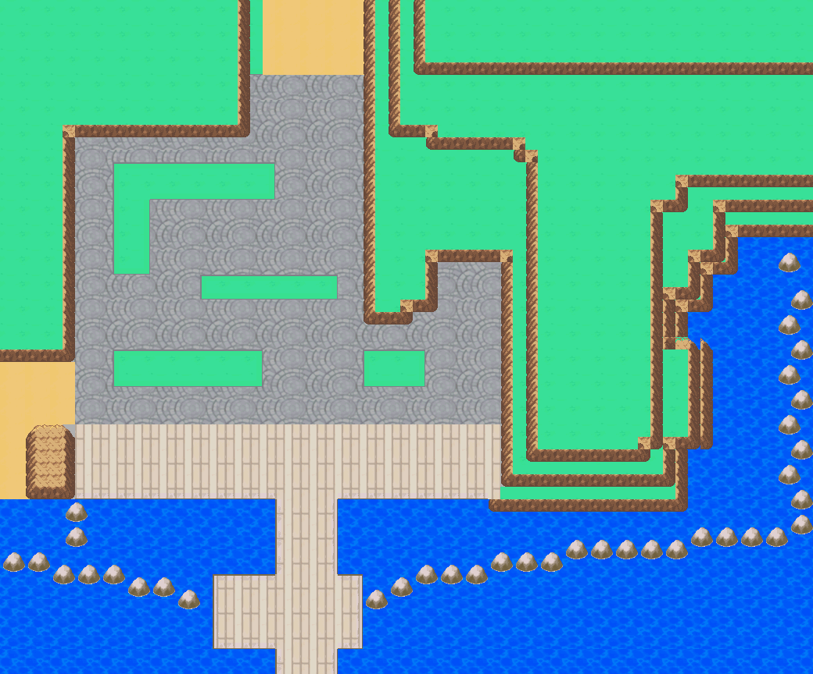

# Olivine — cleared native terrain and directional elevations

Current engine: `df08620e053e1a437557370399cac39667bbd2a4`, branch
`codex/olivine-goldenrod-playbook-20261019`, draft engine PR23.
Owner visual acceptance is pending. This replaces the object-filled exterior
for the requested terrain-building exercise; its art masters and prior evidence
remain available in history and the other source/evidence folders.

[Recorded native walk, 2:04](olivine-walking-tour.mp4) ·
[Actual gameplay views](gameplay-gallery.png) ·
[Opposing terrace faces in-game](terrace-gameplay.png) ·
[HGSS/native cliff comparison](cliff-reference-comparison.png) ·
[Cliff directions and levels](cliff-directions.csv) ·
[Every native cell](cell-ledger.csv)

## What changed

Removed trees, buildings, fences, flags, parasols, boats and stairs as requested.
Retained lawn, paved street, sand, quay/pier, ocean, shoreline rocks and the west
quay outcrop. Native implementation uses 220 reusable 16×16 metatiles across
3,510 cells, with 471 shared 8×8 glyphs. It does not slice or display a whole-map
background. All 13 native Porymap sections retain their dimensions and stable IDs.

The stopped draft incorrectly treated cliffs as undirected border textures.
The replacement traces connected relative surfaces from the original HGSS
reference, then selects directional Emerald cliff faces from the higher side.
West faces (`070`) rise east; east faces (`072`) rise west; front faces (`079`)
rise north. Native convex corners (`068/06A/078/07A`) and concave corners
(`073/074/076/077`) complete the turns. No generic blended corner or vertically
flipped cliff is used. One warm Johto color mapping is shared across the family.
The native donor is `data/tilesets/primary/general`, the same directional family
already used for this project's Route 31 work.

The main avenue/quay is relative level 0, residential terrace 1, lighthouse
terrace 2, northern upper woodland 3, and ocean -1. The coastal toe at level 0
supplies the lowest visible course below the two elevated lighthouse courses.
Opposite sides of each surface rise inward. The western woodland rises to the
west of the city; the residential and lighthouse west faces rise east. Native
engine elevation values follow those surfaces (1/3/5/7/9); cliff cells block
walking. With the stairs removed, the raised surfaces are intentionally isolated.

**Reference limits:** these are relative levels interpreted from the retained
1035×858 HGSS overview, not extracted DS height/collision data. The overview's
projected roughly 20–24px courses are fitted to 16px native rock modules. Tree-
and roof-covered returns are completed from the visible adjoining faces. The
original native canvas is padded to 1040×864. See `elevation-review.json` for
reference identity and explicit adaptations. Small reusable surface texture
cores are retained from the preceding cleared-terrain study; generated concept
contours are not the authority for elevations. The map remains a review pass.

## Native checks

- Actual Porymap exports of all 13 sections agree with decoded tiles/palettes.
- All 351 cliff cells have a recorded orientation/relative high side. Nine
  landmark planes and nine opposed-face/corner placements have independent
  checks. There are no unprotected height changes between open neighboring cells.
- Headless mGBA traversed all 2,077 open cells and tested all 8,308 directed
  movement attempts. Main city/pier has 1,090 reachable cells; the other seven
  components were separately initialized to inspect the stairless terraces.
- All 2,077 standing gameplay backgrounds and sprite composites match native
  source, with zero pixel errors or cache overflows. Cache peak is 268/1008.
- Ordinary save, cold reload, title Continue, prior Olivine and Goldenrod saves,
  and return visits pass. Previous Goldenrod backgrounds remain pixel-exact.
- 7,459 pre-Olivine native files remain unchanged. Layout/map IDs and save schema
  are preserved. Local ROM builds; no hosted CI or second clean build is claimed.

Exhaustive walking exposed an existing inclusive-end error in incoming section
selection. At the newly open `(15,13) → (16,13)` junction, it selected section 02
at y=13, one row beyond its height, instead of section 03 at y=0. Olivine now uses
an exclusive destination bound. The change is scoped to active Olivine maps;
other map selection keeps its prior behavior. The full movement audit passes
with this fix. Camera borders also continue the corresponding cliff courses,
northern entrance ground and southern pier, instead of abruptly substituting
an unrelated terrain core.

The recording is ordinary continuous movement after its initial test placement.
Separately initialized terrace captures are identified above and are not
presented as reachable from the city without stairs. Services, interiors and
external route connections remain unwired. No ROMs or player saves are tracked.

## Editable source and reproduction

The engine's native map/tileset files are the current editable authority.
Hub authoring source: `tools/gba/maps/olivine_city/elevation.py`,
`base_terrain.py`, and `source/base-terrain/`. `elevation.py` stores relative
surface polygons and the explicit native directional family. `geometry.json`,
height/material/solid arrays, and the metatile catalog document the installation.

`base_terrain.py ENGINE` is guarded to a clean `c1363f3f` baseline. It records
this installation; never replay it over later owner edits. `--preview` writes
review/source artifacts without changing engine files. `stream.py ENGINE` safely
derives the viewport atlas from current native files after subsequent edits.
The small C border/connection fixes are separate reviewed edits in the engine.

Validation commands: `base_review.py ENGINE PORYMAP_EXPORTS`,
`check_elevation.py`, `base_runtime.py ENGINE OUTPUT --toolchain TOOLCHAIN`,
`base_verify_frames.py OUTPUT`, and `base_audit.py ENGINE OUTPUT TOOLCHAIN`.
`base_record.py ENGINE OUTPUT TOOLCHAIN` records the continuous walk. Runtime
commands use the installed libmgba include/library paths via `MGBA_FLAGS`.
See build/runtime/manifests beside this file for exact identities and results.
Root evidence left from the earlier building/overlay pass is historical; this
folder is the canonical current validation set.
