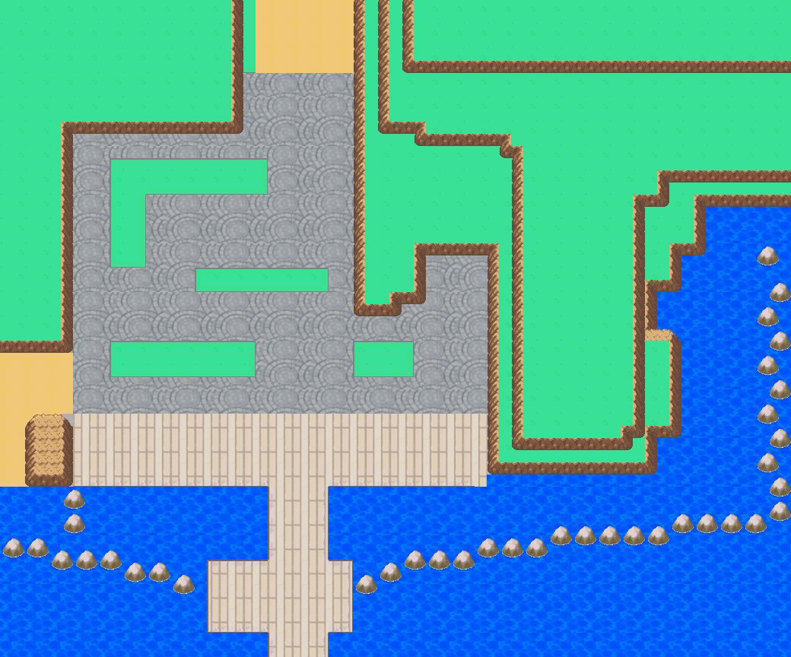

# Olivine inward corners and coastal-tier removal

Engine `0e47f9cc35cfe8f3c43764fa43109e092622d3e0`, same branch and draft PR23.
Owner review is pending. This is a local correction to the directionally accepted
terrain foundation, not another city rebuild.

[All 15 inside corners, before/after](all-inner-corners.png) ·
[Actual gameplay](gameplay-gallery.png) ·
[Updated continuous 2:04 walk](olivine-walking-tour.mp4) ·
[Original native donor use](native-donor-contexts.png)

## Changes

The prior `076/077` pieces were incorrect for these inward bends. Native Emerald
mountain placements establish `089` for the southwest inward join, `074` for
southeast, and `0BF` for the single northeast return. `donor-reference.json`
records actual Route 111 cells and neighboring native IDs. All 15 remaining
inward corners now use those pieces with the established Johto rock palette.
No rotation of a front face or generic corner blend is involved.

Removed the continuous lowest coastal grass/rock strip: 69 cells, including
20 formerly open ground cells, now carry the existing ocean tiles at matching
texture phase. The remaining wall meets the sea directly. Its transparent
exterior pixels use an exact native ocean layer beneath the rock; no grass
backing or differently quantized blue rectangles remain. The prior packer also
omitted the donor's brightest stone shade; that missing shade is restored at
these revised shore joins so it cannot become a blue hole through the rock cap.

All previously present rock pixels of retained straight faces and convex corners
are preserved exactly. Pixels outside the 127 recorded edit cells are unchanged.
Palette files, renderer code, map IDs, section dimensions, stairs and other map
content are unchanged. The original 220 metatile entries and 471 stored glyphs
are preserved; additions produce a 243-entry catalog /481 stored glyphs, with
225 metatiles and 468 viewport-atlas glyphs currently referenced.

## Verification

- All 13 actual Porymap exports match decoded native pixels and map entries.
- The 303 remaining cliff cells have direction/height records. All retained
  high-side checks pass, with no open unprotected height changes.
- Actual mGBA tests pass for all 2,057 open cells /8,228 directed movement attempts.
  All 2,057 background and sprite composites are pixel-exact; no cache overflows.
- Save, cold reload, title Continue, prior Olivine/Goldenrod saves and exact
  Goldenrod return-view comparisons pass. The original saves are untouched.
- Local build and atlas guards pass; 7,459 previous native files are unchanged.
  No hosted CI or second independent compilation is claimed.

The city/quay component has 1,076 ordinary reachable cells. Stairs remain absent;
the other six terrace components are separately initialized for exhaustive
inspection. The video is continuous city walking after its initial placement.
No routes, services, interiors or props were added. HGSS reference interpretation
and native-grid adaptations remain those documented in the foundation review,
except for the owner's explicit removal of the extra coastal course.

## Source

Native engine maps and tilesets remain editable authority. The guarded
`tools/gba/maps/olivine_city/corner_revision.py` applies this additive correction
only to a clean `df08620e` baseline; do not replay it over later owner edits.
`elevation.py` records the current direction/level model. The historical first
installer now imports `foundation_elevation.py` so later corrections cannot
silently change its original geometry. Current source arrays and metatile catalog
are under `source/base-terrain/`; `current-revision.json` distinguishes this
correction from the historical first-install `build.json`.

`base_review.py`, `base_audit.py` and `base_verify_frames.py` accept an explicit
report directory so this correction's results do not overwrite the earlier
foundation proof. The manifests, exact ROM identity and runtime results here
are the current validation set. No ROMs or player saves are tracked.
