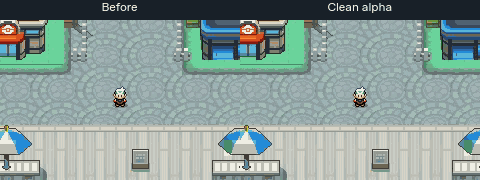
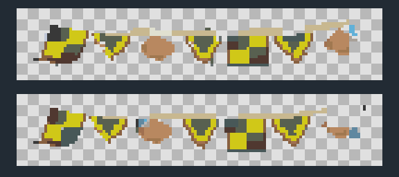

# Flag transparency correction

The first layering pass retained grass/pavement inside its foreground masks.
The owner caught this. It is corrected here; the earlier positive overlap checks
proved those masks rendered, not that their silhouettes were clean.

[Watch the updated2:41 walking tour](olivine-walking-tour.mp4). It includes extra
passes beneath both western orange emblems, in addition to both complete flag
strings and the original support/fence/lamp/waterfront probes.

## Repair

Remove1,367 captured terrain pixels from the foreground alpha. Keep1,769 actual
cloth, emblem and rope pixels. Restore the street/lawn beneath the removed backing,
including the source-colored green rectangles around orange emblems. Keep source
post heads/shafts exactly intact; six post-region comparisons have zero errors.
No collision, elevation, palette, map ID, building or renderer code changes.
Only the two existing native private sections are edited.959/1,008 buffered tile
slots remain sufficient; the earlier invisible-background atlas optimization stays.

## Checks that address the actual defect

All four real-sprite poses (central emblem, both west orange emblems and west
pennant) preserve every visible flag pixel, while29–104 player pixels per pose
remain visible through areas that the previous mask wrongly obscured. The
checkerboard preview independently exposes the alpha boundary. These are
negative-space checks as well as positive foreground-color checks.

Full actual Porymap/native parity,134 BG frames /5,145,600 pixels with zero
mismatches, continuous walking/probes, ordinary save/cold reload/Continue and
previous Olivine/Goldenrod saves pass. Guarded native reproduction and clean
committed source/atlas guards pass. No second clean compilation or hosted CI
success claimed. Owner visual acceptance remains pending.

[Sprite checks](sprite-occlusion.json) · [Post preservation](post-preservation.json) ·
[Edit ledger](native-edit.json) · [Reproduction](reproduction.json)

Engine `dc3c5bf1fe54365b65e2839b01d50fcd7f6a4e41`. `refine_flag_alpha.py` is a guarded83936f1b-baseline edit;
never replay it over newer native work. Previous videos/masks remain as history.
