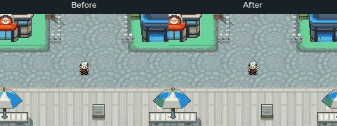

# Olivine flag underpasses — fixed

[Watch the updated2:32 walking tour](olivine-walking-tour.mp4). Same continuous
route as the [before-repair recording](../walking-tour/README.md), including both
flag strings northbound/southbound and support/fence/lamp/waterfront probes.

Both strings now cover the player along their cloth/rope silhouettes. The street
remains walkable and the support collision remains unchanged. No town artwork,
collision/elevation, map IDs, palettes or engine renderer code changes.

## Native change

Extract exact current cloth and rope pixels into a transparent foreground mask
and mark the32 affected metatile cells as split foreground. Keep the original
background below that mask; do not place opaque pavement rectangles above the
player. The displayed composite remains pixel-for-pixel identical when no sprite
is present. Source ground, architecture and all other native maps remain intact.

The derived atlas omits a background quadrant only when the corresponding
foreground quadrant is opaque at all64 pixels. This frees cache space without
changing a visible pixel or native Porymap source. Every retained quadrant and
palette is checked; full native/emulator background comparisons pass. Capacity
is999/1,008 buffered glyph slots,8,152 total glyphs and24,434 cache bytes.

## Verification

- Actual Porymap and native decode agree over3,510 cells; full city composite unchanged.
- Real sprite overlap captures have zero RGB5 errors across1,568 foreground pixels
  per span, with the player still visible immediately outside each mask.
- Same uninterrupted9,060-frame tour passes all walking/probe coordinate assertions.
- Ordinary SaveMapView/cold reload/title Continue and old Olivine/Goldenrod saves pass.
-134 captured backgrounds /5,145,600 pixels have zero mismatches; no cache overflow.
- Guarded edit reproduces the native changes byte-for-byte in an isolated baseline;
  clean committed source and both atlas guards pass. No second clean compilation
  or hosted CI success claimed.

[Central underpass](central-underpass.png) · [West underpass](west-underpass.png) ·
[Sprite occlusion checks](sprite-occlusion.json) · [Native edit](native-edit.json) ·
[Reproduction](reproduction.json)

Source `83936f1b20920137a816535dd900e7429928a79f`. This is an exterior layering correction; services, interiors,
route travel and ferry operation remain unwired. The old recording is preserved.
