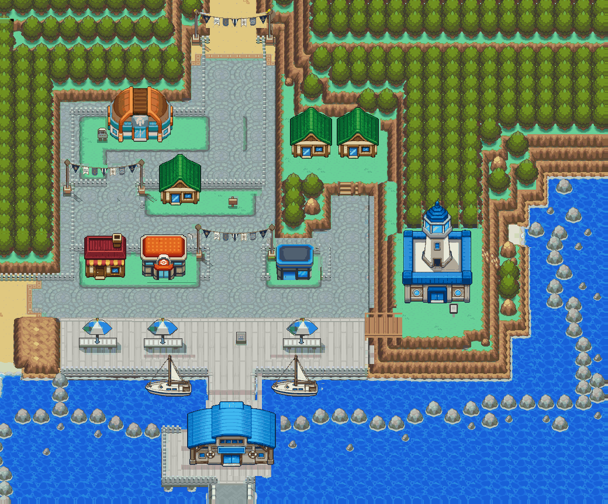
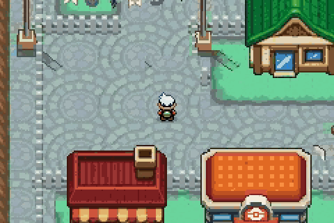
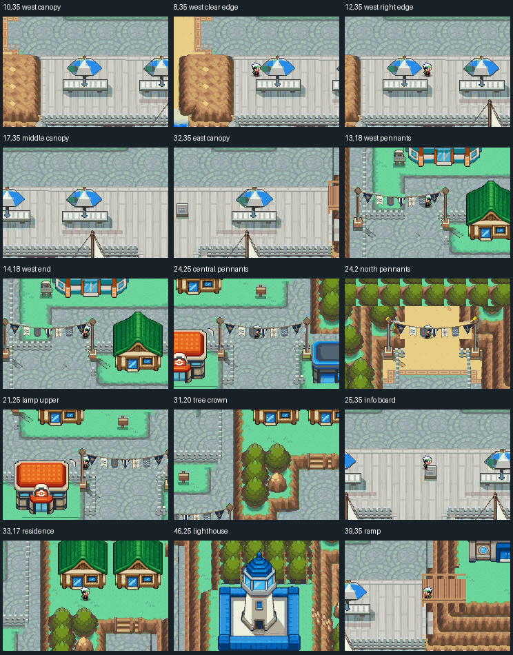
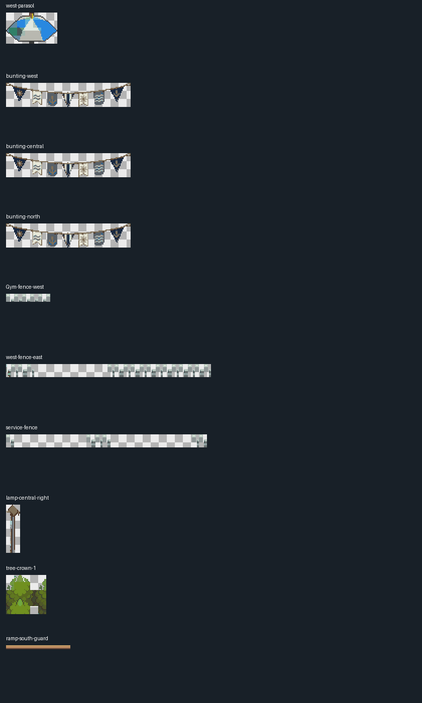

# Olivine: whole-city collision and foreground audit

The owner authorized a full flag redesign and a tile-by-tile check of umbrellas,
foreground objects and physical barriers. The existing repaired HGSS terrain and
polished architecture remain the foundation. This is the current pass; earlier
flag/alpha recordings remain historical evidence in their own folders.

[Full continuous recorded walk, 4:19](olivine-walking-tour.mp4) ·
[Chapters](chapters.srt) · [Inputs and coordinate assertions](tour.jsonl)

## Changes and placement

Three flag strings now reuse one isolated maritime bunting master: navy, sea blue,
ivory and brass, with triangles, swallowtails and rounded pennants. The new master
was generated as a transparent standalone illustration, then cropped, reduced to
native size and fitted to the existing native palette. It is preserved alongside
the native cutout under `../../source/interaction-audit/assets/`. Ground below the
old flags was repaired separately with local sand, lawn and pavement; north cliff
shoulders and existing lamps remain intact. No floor pixels belong to the flags.

All three parasols reuse one source-native, isolated cloth silhouette. Their
transparent edges reveal the player; opaque cloth covers the player. The pole
and table base block at the table, rather than blocking the entire canopy image.
Trees, lamp heads/shafts, sign boards, picket caps and small stair/ramp rails also
have explicit foreground masks. Solid bases and overhanging projections are
independent. The physical harbor ramp remains its original two-cell-wide crossing;
its deck and guards were aligned to those native cells, with locally rebuilt
cliff/lawn around the superseded projected rail corners.

The audit corrected 182 collision cells. Physical building floors now block,
including their rear and side approaches; upper roofs remain overhangs. The west
street's old offset barrier was moved onto the visible fence. The Gym's rear
fence, service-yard fences, north approach rails and dense terrace tree trunks
now block. Old projected post/sign collision cells were released and the actual
bases assigned collision. Tables, quay rails, pier edges, closed exits and water
remain blocked. All building front approaches remain reachable. The terminal
keeps its narrow rear passage under its deep roof overhang; its actual floor
begins one row below that passage.

## Every tile and actual movement

[All 3,510 cells](all-cells.csv) record terrain material, physical owner, collision,
foreground coverage and changes separately. The main evidence folder also contains
coordinate grids, collision views, individual building contexts and actual Porymap
exports. The map was reviewed for fence continuity, transparent canopy edges,
roof/wall footprint alignment, cliff/shore boundaries, pier barriers and approaches.

[Exhaustive runtime results](exhaustive-runtime.json):

- All 877 open cells tested in all four directions: 3,508 directional attempts.
- 868 cells visited through ordinary continuous walking after one initial placement.
- Nine isolated decorative pavement cells outside the west fence tested through a
  separate initial placement; no door, NPC or ordinary route depends on that strip.
- 877 actual BG captures, 33,676,800 pixels, zero native RGB errors.
- Real player/foreground compositing at each pose: zero RGB errors. Opaque cloth,
  roofs and crowns can hide the player; transparent gaps reveal it.
- Zero cache overflows, including the full continuous recorded tour.

The compositing diagnostic captures an ordinary frame, then a separate OBJ-only
frame with BGs disabled and a magenta backdrop, restoring state before walking.
Actual OAM distinguishes the semitransparent player shadow from opaque body
pixels. Its expected color uses the captured blend coefficients and mGBA's
channel expansion. Neither altered diagnostic frames nor helper placements are
presented as normal gameplay footage.

[Scrolling results](scrolling-runtime.json) compare another 1,012 moving-camera
samples / 38,860,800 pixels against exact contiguous native-world windows. Held
inputs exercise dense west streets, the north avenue, all parasols and the ramp,
in both directions. Zero RGB errors or cache overflows.

The ordinary tour initially exposed a transient glyph-cache overflow, even though
standing views fit the budget. The renderer now releases the complete outgoing
row/column before allocating its replacement. Slots still referenced by other
rows/columns remain protected; non-Olivine maps do nothing in this hook. The art
was preserved rather than reduced to conceal the problem. Final static peak is
1,005/1,008 slots, with 8,138 global glyphs and a 24,406-byte volatile cache.

## Build, preservation and reproduction

Engine source: `c1363f3f147e4b61028da9f8a86f9ababda10280`, branch
`codex/olivine-goldenrod-playbook-20261019`, [draft PR23](https://github.com/Davisfox5/pokeemerald-expansion/pull/23).
ROM SHA256: `8f6a9a3d305ac0dd7f7c3196ef6b4cfbe7fad183e824b44dbd1f4b9bbcdaf255`.

Local ARM14.2.1/newlib build, actual Porymap parity, all approaches, ordinary
SaveMapView/cold reload/title Continue and previous Olivine/Goldenrod saves pass.
Goldenrod return/prior-save BGs remain pixel exact. All 7,459 protected previous
native files, map-group prefixes, layout IDs, palettes, elevations and save schema
are preserved. Both atlas guards and source hashes pass from a clean detached
checkout. [Reproduction](reproduction.json) compares 47 guarded native/atlas files
exactly with the isolated baseline generation. The renderer fix is a separate
three-file C/header edit verified by compilation and real movement.

`city_interactions.py` is a provenance edit guarded to clean engine `dc3c5bf1`
and hub `c82106e` source-layer hashes. Never replay it over current maps. Restore
those baseline layers in an isolated hub checkout before reproducing. Ordinary
edits must use current native source. `audit_runtime.py` and `audit_scrolling.py`
are verification tools; their raw VRAM/OAM/diagnostic captures remain scratch
artifacts, while summaries and selected real frames are committed here.

No second clean-checkout compilation or hosted CI success is claimed. This is
an exterior art/interaction review: services, interiors, NPCs, ferry operations,
Lighthouse floors and route/destination warps remain unwired. HGSS overview
projection and hidden footprints are interpreted rather than extracted DS data.
Owner visual acceptance remains separate from these checks.
