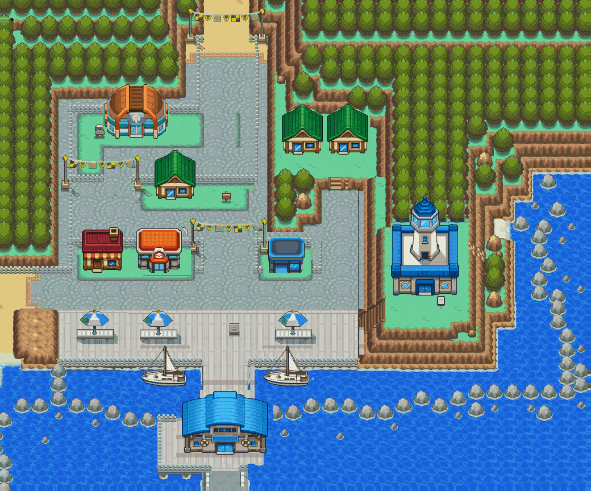

# Olivine receiving-context pass — 2026-10-20

Owner direction: retain HGSS terrain textures and the accepted polished building
masters; clean old objects fully and rebuild their receiving context before placement.
The generic terrain pass in `../rebuild/` is rejected history.

[Before / after](comparison.png) · [Complete clean ground](cleaned-ground.png)

## Receiving areas reviewed

| Area | Repair evidence |
| --- | --- |
| West residence | [Full fence, lawn and old contact shadow](01-context.png) |
| Mart | [Original lamp, fitted placement and rebuilt rear fence](02-context.png) |
| Lighthouse | [Forest behind upper tower, lawn and separate entrance sign](03-context.png) |
| Boats | [Entire old silhouette, water and uninterrupted quay rails](04-context.png) |
| Terminal | [Old upper window, roof, facade and marker removed; deck/water separated](05-context.png) |
| Gym | [Complete rear railing and old shadow envelope](06-context.png) |

Additional service-building rear fences are reconstructed through the full old
roof footprints. Contact shadows and small support/outline fragments were found
in the clean-ground review and removed before the final placements. The canonical
Mart moves from x464 to x469 to clear the preserved lamp; no floor is attached to
the master. Center and Mart source colors are checked exactly in the native decode.

`../../source/middle-ground/repairs.json` records donor rectangles, repair bounds,
master placements and untouched-source pixel counts. Donors come from unobscured
original terrain, never from an already patched intermediate. Forest and paving
courses are reused at compatible phases inside their surfaces to fit hardware;
woodland contours, cliff edges and receiving boundaries remain intact. The native
terrain palette is reduced; this is retained and repaired HGSS imagery, not a
claim of independently redrawn ground or extracted original collision.

## Native integration

All13 section IDs and dimensions stay fixed. Existing collision/elevation is
preserved except two documented lamp cells: old added base (28,27) opens and
original retained lamp (29,27) blocks. Prior collision corrections and save/cache
fixes remain. Metatile tables have512 safe entries per bank so neighboring private
IDs cannot read beyond the attribute arrays during a section crossing. Mirrored
atlas glyphs share storage with composed flips; every native quadrant is checked
for exact decoded pixel and palette preservation.

Current native capacity:8,088 global glyphs, maximum973/1,008 in a buffered16×16
ring,24,306 cache bytes. The actual Porymap export, native decode and in-game
BG comparisons are recorded in the parent evidence folder. Passing those checks
supports integration; owner visual acceptance remains pending.

Exterior only. No interiors, shop/healing services, ferry operation, route travel
or Lighthouse floors are wired. No player save or ROM binary is published.
