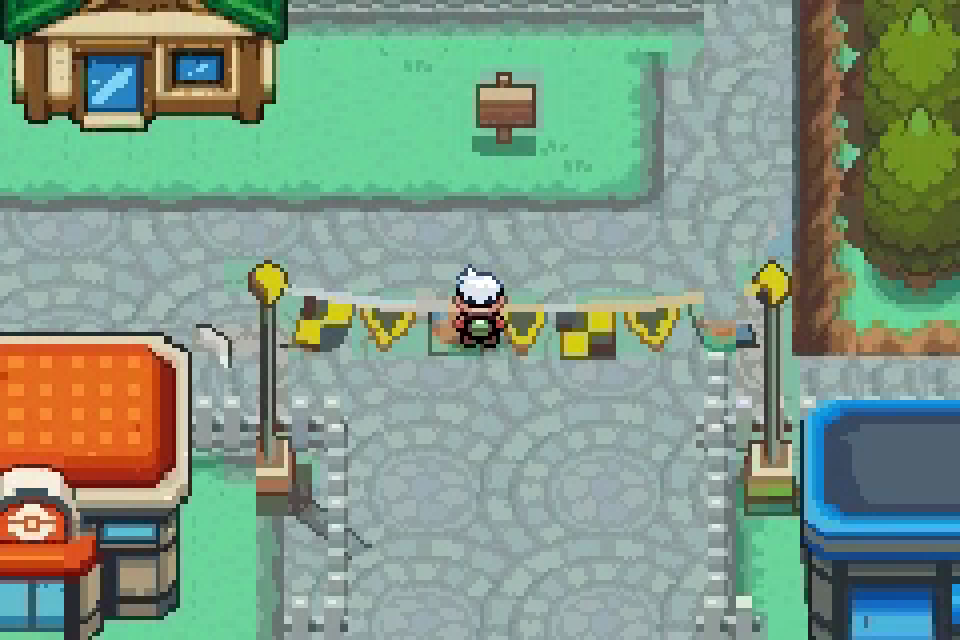

# Olivine recorded walking review — 2026-10-20

[Watch the complete2:32 MP4](olivine-walking-tour.mp4) · [Flag-crossing preview](flag-crossings.gif)

Actual mGBA framebuffer capture from the current unchanged ROM,9060 frames at
59.7275fps.4x nearest-neighbor presentation, chapter labels above the screen,
silent. The player is positioned once before recording; all subsequent travel
is uninterrupted directional input across the real map connections. No ROM,
map or player save is modified. Runtime coordinates are checked after every
step and blocked probe. Raw input/frame logs and chapter times accompany it.

## Finding: flags need a foreground pass

Both flag spans permit walking in both directions. The player currently draws
over the hanging flags (central crossing around00:04, west around00:13).
The flags are retained in the background terrain; they need a separate foreground
mask/layer so the player passes beneath them. The western support post correctly
blocks movement. This recording deliberately shows the current issue before a
repair; it is not evidence that flag occlusion is already correct.

Other probes confirm the west fence, Mart-side lamp, quay railing and lighthouse
retaining wall block. Building entrances remain closed as documented. The tour
also visits the Gym, residences, Center, cafe, harbor/boats, terminal and lighthouse.

## Chapters

| Time | Walk / probe |
| --- | --- |
| 00:01 | Central flags - northbound |
| 00:05 | Walk to west festival gate |
| 00:10 | West flags - northbound |
| 00:14 | West flags - southbound |
| 00:17 | West fence approach |
| 00:20 | West fence blocks |
| 00:22 | West flag support approach |
| 00:26 | Flag support blocks |
| 00:28 | Gym approach |
| 00:30 | Gym entrance currently closed |
| 00:32 | North residence west |
| 00:50 | North residence east |
| 00:52 | Return to central flags |
| 01:03 | Central flags - southbound |
| 01:07 | Mart-side lamp approach |
| 01:11 | Retained lamp blocks |
| 01:13 | Pokemon Center approach |
| 01:20 | Cafe approach |
| 01:23 | Quay railing approach |
| 01:28 | Quay railing blocks |
| 01:31 | Harbor promenade and boats |
| 01:38 | Ferry pier and terminal |
| 01:48 | Terminal currently closed |
| 01:50 | Walk to lighthouse |
| 02:12 | Lighthouse currently closed |
| 02:14 | Lighthouse retaining wall |
| 02:16 | Retaining wall blocks |
| 02:18 | Mart approach |
| 02:27 | Return to city center |

Source engine `86b1e47e0305596bb76fd1a1ff94f3b47947e47d`. ROM SHA256 `d5aa20b933f2040c7bd3b52a576fa3ec76234b150dcb99eb4f3c729ef170eb97`.
Recorder: `tools/gba/maps/olivine_city/record_tour.py`. No cache overflow or
coordinate assertion failed. Native pixel-parity evidence is recorded separately;
this video focuses on observable walking, collision and sprite layering.
