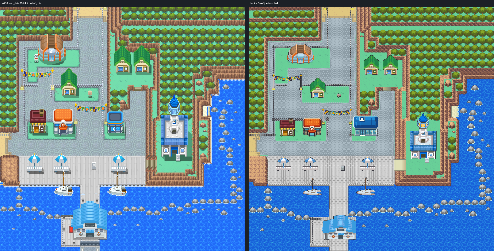
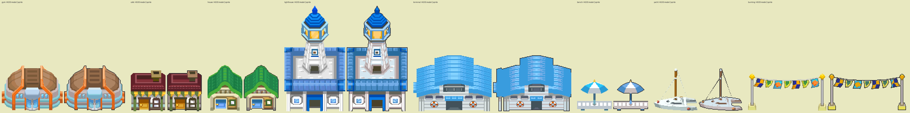

# Olivine City: native exterior built from Gen 3 elements

Olivine as one native 64x64 Gen 3 map, laid out cell for cell from HeartGold/SoulSilver's
own map data and drawn with Gen 3 pieces, by the method of
[Blackthorn](../blackthorn-city/README.md) and [Cianwood](../cianwood-elements/README.md):
each HGSS element (cliffs, terraced forest, cobbled plaza, lawns, fences, deck, quay, pier,
sea, sea rocks, buildings, props) becomes a Gen 3 element that does the same job, in
Olivine's HGSS colours. Editable source is engine branch `claude/olivine-city`, which builds
on `claude/cianwood-city` (#27). Owner visual acceptance is pending.

This replaces nothing. Codex's Olivine (engine PR #21 `codex/olivine-city`, evidence on hub
`codex/olivine-city-evidence`) traces a screenshot into three district maps joined by
fades (`JohtoOlivineCity`, `JohtoOlivineHarbor`, `JohtoOlivineQuay`, `MAPSEC_JOHTO_OLIVINE_CITY`).
It is left as it is. The two install different names but both append to
`gMapGroup_Cherrygrove`, so only one Olivine should merge.



## The map

| | |
| --- | --- |
| Map | `OlivineCity`, 64x64, `gMapGroup_Cherrygrove` id 50 (Center 51, Center upstairs 52, Mart 53), `MAPSEC_OLIVINE_CITY` |
| Primary | `gTileset_OlivinePrimary`, derived from CherrygrovePrimary (below): 512 tiles, 128 of them Cherrygrove's at their own indices |
| Secondary | `gTileset_OlivineCity`: 454 of 496 tiles (16 kept for door animation), 512 metatiles; 53 more metatiles in the primary |
| Palettes | banks 0, 1, 3 Cherrygrove's (ground, sea, trees); one exact fit over the other ten: the Gym with the yachts (2), the cafe (4), the houses (5), the Lighthouse with the parasol benches (6), the terminal with the notice boards (7), rock and paving (8), the harbour greys (9: deck, quay, fences, sea rocks), the Mart (10), C06 over 11 and 12, the flag lines in 12's free slots |
| Border | open sea (Cherrygrove's animated sea, in the sea's 32 px phase) |
| Music | `MUS_SLATEPORT` |

## Why Olivine has its own primary

Olivine has a Center, a Mart, a Lighthouse, a ferry terminal, the Gym's hall, a cafe and
three houses. Rendered at C06's angle and trimmed (mirrored halves, folded edge shifts) they
still come to about 500 tiles, the Center and Mart to 167, the ground to 160: 838 distinct
tiles, against 496 in one secondary. Cutting 350 tiles of buildings would have cost the
look the owner liked in Cianwood. So the map gets a primary of its own,
`gTileset_OlivinePrimary`, made from CherrygrovePrimary:

- tile 0 and the 92 sea tiles CherrygrovePrimary's animation rewrites (tiles 1-92) stay at
  their own indices, and so does every other Cherrygrove tile Olivine draws (35 more); the
  primary keeps Cherrygrove's animation callback, so the sea moves exactly as it does there
- banks 0, 1 and 3 are Cherrygrove's, colour for colour; banks 2, 4 and 5 carry nothing
  Olivine keeps, so they are learned
- the other 384 tile slots and banks hold Olivine, and every Cherrygrove metatile that still
  draws as it did keeps its id (17 do); the rest of the primary's metatile ids hold Olivine's

It is still one ordinary tileset pair: no engine code changed, no streaming. Limit: a future
route connected to Olivine draws its border strip with Olivine's tilesets, as every Gen 3
connection does, so only the Cherrygrove metatiles listed above look the same across it.

## Reference: decoded HGSS data

`hgss_render.py` reads pret/pokeheartgold's packed archives (revision `9d8b7591`, hashes in
`source/hgss/hgss-render.json`): land_data chunks 58-61, area data bank 7, the map and
building textures, and zone events T26 (`source/hgss-events.json`: 9 warps, 6 signs, 9
objects). Its 1:1 render at true heights (`source/hgss/hgss-reference-true-heights.png`) is
the review reference. The element ledger (`source/elements/ledger.json`, `ledger.png`)
labels every cell from the top-down height map, materials and permissions:

- Terrace levels are heights above the town floor (height 1). HGSS models its tree crowns
  as terrain, a level above their trunks, so a tree cell takes the level of the ground under
  its trunk; a rock cell takes the top of its rock pixels.
- Trees: one per trunk (the brown core of `tree01_un`), on the 2x2 grid HGSS plants them on.
- Fences: blocked floor cells whose `fence_a` faces show in the lifted render (the top-down
  view sees only their tops). Other blocked floor cells are plain blocked ground.
- Sea rocks, small rocks, boulders and stones: HGSS's own `sea_rock`, `sea_rock_m`, `rock01`
  and `etc_a` blobs (a wide `sea_rock` blob is touching rocks, 481 px apiece).

## Element vocabulary

| HGSS element | Gen 3 piece | Colours |
| --- | --- | --- |
| Cliffs, terraced walls (`wall01_g`, `wall01_d`, `cliff01gs`) | FRLG General mountain set, autotiled per 8x8 quadrant, a top-layer overlay | HGSS rock ramp (Blackthorn's) |
| Lawns (`grass01gs`), sea | Cherrygrove's own tiles | CherrygrovePrimary 0, 1 |
| Road to Route 39 and the west exit (`road01`) | Cherrygrove's path sand | CherrygrovePrimary 0 |
| Kerb between road and plaza (`as_fe01_r`) | HGSS's brick band, 8 px bricks | Cherrygrove's path colours (bank 0) |
| Cobbled plaza (`as_fe01`) | Slateport's paving nine-slice (Emerald's port city); its scalloped rim onto lawns is HGSS's kerb round the lots | HGSS's cobble blues |
| Deck and pier (`as_fe02`) | Vermilion's pier planks the Gen 3 way, two 8 px boards a cell, joints staggered, running north-south as HGSS's do; a dark side over the sea | HGSS's deck greys |
| Quay edge (row 46) | HGSS's low posts, stone lip and dark deck front | harbour greys |
| Chain fences (`fence_a`) | posts every 8 px with caps and a chain; vertical runs end on | harbour greys |
| Stone stair, Lighthouse ramp (`slope`) | treads and risers, across for the stair, up and down for the ramp | Cherrygrove bank 0 tans |
| Trees (`tree01_*`) | HGSS's own Olivine tree, 32 px, cut from its terrain with trunk and shadow | Cherrygrove's tree greens (bank 3) |
| Sea rocks, small rocks | HGSS's `sea_rock` resampled (Cianwood's) | harbour greys, foam, slate |
| Boulders, stones | HGSS's `rock01`, `etc_a` | rock ramp |
| Rock climb wall | HGSS's `r_climb` holds at their own size | rock ramp |
| East cove beach | Cherrygrove's sandbar edge cell | CherrygrovePrimary 0, 1 |

Buildings and props are HGSS's own models and textures rendered at C06's angle
(`sprites.py`, `hgss_camera.view`), each squeezed across to its HGSS blocked footprint:
the Gym (as a civic hall, below), the cafe, the three houses (one sprite), the Lighthouse,
the ferry terminal, the parasol benches, the two yachts, the three flag lines, the city sign
and two notice boards. The Gym, the benches and the houses' roofs mirror on an 8 px axis;
the terminal mirrors about its door, keeping the canopy over its west platform; the
Lighthouse mirrors everywhere but its tower, which HGSS lights from the left. Benches,
yachts and signs draw in a loaded building's palette (the AGENTS rule for small props).
`evidence/elements/sprites-vs-hgss.png` puts each sprite beside its unquantized model.



The owner-locked C06 Center and the shared Johto Mart (Blackthorn's approved copy, hashes in
`check_elements.py`) stand with their doors on HGSS's Center and Mart doors, pixel exact.

## Canon

DESIGN.md: Olivine has no Gym. The Gym's building stays as a civic hall in its HGSS lot,
its door solid; the emblem decal on its plaque (`as_gym_w`) and the Gym sign are left out.
The sign texts are HGSS's: "OLIVINE CITY / The Port with Sea Breezes", "OLIVINE PORT /
FAST-SHIP PIER", the Lighthouse's. No dialogue, service or district is invented.

## Adaptations (45 cells, listed in `evidence/elements/pack-C.json`)

- 30 cells HGSS blocks because its taller 3D buildings stand over them are open where the
  Gen 3 sprite misses them (13) or reaches only their lower half with a roof's top edge (17).
- 6 open cells are inside the shared Mart, two cells wider and taller than HGSS's; it covers
  the north and east fence of its lot.
- Doors without interiors (the hall, the cafe, the three houses) and the Lighthouse's and the
  port's warps are solid. The pier ends at the terminal's roof; the two rows HGSS's terminal
  covers there are open deck.
- The east-west Rock Climb wall is `MB_ROCK_CLIMB`, solid until the field move exists.
- The flag line between the Center and the Mart stands 0.75 cells west, so its east pole
  clears the wider Mart. Flag lines are 8 cells wide (HGSS's are 8.8).
- Where a building and a tree, fence or rock share an 8x8 tile, the building keeps it and the
  other's pixels there go (no bank holds both): 1,213 pixels, mostly treetops behind the
  Lighthouse's lantern and fence ends behind roofs.
- The terminal's red floor mat (`d_mat01`) lies on the floor, so it is left out with the other
  painted floor faces.

## Verification (engine `6314c7da`, ROM `7164b7aafb7c…`, not committed)

- **Exact colour**: every visible pixel decodes to its 5-bit colour (817,856 of 817,856).
- **Native audit** (`check_elements.py`, `evidence/elements/native-audit.json`): the installed
  map decodes to the packer's image; behaviour, collision, elevation and layer type match the
  ledger in all 4,096 cells; the Center and Mart pixels are exact and their masters' hashes
  match; the primary keeps Cherrygrove's tiles 0-92 and banks 0, 1, 3 and its animation
  callback; budgets hold; existing map ids are preserved; only Olivine files changed. 17
  approaches reachable (the east cove by Surf). Unreachable open cells are HGSS's own
  enclosed strips: the lanes outside the north road's fences (they open only onto Route 39),
  the terminal's west platform and dock, the rock-climb nook, two strips between walls.
- **Headless mGBA** (`runtime_elements.py`, `evidence/elements/gameplay/`): 41 captures, the
  map layers rebuilt from VRAM match the native map with 0 mismatched pixels (so the derived
  primary and its sea animation load as designed); walk-behind BG1 covers the player at 9
  spots (hall roof, house ridge, flag line, Mart roof, Lighthouse frame, parasol, terminal
  roof, yacht mast, city sign); BG1 clear at 11 building fronts; stair and ramp walked; Center
  (both floors) and Mart entered and left; Cherrygrove, Blackthorn and Cianwood unchanged;
  ordinary save, cold reload and Continue.
- **Porymap 6.3.1** (`porymap.py`, `evidence/porymap/results.json`): the city's export equals the
  native decode (0 of 1,048,576 pixels differ); saving leaves every Olivine file byte-identical.
- **Deterministic**: two runs under different `PYTHONHASHSEED` give identical packed arrays.

## Rebuild

```
python3 tools/gba/maps/olivine_elements/hgss_render.py /path/to/pokeheartgold gba/art/olivine-elements/source/hgss
python3 tools/gba/maps/olivine_elements/hgss_events.py /path/to/pokeheartgold gba/art/olivine-elements/source/hgss-events.json
python3 tools/gba/maps/olivine_elements/sprites.py /path/to/pokeheartgold
python3 tools/gba/maps/olivine_elements/elements.py /path/to/engine /path/to/pokeheartgold
python3 tools/gba/maps/olivine_elements/pack.py /path/to/engine C
python3 tools/gba/maps/olivine_elements/install_elements.py /path/to/engine C     # first authoring only
python3 tools/gba/maps/olivine_elements/check_elements.py /path/to/engine C
python3 tools/gba/maps/olivine_elements/runtime_elements.py /path/to/engine gba/art/olivine-elements/evidence/elements/gameplay C
python3 tools/gba/maps/olivine_elements/porymap.py /path/to/engine /path/to/porymap C
python3 tools/gba/maps/olivine_elements/review_elements.py C
```

Review sheets with cell numbers: `evidence/elements/review/`. Until the owner edits or
accepts the map it is regenerated from these tools each round; after that, edit natively.

## Limits

- No interiors for the hall, cafe, houses, Lighthouse or port; no NPCs, items or hidden
  items placed; no connections to Routes 39 and 40 yet.
- 42 secondary tiles and no primary tile slots are spare; new art must free tiles first.
- Rock Climb is not obtainable yet, so the nook behind the Lighthouse is untested in play.
