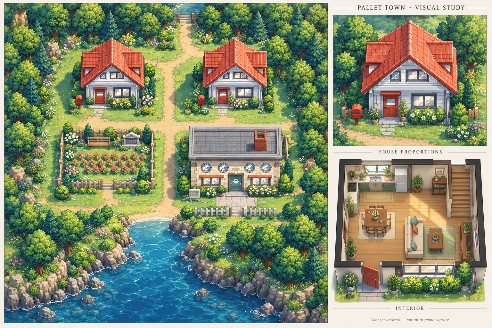

# Pallet visual redesign — GBA retained

The owner rejected both previous native Pallet versions and explicitly retained
GBA while requesting dramatically better art and spatial design. The problems are
distorted house geometry, cramped receiving space, noisy enlarged pixels and crude
interior forms. Passing build/traversal checks did not address those problems.

This is generated concept artwork, not a native map or an in-game capture. It is
not accepted artwork, and it does not establish feasibility at 240×160. Its
reworked garden, paths, coastline and interior arrangement are visual proposals.
Actual HGSS model conversions remain required for production architecture.

The intended changes are clean roof intersections and facade proportions,
properly sized doors/windows, usable yards and entrance approaches, restrained
ground texture, consistent furniture scale, and clearly organized interior
living areas. Native construction must allocate enough map space to assets and
clean their edges deliberately, without stretching individual facade strips.

Preserve the three Pallet buildings and their recognizable relationships, the
memorial garden, north exit and southern water exit. Preserve stable source IDs
and prior saves. Both previous PRs remain historical rejected proposals.

The high-resolution foliage and lighting are direction references, not promises
of GBA output. Judge converted assets in a 240×160 viewport and show that result
inline alongside whole-map previews before calling the map finished.
