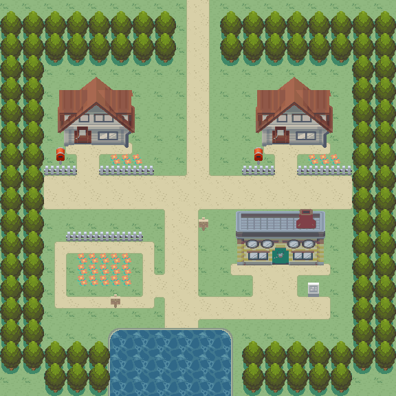
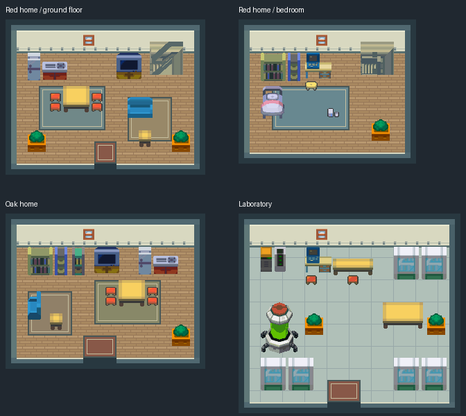
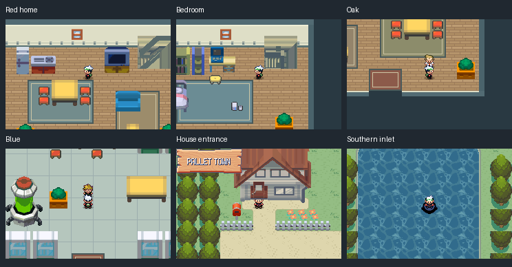

# Pallet Town — native GBA revision

This revision replaces the rejected Pallet layouts and art directly in
pokeemerald-expansion. The target remains GBA. HGSS building and furniture models
supply the assets; decoded FRLG maps supply the original landmark and material
reference. Owner visual acceptance remains pending.





## What changed

- The exterior is 36×36 metatiles. Both homes have full lots and separate entrance
  paths. The lab has a forecourt; the southwest flower garden and southern inlet
  remain in their FRLG relative positions.
- Houses are rendered as complete HGSS meshes, with one camera transform per
  asset. Roofs and walls retain separate color budgets. The old piecewise facade
  squeeze is gone. Door panels fit the native animated opening.
- The conversion retains Nitro vertex colors and adds consistent face lighting.
  Model 101's cushion joins, for example, were lost when vertex colors were ignored.
  The local decoder assembles primitives only when a vertex is emitted.
- Ground floors have kitchens, dining areas, sitting areas and complete room
  boundaries. The bedroom and lab use consistent furniture proportions. Room
  dimensions are 18×14, 16×13, 18×14 and 20×18.
- Oak and Blue use their existing canonical sprites and dialogue. Their two
  graphics definitions and original palette registrations now compile for Emerald; the inherited FRLG-only guard
  previously left their sprites invisible. Runtime checks assert their visibility.
- The converted HGSS water animates in eight phases. A Pallet-only camera border
  continues the inlet south, replacing the previous off-map forest across it.

These are deliberate spatial adaptations requested by the owner, **not an exact
one-to-one FRLG reconstruction**. The original 1,030 reference cells retain their
own material/traversal trace. All 2,368 receiving cells have independent ground,
foreground, collision, elevation and behavior records. No original-reference
cell is counted as a traversal match merely because a new layout exists.

## Editable source and process

Engine: [draft PR #45](https://github.com/Davisfox5/pokeemerald-expansion/pull/45),
`codex/pallet-native-revision`, commit
`14f116de7bb0aa020357e3be34f47264c9b8577f`.
All five stable maps remain at group 80, IDs 43–47. Warp/event order and unrelated
maps, shared tilesets, campaign flags and saves are preserved. Use Porymap 6.3.1
on the engine checkout. Native engine source owns subsequent edits; do not replay
these provenance scripts over owner changes.

`source/` contains full HGSS model identities, editable layers, original FRLG
renders and numbered sheets, original material/traversal CSVs, native per-cell
ledgers, Porytiles input/output and palette adaptation records. Derived original
art is credited to Game Freak / Nintendo / Creatures. Donor revision:
`9d8b7591f09b65804da2fb2dfd56f320633e0d36`.

Tool sequence, from the hub root (paths in the authoring scripts describe this
workspace's read-only donor and qualified tool installations):

```sh
python3 tools/gba/maps/pallet_native/assets.py
python3 tools/gba/maps/pallet_native/assemble.py
python3 tools/gba/maps/pallet_native/pack.py ENGINE PORYTILES_LEGACY
python3 tools/gba/maps/pallet_native/doors.py ENGINE
python3 tools/gba/maps/pallet_native/water.py ENGINE
python3 tools/gba/maps/pallet_native/border.py ENGINE
python3 tools/gba/maps/pallet_native/actors.py ENGINE
# Porymap exports, then serial generated / parallel ROM build
python3 tools/gba/maps/pallet_native/review.py ENGINE PORYMAP_EXPORT_DIR
python3 tools/gba/maps/pallet_native/runtime.py ENGINE OUTPUT_DIR
python3 tools/gba/maps/pallet_native/rom_art_audit.py ENGINE OUTPUT_DIR
```

The global per-map palette cleanup merges a few close colors while retaining
identical colors across tile seams. It never replaces a tile by an unrelated
nearest tile. Shared canopy colors and the water animation ramp stay exact.
Hardware usage and actual output checks are in `evidence/pack.json`,
`native-audit.json`, `rom-art-audit.json`, and the runtime records.

## Verification

The final build passes all 19 mGBA phases, including 709 blocked-edge probes,
all doors/stairs and returns, original Oak/Blue sprite palettes and visibility,
eight-phase water animation, and ordinary save/cold reload/title Continue on
every map. Actual ROM metatiles, VRAM tiles and palette colors match the compiled
source (with the explicitly animated water phases). Porymap and native renders
match across all 2,368 cells. Exact identities are in `evidence/build.json`.



Remote workflows are listed as active, but GitHub returned no runs/checks for this
branch. Local validation is recorded; remote CI is not claimed green.

## Limits

Route 1 and Route 21 connections, campaign access and HM acquisition are not wired.
The off-map boundaries remain closed. Oak and Blue retain the existing proposed
Pallet dialogue; this does not add campaign events or furniture gameplay.
Ordinary saves are checked on the new layouts. Old experimental Pallet coordinate
saves are not migrated; their files are untouched. Production has no accepted
Pallet layout to migrate. Visual approval remains with the owner; technical checks
are not visual acceptance.
