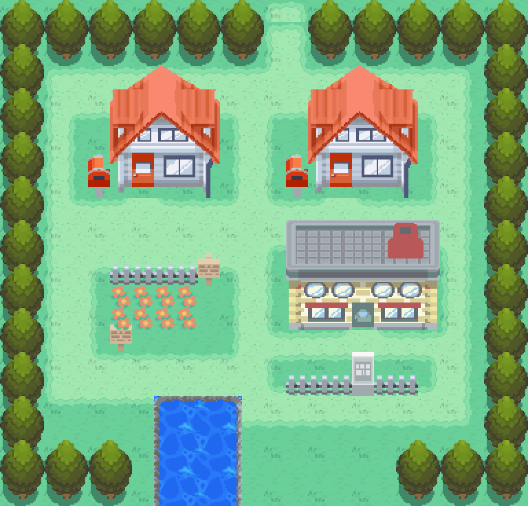
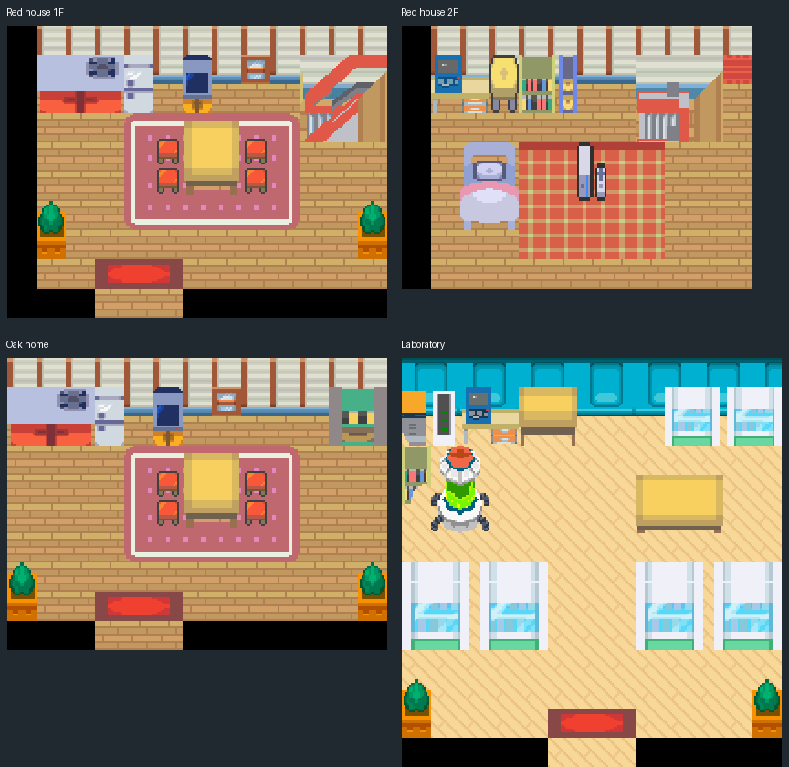

> Rejected by the owner for visual quality. The current direction retains GBA and requires a substantial art/spatial redesign; see [the visual study](../pallet-art-redesign/README.md).

# Pallet Town — fresh FRLG trace and HGSS conversion

The previous Pallet proposal was rejected. This rebuild starts with decoded FRLG
geography and freshly decoded HGSS models. It fixes the compressed house fronts,
broken fence posts, indistinct light-lawn clearing, clipped perimeter trees,
missing bedroom rug and static water in that proposal.

Editable source: [engine PR #42](https://github.com/Davisfox5/pokeemerald-expansion/pull/42),
`codex/pallet-town-rebuild` at `b02c5c97c070368592fc1b60c0c679aa816d5a79`.



[Original/native comparison](evidence/ApocPalletTown-comparison.png) ·
[Numbered original](evidence/ApocPalletTown-registered-reference-grid.png) ·
[Numbered native](evidence/ApocPalletTown-native-grid.png) ·
[Rejected/current comparison](evidence/ApocPalletTown-before-after.png) ·
[Actual gameplay](evidence/gameplay-review.png) · [Coordinate review](REVIEW.md)



## Reference and material trace

FRLG is the geographic reference, decoded from the original maps/tilesets in the
shared expansion source. Each original cell registers to one 16×16 native cell.
The exterior's original 24×20 core sits at native offset **(0,1)** in a 24×23 map.
One north row and two south rows complete the taller shared tree silhouettes.
Only the added apron extends original edge traversal. The four interiors keep
their original dimensions and registration.

All **1,030 original cells** retain collision, elevation and behavior. The final
maps contain **1,102 cells**, including the 72 explicitly identified apron cells.
Original pixels/entries are in each `source/ApocPallet*/decoded.npz`; the material
CSVs and separate traversal JSONs record the reference, native entries, visible
features, hidden-ground interpretations and adaptations per cell. Pixel parity
is reported as conversion proof, separately from the material/coordinate review.

HGSS source is pinned to `Davisfox5/pokeheartgold@9d8b7591`. Field models
313/314 provide the houses/lab, 310/311 the receiving doors, and 29/30/31 the
signs/mailboxes. The four room meshes and `bm_room` models provide the furniture,
equipment, stairs and room materials. Model 114 supplies complete potted plants.
The accepted Cherrygrove lawn and T01 tree with its contact shadow remain shared
art. Archive identities and shared-art hashes are in [provenance](source/provenance.json).
Original selected models, projected assets, native fits and editable layers are
retained. No rejected assembled image, native tile sheet or palette is an input.

## Conversion and local joins

Receiving ground is assembled before foreground objects. The original light-lawn
mask remains lawn; its full clearing and mixed-square rims stay readable. Native
trees use disjoint 2×2 root beds, complete canopies, contact shadows and north to
south draw order. Every original flower/fence/sign/building/shore footprint is
registered to the reference grid.

The houses use separate roof and facade fits: a complete 32-pixel facade is
reserved instead of compressing the whole tall model uniformly. The roofs extend
over two original northern lawn rows; those rows remain walkable behind the roof.
Doors retain the original columns and visible baselines. Complete fence post
heads and rails replace the previous middle-strip crop. The shore lip keeps the
original pixel silhouette with HGSS rock colors. Water scrolls its converted HGSS
texture over eight native phases; the shore and unrelated art stay fixed.

Each asset family is reduced to 15 opaque RGB5 colors without dithering; transparent
pixels do not consume the budget. Explicit palette assignments then let Porytiles
pack every assembled pixel exactly. Private room primaries avoid reducing unrelated
furniture families together. Native deduplication requires identical pixels,
behavior and layer role. Outdoor foreground occludes actors; interior floor/rug
and furniture layers remain behind them. All three doors have native animations
that preserve their complete closed receiving pixels.

HGSS interior adaptations include the lab's wood floor and a refrigerator in the
FRLG telephone footprint. These are declared model/material adaptations, not claims
of FRLG pixel identity. Original void cells, doors, stair axes, landings and returns
are preserved. The original unused Red-house warp in black void stays omitted.

## Canon and interactions

Blue is Kanto's professor; Oak is retired and lives here. Read-only dialogue and
Red's memorial plaque follow those DESIGN.md entries and remain proposals. The
town, both Red-house floors, Oak home and lab are playable. No donor starter gifts,
old campaign triggers, rewards, encounters, battles or persistent flags are imported.

Map IDs remain group 80 / maps **43–47**, with no renumbering of existing maps,
layouts, warps or events. The ordinary Cherrygrove start is preserved. The existing
development menu (**R + START**) can warp to group 80, map 43. Route 1 and Route 21
remain unwired; campaign access and obtaining Surf are outside this location task.
At the unconnected southern boundary the engine still draws its forest border;
this is not a completed Route 21 view. Prior saves/workbenches remain intact;
arbitrary old Pallet-coordinate saves were not migrated or certified compatible.

## Actual output checks

- Full ROM build with ARM GCC 14.2.1; Porytiles 2.0.0 legacy CLI.
- Actual Porymap 6.3.1 loader/render/save exports for every floor: zero pixel
  differences from the decoded native maps. This was headless, not a desktop UI run.
- All 1,102 cells: zero RGB5 differences from editable assembled source; all
  1,030 registered original cells preserve independent traversal attributes.
- Actual ROM metatiles/attributes and captured mGBA VRAM/palettes match source or
  the explicitly recorded water phase. All 16 animated tiles share one phase.
- Nineteen mGBA 0.10.5 phases pass: continuous walking through every floor, both
  stair directions, all three animated doors/returns, Blue/Oak/memorial, **317
  blocked-edge probes**, foot/water separation, Surf/dismount, a complete water
  animation cycle without unrelated VRAM changes, ordinary 128 KiB flash saves,
  fresh-process cold reload and title-screen Continue on every map.

[Native audit](evidence/native-audit.json), [ROM/VRAM audit](evidence/rom-art-audit.json),
[runtime results](evidence/runtime/results.json), and [exact identities](evidence/preservation.json).
Remote CI is reported separately in publication metadata. No ROM, player save,
credential or tool executable is committed. Visual acceptance remains with the owner.

## Editing and reproduction

Open the engine branch directly in Porymap. Its committed native files own future
edits. These scripts reproduce this authorized initial rebuild; do not replay
them over subsequent owner edits. Python dependencies: Pillow and NumPy; the
qualified HGSS renderer also uses SciPy. See the shared source/toolchain rules.

```sh
# Read-only original decoding; raw output stays outside the engine checkout.
python3 tools/gba/maps/pallet_town/hgss.py HGSS_CHECKOUT RAW_OUTPUT
python3 tools/gba/maps/pallet_town/hgss_rooms.py HGSS_CHECKOUT RAW_OUTPUT
python3 tools/gba/maps/pallet_rebuild/reference.py ENGINE_CHECKOUT
python3 tools/gba/maps/pallet_rebuild/assemble.py HGSS_CHECKOUT RAW_OUTPUT
python3 tools/gba/maps/pallet_rebuild/pack.py ENGINE_CHECKOUT PORYTILES_LEGACY
python3 tools/gba/maps/pallet_rebuild/doors.py ENGINE_CHECKOUT
python3 tools/gba/maps/pallet_rebuild/water.py ENGINE_CHECKOUT
make -C ENGINE_CHECKOUT -j1 generated
make -C ENGINE_CHECKOUT -j8
# Export all five maps with the Porymap adapter, then:
python3 tools/gba/maps/pallet_rebuild/review.py ENGINE_CHECKOUT
python3 tools/gba/maps/pallet_rebuild/runtime.py ENGINE_CHECKOUT RUNTIME_OUTPUT
python3 tools/gba/maps/pallet_rebuild/rom_art_audit.py ENGINE_CHECKOUT RUNTIME_OUTPUT
python3 tools/gba/maps/pallet_rebuild/evidence.py RUNTIME_OUTPUT
```

The rebuild compiler uses Pallet's existing stable registrations, provided by
the preserved prior source history; it does not install into an unregistered base.
`MGBA_FLAGS` selects local libmgba headers/libraries. No original archive is modified.

Original Pokémon maps/models/textures: Game Freak / Nintendo / Creatures; decoded
data from pret/pokeheartgold and the shared FRLG source. Shared art provenance is
recorded separately. No independent reuse license is asserted for original game art.
