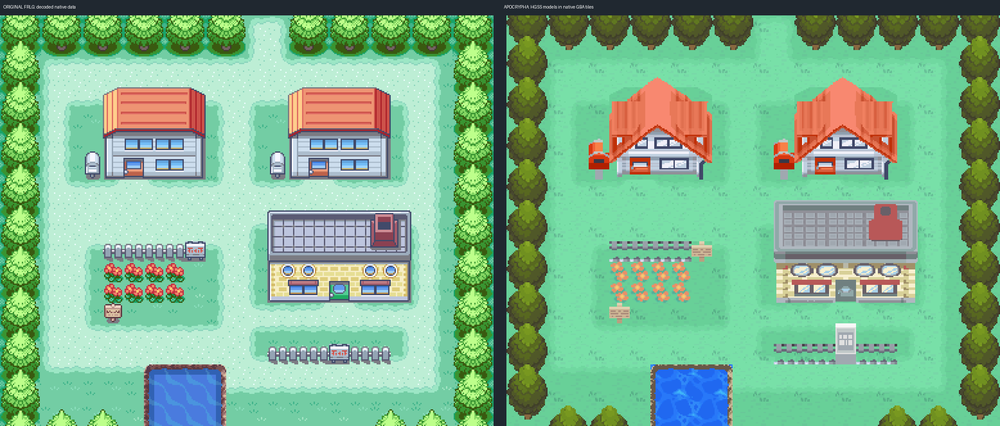

> Rejected by the owner on 2026-10-25. Superseded by the [fresh rebuild](../pallet-town-rebuild/README.md). Kept as historical evidence.

# Pallet Town — converted HGSS models, FRLG reference

Review proposal for the GBA shared source. The owner's current direction is **HGSS models converted into native Gen 3 assets, using FRLG as the reference**. The superseded FRLG-art draft is preserved in [frlg-draft](frlg-draft/README.md) and engine history.

[Whole-town reference/native comparison](evidence/ApocPalletTown-comparison.png) · [Numbered native squares](evidence/ApocPalletTown-grid.png) · [Actual gameplay review sheet](evidence/gameplay-review.png)



## Geography and canon

Five appended maps: Pallet Town, Red's house 1F/2F, Oak family home, and the laboratory. FRLG supplies the 24×20 exterior registration, all four interior dimensions, collision/elevation domains, shore, fences, garden, door coordinates and stair axis. Registration is 16 pixels per square, origin (0,0), no expansion or screenshot trace. No existing maps, layout IDs, tilesets, campaign flags or player saves are replaced.

HGSS field models **313/314** supply the houses/lab, **310/311** the doors, and **29/30/31** the signs/mailboxes. The Pallet room meshes and `bm_room` models supply interior materials, furniture, research equipment, cabinets, carpets and stairs. HGSS model 114 supplies the complete potted plant. The approved Cherrygrove lawn and complete T01 tree remain shared art. All building geometry/textures come from game data; no image-model reconstruction is used.

Blue is Kanto's professor; Oak is retired and lives in Pallet. The original garden plaque commemorates Red. Read-only dialogue is a proposal grounded in DESIGN.md's Pallet/Blue/Oak entries. No starter gifts, original FRLG campaign triggers, battles, encounters, tutors or new persistent flags are imported.

## Conversion and declared adaptations

- HGSS source: `Davisfox5/pokeheartgold@9d8b7591f09b65804da2fb2dfd56f320633e0d36`. Archive hashes, model placements, material names and projection are in [the decoded reference](source/hgss/reference/hgss-render.json). Original town rendering is [here](source/hgss/reference/hgss-render.png).
- The software renderer projects original textured geometry onto native pixels. Isolated source models and projected/receiving PNGs remain under [source/hgss](source/hgss). Interior rendering uses **bm_room**, not bm_field. Off-room nearest-fill pixels are excluded; only room surfaces, textures and isolated props are used.
- Models are fitted to receiving footprints and baselines. House roofs overhang the original footprint by one northern row; traversal there remains open behind the roof. Horizontal fitting keeps each whole door in its actual 16-pixel entrance. Native door animation preserves the receiving closed pixels and uses spare outdoor palette banks, scoped to this tileset.
- Native palette reduction uses 15 **opaque** colors per compatible asset family. Transparency does not consume a color. No dithering, nearest-tile substitution, cross-material compression or sprite/item removal is used. Walls, caps, equipment, trees and shore silhouettes remain distinct.
- Shared lawn grain replaces FRLG lawn pixels. FRLG's lighter-lawn material mask retains its receiving rim with a coherent native ramp; it is not a dirt road. HGSS flowers retain their leaves; only the original plain-lawn colors are removed. Tree roots occupy non-overlapping 2×2 footprints, with supported crown overlap and a matching repeated forest border.
- HGSS interior wood, walls, carpets and cabinets replace FRLG's corresponding art; notably, the lab uses HGSS's wood floor. Interior covered layers put carpets, stairs and furniture behind actors; outdoor canopy layers retain foreground occlusion. Original void cells and visible entrance registration are preserved. The unused donor Red-house warp in black void is omitted; original donor sources remain untouched.
- FRLG's Route 1 and Route 21 geographic sockets remain **unwired** because those campaign routes are not built. Pallet is available through the existing development debug warp menu, not invented interregional story transport. Hold **R + START**, choose the debug warp function, group **80**, map **43** (`ApocPalletTown`). Interior IDs are 44–47. The normal Cherrygrove start is unchanged.
- Water is currently a **static HGSS texture**. Foot blocking, water movement and dismount are checked; obtaining/unlocking Surf through campaign play is outside this map task. No Center/Mart exists in this location, so their approved shared art is not redrawn.

## Verification and review

- Porytiles **2.0.0 legacy CLI** compiles standard Emerald dual-layer source into native tiles, palettes and metatiles. Porymap **6.3.1** actually opens, loads, renders and saves every map; exports match the decoded native output. Source art remains separate from collision/event metadata.
- [Native audit](evidence/native-audit.json): all **1,030** squares match their converted HGSS source at RGB555 precision. Original collision, elevation and behavior are independently checked. Material CSVs, traversal JSONs, quadrant entries and numbered review sheets make individual cells inspectable. This does not claim that HGSS art is pixel-identical to FRLG.
- [Real ROM/VRAM audit](evidence/rom-art-audit.json): actual ROM metatiles and attributes match native source; mGBA VRAM tiles match the compiled art on every map. All 207 ordinary background palette entries match; the engine's explicitly cleared global backdrop slot is checked separately as black.
- [Runtime results](evidence/runtime/results.json): 19 fresh-process phases, continuous walking tour, all building returns, both directional stair transitions, Blue/Oak/plaque interaction, three animated entrances, **311** collision-edge probes, foot/water separation, Surf movement/dismount, and normal 128 KiB flash save → cold reload → title-screen Continue on **all five maps**. The fixture uses existing map-review entrypoints and ordinary directional/A/B input; it is not an uninstrumented campaign playthrough or hardware test.
- [Exact source/build identities](evidence/preservation.json) and [build record](evidence/build.json). No ROM, player save, emulator, toolchain or executable is committed.
- Visual review inspected the native and actual gameplay images at 1× and nearest-neighbor enlargement. Findings/corrections are recorded in [visual-review.md](evidence/visual-review.md). Source acceptance and creative/visual approval remain with the owner.

## Reproduction

Use the shared expansion checkout and the tooling documented in `docs/GBA_SHARED_SOURCE.md`. Porymap opens it directly; the native committed files are authoritative. The scripts below are provenance for this initial build and **must not be replayed over subsequent owner edits**.

```sh
# Decode the narrowly scoped original reference; keep the donor read-only.
python3 tools/gba/maps/pallet_town/hgss.py HGSS_CHECKOUT HGSS_OUTPUT
python3 tools/gba/maps/pallet_town/hgss_rooms.py HGSS_CHECKOUT HGSS_OUTPUT

# Initial authoring only, against the preserved Pallet draft before owner edits:
python3 tools/gba/maps/pallet_town/convert_hgss.py ENGINE_CHECKOUT HGSS_CHECKOUT HGSS_OUTPUT
python3 tools/gba/maps/pallet_town/pack_hgss.py ENGINE_CHECKOUT PORYTILES_LEGACY
python3 tools/gba/maps/pallet_town/doors_hgss.py ENGINE_CHECKOUT

make -C ENGINE_CHECKOUT -j1 generated
make -C ENGINE_CHECKOUT -j8
# Export all five maps using Porymap 6.3.1 (porymap_probe.cpp uses its actual loader/renderer/save).
python3 tools/gba/maps/pallet_town/review.py ENGINE_CHECKOUT
python3 tools/gba/maps/pallet_town/runtime.py ENGINE_CHECKOUT RUNTIME_OUTPUT
python3 tools/gba/maps/pallet_town/rom_art_audit.py ENGINE_CHECKOUT RUNTIME_OUTPUT
```

`MGBA_FLAGS` may select an installed libmgba include/library path. `arm-none-eabi-nm` must be on PATH. Rebuild from committed source for ordinary review; the FRLG installation scripts are historical initialization only.

## Credits

Original Pokémon designs, geometry, textures and maps: Game Freak / Nintendo / Creatures. Decoded source: pret/pokeheartgold (Davisfox5 fork) and the existing expansion FRLG assets. Shared lawn/tree artwork and source catalog: Pokémon Apocrypha's Cherrygrove/T01 work, with the catalog origin and hashes preserved in the hub's route31-catalog provenance. Original binary models are editable source assets, not tool binaries. This is a fan-game development proposal.
