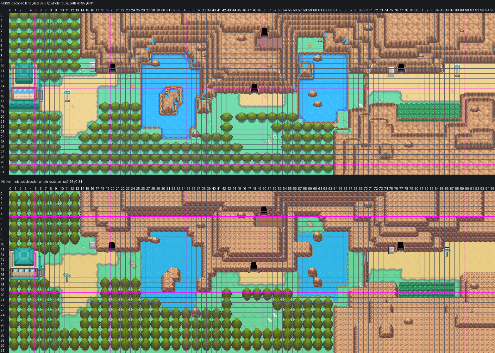

# Route 42: reconstruction guide, Mahogany's process

Route 42 as one native Gen 3 map west of Mahogany Town, built strictly to `AGENTS.md` and
[the map reconstruction workflow](../../../docs/GBA_MAP_RECONSTRUCTION.md) by the process the owner
accepted for Mahogany and Route 43, and the Mahogany-tileset method of
[Route 44](../route-44/README.md): decoded HGSS trace, shared Johto catalog art, Blackthorn's FRLG rock
terraces, the Cherrygrove ground painter, the natural water banks approved on Route 43, lossless pack.
Joined to Mahogany by a map connection, as HGSS joins them, with Mahogany left as the owner accepted it.
Engine branch `claude/route-42` (stacked on `claude/route-44`). Owner review 2026-10-25 fixed the stairs, the
Mt. Mortar ledge and the woods round the gate (below); owner visual review of those fixes pending.



[The seam: Route 42's east end beside Mahogany's west half, HGSS above native](evidence/review3/mahogany-seam.png)

Detail sheets (HGSS beside native, numbered by cell):
[Ecruteak gate and west road](evidence/review3/ecruteak-gate-west-road.png) · [west pond](evidence/review3/west-pond.png) ·
[middle cave and woods](evidence/review3/middle-cave-woods.png) · [east pond and cave floor](evidence/review3/east-pond-cave-floor.png) ·
[east road and tall grass](evidence/review3/east-road-tall-grass.png)

## The map

| | |
| --- | --- |
| Map | `Route42`, 96x32, `gMapGroup_Cherrygrove` id 51, `MAPSEC_JOHTO_ROUTE_42` |
| Tilesets | Mahogany's primary `gTileset_MahoganyPrimary` (138 of its tiles reused) + own secondary `gTileset_Route42` (496 tiles: 445 new, 51 copied from Mahogany; 358 metatiles) |
| Colour | 13 banks, each colour exact: all 786,432 native pixels equal the assembled art in RGB555 |
| Material audit | 2,864 of 3,072 cells show HGSS's material, 16 mismatches (declared below), 192 cells where a foreground object differs |

## 1. Reference (`trace.py`, `elements.ledger`)

- Authority: HGSS land_data chunks 82-84 (3 x 1) decoded from pret/pokeheartgold (header 44, area bank 8,
  matrix origin [13,5]), events zone R42 (`source/hgss-events.json`). Registration exact: HGSS tile (x, z)
  is native cell (x, y), 16 px, origin (0,0). Route 42 x 96 is Mahogany x 0, rows aligned.
- Ledger: rock cells by slope, woods `F`, tall grass `G`, water `~` (type 0x10), and Route 42's own features:
  the stairs `s` (HGSS slope cells (70, 13-14)), the four Mt. Mortar mouths `D` (warps 0x6E), the Ecruteak
  gate's doorway `d` (warps 0x6D, (6, 15-16)) and the Rock Climb wall `K` (0x4C, (54-56, 5)). The gate's
  G02 footprint (x 0-6, rows 11-17) is solid; the cells HGSS's taller gate model covers beyond it (rows
  18-19), and the row under it across its stairs' corner, are woods.
- Trees: one regular lattice of 2x2 roots per woods block (the rule from the Route 44 review): 196. Round
  the gate the woods overlap it as on the owner-approved Route 36 gate surround (AGENTS.md, woods close on
  gates and buildings): a row of four trees stands behind its top two rows, the gate drawn over them with
  the trees seen round its roof, and the first southern row's four crowns sit on its foundation line, the
  stairs' corner included. Both woods keep their own lattices.

## 2. Art (`assemble.py`)

Shared masters copied byte for byte into `source/shared-art/` with hashes (`provenance.json`):

| Part | Art | Placement |
| --- | --- | --- |
| Lawn, road | Cherrygrove/Route 36 painter | per 8 px quadrant from HGSS's flat ground colours |
| Water | Route 30's installed HGSS freshwater (pond-15) | HGSS's water cells, running on under the rock that stands in it |
| Banks | Route 43's owner-approved natural bank (local, `source/local-art/water-banks.png`) | every shore onto lawn; rock in the water meets it directly, as in HGSS |
| Tall grass | G15, the whole-cell piece | every HGSS tall-grass cell |
| Stairs | S04, the catalog's diagonal flight descending west | HGSS's slope (70, 12-14), over the one-cell cliff it cuts through, which runs unbroken from the north rock (row 11) to the south rock (row 19) |
| Gatehouse | G02, the owner-approved east-west gate, stairs east, transparent round its walls | HGSS's Ecruteak gate (model 36), its stairs on HGSS's doorway (6, 15-16), over the trees behind it |
| Trees | T01 | as above |
| Signs | P14 green rounded sign (model 32), P13 grey plaque (model 31) | (11,17) and (86,12) route signs, (16,11) and (75,12) Mt. Mortar plaques |
| Rock | Blackthorn's FRLG terraces in the Johto ramp | HGSS's cliffs |
| Mt. Mortar mouths, cave-floor dirt, boulders | HGSS's own pixels (cavehole, road05, rock01), lifted from the decoded true-heights render (local) | HGSS's positions; mouths on the nearest 8 px corner (at most 2 px), the ten identical boulders on the nearest 16 px corner (at most 8 px). The Mt. Mortar ledge (49-53, 5-6) is the dirt's commonest tone edge to edge under HGSS's pixels, and the rock edges round it show that dirt past them |
| Flowers | HGSS's flower heads (local) | HGSS's flower cells |

Tall grass, flowers, the Mt. Mortar mouths and the stairs are flat details on the top layer, never above the
player; under the stairs, the cliff they cut through is on the ground layer.
Local tone reductions (`source/local-art/reductions.json`): the cave mouths keep 2 tones of their own and
merge the rest onto Mahogany's rock bank; the cave-floor dirt, flower heads and boulders take Mahogany's
existing tones only.

## 3. On Mahogany's tilesets (`pack_fixed.py`)

As on Route 44: Route 42 uses Mahogany's primary tileset, and its secondary carries exact copies of what
the Mahogany cells its tilesets ever draw use (Mahogany x 0-7: 15 metatiles, 51 tiles and their palette
slots in banks 6, 8, 9 and 10). The part of Route 42 Mahogany's tilesets ever draw (x 88-95 round the
road, every standing view from Mahogany and the column that scrolls out while crossing east) is drawn
with Mahogany's metatiles: 161 of its 172 cells are Mahogany metatiles as they are. The other 11 (rock
corners south of the road and HGSS's boulder at (90,18)) are metatiles appended to Mahogany's secondary
table (ids 674-684); where no Mahogany tile drew a quadrant, 18 tiles are appended to Mahogany's secondary
tile sheet after its own 400 (indices 912-929), drawn with Mahogany's palettes as installed. No Mahogany
cell uses any of them. Both maps use Mahogany's border block.

The packer proves: Route 42 decoded with its pair equals its assembled art; every Route 42 pixel
Mahogany's tilesets draw equals it too; every Mahogany pixel Route 42's tilesets draw equals Mahogany's;
Mahogany with the appended metatiles and tiles is unchanged.

## Deliberate adaptations

- **East route sign.** P14 stands on (86,12), two cells west of HGSS's (88,12): there its board would lie
  in the columns Mahogany's tilesets draw, and Mahogany has no tiles for it. The sign's solid cell moves
  with it.
- **Tall grass edge.** The tall grass's last column (88, 18-20) is lawn: it scrolls out under Mahogany's
  tilesets when crossing east, and Mahogany has no tall grass colours. 3 material mismatches.
- **Ecruteak gate.** G02 is shorter than HGSS's gate model. As on Route 36, trees stand behind its top
  rows and crowns sit on its foundation, so no lawn shows and no one walks round it (owner review,
  2026-10-25): HGSS's gate roof cells (1-4, 10) and gate base cells (0-5, 18) show trees, 10 material
  mismatches. The narrow crown tips sit under G02's foundation strip, so the gate keeps its own tiles; the
  tree under the stairs' corner covers (6-7, 18), which HGSS leaves open.
- **Rock Climb.** HGSS's Rock Climb wall (54-56, 5) is plain FRLG cliff face and solid: Gen 3 has no Rock
  Climb. The two pockets behind it (the cave floor by the north Mt. Mortar mouth, and a pool) are not
  reached. 3 material mismatches.
- **Banks.** HGSS's pond rims are drawn as the natural bank the owner approved on Route 43; rock standing in
  the water meets it directly.
- **Mt. Mortar and the Ecruteak gate.** Their interiors are not built: the four mouths and the gate's doorway
  are solid. As in HGSS, Route 42's middle and west are reached through Mt. Mortar or by Surf; with Mt.
  Mortar not built, by Surf.
- **Boulders and mouths.** Moved at most 8 px and 2 px to the grid so identical pieces share tiles.
- **Foreground.** T01, the signs, the gate and the stairs differ in size and offset from HGSS's; these are
  the 192 "foreground differs" cells in `evidence/pack3/material-audit.json`.

## Verification

- **Build**: engine `claude/route-42`, ROM sha256
  `2dca2c6483734837af6103bcf792d6c85ef31b56f62ce1d9e4c1d53ee5f6301f` (not committed).
- **Audit** (`check3.py`, `evidence/pack3/native-audit.json`): the installed Route 42 equals the pack decode
  and its assembled art; Mahogany's installed decode equals its accepted native; both seam views exact from
  the installed files; connections (Mahogany now joins Route 44 east and Route 42 west, offset 0); shared
  border; behaviour, collision, elevation and layer type match the ledger on every cell; foot access
  matches across the seam (rows 10-15); the east part reachable on foot, the middle and west with Surf;
  G02's footprint and the rows along its north and south sides solid;
  walk-behind layering; budgets; shared masters byte-identical; Mahogany's own metatiles and tiles
  unchanged, its map.json changing only by the new connection; only Route 42 files otherwise.
- **Material audit**: 2,864 match, 16 mismatch, 192 foreground differences.
- **Headless mGBA** (`runtime3.py`, `evidence/pack3/runtime/`): 35 captures with map layers rebuilt from
  VRAM equal to the native decodes, connected maps beyond the seam included; the seam walked both ways on
  the road's middle, top and bottom rows, with captures 3 px into each crossing step matching too; BG1
  covers the player behind both route signs and leaves the player clear in front of the east one; the
  stairs descend and climb; a Mt. Mortar mouth, the gate's doorway, a tree and the pond's edge block a
  player on foot; no way round the gate north or south of its east face; all four signs read; Mahogany,
  Route 44 and Cherrygrove regression views; ordinary flash save, cold reload and title Continue.
- **Porymap 6.3.1** (`evidence/pack3/porymap/`): opens, exports and saves Route 42 and Mahogany on a fresh
  clone of the engine commit; both exports equal the native decodes with 0 differing pixels; saving
  rewrites no Route 42 or Mahogany line.

## Remaining

- Not placed: HGSS's object events (trainers, the Apricorn trees, item balls) and the hidden item at
  (64,22); no wild encounter table.
- Mt. Mortar and the Ecruteak gate interior are not built.
- Surf checked from the map data only (no Surf party in the headless run).
- Map ids collide with Blackthorn's PR #26 (both append to `gMapGroup_Cherrygrove`).

## Reproduction

```sh
python3 tools/gba/maps/route42/hgss_render.py PHG_CHECKOUT gba/art/route-42/source/hgss
python3 tools/gba/maps/route42/hgss_events.py PHG_CHECKOUT gba/art/route-42/source/hgss-events.json
python3 tools/gba/maps/route42/trace.py PHG_CHECKOUT
python3 tools/gba/maps/route42/assemble.py PHG_CHECKOUT CATALOG_CHECKOUT ENGINE_CHECKOUT   # catalog: codex/violet-city
python3 tools/gba/maps/route42/pack_fixed.py ENGINE_CHECKOUT PHG_CHECKOUT   # on Mahogany's tilesets, read from claude/route-44
python3 tools/gba/maps/route42/install.py ENGINE_CHECKOUT
make -C ENGINE_CHECKOUT -j8
python3 tools/gba/maps/route42/check3.py ENGINE_CHECKOUT PHG_CHECKOUT
python3 tools/gba/maps/route42/review3.py
python3 tools/gba/maps/route42/runtime3.py ENGINE_CHECKOUT OUT_DIR
python3 tools/gba/maps/route42/porymap.py ENGINE_CHECKOUT PORYMAP_BINARY    # needs the engine change committed
```

Generators are provenance: once the owner edits Route 42 or Mahogany, edit the committed native source in
Porymap.
