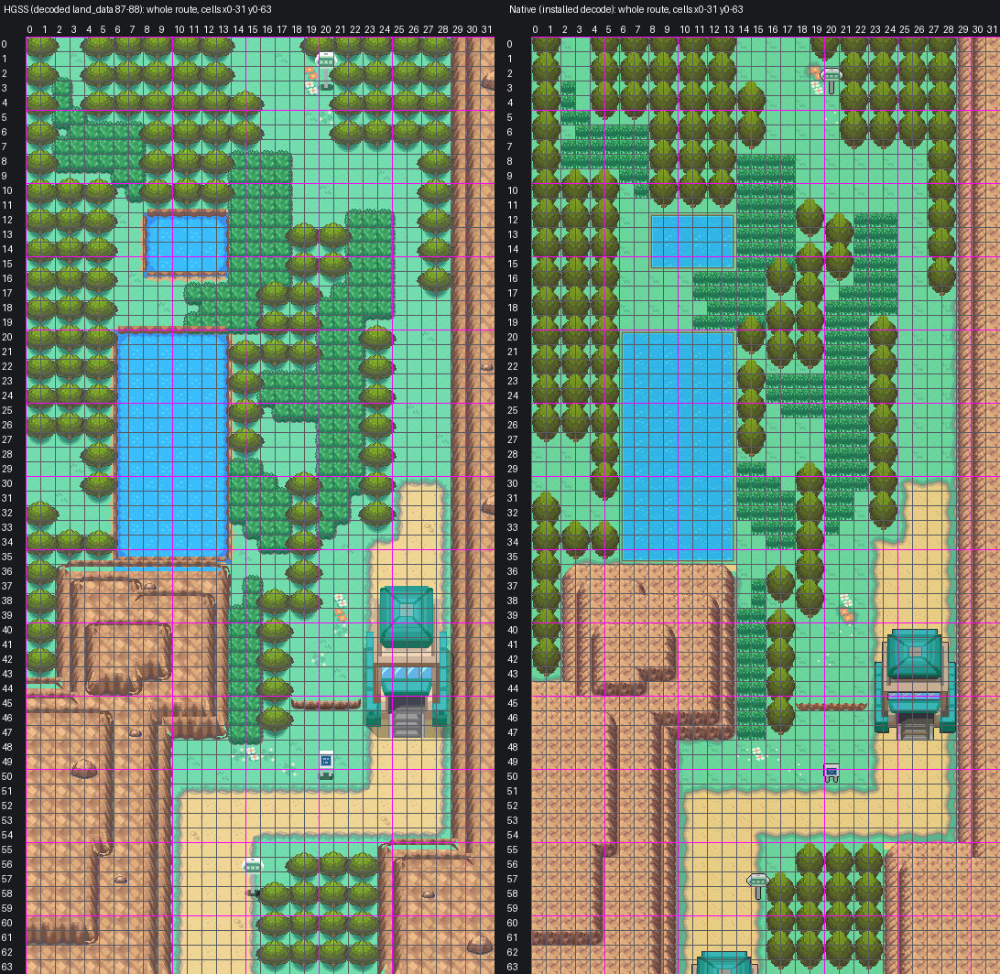

# Route 43: reconstruction guide, Mahogany's process

Route 43 as one native Gen 3 map, north of Mahogany Town, built strictly to `AGENTS.md` and
[the map reconstruction workflow](../../../docs/GBA_MAP_RECONSTRUCTION.md) by the same process the
owner accepted for Mahogany: decoded HGSS trace, shared Johto catalog art, Blackthorn's FRLG rock
terraces, the Cherrygrove ground painter, lossless pack. Engine branch `claude/route-43` (stacked on
`claude/mahogany-town`). Owner visual review pending.



Detail sheets (HGSS beside native, numbered by cell): [north woods and sign](evidence/review3/north-woods-sign.png) ·
[ponds and tall grass](evidence/review3/ponds-tall-grass.png) · [big pond and east lawn](evidence/review3/big-pond-east-lawn.png) ·
[massif, ledge, toll gate](evidence/review3/massif-ledge-toll-gate.png) ·
[south road and Mahogany gate](evidence/review3/south-road-mahogany-gate.png)

**Owner review 2026-10-24** ("nearly one-shotted it"): some large trees overlapped and a few tall-grass
patches were half a cell. Fixed: trees on non-overlapping roots. Second round: tall grass beside trees
and in one-cell lines still did not fill its cell, so every tall-grass cell now takes G15, the piece that
fills the whole cell.

## The map

| | |
| --- | --- |
| Map | `Route43`, 32x64, `gMapGroup_Cherrygrove` id 46; `Route43Gatehouse` 47, `Route43MahoganyGatehouse` 48; `MAPSEC_JOHTO_ROUTE_43` |
| Tilesets | private pair `gTileset_Route43Primary` + `gTileset_Route43`: 466 of 1,008 tiles (all in the primary; the secondary holds one blank metatile the build requires), 222 metatiles |
| Colour | 8 banks, each colour exact: all 524,288 native pixels equal the assembled art in RGB555 |
| Material audit | 1,914 of 2,048 cells show HGSS's material, 0 mismatches, 134 cells where a foreground object differs (below) |

## 1. Reference (`trace.py`, `elements.ledger`)

- Authority: HGSS land_data chunks 87 (north) and 88 (south) decoded from pret/pokeheartgold (header
  45, area bank 8, matrix origin [16,3]), events zone R43 (`source/hgss-events.json`). Registration is
  exact: HGSS tile (x, z) is native cell (x, y), 16 px, origin (0,0), no crop or expansion.
- Numbered sheets: `evidence/trace/hgss-numbered-1..8.png` (16x16-cell blocks); material grid over
  HGSS: `evidence/trace/grid-over-hgss-1..8.png`; traversal ledger `source/trace/traversal.json`; tree
  roots `source/trace/trees.json`; models `buildings.json` (signs 32 and 34, gate 35).
- Flat cell decode (`elements.ledger`): rock cells, the ledge, woods (type 0x06), tall grass (0x02),
  pond water (0x10), ground height per cell.
- Trees: HGSS shows a trunk row only where no crown covers it, and it offsets its trees, so the roots
  are the largest set of non-overlapping 2x2 footprints on its woods cells (an integer program that
  prefers the 108 trunk-detected roots on ties; 97 of them kept): 136 trees, none overlapping. The 34
  woods cells no root fits are HGSS crown overhang and are open lawn (adaptation below).

## 2. Rock: Blackthorn's method

As Mahogany: every HGSS height layer is one terrace (`source/assemble/terrace-grid.txt`). Route 43's
floor is height 4; the south-west massif steps up three terraces (5, 6, 7) and the east ridge two (5,
6). FRLG General's mountain nine-slice in the Johto rock ramp, one face per metatile, as a top-layer
overlay on plain ground (`elements.rock_frlg`).

## 3. Shared art (`assemble.py`)

Copied byte for byte into `source/shared-art/` with hashes and the catalog commit (`codex/violet-city`
`de5d8cf`) in `provenance.json`:

| Part | Shared art | Placement |
| --- | --- | --- |
| Lawn, road, rims | Cherrygrove/Route 36 painter, unchanged | lawn or road per 8 px quadrant from HGSS's flat ground colours |
| Tall grass | G15 | HGSS's 189 tall-grass cells, each the whole-cell piece (owner review: the trimmed edge pieces left cells part empty) |
| Ponds | Route 30's installed HGSS freshwater (`route30-hgss-blocks` pond-*mask*-*phase*) | HGSS's 152 water cells; bank and rim inside the water cells, so the Surf edge is the cell edge |
| Ledge | L11 / L12 / L13 | HGSS's jump-south run (18-22,45) |
| Trees | T01 | 136 non-overlapping roots (above), crown one row behind |
| Signs | P14 green route sign (model 32), P16 blue information board (model 34) | (20,3), (15,58); (20,50) |
| Toll gate | G01a | origin (23,40), doorway on HGSS's gate warps (25,47)/(26,47) |
| Mahogany gatehouse | G01a, its top two rows | origin (10,62), the same G01a Mahogany places at its (10,-2) |

Local asset (`source/local-art/flowers.png`): the flower heads from HGSS's own flower01-03 textures
(every texture pixel that is not lawn green), on HGSS's 18 flower cells.

## 4. Native pack (`pack_lossless.py`)

Mahogany's lossless packer: exact colour banks, flip dedupe, and only bottom pixels hidden under opaque
top-layer art compacted. Asserts every native pixel equals the assembled art.

## Gatehouses and Mahogany

- Interiors: Emerald's north-south gatehouse layout `LAYOUT_BATTLE_FRONTIER_RECEPTION_GATE` (south
  arrow warp (4,13), north doorway (4,1)), without its attendants and scripts. FRLG's N-S entrance layout
  was the first choice, but FRLG tilesets are not compiled into the Emerald build.
- Toll gate (`Route43Gatehouse`): Route 43 door (25,47)/(26,47) to the south arrow; the north doorway to
  Route 43's arrow warps (25,39)/(26,39) and back.
- Mahogany gatehouse (`Route43MahoganyGatehouse`): Mahogany (12,5)/(13,5) to its south arrow; its north
  doorway to Route 43's arrow warps (12,61)/(13,61) and back.
- Mahogany is locked, so its wiring is a native-source edit (`install.wire_mahogany`): two warp
  events, the two doorway cells' collision cleared and their two single-use metatiles given
  `MB_NON_ANIMATED_DOOR`. No Mahogany pixel changes (check3 compares its decode with Mahogany's native).
- No map connection between Route 43 and Mahogany: Gen 3 draws a connected map with the current map's
  tilesets, and the two maps each have their own pair, so a connection showed Mahogany in Route 43's
  tiles (caught by the headless run). Each map shows its own rock border beyond the seam.

## Deliberate adaptations

- **Gate warps.** HGSS's gate models are taller than G01a, so HGSS's north-side warp cells (25,38),
  (26,38), (12,60), (13,60) stand one row short of the Gen 3 roof. The arrow warps move onto the row
  against the roof ((25,39), (26,39), (12,61), (13,61)); HGSS's warp row stays open ground. Cells
  (23,39)-(28,39), (23,40) and (28,40), blocked only by HGSS's taller model, are open where G01a has no
  pixel. Listed per cell in `evidence/pack3/pack.json` (`adaptations`).
- **Woods overhang.** 34 cells HGSS blocks under its offset crowns hold no Gen 3 root and are open
  lawn: (14-15,3), (2-5,9), (20-21,12), (18-19,14), (16-17,18), (23-24,19), (14-15,22), (18-19,29),
  (0-1,31), (2-5,33), (16-17,39), (18-23,55), (16-17,57). None joins two areas; most sit under the
  crown of the tree south of them, so the player walks behind it.
- **Rock.** One-metatile FRLG faces in place of HGSS's projected faces, as in Mahogany and Blackthorn.
- **Foreground.** T01 rises one row higher than HGSS's trees and sits on a 2-cell grid where HGSS
  offsets its crowns; G01a is smaller than HGSS's gate. These are the 134 "foreground differs" cells in
  `evidence/pack3/material-audit.json`.
- **Sign text.** HGSS's text (msg_0401_R43) in Gen 3 sign boxes: ROUTE 43 / NORTH: LAKE OF RAGE (and
  SOUTH: MAHOGANY TOWN on the north sign); the Trainer Tips text over three pages.

## Verification

- **Build**: engine `claude/route-43`, ROM sha256
  `903f8a1b8aa947175b9b210a124123ff033141593e0e5389c638faf3ede5da69` (not committed).
- **Native audit** (`check3.py`, `evidence/pack3/native-audit.json`): installed decode equals the packer's
  and the assembled art pixel for pixel; behaviour, collision, elevation and layer type match the ledger
  on all 2,048 cells; every approach reachable on foot, every pond cell with Surf; walk-behind layering
  matches the objects' base rows; every warp leads back; Mahogany's doorways are doors and its pixels
  unchanged; shared masters byte-identical; only Route 43 files and Mahogany's three wiring files
  changed; budgets met.
- **Material audit** (`evidence/pack3/material-audit.json`, `native-grid.png`): 1,914 match, 0 mismatch,
  134 foreground differences.
- **Headless mGBA** (`runtime3.py`, `evidence/pack3/runtime/`): 32 captures with map layers rebuilt from
  VRAM equal to the native decode in all of them; BG1 covers the player behind two tree rows and all
  three signs and leaves the player clear in front of both gatehouses; the ledge jumps and refuses the
  climb back; tall grass walks; woods, rock, ridge, gate body and the pond edge block; all three signs
  read; the toll gate south to north and north to south; Route 43 to Mahogany through the gatehouse and
  back; a Cherrygrove regression view; ordinary flash save, cold reload and title Continue.
- **Porymap 6.3.1** (`evidence/pack3/porymap/`): opens, exports and saves Route 43, both gatehouses and
  Mahogany on a fresh clone of the engine commit; its exports equal the native decodes of Route 43 and
  Mahogany with 0 differing pixels; saving rewrites no Route 43 line.

## Remaining

- The north edge (Lake of Rage) is unwired: no Lake of Rage map exists yet.
- Not placed: HGSS's object events (six trainers, the Max Ether item ball, the Apricorn tree at (1,29)
  and the Cut tree at (3,32)). The west nook (0-5, 28-32) is reachable only by Surf, as HGSS's woods
  enclose it.
- No wild encounter table yet, so the tall grass and ponds start no battles.
- Gatehouse interiors are Emerald's Battle Frontier reception gate (orange carpet, counters).
- Map ids collide with Blackthorn's PR #26 (both append to `gMapGroup_Cherrygrove`).

## Reproduction

```sh
python3 tools/gba/maps/route43/hgss_render.py PHG_CHECKOUT gba/art/route-43/source/hgss
python3 tools/gba/maps/route43/hgss_events.py PHG_CHECKOUT gba/art/route-43/source/hgss-events.json
python3 tools/gba/maps/route43/trace.py PHG_CHECKOUT
python3 tools/gba/maps/route43/assemble.py PHG_CHECKOUT CATALOG_CHECKOUT ENGINE_CHECKOUT   # catalog: codex/violet-city
python3 tools/gba/maps/route43/pack_lossless.py ENGINE_CHECKOUT PHG_CHECKOUT
python3 tools/gba/maps/route43/install.py ENGINE_CHECKOUT
make -C ENGINE_CHECKOUT -j8
python3 tools/gba/maps/route43/check3.py ENGINE_CHECKOUT PHG_CHECKOUT
python3 tools/gba/maps/route43/review3.py
python3 tools/gba/maps/route43/runtime3.py ENGINE_CHECKOUT OUT_DIR
python3 tools/gba/maps/route43/porymap.py ENGINE_CHECKOUT PORYMAP_BINARY    # needs the engine change committed
```

Generators are provenance: once the owner edits the map, edit its committed native source in Porymap
(the installer refuses if a Route 43 or Mahogany wiring file carries a commit it did not make).
