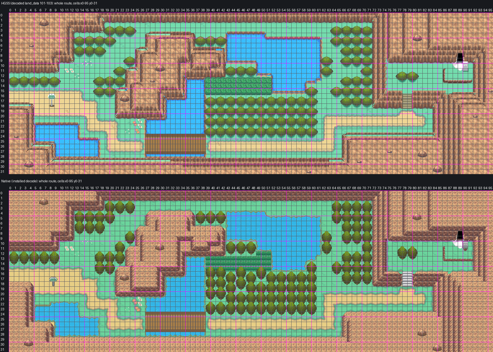

# Route 44: reconstruction guide, Mahogany's process

Route 44 as one native Gen 3 map east of Mahogany Town, built strictly to `AGENTS.md` and
[the map reconstruction workflow](../../../docs/GBA_MAP_RECONSTRUCTION.md) by the process the owner
accepted for Mahogany and Route 43: decoded HGSS trace, shared Johto catalog art, Blackthorn's FRLG
rock terraces and ledges, the Cherrygrove ground painter, the natural water banks approved on Route 43,
lossless pack. Joined to Mahogany by a map connection, as HGSS joins them, with Mahogany left as the
owner accepted it. Engine branch `claude/route-44` (stacked on `claude/lake-of-rage`). Owner visual
review pending.



[The seam: Mahogany's east half beside Route 44's west end, HGSS above native](evidence/review3/mahogany-seam.png)

Detail sheets (HGSS beside native, numbered by cell):
[west end and pond](evidence/review3/west-end-pond.png) · [river and bridge](evidence/review3/river-bridge.png) ·
[big pond and tall grass](evidence/review3/big-pond-tall-grass.png) · [east woods and road](evidence/review3/east-woods-road.png) ·
[Ice Path](evidence/review3/ice-path.png)

## The map

| | |
| --- | --- |
| Map | `Route44`, 96x32, `gMapGroup_Cherrygrove` id 50, `MAPSEC_JOHTO_ROUTE_44` |
| Tilesets | Mahogany's primary `gTileset_MahoganyPrimary` (146 of its tiles reused) + own secondary `gTileset_Route44` (467 tiles: 391 new, 76 copied from Mahogany; 334 metatiles) |
| Colour | 13 banks, each colour exact: all 786,432 native pixels equal the assembled art in RGB555 |
| Material audit | 2,882 of 3,072 cells show HGSS's material, 3 mismatches (the pond corner below), 187 cells where a foreground object differs |

## 1. Reference (`trace.py`, `elements.ledger`)

- Authority: HGSS land_data chunks 101-103 (3 x 1) decoded from pret/pokeheartgold (header 46, area bank 8,
  matrix origin [17,5]), events zone R44 (`source/hgss-events.json`). Registration exact: HGSS tile (x, z)
  is native cell (x, y), 16 px, origin (0,0). Route 44 x 0 is Mahogany x 32, rows aligned.
- Ledger: rock cells by slope, woods `F`, tall grass `G`, water `~` (type 0x10), the Ice Path ledges (jump
  south `L`, jump west `Q`, the corner `J`), and Route 44's own features: the bridge deck `b` (HGSS bridge_a,
  cells 27-38 x 24-27), the stairs `s` (HGSS slope cells, 78-79 x 16-18) and the Ice Path mouth `D` (warp 0x6E).
- Trees: the largest set of non-overlapping 2x2 roots on the woods cells (integer program): 102. Woods
  cells under a rooted tree's crown stay blocked, as HGSS has them; the others no root fits are open lawn.

## 2. Art (`assemble.py`)

Shared masters copied byte for byte into `source/shared-art/` with hashes (`provenance.json`):

| Part | Art | Placement |
| --- | --- | --- |
| Lawn, road | Cherrygrove/Route 36 painter | per 8 px quadrant from HGSS's flat ground colours |
| Water | Route 30's installed HGSS freshwater (pond-15) | HGSS's water cells and the river under the bridge |
| Banks | Route 43's owner-approved natural bank (local, `source/local-art/water-banks.png`) | every shore; the noise repeats every 64 px along each edge, as on the Lake |
| Tall grass | G15, the whole-cell piece | every HGSS tall-grass cell |
| Stairs | S01 (west column), S03 (east column) | HGSS's slope cells |
| Trees | T01 | as above |
| Signs | P14 green rounded sign (model 32), P13 grey plaque (model 31) | (8,18) route sign, (90,11) Ice Path sign |
| Rock, ledges | Blackthorn's FRLG terraces and FRLG jump ledges in the Johto ramp, as Mahogany's | HGSS's cliffs; the Ice Path ledges |
| Bridge, Ice Path mouth, boulders | HGSS's own pixels (bridge_a, icehole, rock01), lifted from the decoded true-heights render, sign models excluded (local) | HGSS's positions; the seven identical boulders on the nearest 8 px corner (at most 4 px) |
| Flowers | HGSS's flower heads (flower01-03, every pixel that is not lawn green, local) | HGSS's flower cells |

Tall grass, flowers and the Ice Path mouth are flat details on the top layer, never drawn above the
player (in a cell that draws its top layer above the player, a crown's, they join the bottom layer).

Local tone reductions (`source/local-art/reductions.json`, closest tones merge, shapes untouched): each
local piece keeps at most a few tones Mahogany's palettes lack and otherwise merges onto the Mahogany bank
its surroundings live in: the Ice Path mouth 4 (rock bank), the bridge 4 (bank 6's browns), the boulders 0
(rock bank), the flower heads 2 (lawn bank).

## 3. On Mahogany's tilesets (`pack_fixed.py`)

A Gen 3 connection draws the neighbouring map with the current map's tilesets, and crossing it reloads
only the secondary tileset, at the start of the step, with the old view still on screen. Mahogany is
locked, so Route 44 is packed onto Mahogany's tilesets:

- Route 44's primary is Mahogany's: tiles, palettes 0-5 and metatiles 0-511 unchanged.
- Route 44's secondary carries exact copies of what the Mahogany cells it ever draws use (Mahogany x 24-31
  round the seam rows, and what a player surfing the west pond sees): 32 metatiles at Mahogany's ids, 76
  tiles at Mahogany's indices, and the palette slots they use in banks 6, 9, 10 and 12. Route 44 fills the
  other slots of those banks, and banks 7, 8 and 11.
- The part of Route 44 Mahogany's tilesets ever draw (x 0-7, rows 10-22: every standing view from Mahogany,
  and the column that scrolls out while crossing west) is drawn with Mahogany's own metatiles. 100 of its
  104 cells are Mahogany metatiles as they are. (5,22) and (7,22), half in view, use Mahogany secondary ids
  whose visible halves draw the same in both maps. The rock corner at (3,19) and the half-visible (6,22)
  needed metatiles Mahogany did not have: they are appended to Mahogany's secondary table as ids 672-673,
  built from quadrants of Mahogany's own metatiles. No Mahogany cell uses them.
- Both maps use Mahogany's border block (metatile 0).

The packer proves: Route 44 decoded with its pair equals its assembled art; every Route 44 pixel
Mahogany's tilesets draw equals it too; every Mahogany pixel Route 44's tilesets draw equals Mahogany's;
Mahogany with the appended metatiles is unchanged.

## Deliberate adaptations

- **Banks.** HGSS's pond rims (pond_line) are drawn as the natural bank the owner approved on Route 43.
- **Pond corner in Mahogany's view.** The top half of (5-7,22), the west pond's north-west corner, is lawn:
  Mahogany's camera shows it and Mahogany's tilesets hold no water or bank colours. The cells stay water
  for Surf; the bank starts in their lower half. These are the 3 material mismatches.
- **Route sign.** P14 at (8,18) stands 5 px east of centre (its post still inside its cell): centred, its
  board reaches into column 7, which scrolls out under Mahogany's tilesets when crossing west.
- **Boulders.** Moved at most 4 px to the 8 px grid so the seven identical boulders share tiles.
- **Ice Path.** The mouth is solid; Ice Path is not built.
- **Foreground.** T01, the signs and the stairs differ in size and offset from HGSS's; these are the 187
  "foreground differs" cells in `evidence/pack3/material-audit.json`.

## Verification

- **Build**: engine `claude/route-44`, ROM sha256
  `772f97413e09d001455f7adc1f8642c26a9b8079e18ffec74e0374d2ddf89ce0` (not committed).
- **Audit** (`check3.py`, `evidence/pack3/native-audit.json`): the installed Route 44 equals the pack decode
  and its assembled art; Mahogany's installed decode equals its accepted native; both seam views exact from
  the installed files; connections both ways (offset 0); shared border; behaviour, collision, elevation and
  layer type match the ledger on every cell; foot access matches across the seam (rows 15-17); every
  approach reachable from the seam, the tall grass between the river and the big pond with Surf, as in
  HGSS; walk-behind layering; budgets; shared masters byte-identical; Mahogany's map.json changes only
  its connection and its own 160 metatiles are unchanged; only Route 44 files otherwise.
- **Material audit**: 2,882 match, 3 mismatch, 187 foreground differences.
- **Headless mGBA** (`runtime3.py`, `evidence/pack3/runtime/`): 35 captures with map layers rebuilt from
  VRAM equal to the native decodes, the connected map beyond the seam included; the seam walked both ways on
  all three road rows, with captures 3 px into each crossing step (just after the secondary tileset swaps)
  matching too; BG1 covers the player behind both signs and leaves the player clear in front of the route
  sign; both ledges jump and refuse the climb back; the stairs climb; the Ice Path mouth, a tree and the
  pond's edge block a player on foot; both signs read; ordinary flash save, cold reload and title Continue.
- **Porymap 6.3.1** (`evidence/pack3/porymap/`): opens, exports and saves Route 44 and Mahogany on a fresh
  clone of the engine commit; both exports equal the native decodes with 0 differing pixels; saving
  rewrites no Route 44 or Mahogany line.

## Remaining

- Not placed: HGSS's object events (fishermen, trainers, three item balls) and the hidden Elixir at (69,11);
  no wild encounter table.
- Ice Path is not built; its mouth is solid.
- Surf checked from the map data only (no Surf party in the headless run).
- Map ids collide with Blackthorn's PR #26 (both append to `gMapGroup_Cherrygrove`).

## Reproduction

```sh
python3 tools/gba/maps/route44/hgss_render.py PHG_CHECKOUT gba/art/route-44/source/hgss
python3 tools/gba/maps/route44/hgss_events.py PHG_CHECKOUT gba/art/route-44/source/hgss-events.json
python3 tools/gba/maps/route44/trace.py PHG_CHECKOUT
python3 tools/gba/maps/route44/assemble.py PHG_CHECKOUT CATALOG_CHECKOUT ENGINE_CHECKOUT   # catalog: codex/violet-city
python3 tools/gba/maps/route44/pack_fixed.py ENGINE_CHECKOUT PHG_CHECKOUT   # on Mahogany's tilesets, read from claude/lake-of-rage
python3 tools/gba/maps/route44/install.py ENGINE_CHECKOUT
make -C ENGINE_CHECKOUT -j8
python3 tools/gba/maps/route44/check3.py ENGINE_CHECKOUT PHG_CHECKOUT
python3 tools/gba/maps/route44/review3.py
python3 tools/gba/maps/route44/runtime3.py ENGINE_CHECKOUT OUT_DIR
python3 tools/gba/maps/route44/porymap.py ENGINE_CHECKOUT PORYMAP_BINARY    # needs the engine change committed
```

Generators are provenance: once the owner edits Route 44 or Mahogany, edit the committed native source in
Porymap. A Route 42 west of Mahogany would follow the same method on Mahogany's tilesets.
