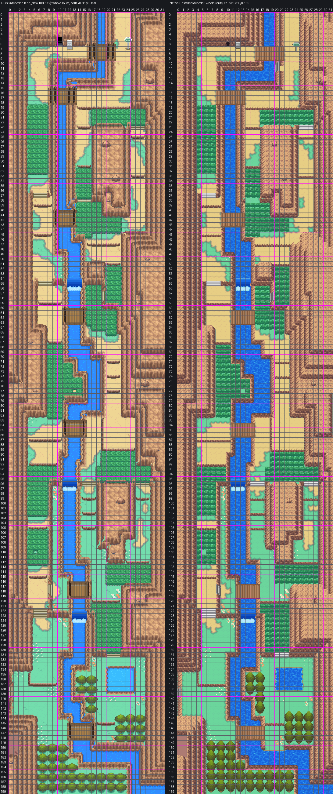

# Route 45: reconstruction guide, Blackthorn's tilesets

Route 45 as one native Gen 3 map south of Blackthorn City, built strictly to `AGENTS.md` and
[the map reconstruction workflow](../../../docs/GBA_MAP_RECONSTRUCTION.md) by the process the owner
accepted for Mahogany, Routes 43, 44 and 42 and the Lake of Rage: decoded HGSS trace, shared Johto catalog
art, Blackthorn's FRLG rock terraces, water and bridge, the Cherrygrove ground painter, the natural water
banks approved on Route 43, lossless pack. Joined to Blackthorn by a map connection, as HGSS joins them,
with every Blackthorn pixel kept. Engine branch `claude/route-45` (stacked on `claude/blackthorn-city`,
engine PR #26). Owner review 2026-10-25 fixed the river banks, bridges, stairs and cascades; owner review
2026-10-26 walled the river in rock, added a Surf landing at each end and a Waterfall return, and closed
the road round the row 47 ledge; owner review 2026-10-27 turned the river's south walls to face the
water, gave the side walls FRLG's plain side face and put stairs down to the landing (below). Owner
visual review of the 2026-10-27 changes pending.



[The seam: Blackthorn's south end above Route 45's north end, HGSS beside native](evidence/review3/blackthorn-seam.png)

Detail sheets (HGSS beside native, numbered by cell):
[Dark Cave and the first bridges](evidence/review3/dark-cave-first-bridges.png) ·
[tall grass and the third bridge](evidence/review3/tall-grass-third-bridge.png) ·
[first cascade and fourth bridge](evidence/review3/first-cascade-fourth-bridge.png) ·
[middle ledges and fifth bridge](evidence/review3/middle-ledges-fifth-bridge.png) ·
[second cascade and the island](evidence/review3/second-cascade-island.png) ·
[third cascade and the pond](evidence/review3/third-cascade-pond.png) ·
[woods and the river's mouth](evidence/review3/woods-river-mouth.png)

## The map

| | |
| --- | --- |
| Map | `Route45`, 32x160, `gMapGroup_Cherrygrove` id 47, `MAPSEC_JOHTO_ROUTE_45` |
| Tilesets | Blackthorn's primary `gTileset_CherrygrovePrimary` (53 of its tiles reused, its animated sea among them) + own secondary `gTileset_Route45` (239 new tiles, 54 copied from Blackthorn; 386 metatiles) |
| Colour | 13 banks, each colour exact: all 1,310,720 native pixels equal the assembled art in RGB555 |
| Material audit | 5,047 of 5,120 cells show HGSS's material, 14 mismatches (declared below), 59 cells where a foreground object differs |

## 1. Reference (`trace.py`, `elements.ledger`)

- Authority: HGSS land_data chunks 108-112 (1 x 5) decoded from pret/pokeheartgold (header 47, area bank 9,
  matrix origin [20,6]), events zone R45 (`source/hgss-events.json`). Registration exact: HGSS tile (x, z)
  is native cell (x, y), 16 px, origin (0,0). Route 45 y 0 is Blackthorn y 64, columns aligned.
- Ledger: rock cells by slope, woods `F`, tall grass `G`, water `~` (the river, HGSS type 0x15, and the pond,
  0x10), jump ledges south `L` and west `Q`, and Route 45's own features: the stairs `s` (HGSS slope cells),
  the Dark Cave mouth `D` (warp 0x6E, (10, 6)), the bridge decks `b` (HGSS bridge_a, 7 bridges) and the
  blocked river cells either side of each bridge `X` (HGSS slopes its banks into them, but they show the river).
- Trees: one regular lattice of 2x2 roots per woods block: 43.

## 2. Art (`assemble.py`)

Shared masters copied byte for byte into `source/shared-art/` with hashes (`provenance.json`):

| Part | Art | Placement |
| --- | --- | --- |
| Lawn, road | Cherrygrove/Route 36 painter, its road Cherrygrove's own sand (Blackthorn's), lawn and road one 16 px quarter of Cherrygrove's block, the rim wave over 16 px | one material per cell, from HGSS's flat ground colours |
| River, pond | CherrygrovePrimary's animated sea, Blackthorn's lake water, on its 32 px phase (Blackthorn's carries on across the seam) | HGSS's water cells, running on under the rock beside it |
| Banks | Route 43's owner-approved natural bank (local, `source/local-art/water-banks.png`) | the pond and the river's shore at its foot; everywhere else the river runs between rock faces |
| Cascades | HGSS's own falling sheet and foam (local, `source/local-art/cascades.png`), the sheet's top two rows in HGSS's foam blues as a bright lip | HGSS's three drops, (12-14, 55), (11-13, 96), (13-15, 123), the foam the river's full width; Waterfall cells |
| Bridges | Blackthorn's plank bridge in CherrygrovePrimary's wood ramp, turned to run east-west | HGSS's seven decks |
| Tall grass | G15, the whole-cell piece | every HGSS tall-grass cell |
| Stairs | S01-S03, the catalog's straight flight; S04 and S05, its diagonal flights descending west and east | HGSS's flights: straight down a south face (5-7, 37), (6-8, 55), (25-27, 23), (15-17, 96), (26-28, 96), (5-7, 122-123), (20-22, 131); diagonal at (19, 57-59), (8, 117-119), (0, 138-140); and S04 down the bank to the landing below Blackthorn, (20, 10-12) (owner review) |
| Trees | T01 | as above |
| Signs | P14 green rounded sign (model 32), P13 grey plaque (model 31) | (24,7) route sign, (12,7) Dark Cave plaque |
| Rock | Blackthorn's FRLG terraces in the Johto ramp | HGSS's cliffs; a wall showing a south face has the ground beside it as its top, so it reads as ground, face, then the lower side; a side wall is FRLG's side piece whole; a wall on the river's south bank is FRLG's south face turned to look north at the water |
| Dark Cave mouth | FRLG General's cave mouth (metatile 0xA9), as Blackthorn's Dragon's Den | (10, 6), on its face |
| Boulders | FRLG General's boulder (0x9F's top layer) in the Johto ramp | one on the middle of each HGSS boulder footprint; the footprint cells take the ground round them, collision HGSS's |
| Route 46's dirt | HGSS's road05, its commonest tone (local) | (0-1, 148-151) |
| Flowers | HGSS's flower heads (local) | HGSS's flower cells |

Tall grass, flowers and the diagonal stairs are flat details on the top layer, never above the player;
under a diagonal flight the cliff it cuts through is on the ground layer. A straight flight is the cell
itself. Under G15 and under flower patches on open lawn the ground is plain lawn, the same in every such
cell. Local tone reductions are in `source/local-art/reductions.json`.

Every cell stands at its own HGSS height, counted from Route 45's lowest ground (the river's mouth, HGSS
height 2): rock at its peak, ground at its ground, a bridge deck at its deck, water at its surface. So every
HGSS height step is a wall of its own, and a wall has a face only toward ground that is really lower.

## Owner review (2026-10-25)

- **River banks read as raised spikes.** Ground had been level 0 under every wall, so each one-cell bank
  was drawn higher than the road beside it, with an edge on both sides and rounded tips at the bridges.
  Ground and water now take their HGSS heights: a bank faces the river and its top is the road or lawn
  beside it; a slope falling north stays rock, as HGSS shows it (`assemble.terraces`, `assemble.topped`,
  `elements.rock_frlg`).
- **Bridges.** The decks now meet the banks flush; the banks run under them instead of ending in tips
  with stubs of deck below.
- **Walls in line with the cascades.** The step walls either side of each drop now fall to the lower
  ground with a face, level with the drop, instead of a thin ledge-like strip; the banks step down with
  the river.
- **Cascades.** The foam runs the river's full width, and the sheet starts at a bright lip where the
  river tips over.
- **Stairs.** The diagonal flights keep their whole cliff, as on Route 42, topped with lawn by tall grass
  instead of road sand; the west-edge flight down to Route 46 has its face back; the sign cells, which
  HGSS blocks for its models, are road under the signs (a rock square had shown behind both).

## Owner review (2026-10-26)

- **River walled in rock.** Every bank cell beside the river is a rock face, so the river reads as a valley
  and a player on foot can't step or Surf in from the road or lawn. The river (with the pond) is the only
  water; its cells are Gen 3 sea at elevation 1, which Surf can't start from or leave onto anything but
  elevation 3 ground.
- **Ways on and off.** Four cells of HGSS river-mouth bank at the foot, (18-21, 150), are lawn level with
  the water, the place to start surfing. Below Blackthorn, (20-21, 11) is a sand landing level with the
  river beside the road: the way off at the top. Blackthorn's own lake channel has no shore and is
  another agent's map, so the landing is on Route 45.
- **Waterfall return.** The three cascades are Waterfall cells (9 in all). A player who drops down the
  ledges can surf up the river from the foot, climb the cascades with Waterfall, pass under all seven
  bridges (each deck is a Gen 3 bridge over the sea, elevation 15, as on Emerald's Routes 110 and 119),
  land at (20-21, 11) and walk into Blackthorn. `check3.py` walks this route on the installed data.
- **Ledges.** Every ledge is checked one-way: nothing reachable below a ledge on foot reaches above it
  without Surf. The row 47 ledge's east end had a strip of rock top beside the road that went round it;
  (23-24, 45-46) are road now and the ledge ends against the rock face.

## Owner review (2026-10-27)

- **East-west walls along the river.** The walls on the river's south banks were drawn as south faces,
  looking down onto the road below them, as if the river ran on a ridge. They now face the water: FRLG's
  south face and its corners turned to look north (`assemble.north_faces`, `elements.rock_frlg`), so
  every stretch of the river reads as a valley, faces on both sides looking at the water. The north
  banks already faced it.
- **Side walls.** A side wall level with the road beside it had its rock top swapped for the road, which
  left the face's dark stripes standing in the sand (the fuzzy wall by the top of the river, (21, 0-15),
  and the others like it). Side walls are FRLG's side piece whole now, face band and rock top, as the
  river's other side walls are. The six Blackthorn metatiles and four tiles appended for (21, 0-5) are
  gone: those cells are Blackthorn's own metatiles again.
- **Corners.** Where a south-bank wall turns into a side wall, the inner corner is FRLG's turned the same
  way, and a stepped bank (a lower wall in front of a higher one, as at (12-21, 14-15)) runs the
  corner through both steps.
- **Stairs to the landing.** The way down from the road to the river below Blackthorn is S04, the
  catalog's flight descending west, over the bank at (20, 10-12). Its middle row is the way down,
  from the road at (21, 11) to the water at (19, 11); its top and bottom rows stay cliff. The shore at
  the river's foot is lawn one level above the water, with the natural bank, so it has no stairs.

## 3. Beside Blackthorn's tilesets (`pack_fixed.py`)

As on Routes 44 and 42: Route 45 uses Blackthorn's primary tileset, and its secondary carries exact copies
of what the Blackthorn cells its tilesets ever draw use (Blackthorn's south rows: 37 metatiles, 54 tiles
and their palette slots in bank 6). The part of Route 45 Blackthorn's tilesets ever draw (rows 0-5 round
the road and the river, every standing view from Blackthorn and the rows that scroll out while crossing
north) is drawn with Blackthorn's metatiles: all 130 of its cells are Blackthorn metatiles as they are, so
Blackthorn's tilesets are unchanged (the pack can still append metatiles and tiles to Blackthorn's
secondary where a cell needs them; none does). Both maps use Blackthorn's border block (metatile 512,
which Route 45 carries whole).

The packer proves: Route 45 decoded with its pair equals its assembled art; every Route 45 pixel
Blackthorn's tilesets draw equals it too; every Blackthorn pixel Route 45's tilesets draw equals
Blackthorn's; Blackthorn with the appended metatiles is unchanged.

## Deliberate adaptations

- **Ground grid.** Route 45 is five times Route 42's height. With lawn edges mid-cell and the painter's
  32 px wave it needed about 640 secondary metatiles of 512, so the lawn and road are one material per
  cell, both textures repeat every 16 px (a quarter of Cherrygrove's block; the lawn's quarter has no
  tuft) and the rim wave keeps its ±2 px over 16 px. Under G15 and open-lawn flower patches the ground is
  plain lawn.
- **Road texture.** The road is Cherrygrove's sand, as Blackthorn's is: the painter's road has a tone
  CherrygrovePrimary's palettes lack, and the road crosses the seam.
- **Cascades.** Gen 3 has no short drop, and Emerald's waterfall reads as flat bands without its
  animation, so the three cascades are HGSS's own pixels over the river. HGSS has them as river; here
  they are Waterfall cells, the owner's return route up the river.
- **Banks.** HGSS's pond rim is drawn as the natural bank the owner approved on Route 43. HGSS lets a
  player Surf off the road onto the river at a few low banks; here the river is walled in rock except at
  the shore (18-21, 150) and the landing (20-21, 11), at the owner's request. The shore, the road at
  (21, 11), the foot of the landing's stairs at (20, 11) and the road at (23-24, 45-46) are ground or
  stairs where HGSS has river bank or rock: 10 declared material mismatches.
- **Bridges.** A deck is elevation 15 over the river; reached by warp or a respawn onto a deck, Gen 3 puts
  the player at elevation 0, which can walk onto water. Emerald's own bridges behave the same way; a player
  walking on never hits it.
- **Dark Cave.** Its Route 45 side is not built: the mouth is solid.
- **Route 46.** Not built: no west connection. HGSS's dirt pocket at (0-1, 148-151), with the hidden PP
  Max at (0,149), is reached from Route 46 alone.
- **Grass on slopes.** HGSS draws its tall grass texture on three slope cells (14-16, 38) and one cell
  without encounters (13, 77); they are lawn here, so tall grass always means encounters. 4 material
  mismatches.
- **North-facing slopes.** Gen 3 draws a slope falling north as a rim; these stay rock on top, as
  HGSS shows them.
- **Foreground.** T01 and the signs differ in size and offset from HGSS's; these are the 59 "foreground
  differs" cells in `evidence/pack3/material-audit.json`.

## Verification

- **Build**: engine `claude/route-45`, ROM sha256
  `0420d3f585aff9b9f2965345d5984a3751eac283583d5a580f5d1cd4f727f430` (not committed).
- **Audit** (`check3.py`, `evidence/pack3/native-audit.json`): the installed Route 45 equals the pack decode
  and its assembled art; Blackthorn's installed decode equals its decode as committed on
  `claude/blackthorn-city`; both seam views exact from the installed files; connections (Blackthorn joins
  Route 45 down, offset 0); shared border; behaviour, collision, elevation and layer type match the ledger
  on every cell; collision and elevation match across the seam (crossing at the road, x 22-24, and on the
  river, x 18-19); the cells reached from Blackthorn on foot are exactly HGSS's (less the Dark Cave warp)
  plus the owner's new ground; every ledge is one-way; the river is entered and left only at the shore and
  the landing; Surf from the shore passes all 9 Waterfall cells and 60 deck cells, lands at (20, 11) and
  walks to the seam, and the shore can't reach Blackthorn on foot; walk-behind layering; budgets; shared masters
  byte-identical; Blackthorn's tilesets unchanged, its map.json changing only by the new connection;
  only Route 45 files otherwise.
- **Material audit**: 5,047 match, 14 mismatch (declared above), 59 foreground differences.
- **Headless mGBA** (`runtime3.py`, `evidence/pack3/runtime/`): 41 captures with map layers rebuilt from
  VRAM equal to the native decodes, Blackthorn beyond the seam included, the animated sea counted apart;
  views down the whole route (rows past 127 reached by rewriting the warp destination, since Gen 3's warp
  call takes 8-bit coordinates); the seam walked both ways on the road's three columns, with captures 4
  frames into each crossing step matching too; BG1 covers the player behind the route sign and leaves the
  player clear in front of it; a ledge jump; a straight and a diagonal flight; the Dark Cave mouth and a
  tree block a player on foot; a bridge walked end to end with no step off the deck onto the river; the
  landing's stairs and the shore walked to, the water beside them blocked on foot; the road beside the
  row 47 ledge ending at rock; both signs read; Blackthorn and Cherrygrove regression views;
  ordinary flash save, cold reload and title Continue.
- **Porymap 6.3.1** (`evidence/pack3/porymap/`): opens, exports and saves Route 45 and Blackthorn on a fresh
  clone of the engine commit; both exports equal the native decodes with 0 differing pixels in RGB555;
  saving rewrites no Route 45 or Blackthorn line.

## Remaining

- Not placed: HGSS's object events (trainers, item balls, the Apricorn tree) and the hidden PP Up at
  (9,97); no wild encounter table.
- Dark Cave's Route 45 side and Route 46 are not built.
- Surf and Waterfall checked from the map data only (no party with the HMs in the headless run).
- Blackthorn (PR #26) is pending owner review; if it changes, Route 45's seam is packed again from it.

## Reproduction

```sh
python3 tools/gba/maps/route45/hgss_render.py PHG_CHECKOUT gba/art/route-45/source/hgss
python3 tools/gba/maps/route45/hgss_events.py PHG_CHECKOUT gba/art/route-45/source/hgss-events.json
python3 tools/gba/maps/route45/trace.py PHG_CHECKOUT
python3 tools/gba/maps/route45/assemble.py PHG_CHECKOUT CATALOG_CHECKOUT ENGINE_CHECKOUT   # catalog: codex/violet-city
python3 tools/gba/maps/route45/pack_fixed.py ENGINE_CHECKOUT PHG_CHECKOUT   # beside Blackthorn's tilesets, read from claude/blackthorn-city
python3 tools/gba/maps/route45/install.py ENGINE_CHECKOUT
make -C ENGINE_CHECKOUT -j8
python3 tools/gba/maps/route45/check3.py ENGINE_CHECKOUT PHG_CHECKOUT
python3 tools/gba/maps/route45/review3.py ENGINE_CHECKOUT
python3 tools/gba/maps/route45/runtime3.py ENGINE_CHECKOUT OUT_DIR
python3 tools/gba/maps/route45/porymap.py ENGINE_CHECKOUT PORYMAP_BINARY    # needs the engine change committed
```

Generators are provenance: once the owner edits Route 45, edit the committed native source in Porymap.
