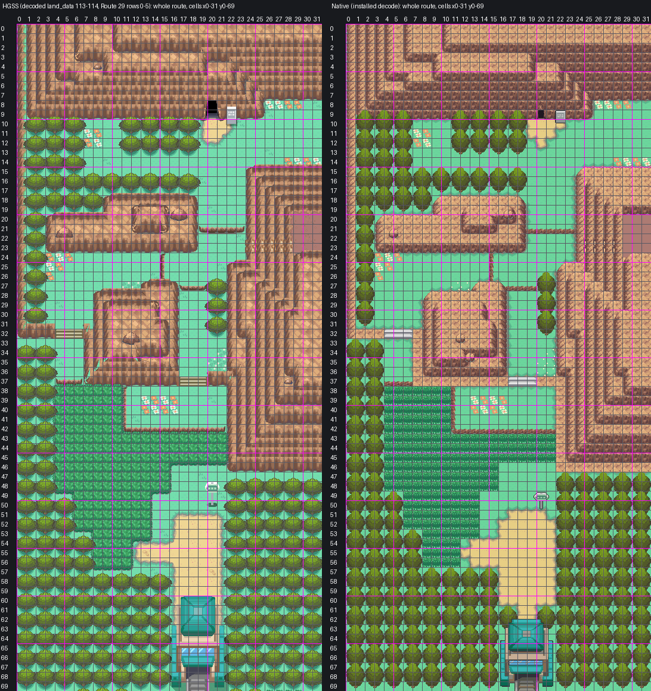

# Route 46: reconstruction guide, beside Route 45's tilesets

**Owner-accepted 2026-10-30** ("Oh yeah, way better. We can move on from this route."), engine
`f4d5ab678a`, hub `0074426a`. Treat this map as locked: edit its committed native source in Porymap,
never regenerate it from these tools.

Route 46 as one native Gen 3 map west of Route 45's foot, built to `AGENTS.md` and
[the map reconstruction workflow](../../../docs/GBA_MAP_RECONSTRUCTION.md) by Route 45's process:
decoded HGSS trace, shared Johto catalog art, Blackthorn's FRLG rock terraces, the Cherrygrove ground
painter, lossless pack. Joined to Route 45 by a map connection, as HGSS joins them, with every Route
45 pixel kept (Route 45 is owner-accepted and locked). Engine branch `claude/route-46` (stacked on
`claude/route-45`, engine PR #43). Owner review 2026-10-29 put the whole Route 29 gatehouse on the map
with the woods closing on it (below).



[The seam: Route 46's east half beside Route 45's west columns by its foot, HGSS above native](evidence/review3/route45-seam.png)

Detail sheets (HGSS beside native, numbered by cell):
[Dark Cave and the north lawn](evidence/review3/dark-cave-north-lawn.png) ·
[terraces and the Rock Climb wall](evidence/review3/terraces-rock-climb.png) ·
[tall grass, the road and the gate](evidence/review3/tall-grass-road-gate.png)

## The map

| | |
| --- | --- |
| Map | `Route46`, 32x70 (HGSS's 32x64 and six rows of Route 29's chunk below it), `gMapGroup_Cherrygrove` id 48, `MAPSEC_JOHTO_ROUTE_46` |
| Tilesets | Route 45's primary `gTileset_CherrygrovePrimary` + own secondary `gTileset_Route46` (217 new tiles, the rest copies of Route 45's; 278 metatiles) |
| Colour | 13 banks, each colour exact: all 573,440 native pixels equal the assembled art in RGB555 |
| Material audit | 2,111 of 2,240 cells show HGSS's material, 2 mismatches (declared below), 127 cells where a foreground object differs |

## 1. Reference (`trace.py`, `elements.ledger`)

- Authority: HGSS land_data chunks 113-114 (1 x 2) decoded from pret/pokeheartgold (header 48, area bank 9,
  matrix origin [19,10]), and the top six rows of the chunk below them, Route 29's (header 33, area bank 2,
  its own map textures; `hgss_render.SOUTH_ROWS`), which hold the Route 29 gatehouse and its woods; events
  zone R46 (`source/hgss-events.json`). Registration exact: HGSS tile (x, z) is native cell (x, y), 16 px,
  origin (0,0). Route 46 (x, y) is Route 45 (x - 32, y + 128).
- Ledger: rock cells by slope, woods `F` (HGSS's Headbutt trees, and the woods at (26-31, 47-53) HGSS
  does not mark for Headbutt: a blocked cell whose dominant material is a tree, and the crown row above
  it), tall grass `G`, jump ledges south `L` and west `Q`, the stairs `s` (HGSS slope cells), the Dark
  Cave mouth `D` (warp 0x6E, (20, 9)), the Rock Climb wall `K` (0x4C, (24-28, 23)) and the Route 29
  gatehouse's north warps `g` (0x6F, (18-19, 60)).
- Trees: one regular lattice of 2x2 roots per woods block: 133.

## 2. Art (`assemble.py`)

Shared masters copied byte for byte into `source/shared-art/` with hashes (`provenance.json`):

| Part | Art | Placement |
| --- | --- | --- |
| Lawn, road | Cherrygrove/Route 36 painter as on Route 45: Cherrygrove's sand road, lawn and road one 16 px quarter of Cherrygrove's block, the rim wave over 16 px | one material per cell, from HGSS's flat ground colours |
| Dirt plateau | HGSS's road05, its commonest tone (Route 45's) | (29-31, 20-23), running on into Route 45's (0-1, 148-151) |
| Rock | Blackthorn's FRLG terraces in the Johto ramp (Route 45's `elements.rock_frlg`) | HGSS's cliffs, every HGSS height its own terrace; a south face has the ground beside it as its top, a side wall is FRLG's side piece whole |
| Rock Climb wall | the west-facing slope it climbs, with HGSS's climbing pegs (r_climb's light tones in the rock ramp), as on Route 42 | (24-28, 23) |
| Dark Cave mouth | FRLG General's cave mouth (metatile 0xA9), as Route 45's and Blackthorn's Dragon's Den | (20, 9), on its face |
| Boulders | FRLG General's boulder in the Johto ramp | one on the middle of each of HGSS's four boulder footprints |
| Tall grass | G15, the whole-cell piece | every HGSS tall-grass cell (175) |
| Stairs | S01-S03, the catalog's straight flight | HGSS's flights down a south face: (4-6, 32), (17-19, 37) |
| Trees | T01 | as above |
| Signs | P14 green rounded sign (model 32), P13 grey plaque (model 31) | (20, 50) route sign, (22, 10) Dark Cave plaque |
| Route 29 gatehouse | G01a, the owner-approved front gate, whole | on HGSS's gate (rows 62-69), 4 px west of the cell grid so its walls stand centred between the woods; the woods close on it, two of their trees standing behind its roof either side of its doorway (`elements.gate_anchors`, the Route 36 surround), and the road narrows to the doorway |
| Flowers | HGSS's flower heads (local) | HGSS's flower cells |

Every cell stands at its own HGSS height, counted from Route 45's lowest ground (HGSS height 2), so the
terraces on both sides of the seam share one scale.

## Owner review (2026-10-29)

- **Space beside the gate.** Only G01a's top two rows were on the map, narrower than the road, so road
  showed on both sides of the roof and seemed to run on past it. Route 46 now takes six more rows, HGSS's
  own Route 29 rows below it, so the whole gate stands on the map with the woods either side of it, as
  HGSS has them. Two trees of the woods' own lattice stand behind the gate's roof at (16, 62) and
  (20, 62), the gate drawn over them, so the road's last row narrows to the doorway, (18-19, 61); the ground
  under and beside the gate is the woods' lawn. The player can't pass the gate on either side (checked in
  mGBA).
- **The border below the gate.** The map now ends under the gate's front steps. The furthest south a
  player stands is the doorway row, 61, and the camera there reaches row 66, so the border (Route 45's
  rock) never comes into view.

## 3. Beside Route 45's tilesets (`pack_fixed.py`)

As Route 45 beside Blackthorn: Route 46 uses Route 45's primary tileset, and its secondary carries exact
copies of what the Route 45 cells its tilesets ever draw use (Route 45's west columns round the seam:
the tiles, metatiles and palette slots, at Route 45's own indices). The part of Route 46 Route 45's
tilesets ever draw (`assemble.views`: Route 46's east columns, in view from every walkable Route 45
cell and from the seam rows while crossing) is drawn with Route 45's metatiles: 196 of those 214 cells
are Route 45 metatiles as they are. The other 18 are metatiles appended to Route 45's secondary table
(ids 892-909); where no Route 45 tile drew a quadrant, 7 tiles are appended to its secondary tile sheet
after its own 480 (indices 992-998), drawn with Route 45's palettes as installed. No Route 45 cell uses
any of them. Both maps use Route 45's border block (Blackthorn's metatile 512, which Route 46 carries
whole).

The packer proves: Route 46 decoded with its pair equals its assembled art; every Route 46 pixel
Route 45's tilesets draw equals it too; every Route 45 pixel Route 46's tilesets draw equals Route
45's; Route 45 with the appended metatiles is unchanged.

## The seam

HGSS opens the seam on two stretches, and so does the native: Route 45's west-edge stairs at
(0, 138-140) step down onto Route 46's lawn at (31, 10-12), and the dirt plateau runs across at Route 46
rows 20-23 (Route 45 rows 148-151). Route 45's map.json changes only by its connection west (offset
128); Route 46's connection east has offset -128.

## Deliberate adaptations

- **Rock Climb.** Gen 3 has none: the wall at (24-28, 23) is solid cliff with HGSS's pegs, so the dirt
  plateau east of it, (29-31, 20-23), and Route 45's pocket beside it (with HGSS's hidden PP Max at
  Route 45 (0, 149)) are not reached. These are the 12 unreachable open cells in
  `evidence/pack3/native-audit.json`.
- **Dark Cave.** Not built: the mouth is solid.
- **Route 29 gatehouse.** Its interior and Route 29's side are not built in this style (the engine's
  Route 29 is the older `CherrygroveRoute29Approach`), so its doorways are solid and Route 46 has no
  connection south. HGSS blocks (16-21, 61) for its taller gate model; G01a starts at row 62, so the
  doorway's two cells of that row are open road up to its roof, as on Route 43 (`elements.GATE_APRON`).
  The two trees behind the roof stand where HGSS has road at (17, 61) and (20, 61): the 2 material
  mismatches.
- **Region map.** `MAPSEC_JOHTO_ROUTE_46` sits at (5, 5) on the proof region map, the free square next to
  Route 45's (the squares west of Route 45 are taken).
- **Foreground.** T01, the signs and the gate differ in size and offset from HGSS's; these are the 127
  "foreground differs" cells in `evidence/pack3/material-audit.json`.

## Verification

- **Build**: engine `claude/route-46`, ROM sha256
  `d766cd994cb9990e6d944f2d165feebb269924465dee3dace1f474a2f139d10e` (not committed).
- **Audit** (`check3.py`, `evidence/pack3/native-audit.json`): the installed Route 46 equals the pack decode
  and its assembled art; Route 45's installed decode equals its decode as committed on `claude/route-45`;
  both seam views exact from the installed files; connections both ways, Route 45's map.json changing only
  by its connection west; shared border; behaviour, collision, elevation and layer type match the ledger
  on every cell; the seam open on exactly the rows HGSS opens on both sides, at one elevation; the cells
  reached on foot from Route 45's stairs are exactly HGSS's (its Rock Climb wall blocked, less the Dark
  Cave warp) plus the doorway's road under HGSS's taller gate; every ledge one-way; walk-behind layering; budgets;
  shared masters byte-identical; Route 45's metatiles and tiles unchanged (its tables only grow); only
  Route 46 files otherwise.
- **Material audit**: 2,111 match, 2 mismatch (declared above), 127 foreground differences.
- **Headless mGBA** (`runtime3.py`, `evidence/pack3/runtime/`): 33 captures with map layers rebuilt from
  VRAM equal to the native decodes, Route 45 beyond the seam included; views down the whole route; the
  seam walked from Route 45's stairs into Route 46 and back on all three rows, with captures 4 frames into
  each crossing step matching too; BG1 covers the player behind the route sign and leaves the player clear
  in front of it; a south and a west ledge jumped and refusing the climb back; both flights; the Dark Cave
  mouth, the Rock Climb wall, the gate, the trees either side of its doorway and a tree block a player on
  foot; both signs read; Route 45,
  Blackthorn and Cherrygrove regression views; ordinary flash save, cold reload and title Continue.
- **Porymap 6.3.1** (`evidence/pack3/porymap/`): opens, exports and saves Route 46 and Route 45 on a fresh
  clone of the engine commit; both exports equal the native decodes with 0 differing pixels in RGB555;
  saving rewrites no Route 46 or Route 45 line.

## Remaining

- Not placed: HGSS's object events (three trainers, two Apricorn trees, the X Speed ball, the gate
  attendant); no wild encounter table.
- Dark Cave and the Route 29 gatehouse are not built.

## Reproduction

```sh
python3 tools/gba/maps/route46/hgss_render.py PHG_CHECKOUT gba/art/route-46/source/hgss
python3 tools/gba/maps/route46/hgss_events.py PHG_CHECKOUT gba/art/route-46/source/hgss-events.json
python3 tools/gba/maps/route46/trace.py PHG_CHECKOUT
python3 tools/gba/maps/route46/assemble.py PHG_CHECKOUT CATALOG_CHECKOUT ENGINE_CHECKOUT   # catalog: codex/violet-city
python3 tools/gba/maps/route46/pack_fixed.py ENGINE_CHECKOUT PHG_CHECKOUT   # beside Route 45's tilesets, read from claude/route-45
python3 tools/gba/maps/route46/install.py ENGINE_CHECKOUT
make -C ENGINE_CHECKOUT -j8
python3 tools/gba/maps/route46/check3.py ENGINE_CHECKOUT PHG_CHECKOUT
python3 tools/gba/maps/route46/review3.py ENGINE_CHECKOUT
python3 tools/gba/maps/route46/runtime3.py ENGINE_CHECKOUT OUT_DIR
python3 tools/gba/maps/route46/porymap.py ENGINE_CHECKOUT PORYMAP_BINARY    # needs the engine change committed
```

Generators are provenance: once the owner edits Route 46, edit the committed native source in Porymap.
