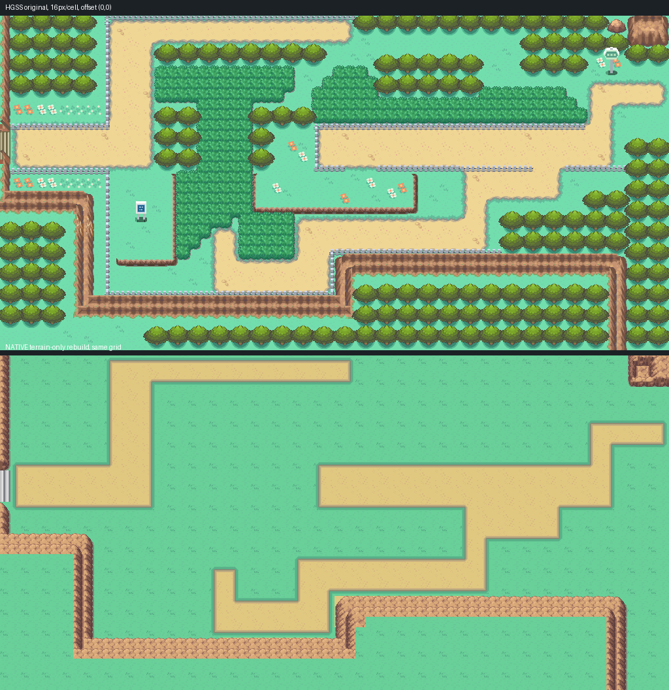
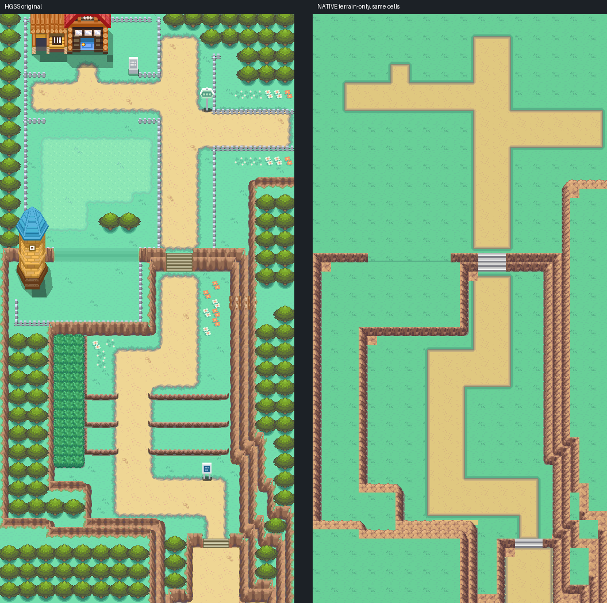
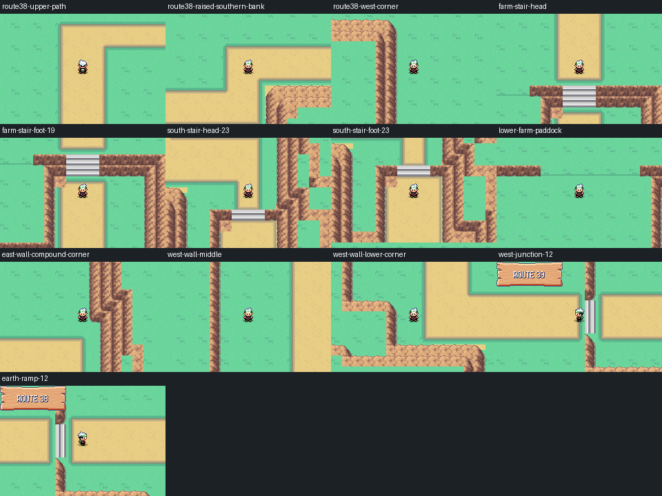

# Routes 38 and 39 — HGSS texture-grid native rebuild

Editable engine source: [PR #41](https://github.com/Davisfox5/pokeemerald-expansion/pull/41), branch `codex/route38-39-hgss-native`, commit `cbb5a4d038b9546bc9cde861892eecb11b3d1479`. Open that complete checkout in Porymap. Stable maps: `JohtoRoute38` (80.53, 64×32), `JohtoRoute39` (80.54, 32×64). This replaces the previous terrain proposal; it is pending owner visual review. Earlier drafts, other maps and saves remain preserved.

## Instructions and original authority

Read current [AGENTS.md](../../../AGENTS.md), [map reconstruction workflow](../../../docs/GBA_MAP_RECONSTRUCTION.md), shared source, production and outdoor refinement instructions. Main was refreshed to `67ec55804eb4b56ba40ff7635f1f39e30a8e7f4e`; its newer Route 30/31 work is preserved. Original HGSS is the layout authority, with no use of a previous Gen 3 composite as the base map.

`source/route*-hgss/reference.json` pins original archives/revision, model placements, chunk coordinates and projection. Original `pret/pokeheartgold` commit `6988158691eb6178cff697cda0428045ddcba5fb`; EVERYWHERE matrix header 42/43; area bank 7, texture set 7. Members 54/55 define Route 38 at matrix (9,5)/(10,5), 56/57 define Route 39 at (8,5)/(8,6). Registration: one original 16-unit square to one native 16px cell, offset (0,0), no expansion. Original full/flat/terrain views are independently rendered from model UVs and actual textures using the shared accepted HGSS renderer. `cleared-flat.png` removes foreground materials without tracing a screenshot; black regions have no original base geometry and are declared uncertain.

Material, original collision and BDHC height remain separate (`route*-original.npz`, original byte grids, terrain meshes, ledger and layers). Actual dirt is read at 8px from foreground-free original road textures: neither the footstep flag nor the whole mesh bounds establishes visible dirt. Mixed path squares retain their ground when the jump ledge is cleared. Original ground is undefined in 4,684 reviewed quadrants beneath removed foreground; those receive lawn, are listed in `uncertain-ground.json`, and are excluded from original-match claims. There are 9,684 defined ground quadrants with zero native material mismatches. The 2,016 rock/stair/ramp quadrants are reviewed separately, not counted as plain-ground matches.

Owner-authorized scope remains terrain only: remove trees, fences, houses, tall grass, jump ledges, props and NPCs; retain lawn, dirt, rock walls, levels and stairs. Source collision versus native changes are explicit in `adaptations.json`. Ordinary removed-foreground collision becomes lawn; the outer preview perimeter stays bounded except the internal three-lane crossing. No exterior city exits, campaign progression or new HM behavior are wired.

## Shared native art and level logic

Ground uses accepted Cherrygrove lawn and the actual native town's 32px road texture. Paths retain the original 8px material footprint, straight native edges and Cherrygrove contact profiles; the painter's wave is disabled to honor the owner's straight-tile direction. This is an explicit Gen 3 edge adaptation, not a claim that the original texture has straight borders.

Rock uses the shared FRLG terrace method from the accepted Mahogany/Route43 process and the newer Route31 catalog (`route31_catalog/rock.py`): complete mountain nine-slice, ground-facing/over-rock variants and inner corners in the Johto rock ramp. Each face follows the measured original peak and adjoining ground plane. Distinct courses retain cap/front/side roles; grass tops remain grass. No custom corner clipping or nearest-color tile substitution is used. Original texture appearance is adapted to this shared Gen 3 vocabulary; the source/native wall sheets show the difference openly.

Source heights 1–5 map to native elevations 1/3/5/7/9; real inclines use 0. Route38 main terrace 3, southern bank 5; Route39 upper farm 4, lower paddock 3, central valley 2 and south beyond the final stair 1. The internal east-facing stair at Route38 x0,y11–13 crosses height4→3. Route39 farm stairs span x18–20,y26–27; grass ramp x6–14,y26; southern stairs x22–24,y57. Original undefined height backing is separately marked and inferred, not treated as measured. The little Route38 northeast outcrop remains a blocked rock cap. Narrow eastern Route39 grass tops stay at their defined height.

Gray stair art reuses the existing Emerald Mossdeep donor. Its historical transparency mask incorrectly keyed out the white tread noses; those are restored opaque. The complete flight is rotated for the east-facing junction. Wall shoulders and the first/last steps are reviewed together. Native packing is exact RGB5: 94 metatiles, 208 allocated 8px glyph slots, palette banks 0 and 12. A new private `route3839_native` bank preserves all earlier banks and other maps. `art-provenance.json` records hashes and local adaptations.

## Review

Numbered source/native sheets: [R38 west](evidence/route38-grid-comparison-1.png), [R38 east](evidence/route38-grid-comparison-2.png), [R39 north](evidence/route39-grid-comparison-1.png), [R39 south](evidence/route39-grid-comparison-2.png). [Whole wall/stair comparisons](evidence/wall-original-native.png), [native level grids](evidence/route39-levels.png) and [specific findings](evidence/visual-findings.json). The previous proposal remains at [route38-39-rebuild](../route38-39-rebuild/README.md) for comparison.

Build and actual Porymap 6.3.1 export pass. All 4,096 native cells are audited; no forbidden behavior or open nonzero elevation seams. Original-defined material checks use actual decoded native pixels, not authoring names. 798 mGBA wall-boundary probes, all stair lanes and nine grass-ramp lanes both ways, all three connection lanes both ways, ordinary flash save, cold reload and title Continue pass on the final ROM. The original preview save is copied for compatibility checking and remains unchanged. Thirteen actual game frames match 460,000 native RGB5 terrain pixels; the player and declared map-name popup rectangles are excluded. Porymap pixels also match the native decode exactly. `preservation.json`, adjacent final runtime JSONs, `material-comparison.json`, `gameplay-pixels.json` and `visual-findings.json` record exact scope and identities. Functional checks do not establish owner visual acceptance. No hosted checks are present; current project handoff reports Actions disabled. PRs remain drafts.

## Reproduce and continue editing

Tools live under `tools/gba/maps/route3839_native/` and use existing shared code rather than a new editor. `original.py PHG` renders the scoped original maps from the four pinned archives and EVERYWHERE matrix. `planes.py RAW GLTF` decodes original BDHC/grid/mesh data, using the preserved first reference's archive extraction and apicula conversion. `assemble.py ENGINE` and `install.py ENGINE PORYTILES` performed first authoring and refuse replay after the new bank is committed. Current native source is authoritative; continue in Porymap/native sources.

Read-only engine checks: `review.py ENGINE`, `compare.py ENGINE`; then build and run `runtime.py ENGINE OUT --toolchain ARM_ROOT`, plus separate `--boundary-part 0`/`1` outputs with libmgba flags. Export with the existing actual Porymap probe, then `gameplay.py RUNTIME_OUT`. Legacy compatibility uses the preserved `route38_39/legacy_save.py` on a copied first-preview save. Source PNGs, native inputs, grids, complete FRLG pieces and provenance are editable and tracked; full source archives/tool binaries are excluded. ROM and ordinary matched flash save are delivered outside Git in a separate playable ZIP. Choose Continue to begin on Route39.
