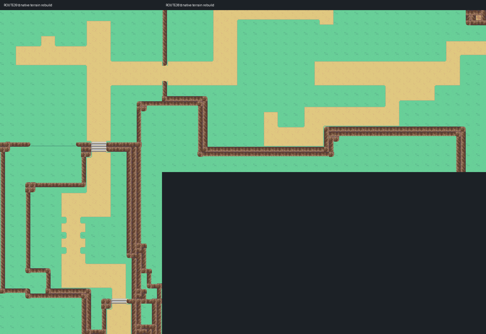
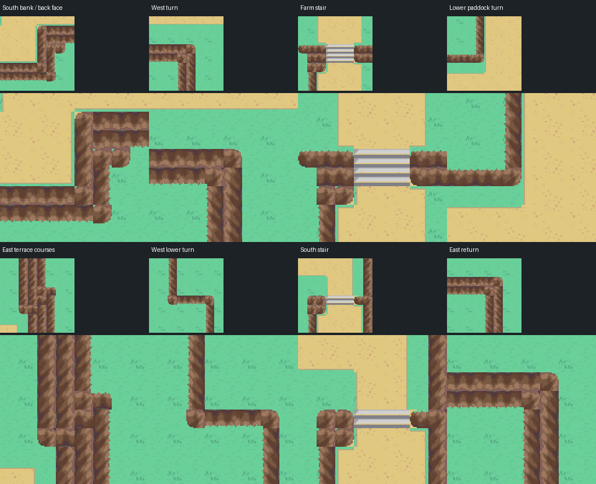

# Routes 38 and 39 — fresh terrain rebuild

Native source: [engine PR #36](https://github.com/Davisfox5/pokeemerald-expansion/pull/36), branch `codex/route38-39-rebuild`, commit `eb8d6bb9f85c511f0b21e0e0b2d7f038beb47f6c`. Open that full checkout in Porymap. Stable maps `JohtoRoute38` (80.53, 64×32) and `JohtoRoute39` (80.54, 32×64) remain editable native maps. Earlier route drafts, Ecruteak and other maps remain preserved. This supersedes the terrain/refinement proposal; it is pending owner visual review.

The rebuild follows the current published root AGENTS.md and GBA_MAP_RECONSTRUCTION.md, checked against main `266cb169ca361b6c8737c6f9985792e6a851cb1b`. It retains the owner's terrain-only scope: grass, dirt paths, rock terrain and stairs. Trees, houses, fences, props, NPCs, tall grass and jump ledges are removed.

## Original source and interpretation

`source/reference.json` pins the original `pret/pokeheartgold` revision, archive and four member hashes. Members 54/55 define Route 38; 56/57 define Route 39. One original 16-unit square maps to one native 16px cell. `route*-original.npz` retains type, original collision, known-height mask, BDHC plane heights, terrain-wall coverage, face normals and bound road coverage; `route*-terrain-mesh.json` retains the scoped original mesh triangles. No full archive or donor tool is vendored.

Material, original traversal and height are separate. An ordinary walkable type flag does not always mean visible dirt here: the original bound road mesh resolves the actual path. Cleared foreground backing is documented in `adaptations.json`; every traversal difference is recorded in `traversal-adaptations.json`. Undefined backing heights are inferred and marked; they are not presented as measured planes.

Source heights 1–5 map to native elevations 1/3/5/7/9. Inclines use elevation 0. Route 38's main terrace is height 3, southern bank 5, with the western earth ramp rising to Route 39's height-4 upper farm. Route 39's lower paddock is height 3, central valley 2, south below the final stair 1; the narrow eastern terrace tops remain grass at their measured height 5. The farm stair spans x18–20, rows26–27; the grass ramp spans x6–14, row26; the south stair spans x22–24, row57. The internal route crossing uses rows11–13. Exterior city exits remain unwired and other preview edges are blocked.

## Native art and cleanup

The finite native kit uses accepted Ecruteak R01–R12 cliff masters, accepted Azalea grass/path and existing gray Mossdeep stairs; see `kit-provenance.json`. Front/back/side rim and body roles, full corner pieces and ground phase remain distinct. Complete native corners preserve the donor texture, high-plane lip and rounded receiving outline. The 32px ground phase continues through native border blocks. Paths use square tile geometry with small corners.

`used-kit.png` and `used-kit-index.json` provide an editable atlas; all used individual pieces are tracked under `source/kit/`. Native packing is exact RGB5: 105 metatiles, 176 allocated glyph slots, five palette banks. A separate `route3839_rebuild` bank preserves the previous private bank and unrelated maps.

The initial authoring tools live in `tools/gba/maps/route3839_rebuild/`: `reference.py RAW_DIR GLTF_DIR` decodes the scoped original source; `build.py ENGINE PORYTILES` and `install.py ENGINE PORYTILES` performed first authoring. They refuse to replay over the committed rebuild. Current native sources are authoritative; make subsequent map changes directly in Porymap/native sources. `review.py ENGINE` is read-only with respect to the engine. `runtime.py ENGINE OUT_DIR` runs the existing headless mGBA harness; `--boundary-part 0` and `1` split all wall probes. Raw source retrieval/apicula conversion follows the preserved original terrain reference tooling and pinned hashes.

## Review and evidence

Material/level reviews: [Route 38 materials](evidence/route38-material-grid.png), [Route 38 levels](evidence/route38-levels.png), [Route 39 materials](evidence/route39-material-grid.png), [Route 39 levels](evidence/route39-levels.png). Coordinate-labelled native grids and per-cell source/native audit records sit beside them. Compare the previous [terrain refinement](../route38-39-terrain/evidence/refinement/README.md) for the preserved earlier draft.

All 4,096 native cells pass the material/elevation/behavior audit with no open nonzero elevation seams. Actual Porymap exports match decoded native RGB5 pixels. Visual inspection covered the upper/lower courses, complete wall turns, terrace tops and both stair shoulders. 336 two-sided known-plane face checks found no reversed wall direction; the other corners are reviewed against source mesh geometry and native views. Rock pixels form three connected formations on Route 38 and two on Route 39, with no disconnected fragments under 12 pixels.

The final ROM passed 798 wall-boundary probes, all stair lanes and nine grass-ramp lanes both ways, three route-crossing lanes both ways, ordinary save/cold Continue and the preserved earlier preview save. Ten actual game captures agree with 358,080 native terrain pixels outside the player; 1,920 exterior border pixels also agree. See `runtime.json`, `boundaries-a.json`, `boundaries-b.json`, `legacy-save.json`, `gameplay-pixels.json`, `border-view.json` and `preservation.json` for exact identities/results. Functional checks do not establish owner visual acceptance. Hosted checks had no runs at packaging; source and evidence remain draft PRs.

The playable ZIP and matched ordinary flash save are delivered outside Git. Choose Continue to start on Route 39. It is an isolated terrain review build, with no exterior city wiring, campaign progression or new HM behavior.
