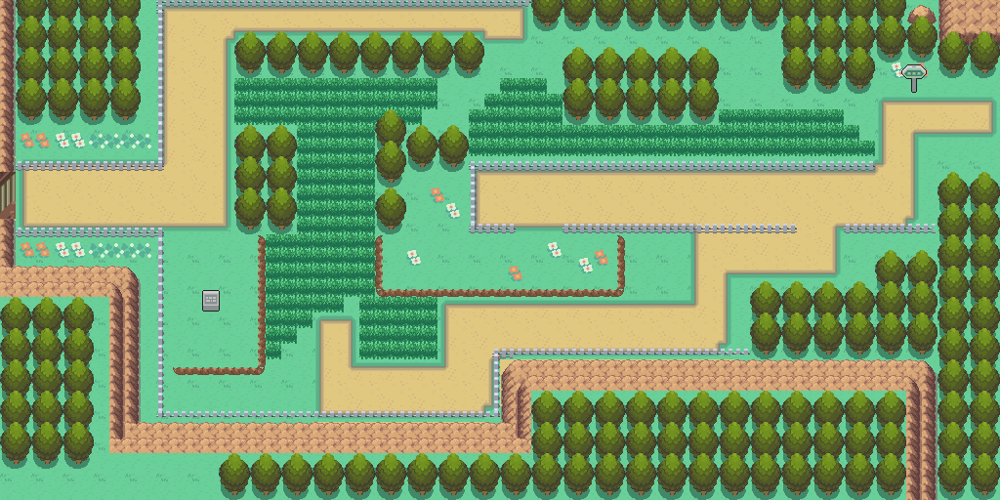
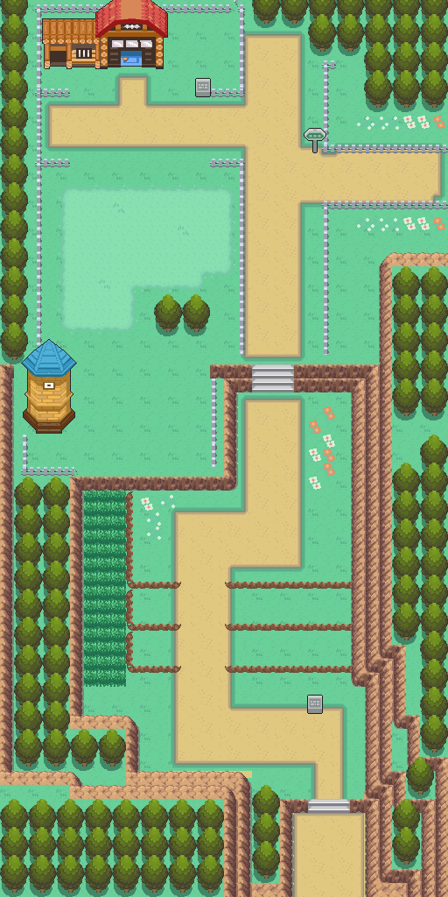

# Complete Routes 38 and 39 — fresh HGSS reconstruction

The owner rejected the earlier terrain-only attempts and explicitly requested **complete routes**.
This revision starts at accepted Ecruteak engine `2d7689a9c420e1af075d6c29c0d069d1aaa04fe3`, before
any of those attempts. No earlier route layout, tile bank or cliff generator is carried forward.
Earlier branches and saves remain intact. This is a complete outdoor architecture proposal; visual acceptance is pending.

Editable native source: [engine branch](https://github.com/Davisfox5/pokeemerald-expansion/tree/codex/routes3839-complete),
commit **7cf7ce296f2cf8fc51bc2ad0181d24efab7908ac**. Open that checkout in Porymap.
The maps are `JohtoRoute38` (64×32, ID 80.53) and `JohtoRoute39` (32×64, ID 80.54).
They connect directly, west/east at offset 0, on one private shared primary/secondary tileset.
Existing maps, palette/metatile IDs and layouts are unchanged.

[Route 38 original/native comparison](evidence/route38/comparison.png) ·
[Route 39 original/native comparison](evidence/route39/comparison.png) ·
[Actual gameplay gallery](evidence/gameplay-contact.png)

## Reference and construction

Authority: `pret/pokeheartgold@6988158691eb6178cff697cda0428045ddcba5fb`, original land archive
`files/a/0/6/5`, area metadata `0/4/2`, map textures `0/4/4`, exterior models `0/4/0`, EVERYWHERE matrix,
and zone events `039_R38.json` / `040_R39.json`. Archive hashes, original building placements and matrix
origins are in each `source/route*/original.json`. Route 38 is land members 54/55 at matrix (9,5),
Route 39 members 56/57 at (8,5). Registration is exactly 16 pixels per original cell, origin (0,0),
with no expansion. The original projected renders and independent permission arrays are retained.
Nintendo/Game Freak original assets are reference material; decoder provenance is the existing shared
`route31_catalog/hgss_render.py` and its pret/apicula dependencies.

Each route has an editable `material-grid.txt`, detailed material/height `ledger.json`, independent
`traversal.json`, `placements.json`, tree roots, and separate ground/foreground `layers.npz`.
Construction reuses the latest shared Johto catalog workflow:

- Cherrygrove lawn and dirt textures, T01 trees with their contact shadow, and catalog G15 grass.
- Original fence silhouettes and positions; original flower and pasture textures, reduced within their own material.
- Owner-locked Johto rock ramp on shared FRLG terrace modules, including concave/convex joins.
- Existing Johto gray north/south stairs and Route 36 plank east/west flight.
- L11/L12/L13 ledges, including mirrored west-facing runs and connected endpoints.
- Farmhouse/stable and silo rendered from original models 112/114 and 113 at the shared C06 camera angle,
  finished with the same 14-tone-plus-outline method as Route 30 buildings. Doors remain on original cells.
- Shared P13/P14 signs. No invented characters or story rewards.

The original decoded reference is the layout authority; shared routines provide reusable art and packing technique.
The farm buildings keep their original design. This is not a new ten-year story proposal.

## Reviewed adaptations and limits

The paths use the owner's requested square native boundaries instead of the original wavy projected outlines.
Shared palette rims retain small stepped corners. Tree crowns use the accepted town art, with distinct 2×2 roots:
162 complete trees on Route 38 and 112 on Route 39. Two shoulder trees at (26,9) and (28,9) were aligned with
the original trunk row, eliminating the empty blocked strip below them. Canopies can cover the row above their
roots; native layer types permit walking behind crowns without cutting their outlines.

Ground hidden under foliage is reconstructed as continuous shared lawn; it is not counted as independently
observed original ground. The original southern crop on Route 38 has 14 one-row woodland collision cells
(x0–13,y31) where a complete root cannot fit inside the map: these retain the original blocked boundary and lawn
backing, with no invented half trees. Source model/render seams and original unseen ground are not proof of exact
pixel identity. The grass ramp across the pasture remains traversable lawn. Height differences are represented
by Gen 3 terrace art and collision, not a new continuous elevation engine.

**Exterior-only interaction limits:** farm entrances have inspection labels, but no interior warps. Route 38's
Ecruteak gatehouse and Route 39's Olivine exit remain unwired. Trainers, Miltank, Apricorn harvest objects,
encounters and items are not placed; those require the campaign's actor/reward decisions. No original HGSS
story scripts or reward flags were imported. Existing Ecruteak is preserved, not silently rewired.

## Verification and concrete findings

- Native source built locally with ARM GCC 14.2.1. ROM SHA-256:
  `ff5932fa2321c493841f615ec48ab16cda8b08093b0b52f18fdb971382500dcb`.
- Porytiles 2.0.0 legacy compiles 539 metatiles; a local native boulder repair appends four, for 543 total.
  The final banks use 688 allocated tile slots and 13 palettes.
  Exact RGB555 packing; no nearest-image or silhouette substitution. Both routes share all seam definitions.
- Porymap 6.3.1 opened/exported both native maps. Exports equal the independent native decoder pixel for pixel.
- All 4,096 cells retain original solid/open status; all 247 tall-grass and 79 ledge cells have the correct native
  behaviours. Material review is recorded separately from those collision checks.
- Headless mGBA 0.10.5 completed a 344-step continuous tour, traversing the southern approach, all terraces,
  the pasture, farm frontage, Route 38 grass corridors and the connection in both directions.
- All 79 ledges were jumped in their allowed direction and blocked from the reverse side.
- All 365 distinct obstacle-metatile/direction cases blocked correctly. Five signs and both farm labels open
  and close. Tall-grass walking with the preview's empty party remains in the field.
- Ordinary 128 KiB flash save, fresh-process load and title-menu Continue pass in both test runs.
- 719,840 actual game pixels across 21 positioned frames equal the native RGB555 maps. The player rectangle,
  crossing map-name popup and pixels outside defined map bounds are excluded explicitly.

Whole maps and numbered 16×16-cell source/native sheets were reviewed. Specific repairs: the east wall's
Rock Climb material at Route 39 (25–27,31) is included in the continuous wall; west-facing ledges and their
southern corners are mirrored as joined runs; Route 38's four shoulder woodland cells are now under complete
roots; farmhouse cell (9,4) keeps its original solid flag rather than becoming an unsupported walk-through door.
The original northeastern rock01 boulder at Route 38 (58–59,0–1) was restored through a local native edit,
  appending eleven glyphs and four metatiles without changing existing palette slots or repacking owner source.
  See `boulder-repair.json`; all gameplay checks were rerun on the resulting ROM.
  The farm roof/door alignment, silo footprint, pasture fences, stair approaches and both route seam views were
inspected again in actual gameplay. These checks support review; they do not assert owner visual acceptance.

See `evidence/audit.json`, `packing.json`, `runtime-plan.json`, `runtime/`, `gameplay-pixels.json`,
`preservation.json`, `source-manifest.json` and `compare-grid-*.png` under each evidence route directory.
GitHub Actions is disabled on the engine repository; local build evidence is included, not a claim of green CI.

## Reproduction / native editing

`tools/gba/maps/routes3839_complete/` is first-authoring provenance. `build.py` adapts the current shared catalog
routines; `native.py` compiles with Porytiles and registers native banks; `integrate.py` appends stable map IDs
and exterior inspection scripts. The latter two refuse to run over committed route sources. Edit the committed
maps directly in Porymap rather than replaying these generators.

To reproduce separately, check out the engine baseline above and this hub revision. Set `ROUTES_ENGINE` to the
isolated engine path and `HGSS_SOURCE` to a pinned original-data checkout. Run `reference.py HGSS_SOURCE`,
`build.py`, `native.py`, `integrate.py`, `boulder.py`, then the normal serial `make generated` and parallel engine build.
`native.py` uses the installed legacy Porytiles path recorded in `packing.json`; adjust that local executable
path if necessary. Export Porymap maps, then run `review.py`, `runtime.py ENGINE OUTPUT --toolchain TOOLCHAIN`,
a separate `runtime.py ... --boundaries`, and `gameplay.py TOUR_OUTPUT`.
The final local repair is recorded by `boulder.py` and refuses to run if those native cells have changed.
ROMs, saves and tool executables are deliberately outside both repositories. The downloadable preview contains
an ordinary save positioned on Route 39, the ROM, the native map images and its build identity.
