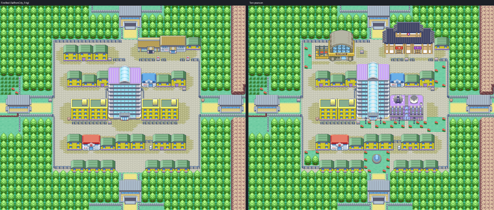
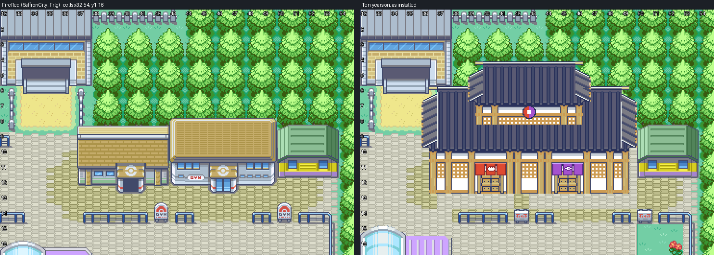
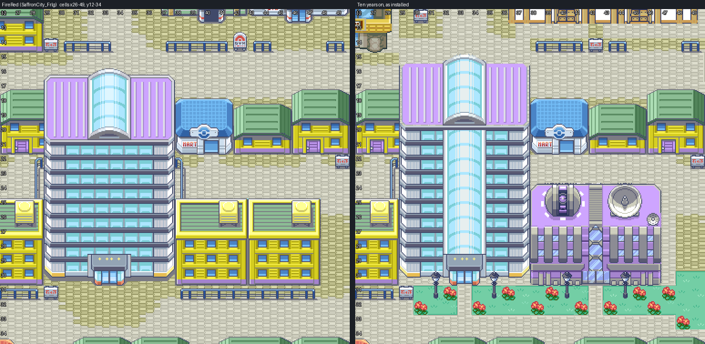
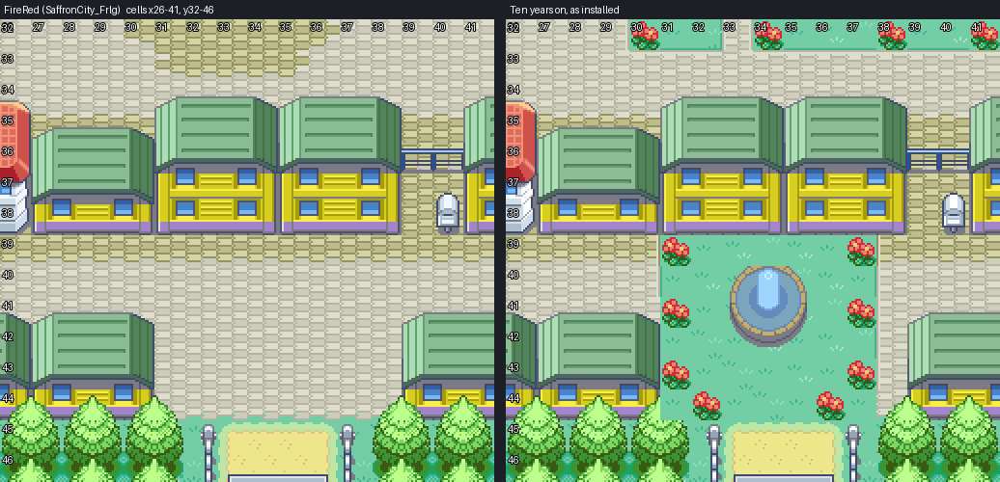
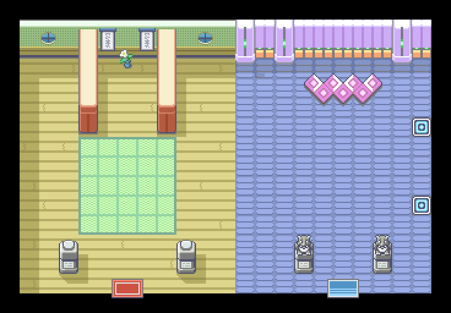

# Saffron City, ten years on

FireRed's own Saffron, cell for cell, with the changes ten years and Apocrypha's story have
made to it. Saffron is where Kanto starts (Chapter 4 ends at Saffron Station, Chapter 5 is
spent in the city), so it is the first Kanto town updated. Editable source is engine
branch `claude/saffron-city`, which builds on `claude/olivine-city`. Owner visual
acceptance is pending.

This is the third round. The first edited FireRed's map; the second moved to HGSS's plan
with buildings rendered from HGSS's models, and the owner turned it down (2026-10-24:
"a severe regression ... It looks like it was made for a 1980s game"; the Dojo "still
look[ed] like two separate buildings just with a shared roof"; Silph "basically looking the
same" with "that detached laboratory"; "the buildings look boring. The floor looks
boring"). v3 goes back to FireRed's map and builds the new buildings from real Gen 3 map
art instead: FireRed's and Emerald's own pixels, cut and put together into buildings of
Saffron's own (`parts.py`). The v2 engine commit is reverted, not rewritten.

FireRed's `SaffronCity_Frlg` stays as it is (FireRed's maps are not in the Emerald build).
This is a new map beside it.



## What changed, and why

Each change answers the owner's brief or DESIGN.md (Kanto: "the political, technological,
and financial core. Silph Co. dominates the skyline, and the city houses interregional rail
connections, League offices, and the competing Psychic and Fighting Dojos ... No gym";
Chapters 4 and 5).

| Change | Source art | Story |
| --- | --- | --- |
| The Saffron Dojo: one building on FireRed's Fighting Dojo and Gym lots, 14 cells wide, a door for each school, Fighting (40, 12) and Psychic (45, 12), into one shared hall | Emerald's Battle Palace hall (Battle Frontier) widened under one dark tiled roof, its periodic roof bay repeated; a second roof tier over the centre bay with a shoji band and the shared crest (half Fighting red, half Psychic purple); a noren over each door in its school's colour, a fist on the red, an eye on the purple | The owner's brief: both dojos "each with an individual entrance but a shared interior", one original building. Canon has no Saffron Gym |
| Silph Co.: FireRed's own Silph, a floor taller, the roof atrium's glass carried down the whole front as one spine to the entrance canopy (which is the atrium's width), its mullions on the floor lines | FireRed's Silph throughout: purple roof panels, white rounded sides, pale teal glass, a floor line every 16 px | "Silph Co. dominates the skyline" |
| Silph's research lab, built onto the tower's east side, its own door (42, 30) into an open, empty lab | Emerald's Mossdeep Space Center (observatory dome, roof-deck dish, glass stair column) recoloured to Silph's lavender | The owner's brief: a wing on Silph with a separate entrance, "Open, empty lab" |
| Green spaces: a fountain garden on the south avenue out to the south gate's grass; lawns and flower beds before Silph and the lab (paths kept to both doors); the east fence's green north and south of the east gate and the strip west of the station, in flowers; a grove of trees in the fenced corner by the Center, the one place trees close no walkway | FireRed's own General grass, flowers and trees (Celadon's), Celadon's fountain; Celadon's lawn edge drawn in Saffron's colours (a darker grass rim, a mortar-and-highlight kerb on the paving) | "The floor looks boring": Celadon's Gen 3 vocabulary, no new colours |
| Street lamps at Silph's and the lab's doors | Rustboro's lamp (Emerald), its paving left behind | |
| The Magnet Train station in the north-west block, in place of three houses | v1's station (`sprites.py`, HGSS's model at C06's angle) | Chapter 4's arrival with Mel, Chapter 5's missing rail pass |
| The Gym's red signposts made plain city signposts; signs SAFFRON DOJO - FIGHTING and SAFFRON DOJO - PSYCHIC, "Challengers welcome." | | No gym |
| The Trainer Fan Club's sign reads POKéMON LEAGUE, KANTO OFFICE | | "League offices" |
| The Copycat's house moves to the house at (18, 17), which gains FireRed's door front at (19, 21) | | The station took her lot |
| Silph's sign: SILPH CO. HEADQUARTERS, "The lobby is open to visitors. RESEARCH LAB entrance to the east." | | Chapter 5's public lobby |
| The Mart stocks KANTO_ITEMS.md's badge-1 list | | "Trim the vanilla Kanto stock" |
| Team Rocket's occupation, its grunts and FireRed's scripts gone | | Ten years gone. No NPCs yet |

Every other cell keeps its FireRed metatile, behaviour, collision, elevation and layer type,
and FireRed's colours (no Kanto grade in v3).





### The Dojo's hall

`KantoSaffronDojo`, 25x16: FireRed's Fighting Dojo built out to twice its width
(`interiors.py`). One wall runs the length of it, its pillars every four cells and its
window and scroll bays repeated; one tatami arena, FireRed's mat drawn 17 cells long, shared
by both schools. The west end is FireRed's Dojo floor with its two statues and the exit mat
back to the Fighting door; the east end repeats it with Sabrina's Gym in it (the Gym's two
Pokemon statues and its pink diamond rug, laid on the Dojo's wood by their own pixels) and
the exit mat back to the Psychic door. Either door leads into the same room.



The lab, `KantoSaffronSilphLab`, is FireRed's Cinnabar Lab experiment room as it is, open
and empty.

## The map

| | |
| --- | --- |
| Map | `KantoSaffronCity`, 66x55, `gMapGroup_Kanto` (group 81) id 0; Center 1, Center upstairs 2, Mart 3, Dojo 4, lab 5; `MAPSEC_SAFFRON_CITY`, `REGION_KANTO` |
| Primary | `gTileset_KantoSaffronPrimary`: 512 tiles, 260 metatiles (every cell FireRed drew as it was, and the border) |
| Secondary | `gTileset_KantoSaffronCity`: 284 of 496 tiles (16 kept for door animation), 265 metatiles (the 424 art cells) |
| Palettes | 13 banks, 192 of 195 colours, one pixel-exact fit over the whole map |
| Rooms | `KantoSaffronDojo` (81 tiles, 51 metatiles) and `KantoSaffronSilphLab` (114 tiles, 70 metatiles), each on `gTileset_Building` and its own secondary |
| Border | FireRed's |
| Music | `MUS_RG_PEWTER` (FireRed's Saffron theme); the lab `MUS_RG_SILPH` |
| Doors | Center (24, 38) and Mart (40, 21) open on interiors cloned from Cherrygrove's, with FireRed's sliding door; the Dojo's two doors and the lab's door open on the new rooms (no door animation, as in Olivine); Silph's lobby, the station, the other houses and the four gates solid |

### How it is packed

- `parts.py` cuts each part from a FireRed or Emerald map as the game draws it, makes the
  ground round it transparent and writes `source/sprites/*.png`.
- `compose.py` edits FireRed's grid (cleared lots, signposts, the Copycat's door front,
  lawns, flowers, trees), refuses a lawn over anything but paving or grass, renders it, draws the kerbs, and places the parts in painter's
  order. A cell any part draws in is an art cell: FireRed's picture there, both layers
  flat, on the bottom layer, the part's pixels on the top layer. Part colours within 2.5
  5-bit steps of one FireRed draws take FireRed's; colours one 5-bit step apart in every
  channel merge (10 merged).
- `pack.py` packs every cell and the border from its pixels into 13 banks with one
  annealed exact fit (every 8x8 tile's 5-bit colours in one bank), each tile kept once in
  any flip. Cells FireRed drew as they were go in the primary with FireRed's behaviour and
  layer type; art cells go in the secondary. Every bottom-layer pixel is opaque, so the
  engine's BG3 fill never shows.
- A building blocks the cells it covers by half or more, except its back row (the top row
  its pixels reach; Silph's back two rows, `compose.BACK_ROWS`), which keeps its ground's
  collision: the street behind Silph is four cells deep, two in the open and two behind
  its roof and dome, walkable its whole length. A lamp
  blocks its foot cell. In an art cell the player can walk, the part draws above the player
  when its foot row is south of the cell, below it otherwise.
- The door's banks must also hold the sliding door's frame colours, so the packer fits each
  door tile together with its frames' colours (`pack.door_frame_colours`).
- The Center's and Mart's door metatile moved banks in the repack (now 10 and 11), so
  `install.py` indexes FireRed's sliding-door frames into those banks, tile by tile, every
  colour exact (`graphics/door_anims/kanto_saffron_sliding.png`).

### Solid until built

FireRed warps that stay solid: Silph's lobby (33, 30), the station (25, 14), the League
office (47, 21), the house at (27, 21), Mr. Psychic's house (43, 38), the Copycat's new
door (19, 21), and both doors of the four gates. FireRed's Gym door (46, 12) is under the
Dojo's wall. No connections: Routes 5-8 are not built.

## Verification

- **Native audit** (`check.py`, `evidence/native-audit.json`): the installed map decodes to
  compose.py's picture and the packer's decode, every pixel, palettes equal to the
  packer's, no transparent bottom pixel; behaviour, collision, elevation and layer type
  match the ledger in all 3,630 cells, and every cell FireRed drew keeps FireRed's layer
  type; every approach, sign and remaining door reachable from the Center; no tree makes
  any route between two approaches longer than it would be without trees; the gates'
  route-side doors face only route ground. The 148 unreachable open cells are FireRed's
  own (route ground past the gates, gate roofs, tree tops). The door entry names the
  door's banks and its frames' colours are FireRed's. Both rooms' blocks are the packed
  ones, every exit mat is an arrow warp back to its door, and every door lands on a mat.
  Budgets hold; existing map ids are preserved; only Saffron files changed.
- **Headless mGBA** (`runtime.py`, `evidence/gameplay/`): 52 captures; the map layers
  rebuilt from VRAM match the native map with 0 mismatched pixels, in the city, the Dojo's
  hall and the lab; Silph's back walked end to end behind its roof; BG1 covers the player
  behind Silph's roof (fully, in the second row) and its dome, the lab's roof, the station, the Dojo's
  west end, a grove tree, the Copycat's house, the Center and the Mart; BG1 clear at 16 fronts;
  the station, Silph's lobby, the Copycat's door and two gates solid; the ten signs read;
  the Center's door plays the sliding door (frames 0-2 seen in VRAM); Center (both floors)
  and Mart entered and left; the Dojo entered by the Fighting door and left by the Psychic
  mat, then the other way round; the lab entered and left; Cherrygrove and Olivine
  unchanged; ordinary save, cold reload and Continue.
- **Porymap 6.3.1** (`porymap.py`, `evidence/porymap/results.json`): the city's export equals
  the native decode (0 of 929,280 pixels differ); saving leaves every Saffron file
  byte-identical.
- **Deterministic**: two runs of parts, compose, pack and interiors under different
  `PYTHONHASHSEED` give identical arrays and sprites.

Local ROM `9e2472b6` on engine `claude/saffron-city`.

## Rebuild

```
python3 tools/gba/maps/saffron/sprites.py /path/to/pokeheartgold     # the station (v1)
python3 tools/gba/maps/saffron/parts.py /path/to/engine
python3 tools/gba/maps/saffron/compose.py /path/to/engine
python3 tools/gba/maps/saffron/pack.py /path/to/engine
python3 tools/gba/maps/saffron/interiors.py /path/to/engine
python3 tools/gba/maps/saffron/install.py /path/to/engine        # over the first install, once
python3 tools/gba/maps/saffron/check.py /path/to/engine
python3 tools/gba/maps/saffron/runtime.py /path/to/engine gba/art/saffron-kanto/evidence/gameplay
python3 tools/gba/maps/saffron/porymap.py /path/to/engine /path/to/porymap   # after committing the engine
python3 tools/gba/maps/saffron/review.py /path/to/engine
```

Review sheets with cell numbers: `evidence/review/`. Until the owner edits or accepts the
map it is regenerated from these tools each round; after that, edit natively.

## Limits

- Owner review, round 1 (2026-10-25): the east lawn covered the League office house's east
  column, trees closed walkways, Silph's sides were hard; all three fixed.
- Owner review, round 2 (2026-10-25): Silph's tower was Emerald's Battle Tower wall, deep blue,
  "pasted right on top of the old building". Rebuilt in FireRed Silph's own materials.
- Owner review, round 3 (2026-10-25): walk behind Silph, not on it. FireRed's railings and
  old city sign behind its roof cleared; the back row walkable, the roof drawn over the player.
- Owner review, round 4 (2026-10-25): more room behind Silph. One floor lower (a floor taller
  than FireRed's, not two), its back two rows walkable behind the roof.
- The station is still v1's (HGSS's model at C06's angle); it is the one part not cut from
  Gen 3 map art.
- Interiors other than the Center, the Mart, the Dojo's hall and the lab (Silph's lobby,
  the station, the League office, the Copycat's house) are not built, so their doors are
  solid.
- No NPCs or scene scripts: Chapter 5's cast (the station attendant, Mel, the dojo
  students, Sabrina and Bruno, the Copycat) comes with its scenes.
- The café and hidden items in KANTO_ITEMS.md are not placed.
- The Center and Mart interiors are Cherrygrove's (the same clerk and nurse sprites).
- Three palette slots are free: a further part with new colours needs colours freed first.
