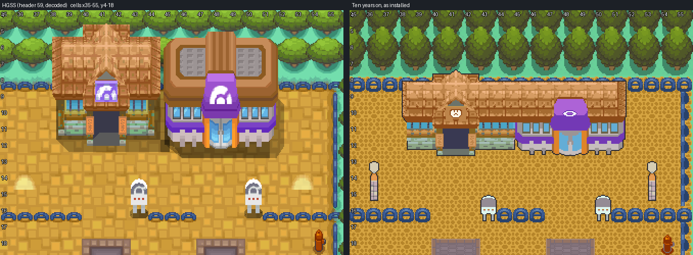
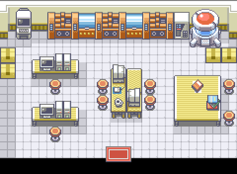

# Saffron City, ten years on

HGSS's Saffron, cell for cell, in Gen 3 pieces, with the changes ten years and Apocrypha's
story have made to it. Saffron is where Kanto starts (Chapter 4 ends at Saffron Station,
Chapter 5 is spent in the city), so it is the first Kanto town updated. Editable source is
engine branch `claude/saffron-city`, which builds on `claude/olivine-city`. Owner visual
acceptance is pending.

The first round (FireRed's Saffron, edited) gave way on 2026-10-24 to the owner's call:
look to HGSS, move the city toward HGSS's plan, build one new Dojo for both dojos (an
entrance each, a shared interior) and a lab wing on Silph with its own entrance (an open,
empty lab for now). The map keeps its name and map id, and its Center, Center upstairs and
Mart; FireRed's `SaffronCity_Frlg` stays as it is.


## What changed, and why

Each change answers the owner's brief or DESIGN.md (Kanto: "the political, technological,
and financial core. Silph Co. dominates the skyline, and the city houses interregional rail
connections, League offices, and the competing Psychic and Fighting Dojos ... No gym";
Chapters 4 and 5).

| Change | Story |
| --- | --- |
| The Saffron Dojo: one building where HGSS has the Fighting Dojo and the Gym, an entrance each, one hall inside | The owner's brief; "the competing Psychic and Fighting Dojos ... No gym". Built from HGSS's own models (`newbuildings.saffron_dojo`): the Fighting Dojo's west end, gabled porch, open doorway and banners; a long hall under the same shingled roof (a one-unit slice of the Fighting Dojo, repeated); the Gym's purple porch, glass door, walls and windows for the Psychic half. The League emblems come off; a fist on the Fighting plaque, an eye on the Psychic gable. Doors on HGSS's (41, 12) and (48, 12) |
| The Dojo's hall | FireRed's Fighting Dojo (wood floor, tatami, scrolls, statues) as its west half and Sabrina's Gym (lilac wall, blue floor, the pink rug under the wall, statues) as its east, open between them, an exit mat under each half |
| Silph Co. two floors taller | "Silph Co. dominates the skyline". HGSS's model with its fourth floor band repeated (`newbuildings.taller`) |
| Silph's research lab wing, its own entrance | The owner's brief. A low wing built from the tower's own parts (its lobby, three floors, its canopy and glass door, the canopy lamps in the lab's green, the tower's roof panels without the atrium), on the lot of the apartment block east of Silph; door (37-38, 41). Inside: FireRed's Cinnabar Lab experiment room, open and empty |
| The Magnet Train station | HGSS's own (256, door 260): Chapter 4 ends here, Chapter 5 turns the player back for want of a rail pass |
| Signs: HGSS's six, ten years on | The station's (KANTO-JOHTO MAGNET TRAIN LINE), the city's ("Shining Big City"), the Fighting Dojo's ("Everyone is welcome!"), the Gym's now the PSYCHIC DOJO's, SILPH CO. OFFICE BUILDING, Mr. Psychic's |
| No NPCs | Chapter 5's cast comes with its scenes |

Everything else is HGSS's plan: the asphalt road rings, the orange paving lots and kerbs,
the apartment blocks, the Copycat's and Mr. Psychic's houses, the north and east gates,
the hydrants, manholes, street lamps, blue railings and trees, in HGSS's own colours.






## How it is made

Olivine's element method (`tools/gba/maps/olivine_elements`, AGENTS.md "Converting a Gen 4
map element by element"), loaded through `olivine.py`:

1. `hgss_source.py` decodes HGSS's Saffron (header 59, area bank 12) and its events.
2. `art.py` renders every HGSS building at C06's angle in its own palette group (14 colours
   a group, HGSS's colours), and the new buildings from `newbuildings.py`, which works on
   HGSS's model faces (`modelkit.py`: slice with axis planes, move, copy, retexture,
   render).
3. `terrain.py` lays the Gen 3 ground (road, paving, kerbs, grass, manholes) from the HGSS
   element ledger, stands the trees, railings, hydrants and buildings in painter's order
   and splits each 8x8 tile into the top and bottom layer.
4. `pack.py` packs it into one map on its own pair (a primary derived from
   CherrygrovePrimary, Olivine's way), every pixel exact, with HGSS's traversal.
5. `interiors.py` builds the two rooms from FireRed's metatiles and packs each from its
   pixels into a secondary of its own on Emerald's `gTileset_Building`.
6. `install.py` replaces the first round's install (the same tileset symbols and map id).

Tile budget: Saffron draws 909 distinct tiles in 962 slots (466 primary, 496 secondary).
To fit, the symmetric buildings mirror on an 8 px axis (both Dojo porches, the station's
hall and its platform annex, the east gate), Silph and its lab are drawn 16 px per model
unit so their one-unit window bays repeat as tiles (the tower one cell narrower than
HGSS's 11-cell footprint), and the lab is the 80 px width of the block it replaces.

### Gen 3 adaptations

| | |
| --- | --- |
| Sprites moved a tile column | The station 8 px west (its door nearer HGSS's), the apartments either side of the Mart clear of it (the Mart is wider than HGSS's) |
| Trees left out | HGSS's four trees on the east gate's south side stand on the plinth the Gen 3 gate is drawn with; a Gen 3 tree stands clear of a building's front |
| Street bank | The road, paving, kerbs, railings and hydrants share one palette bank, so a tile with paving and a hydrant finds both |
| Traversal | HGSS's permissions, with: the Center, the Mart, both Dojo doors and the lab's door open; the 13 other HGSS warps solid (below); 12 cells HGSS's taller models block open where the Gen 3 sprite leaves them clear or only its roof's top edge reaches; 8 HGSS-open cells solid, 5 inside the shared Center and Mart and 3 a Gen 3 wall fills (the east gate's south-west corner, and two inside HGSS's own enclosed pockets) |
| Unreachable open cells | 37, all in two pockets HGSS also leaves enclosed (behind the station, inside the Dojo's east end) |

## The map

| | |
| --- | --- |
| Map | `KantoSaffronCity`, 64x64, `gMapGroup_Kanto` (group 81) id 0; Center 1, Center upstairs 2, Mart 3, Dojo 4, Silph lab 5; `MAPSEC_SAFFRON_CITY`, `REGION_KANTO` |
| Primary | `gTileset_KantoSaffronPrimary`: 512 tiles (46 Cherrygrove's at their own index: tile 0, grass, trees), 512 metatiles (27 Cherrygrove's kept), banks 0 and 3 Cherrygrove's (3 with the two plain greens), no callback |
| Secondary | `gTileset_KantoSaffronCity`: 443 of 496 tiles (16 kept for door animation), 512 metatiles |
| Palettes | Cherrygrove's 0 and 3; C06 Center over two banks, the shared Mart one, the station, Silph and the lab, the Dojo's Fighting and Psychic halves, the apartments, the houses, the gates one each, the street one; one exact fit |
| Border | The east forest's 2x2 tree block (60, 19) |
| Music | `MUS_RG_PEWTER` (FireRed's Saffron theme); the hall `MUS_RG_PEWTER`, the lab `MUS_RG_SILPH` |
| Doors | Center (14, 50) and Mart (38, 26) on interiors cloned from Cherrygrove's (the C06 Center and shared Mart play no door animation, as in Olivine); the Fighting door (41, 12) and the Psychic door (48, 12) into the one hall; the lab's (37-38, 41) |
| Interiors | `KantoSaffronDojo` 23x16 on `gTileset_Building` + `gTileset_KantoSaffronDojo` (95 tiles, 68 metatiles); `KantoSaffronSilphLab` 15x11 on `gTileset_Building` + `gTileset_KantoSaffronSilphLab` (115 tiles, 70 metatiles). Exit mats `MB_SOUTH_ARROW_WARP`, every other cell `MB_NORMAL` (FireRed's statue signposts, the Gym's teleport pads and the lab's machines need scripts the rooms do not have yet) |

### Solid until built

The station (10, 16), the Copycat's house (17, 26), Silph's lobby (28-29, 37), Mr.
Psychic's house (43, 50), the north gate (20-21, 5), the east gate (57, 48-49) and the
city's south and west exits (20-21, 61; 0, 48-49). No connections: Routes 5-8 are not
built. Each comes back when its interior or route exists.

## Verification

- **Native audit** (`check.py`, `evidence/native-audit.json`): the installed map decodes to
  the packer's decode in every pixel; behaviour, collision, elevation and layer type match
  the ledger in all 4,096 cells; every approach, door, sign and exit reachable from the
  Center; walk-behind depth as Olivine's rule; the C06 Center and the shared Mart pixel
  exact (13,925 pixels, masters' hashes checked); Cherrygrove's kept banks and tiles
  unchanged, no primary callback; the city's six warps lead into rooms whose warps lead
  back to the same building; both interiors decode from their own files to FireRed's
  pixels, their exit mats reachable from each other; v1's door entry gone; budgets hold;
  existing map ids preserved; only Saffron files changed.
- **Headless mGBA** (`runtime.py`, `evidence/gameplay/`): 43 captures, the map layers
  rebuilt from VRAM match the native decode with 0 mismatched pixels, the hall's and the
  lab's frames included; BG1 covers the player behind the lab's roof, the Mart, a Dojo
  sign, a street lamp, the city sign, a Silph board and the east gate; BG1 clear at 14
  building fronts; the station's, Silph's, the houses' and the gates' doors, the city's
  exits and the east gate's corner solid; the six signs read; the Center (both floors) and
  the Mart entered and left; the Dojo entered by the Fighting door, crossed on foot and
  left by the Psychic door, then in and out by the Psychic door; the lab entered by both
  door cells and left; Cherrygrove and Olivine unchanged; ordinary save, cold reload and
  Continue.
- **Porymap 6.3.1** (`porymap.py`, `evidence/porymap/results.json`): the city's, the hall's
  and the lab's exports equal the native decodes (0 of 1,048,576, 94,208 and 42,240 pixels
  differ); saving leaves every Saffron file byte-identical.
- **Deterministic**: two runs under different `PYTHONHASHSEED` give identical sprites,
  arrays and decodes.

Local ROM `4a3a85c0` on engine `claude/saffron-city`.

## Rebuild

```
python3 tools/gba/maps/saffron/hgss_source.py /path/to/pokeheartgold
python3 tools/gba/maps/saffron/art.py /path/to/pokeheartgold
python3 tools/gba/maps/saffron/terrain.py /path/to/engine /path/to/pokeheartgold
python3 tools/gba/maps/saffron/pack.py /path/to/engine
python3 tools/gba/maps/saffron/interiors.py /path/to/engine
python3 tools/gba/maps/saffron/install.py /path/to/engine        # over the first round's install only
python3 tools/gba/maps/saffron/check.py /path/to/engine
python3 tools/gba/maps/saffron/runtime.py /path/to/engine gba/art/saffron-kanto/evidence/gameplay
python3 tools/gba/maps/saffron/porymap.py /path/to/engine /path/to/porymap   # after committing the engine
python3 tools/gba/maps/saffron/review.py /path/to/engine
```

Review sheets with cell numbers: `evidence/review/` (HGSS beside the installed map; each
room beside the FireRed rooms it is built from). Until the owner edits or accepts the map
it is regenerated from these tools each round; after that, edit natively.

## Limits

- Interiors other than the Center, the Mart, the Dojo's hall and the lab (Silph's lobby,
  the station, the Copycat's and Mr. Psychic's houses, the gates) are not built, so their
  doors are solid.
- No NPCs or scene scripts: Chapter 5's cast (the station attendant, Mel, the dojo
  students, Sabrina and Bruno, the Copycat) comes with its scenes. The hall has no masters
  or trainers yet; the lab has no staff.
- The café and hidden items in KANTO_ITEMS.md are not placed.
- The Center and Mart interiors are Cherrygrove's (the same clerk and nurse sprites); the
  Mart keeps the first round's KANTO_ITEMS.md badge-1 stock.
