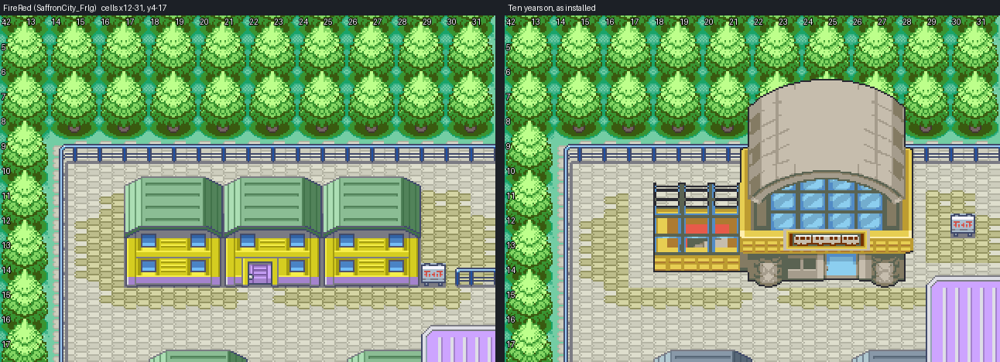
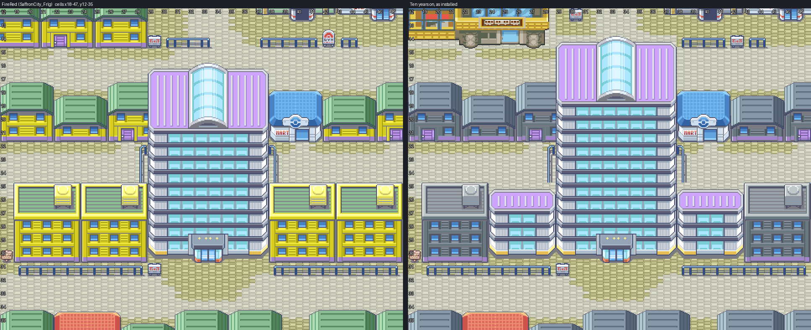

# Saffron City, ten years on

FireRed's own Saffron, cell for cell, with the changes ten years and Apocrypha's story have
made to it. Saffron is where Kanto starts (Chapter 4 ends at Saffron Station, Chapter 5 is
spent in the city), so it is the first Kanto town updated. Editable source is engine
branch `claude/saffron-city`, which builds on `claude/olivine-city`. Owner visual
acceptance is pending.

FireRed's `SaffronCity_Frlg` stays as it is (FireRed's maps are not in the Emerald build).
This is a new map beside it.


## What changed, and why

Each change answers DESIGN.md (Kanto: "the political, technological, and financial core.
Silph Co. dominates the skyline, and the city houses interregional rail connections,
League offices, and the competing Psychic and Fighting Dojos ... No gym"; Chapters 4 and 5).

| Change | Story |
| --- | --- |
| The Magnet Train station in the north-west block, in place of three houses | The player arrives here with Mel at the end of Chapter 4 and is turned back for want of a rail pass in Chapter 5. HGSS puts the station in this block; it is HGSS's own model (256, door 260) at C06's angle, `sprites.py`. Its sign reads SAFFRON STATION, MAGNET TRAIN to GOLDENROD CITY |
| Silph Co. two floors taller, its roof over the street north of it | "Silph Co. dominates the skyline" |
| Two Silph annex wings in place of the inner apartment blocks | Silph's growth over ten years; built from the tower's own metatiles |
| The Gym's "GYM" plate painted out, both red Gym signposts made plain city signposts | No gym: Sabrina's building is the Psychic Dojo, beside the Fighting Dojo. Signs: PSYCHIC DOJO and FIGHTING DOJO, "Challengers welcome." |
| The Trainer Fan Club's sign reads POKéMON LEAGUE, KANTO OFFICE | "League offices" |
| The Copycat's house moves to the house at (18, 17), which gains FireRed's door front at (19, 21) | The station took the Copycat's old lot (Chapter 5's Copycat reward beat needs her house) |
| Kanto's grade on house walls and roofs (`frlg.GRADE`: walls concrete, roofs slate) | "cooler institutional steel and glass; restrained, corporate". Paving, trees, the Center and Mart, Silph's purple and the dojos' and gates' wood keep FireRed's colours |
| Silph's signs: SILPH CO. HEADQUARTERS, "The lobby is open to visitors."; "The MAGNET TRAIN runs on SILPH CO. engineering." | Chapter 5's public lobby, and its display on the Magnet Train's Silph-engineered systems |
| The Mart stocks KANTO_ITEMS.md's badge-1 list | "Trim the vanilla Kanto stock" |
| Team Rocket's occupation, its grunts and FireRed's scripts gone | Ten years gone. No NPCs yet (the Chapter 5 cast comes with its scenes) |

Every other cell keeps its FireRed metatile, behaviour, collision, elevation and layer type.




## The map

| | |
| --- | --- |
| Map | `KantoSaffronCity`, 66x55, `gMapGroup_Kanto` (group 81) id 0; Center 1, Center upstairs 2, Mart 3; `MAPSEC_SAFFRON_CITY`, `REGION_KANTO` |
| Primary | `gTileset_KantoSaffronPrimary`: 512 tiles (FireRed's, tile 0x14 at its own slot, below), 311 metatiles (FireRed's kept ones) |
| Secondary | `gTileset_KantoSaffronCity`: 149 of 496 tiles (16 kept for door animation), 84 metatiles (the station and the plate) |
| Palettes | FireRed's banks 0-3, 5 and 8-10 as FireRed has them, 11 and 12 graded; 4 the station's 15 colours; 6 and 7 free |
| Border | FireRed's |
| Music | `MUS_RG_PEWTER` (FireRed's Saffron theme) |
| Doors | Center (24, 38) and Mart (40, 21) open on interiors cloned from Cherrygrove's, with FireRed's sliding door animation (`src/field_door.c`); every other door and the four gates solid (below) |

### FireRed's tiles in an Emerald-format pair

FireRed's tileset pair has a 640-tile, 640-metatile primary and 32-bit attributes; the
Johto towns' maps are Emerald format (512 and 512, 16-bit). `pack.py` repacks the 476
FireRed tiles and 10 palette banks the edited Saffron draws into one Emerald-format pair,
so the map sits in the same Porymap project and build as the Johto towns:

- FireRed's banks keep their numbers (Saffron draws none from FireRed's 4, 6 and 7, so the
  station takes 4).
- Kept metatiles keep their entries (remapped to the new slots), behaviour and layer type.
- The station and the plate are packed from their pixels, each 8x8 tile reusing a
  FireRed tile wherever one draws the same.
- A normal-layer metatile's colour-0 bottom pixels show BG3, which the engine fills with
  primary tile 0x14 in bank 3 (`DrawMetatile`, `0x3014`). FireRed's roof corners have such
  pixels, so FireRed's tile 0x14 stays at slot 0x14 and they look as they do in FireRed.
  The decoders (`frlg.under`) draw it that way, and so does Porymap.
- FireRed's animated flowers are drawn in their first frame (no tileset callback).

### Solid until built

18 FireRed warps are solid cells: Silph (33, 30), the Fighting Dojo (40, 12), the Psychic
Dojo (46, 12), the League office (47, 21), the house at (27, 21), Mr. Psychic's house
(43, 38), the station door (25, 14), the Copycat's new door (19, 21), and both doors of the
four gates (north 34-35, 5; west 8, 27 and 1, 27; east 58, 27 and 65, 27; south 34-35, 46
and 34-35, 52). No connections: Routes 5-8 are not built. Each comes back when its interior
or route exists.

## Verification

- **Native audit** (`check.py`, `evidence/native-audit.json`): the installed map decodes to
  compose.py's picture and the packer's decode, every pixel; FireRed's palettes (11 and 12
  graded); the station's 16,455 opaque pixels exact; behaviour, collision, elevation and
  layer type match the ledger in all 3,630 cells, and every cell but the station's keeps
  FireRed's layer type; the station's 85 cells blocked and below the player; every
  approach, sign and former door reachable from the Center; the gates' route-side doors
  face only route ground. The 148 unreachable open cells are FireRed's own (the route
  ground past the gates, gate roofs, tree tops), identical to FireRed's grid. Budgets hold;
  existing map ids are preserved; only Saffron files changed.
- **Headless mGBA** (`runtime.py`, `evidence/gameplay/`): 41 captures; the map layers rebuilt
  from VRAM match the native map with 0 mismatched pixels; BG1 covers the player behind
  Silph's raised roof, a wing, the League office, the Copycat's house, the Center and the
  Mart; BG1 clear at 13 building fronts, the station's among them; the station, Silph, the
  dojos, the Copycat's door and two gates solid; the ten signs read; the Center's door
  plays FireRed's sliding door (frames 0-2 seen in VRAM); Center (both floors) and Mart
  entered and left; Cherrygrove and Olivine unchanged; ordinary save, cold reload and
  Continue.
- **Porymap 6.3.1** (`porymap.py`, `evidence/porymap/results.json`): the city's export equals
  the native decode (0 of 929,280 pixels differ); saving leaves every Saffron file
  byte-identical.
- **Deterministic**: two runs under different `PYTHONHASHSEED` give identical arrays.

Local ROM `bad30f05` on engine `claude/saffron-city`.

## Rebuild

```
python3 tools/gba/maps/saffron/sprites.py /path/to/pokeheartgold
python3 tools/gba/maps/saffron/compose.py /path/to/engine
python3 tools/gba/maps/saffron/pack.py /path/to/engine
python3 tools/gba/maps/saffron/install.py /path/to/engine        # first authoring only
python3 tools/gba/maps/saffron/check.py /path/to/engine
python3 tools/gba/maps/saffron/runtime.py /path/to/engine gba/art/saffron-kanto/evidence/gameplay
python3 tools/gba/maps/saffron/porymap.py /path/to/engine /path/to/porymap   # after committing the engine
python3 tools/gba/maps/saffron/review.py /path/to/engine
```

Review sheets with cell numbers: `evidence/review/`. Until the owner edits or accepts the
map it is regenerated from these tools each round; after that, edit natively.

## Limits

- Interiors other than the Center and the Mart (Silph's lobby, the dojos, the station, the
  League office, the Copycat's house) are not built, so their doors are solid.
- No NPCs or scene scripts: Chapter 5's cast (the station attendant, Mel, the dojo
  students, Sabrina and Bruno, the Copycat) comes with its scenes.
- The café and hidden items in KANTO_ITEMS.md are not placed.
- The Center and Mart interiors are Cherrygrove's (the same clerk and nurse sprites).
