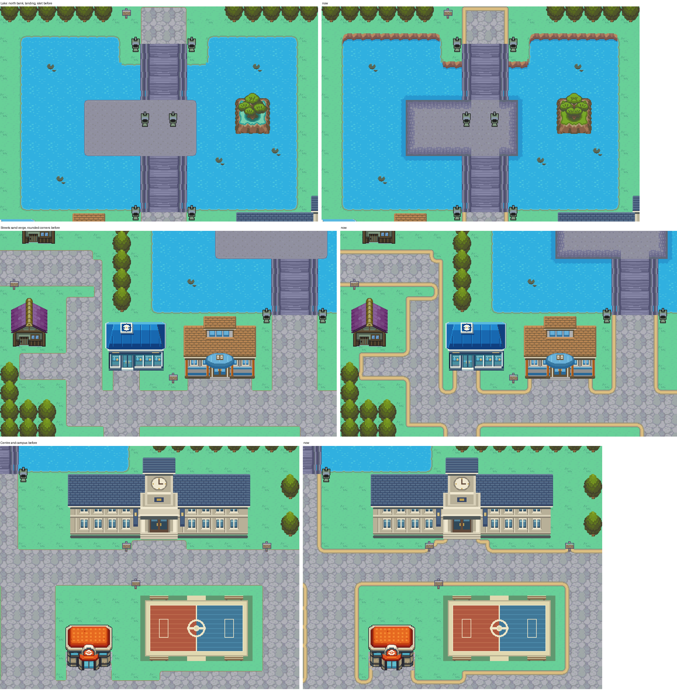
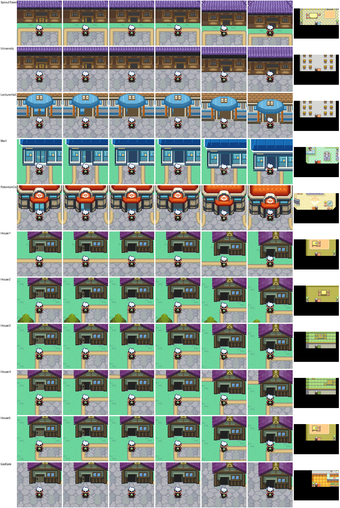

# Violet City, cleaned up to AGENTS.md's native visual rules

2026-10-29, engine branch `claude/routes-30-31-catalog` (PR #39). Starting point: the newest Violet City,
ported unchanged from `codex/johto-editor-consolidation` 8eb43845f6 (engine 42cd9d1a53, with Route 36 and the
west gate; both decode pixel for pixel as that branch's own renders). Checked against HGSS Violet rendered
from pokeheartgold's own data. Every cell keeps its collision, elevation, behaviour and layer type.



## What changed

- **Streets**: the cobble ran square into the lawn behind a 1 px tan line. HGSS runs a dirt verge between
  cobble and lawn and rounds its corners. The cobble now stops 8 px short of the lawn and the Johto port's
  own dirt tones run between (the lawn's shade line, the painter's sand, a dark line on the cobble), the
  corners rounded (3 px). Against buildings, bridges, signs and lanterns the cobble runs right up to them.
  The street's shape is read by cells, so a building's outline doesn't cut it up.
- **Lake, north bank**: HGSS drops from the lawn to the water by an earth bank on the lake's north sides.
  Violet had a 1 px line. It takes HGSS's own bank (`source/hgss/lake-bank.png`): the light face on the
  lawn's last pixels, the dark foot over the water's first, a deeper blue below.
- **Lake, landing**: Violet's landing is HGSS's own size and place (x31-42, rows 23-28). The flat slab with a
  1 px outline takes HGSS's 12 px stone-block border round its dotted floor (`source/hgss/landing.png`, the
  ground layer, so no bridge or lantern), in Violet's own grey ramp, and the deeper ring HGSS draws in the
  water round it. The walkways stay open where the bridges land; the lanterns stay.
- **Sprout Tower** (owner requests, October 31): the port drew it near-black, dim purple tiers over a flat
  black wall with dull gold shapes. HGSS's tower is a bright blue-violet roof over a carved wooden front.
  The roof keeps every pixel's shape and takes a lighter ramp with more step between tones; the black eave
  lines stay for a crisp edge, lone speckle pixels take their neighbours' tone, and the port's drop shadow
  and grey trim outside the outline (and the spire's shadow on the lawn) are gone. The front is HGSS's own
  (`source/hgss/tower-front.png`): the carved beam, barred windows over tan sills and oval panels, the door
  with its gold panels, fitted to the tower's 24 px wall by leaving out repeated rows of plain wood and
  mirrored about the door (a figure standing at the door in HGSS's render is left out). Wooden corner posts
  and a dark sill beam stand straight on the lawn; HGSS's stone plinth is left out (owner's call).
- **University** (owner requests, October 30-31): the port's western hall (slate roof, cream walls, clock
  tower, 20 x 9 cells at x47-66) did not match Violet's Johto style. It is now a two-storey Johto hall in
  Sprout Tower's materials, every part centred on its door (x 924 px). Both roofs are the tower's top tier,
  a whole hip roof at the tower's own pitch (the spire's foot filled with the front face below it,
  mirrored): the lower one stretched across the ground floor (216 px), its side slopes running back past
  the upper floor so it wraps round it; the upper one over the upper floor, one column wider to centre.
  The ground floor is the tower's front with three window bays each side of the door, the upper floor three
  bays of it. Walls sit on the lower layer and roofs on the upper, so where an eave crosses a wall inside
  one tile each keeps its own palette. The hall's base is 8 px short of the street (the street runs up to
  the door); the cells it gave back are walkable lawn, its own cells are blocked, and the back path behind
  it (row 33) stays open with the top roof's ridge drawn over the player. The sign at (53, 43) stays.
- Unchanged: the islet (as the port has it, owner's choice), the lecture hall, the practice court, the
  approved C06 Center and M01 Mart, the houses, the west gatehouse, the forests (already the overlapping
  lattice), bridges, lanterns, signs, ducks.

## Doors



All eleven doors open with an animation and lead inside (October 31, owner request). The door cells take
the animated-door behaviour and are walkable; everything else keeps its collision.

| Door | Cell | Behind it |
| --- | --- | --- |
| Sprout Tower | (39, 12) | `SproutTower1F`, a stand-in room (`LAYOUT_RUSTBORO_CITY_HOUSE1`) until the tower's floors are built |
| University hall | (57, 42) | `VioletUniversity` (`LAYOUT_RUSTBORO_CITY_POKEMON_SCHOOL`) |
| Lecture hall | (31, 41) | `VioletLectureHall` (`LAYOUT_RUSTBORO_CITY_POKEMON_SCHOOL`) |
| Mart (M01) | (21, 40) | `VioletMart`, clerk with `docs/JOHTO_ITEMS.md`'s Violet stock |
| Center (C06) | (49, 55) | `VioletPokemonCenter` with its nurse, `VioletCenterUpstairs` |
| Houses | (11, 27), (10, 38), (26, 56), (36, 61), (56, 64) | `VioletHouse1`-`5` (stock house layouts, empty) |
| East gate | (74, 56) | `VioletEastGate`, its warp as before |

- **Frames** (`doors.py`): the door's 2x2 block (its cell, the cell right of it, the row above) in three
  frames cut from the town's own upper layer, the door panel going dark from its far edge. `field_door.c`
  draws Violet's frames on the top layer over each cell's own bottom layer (a `layered` flag on the door
  table entry, an engine addition), so the ground under each building stays its own tiles and every frame
  tile has a bank holding all its colours: 0 colours off palette on all eleven.
- Each door cell has its own metatile, so the door table finds its own frames.
- The hall's lower roof sits 8 px higher than before, with 4 px of eave shadow between it and the ground
  floor, so the door's block holds no roof.
- The interiors are working shells: the nurse heals, the clerk sells. Their scenes (`docs/CHAPTER2_SCENES_SPEC.md`)
  are the chapter's implementation pass.

## Tilesets

Violet is the only map on `VioletCityPrimary` and `VioletCity`, so the installer (`tools/gba/maps/violet_city`)
lays both out anew from the town's two decoded layers: each quadrant takes the bank that holds its colours,
identical quadrants share one tile in any flip, identical cells one metatile. The 13 banks are Violet's,
with colours its art no longer draws freed for the new ones.

- 997 of 1,008 tiles (512 primary, 485 secondary), 695 metatiles. The hall saves 39 tiles over the port's
  university (1,048 against 1,009 before folds).
- Secondary slots 496-511 (tiles 1008-1023) stay empty: `field_door.c` draws door frames there, so Violet's
  doors can animate. The installer always reserves them.
- Where both of a cell's layers draw below the player, a quadrant one bank can draw takes one tile, not
  two (4,022 quadrants).
- **Folds**: none at the current budget. When tiles run short the installer lets a new texture tile take an
  existing one a few px away, each moved pixel another tone of its own texture. Lawn, cobble, water and
  canopy move anywhere within themselves; the verge, the bank and the landing's stone only inside, never
  their lines or edges. Building art never moves.

## Checks

| Check | Result |
| --- | --- |
| Every cell draws as composed (`violet.py --install`) | 0 pixels differ outside the folds; every fold is a tone of its own texture |
| Collision, elevation, behaviour and layer type | unchanged on every cell outside the university's old and new footprint (the hall blocked, the rest walkable lawn) |
| Porymap 6.3.1 export vs native decode | 0 pixels differ (Violet City, Route 36, Cherrygrove) |
| Runtime (`runtime.py`): into the east gate, into the west gate, the north road over both bridges and the landing to the main street (30 steps), the lake blocking on foot, the hall blocking at its door, the back path behind it open, the old west wing's lawn walkable, all eleven doors in and out | passes; 48 frames outside the door openings, every one at least 99.7% identical to the decode outside the player (`evidence/runtime-summary.json`, `evidence/runtime-walk.png`, `evidence/runtime-hall.png`) |
| Cherrygrove town runtime on the same ROM | passes |

## Limits

- 11 tiles free beyond the 16 door-frame slots. The largest users before the hall (exclusive tiles): Sprout
  Tower 236, C06 Center 94, lecture hall 82, the port university 81, M01 Mart 77, lake water, banks and
  ducks 55, islet 55.
- Interiors and onward routes are as the source branch left them.
- Owner visual acceptance: Sprout Tower and the hall accepted October 31 ("lock those in"); the rest of the
  town not yet reviewed as a whole.
- Interiors are working shells (see Doors); Sprout Tower's is a stand-in room.

## Reproduce

```sh
python3 tools/gba/maps/violet_city/hgss_sources.py PATH/TO/pokeheartgold   # source/hgss/
python3 tools/gba/maps/violet_city/violet.py ENGINE --preview              # evidence/preview.png, before-after.png
python3 tools/gba/maps/violet_city/violet.py ENGINE --install              # both tilesets and the map
```

Every run starts from Violet at the engine's port commit (`base.py` BASE_REV). Treat the tools as
provenance: once the owner edits Violet in Porymap, edit the native files and don't replay the generator.
