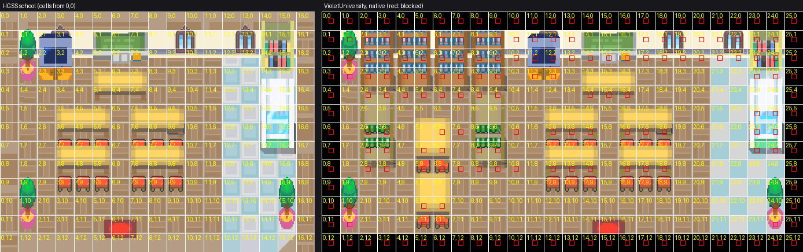

# Violet City interiors (November 3)

Owner request: rebuild the interiors of the university, Sprout Tower, the lecture hall and the five houses,
"with aesthetics based on their previous iterations but more appropriate for their new roles in the story."

The previous iteration of each room is its HGSS original. Every room starts from HGSS's own data, rendered
from pret/pokeheartgold (revision `9d8b7591f`) by `tools/gba/maps/violet_interiors/hgss_interior.py`. That
script uses the route renderer's projection (`route29_catalog/hgss_render.py`), one HGSS tile per 16 px
cell, and draws each room's terrain and every furniture model separately. Collision comes from HGSS's
permission grid, and warps and exits from HGSS's zone events. Rooms whose role changed are labelled
**proposals**. Their sources are DESIGN.md (Violet as the academic capital: the trainer school grown into a
university, Falkner's gym a lecture hall and practice arena) and the owner's November 3 choice of campus homes.

| Room | HGSS original | What it is now |
| --- | --- | --- |
| `SproutTower1F`-`3F` | Sprout Tower 1F-3F (D15R0101-0103) | HGSS as it is: the floor, walls, lanterns, railings, the swaying pillar, ladders, Bellsprout statues. All three floors are built, linked by HGSS's own ladders. |
| `VioletUniversity` | Pokémon School (T22R0301) | Proposal. HGSS's school is the lecture room as it is: blackboard, the dean's desk, students' desks, bookshelf and cabinet, the tiled aisle. West of it the room runs on nine columns of its own floor and wall as the library: four tall stacks on the back wall (bookshelf behaviour), two free-standing stacks and two reading tables (scenes 2.3b-c). |
| `VioletLectureHall` | Violet Gym (T22GYM0101) | Proposal. HGSS's hall: the drapery and crest, orange pillars, glass floor panels and rails, the wooden stage and its green mat, the statues at the door. The pit and the raised walkways become a stone practice court with white lines. A blackboard stands at the back of the stage and a lectern at its edge. Two rows of desks face the stage on each side (scene 2.5). |
| `VioletHouse1` (11, 26) | Violet house, tatami twin (T20R0301) | Proposal: a retired sage's home, nearest the tower. A home shrine, a low table with cushions, a Bellsprout statue (Sprout Tower's own model), a bonsai. |
| `VioletHouse2` (10, 37) | Violet house (T22R0401) | Proposal: a students' boarding house. Two beds, a study desk, a poster. |
| `VioletHouse3` (26, 55) | Violet house | Proposal: a second boarding house. Two beds, the bookshelf, a study table, a new arrival's boxes. |
| `VioletHouse4` (36, 60) | Violet house | Proposal: a professor's home with a study. Two tall shelves and a globe by the reading table. |
| `VioletHouse5` (56, 63) | Violet house | Proposal: the map-card kid's family home (scene 2.3c), with their gran. HGSS's house as it is, plus a town map on the wall and a TV. |

Each `evidence/<map>-compare.png` shows HGSS's room (coordinate grid in HGSS cells) beside the native map
(map cells, blocked cells marked red). `-composed.png` is the room as composed, and `-installed.png` is the
installed map decoded from its native tiles.

## How it is built

`tools/gba/maps/violet_interiors/build.py ENGINE` runs these steps:

- **Compose each room.** `rooms.py` holds each room's recipe and `room.py` the tools:
  - Crop or re-lay HGSS's columns (`compose`).
  - Keep, drop, move or add HGSS furniture models (`place`).
  - Copy terrain cells (`paint`).
- **Layers.** A prop's parts that stand over a walkable cell go on the top layer and draw over the
  player. Everything else is the bottom layer. Ladder and exit cells keep their art under the player.
- **Collision.**
  - Rooms kept as HGSS has them use HGSS's own collision.
  - Added furniture blocks the cells it stands on.
  - The lecture hall's court and seating are walkable floor apart from the desks, rails and statues.
- **Packing.** Each building's rooms pack into a private tileset pair of its own (`ipack.py`):
  - Pairs: `violet_university`, `violet_lecture_hall`, `violet_sprout_tower`, `violet_sage_house`,
    `violet_houses`.
  - Every 8 px quadrant draws from one of 13 banks of 15 colours.
  - The packer tries two palette methods and keeps the one that scores better:
    - exact banks after merging near-identical colours, each bank then refit to its quadrants' own colours;
    - k-means over quadrants.
  - A repair pass then gives each quadrant's missing colours a bank.
- **Install.** Layouts, maps and warps go into the engine. `violet_city/doors.py` keeps these interiors'
  layouts and inner warps whenever Violet is reinstalled.

| Pair | Colours in | Method | Tiles | Metatiles |
| --- | --- | --- | --- | --- |
| violet_university | 121 | merged within 2 steps, refit | 241 | 110 |
| violet_lecture_hall | 227 | merged within 2 steps, refit, repaired | 574 | 300 |
| violet_sage_house | 111 | merged within 1 step, refit | 185 | 78 |
| violet_houses | 150 | merged within 2 steps, refit, repaired | 354 | 151 |

The numbers are in `evidence/build.json`; two builds in a row write identical tilesets.
| violet_sprout_tower | 146 | k-means, repaired | 928 | 623 |

Installed against composed: mean channel error 0.4-2.0 per room, and at most 9 pixels per room more than
32 off on a channel (most rooms 0).

## Checks

| Check | Result |
| --- | --- |
| `make` | builds |
| Porymap 6.3.1 (its own loader and renderer, headless) | all ten interiors and Violet City export with 0 pixels differing from the native decode |
| Interior runtime (`violet_interiors/runtime.py`): every warp in every interior, from the cell next to it (or standing on the exit mat), lands on its destination | 19 of 19: Sprout Tower's exit and all ten ladder cells across three floors, each other room's exit |
| Violet runtime (`violet_city/runtime.py`): every door in and back out | 11 of 11; 48 frames outside the door openings at least 99.7% identical to the decode |
| Cherrygrove town runtime on the same ROM | passes |

## Not done

- No NPCs or scenes yet: sages, Elder Li, the instructors, the library seeds, the practicum trainers,
  the house residents (CHAPTER2_SCENES_SPEC.md is the implementation pass). The rooms leave space for them.
- Sprout Tower 3F's top floor is as HGSS has it; the swaying pillar does not sway.
- Bookshelf behaviour is on the university's back-wall stacks only.
- Owner visual acceptance.

Original designs and textures: Game Freak / Nintendo / Creatures (read-only derivation from the game's data).
