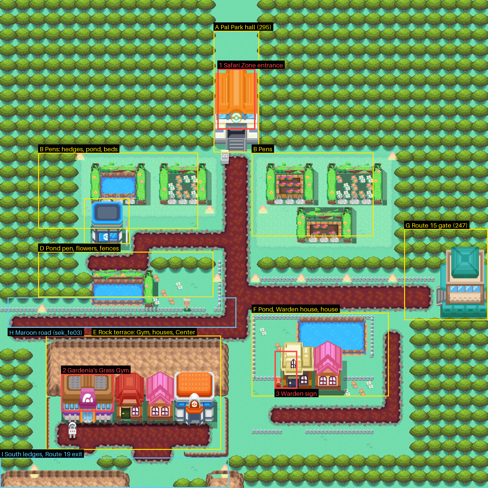

# KantoFuchsiaCity plan (HGSS `MAP_FUCHSIA`)

Gates: [MAP_CHECKLIST.md](../../../docs/MAP_CHECKLIST.md). Status: G2 approved 2026-11-23, built, G4 pass,
G5 done, in owner review (G6). The first build (FireRed's pieces on HGSS's plan, fork
PR #62 / hub PR #59) was turned down and deleted on 2026-11-23.

Method: MAP_CHECKLIST gates, GBA_MAP_RECONSTRUCTION steps 1 and 2, and the Kanto town rules on
`claude/celadon-city` (AGENTS.md "Converting a Gen 4 map", "Kanto towns: HGSS's Kanto, the
Olivine way", "Planning a new town: the change plot"), Celadon as the worked example.

## G1 Reference

- HGSS constant / code: `MAP_FUCHSIA` / `MAP_T08`, header 56, area bank 16, map texture set 16,
  building texture set 15. pokeheartgold `9d8b7591`.
- Size, matrix cells: 64 x 64 cells; matrix cells (37, 12), (38, 12), (37, 13), (38, 13);
  origin tile (1184, 384).
- Decoded render: `gba/art/kanto-fuchsia/source/hgss/` (`tools/gba/maps/fuchsia_city/hgss_render.py`).
- Numbered reference sheets (four 32 x 32 quadrants, every cell numbered):
  `gba/art/kanto-fuchsia/evidence/trace/hgss-numbered-1..4.png`; the traced grid over HGSS:
  `grid-over-hgss-1..4.png`.
- Material grid, one code per cell: `gba/art/kanto-fuchsia/source/trace/material-grid.txt`.
  Traversal ledger (walk, block, Surf, jump direction, warp per cell): `traversal.json`.
  Tree roots (499): `trees.json`. Building and prop placements: `objects.json`. Events:
  `source/hgss-events.json`.
- Registration: native = HGSS + (0, 0). Gate file: `gba/maps/gates/KantoFuchsiaCity.json`.
- Warps (HGSS id, cell, destination):

  | id | cell | destination | this pass |
  | --- | --- | --- | --- |
  | 0, 1 | (57, 38), (57, 39) | Route 15 gatehouse | solid |
  | 2, 3 | (19, 61), (20, 61) | Route 19 gatehouse | solid |
  | 4 | (13, 32) | Mart | solid door |
  | 5, 6 | (30, 19), (31, 19) | Pal Park entrance (here: Safari Zone entrance) | solid |
  | 7 | (11, 55) | Gym | solid door |
  | 8 | (16, 55) | southwest house | solid door |
  | 9 | (25, 55) | Pokémon Center 1F | solid door |
  | 10 | (38, 51) | Warden's house | solid door |

  Every destination is `not started` in the inventory, so every door is drawn and blocked
  (AGENTS.md: doors to unbuilt interiors are solid). Each is `adapt_warps` in the gate file
  at G3.
- Connections and neighbours:

  | side | HGSS map | joins at | inventory |
  | --- | --- | --- | --- |
  | west | `MAP_ROUTE_18` | rows 32-63 (road rows 41-44 at x 0) | not started |
  | east | `MAP_ROUTE_15` | through the gatehouse at (57, 38-39) | not started |
  | south | `MAP_ROUTE_19` | through the gatehouse at (19-20, 61) | not started |

  No connection is written this pass. The west road runs to the map edge as HGSS has it.
- Signs: notice board (29, 21), city sign (24, 40), Gym sign (9, 57), Warden sign (36, 51),
  hidden Nugget (48, 29). Objects: cuttable tree (27, 40), Apricorn tree (22, 37), 5 NPCs.
- Occluded or uncertain squares and how they are read:

  | squares | reading |
  | --- | --- |
  | Mart, x 12-15 rows 28-32 | HGSS leaves its permissions hollow behind the model. Row 28 is the roof's back row: blocked. Footprint read from the model's box, door from warp 4 |
  | Pen insides, rows 23-25 and 29-31 | blocked in HGSS's permissions; drawn as bed, soil or pond from the texture under each cell |
  | Row 52, x 8-27, behind the south row | hidden by roofs at 45 degrees; rock top (terrace height 2) from the height data |
  | Route 19 gate top, x 17-22 rows 62-63 | the gate model's roof pokes into this map; drawn as HGSS shows it, blocked |
  | Woods cells with no 2x2 root, (23-26, 62-63) and the `k` cells | blocked lawn under the crown of the tree to the south |
  | Lawn north of the hall, x 28-33 rows 0-10 | open in HGSS's permissions but walled off by the hall; kept as lawn, unreachable |
  | Pond yard, x 34-38 rows 42-48 | fenced on every side, reached only by Surf; kept as HGSS has it |
  | Low walls at x 6 and x 29, rows 52-58 | jump ledges in HGSS (west at x 6, east at x 29), not solid walls |
  | Model 333 (12 placements) | a ground light glow, not a lamp post |

## G2 Sourcing plan

Approved by owner: 2026-11-23, with three answers:

1. Plain HGSS Fuchsia in a Gen 3 style. The story changes below (Safari Zone entrance, Gardenia's Gym crest,
   Warden sign) wait for a later pass; the Gym keeps HGSS's crest.
2. The Mart is the one Saffron uses: FireRed's Mart (`general_frlg` 0x028-0x02B, 0x030-0x033, 0x038-0x03B,
   0x040, 0x041, 0x062, 0x063).
3. The engine base is the builder's call: built on `apocrypha`, on a tileset pair of its own.

Sources as built, where they differ from the table (each still one source per line):

- Pen lawn: FRLG, `general_frlg` 0x0BD-0x0CF (FireRed's own pale lawn and its edge pieces), in place of HGSS's
  `grass02`, so it sits on FireRed's grass without a colour break.
- Pens, ponds, rock, ledges, fences: Converted HGSS, taken from the decoded map at 1:1 by material and repeated
  from one period each (`compose.remap`), so each costs the same tiles wherever it runs. The east post of a pen
  is its west post mirrored.
- Road: `sek_fe03`, the west half of the texture (32 px period across, 64 down).
- Hall, Gym, Route 15 gatehouse and the pink house are drawn as their west half mirrored (symmetric models).
- Mart: FRLG (answer 2).

### Story brief (change plot step 1)

- DESIGN.md 187: Fuchsia is "Safari Zone and conservation. Kanto's ecological conscience."
- DESIGN.md 517: Gym leader Gardenia (Grass), "relocated to the Safari Zone for its biodiversity".
- DESIGN.md 599 and CHAPTER6_SCENES_SPEC 130-135: Janine, the former leader, now studies at
  Celadon's gardens ("I traded the gym for a laboratory").
- No Fuchsia rows in KANTO_ITEMS or KANTO_BATTLES, and no chapter spec section for the town.

### Other agents' work (step 2)

No Fuchsia map on any open or closed PR or branch besides this thread's deleted round. Kanto
towns so far: Saffron (hub #29 / engine #32) and Celadon (hub #39 / engine #46), both open and
stacked on Olivine, neither merged. `gMapGroup_Kanto`, the Kanto C06 Center placement and the
streamed view (`src/celadon_view.c`) exist only on that stack.

### Sourcing table: one source per line

Ids are assigned at G3 when the town's own pair is packed; the source of every pixel is fixed here.

| Element | Where on the map | Source | Tileset and ids |
| --- | --- | --- | --- |
| Ground: lawn | `g`, `u`, `k`, `o` cells | FRLG | `general_frlg` 0x001, tufts 0x008, 0x009 (Celadon's `nature.grass`) |
| Ground: pen lawn | `l` cells, rows 20-32 | Converted HGSS | `grass02`, one 16 px quadrant at 1:1 |
| Paths: maroon stone road | `d` cells | Converted HGSS | `sek_fe03` at its own size in the world's phase |
| Path edge at grass | every road, bed and pond cell touching lawn | FRLG | `general_frlg` 0x0D0-0x0E2, inner corners 0x106, 0x107 (`nature.grass_edges`) |
| Tall grass | none in HGSS's Fuchsia | none | |
| Trees | 499 roots in `trees.json` | Accepted map | Cherrygrove's standard tree, the clear-background cut, staggered 2x2 |
| Flowers | `f` cells, pen beds | FRLG | `general_frlg` 0x004 and its colour swaps (`nature.flowers`) |
| Rock face and top | terrace rows 45-51 x 6-29; south hills rows 62-63 | Converted HGSS | `wall01_d`, `wall01_g`, `cliff01gs`; one level, Route 36's face height |
| Ledges | x 6 and x 29 rows 52-58; row 59 | Converted HGSS | `allpeakgs` strip with rounded ends; `MB_JUMP_WEST`, `MB_JUMP_EAST`, `MB_JUMP_SOUTH` |
| Water and shore | pens (13-17, 23-25), (12-18, 37-39); yard pond (39-47, 42-46) | Converted HGSS | `pond_on`, `pond_un`, `pond_edge`, `pond_line`; `MB_POND_WATER` |
| Stairs | none on the ground. The hall's steps are part of its model | none | |
| Fences | `x` cells | Converted HGSS | `fence_a`, one post to a cell |
| Pen hedges | `h` cells | Converted HGSS | `sek_teien` at 45 degrees |
| Pen beds and planters | `b` cells | Converted HGSS | `f_dodai` planter, soil bed; flowers from the Flowers line |
| Pen front rail | `p` cells, row 26 | Converted HGSS | the white picket and post from the pen model |
| Bridges and docks | none | none | |
| Safari Zone entrance hall | x 28-33 rows 11-19 | Converted HGSS | model 295 with its `pokepark` overlay |
| Mart | x 12-15 rows 28-32, door (13, 32) | Converted HGSS | models 39 + 15 |
| Gym | x 8-14 rows 51-55, door (11, 55) | Converted HGSS | models 300 + 16 |
| Red house | x 15-18 rows 51-55, door (16, 55) | Converted HGSS | models 297 + 307 |
| Pink house (2) | x 19-22 rows 51-55; x 41-45 rows 47-51 | Converted HGSS | model 298 |
| Pokémon Center | x 23-27 rows 52-55, door (25, 55) | Regional kit | the owner-locked C06 Center |
| Warden's house | x 36-40 rows 47-51, door (38, 51) | Converted HGSS | models 299 + 306 |
| Route 15 gatehouse | x 58-63 rows 36-41 | Converted HGSS | model 247 |
| Route 19 gate top | x 17-22 rows 62-63 | Converted HGSS | the Route 19 gate model's roof |
| Signs | (24, 40), (36, 51), (29, 21), (9, 57) | Converted HGSS | models 29, 30, 31, 33; text in sign events, none drawn |
| Light glows | 12 `i` cells | Converted HGSS | model 333 |
| Cut tree, Apricorn tree | (27, 40), (22, 37) | Regional kit | the engine's object events |

Every HGSS building and prop model is already rendered at 45 degrees beside its HGSS source:
`gba/art/kanto-fuchsia/evidence/buildings/sprites-vs-hgss.png` (`tools/gba/maps/fuchsia_city/sprites.py`).
HGSS's ground textures: `evidence/hgss-textures.png`.

- Tileset pair: `gTileset_KantoFuchsiaPrimary` + `gTileset_KantoFuchsiaCity`, wholly its own,
  every palette bank seeded with a job. Map `KantoFuchsiaCity` in `gMapGroup_Kanto`,
  `MAPSEC_FUCHSIA_CITY`, `REGION_KANTO`, Emerald format, 64 x 64.
- Expected budget: the rendered models alone are 586 unique 8x8 tiles; with C06, trees,
  ground, road, rock, ponds and edges the town comes to about 900 to 1,100 tiles against a
  1,015 limit, in 13 banks. If the exact pack lands over, the town streams the way Celadon
  does (`src/celadon_view.c`). The exact count is reported before anything is installed.
- Seam ids: none this pass. No neighbour exists, and Routes 15 and 19 join through gatehouses.
  Route 18 will take this pair's lawn, road and tree ids when it is built.

### Change list (step 6)

1. **Safari Zone entrance** (DESIGN 187, 517; plot A). HGSS's Pal Park hall becomes the
   Safari Zone's entrance again. Model 295 unchanged. Notice sign text later.
2. **Gardenia's Grass Gym** (DESIGN 517; plot E). HGSS's Gym model on its lot, its pink
   poison crest swapped for a leaf, as Celadon's Gardens took one. Nothing else on the model changes.
3. **Safari Zone Warden** (DESIGN 187; plot F). The Warden's house stays; its sign text later.

Nothing else differs from HGSS. No door, interior or warp is displaced.

Out of this pass: interiors, both gatehouses, the Route 18 connection, NPCs, sign text, the
hidden Nugget, the cut tree and Apricorn objects' scripts.

### Adaptations from HGSS (walk and warps)

- All 11 warps solid until their destinations exist (`adapt_warps`).
- No other traversal difference is planned. The gate's walk check runs against
  `traversal.json` at offset (0, 0).

### Questions for the owner

1. Gym: leaf crest (recommended), or exactly as HGSS draws it.
2. Mart: HGSS's Kanto Mart model as Kanto's Mart kit (recommended), or another Mart.
3. Engine base: build on Celadon's stack (engine `claude/celadon-city`, which has
   `gMapGroup_Kanto` and the streamed view; recommended), or on `apocrypha` alone.

## G4 Gate

`evidence/gate/KantoFuchsiaCity.gate.json`: build, glitch, budget, seams, warps, walk, porymap all pass.
Budget: 1,000 of 1,024 tiles, 497 metatiles, 13 palettes; 92.8% of pixels keep their exact 5-bit colour
(`evidence/pack.json`); the C06 Center is exact. Walk: 117 cells in `adapt_walk`, each kind explained in the
gate file's notes.

## G5 Self-review

Checked and fixed (cells):

- Whole map beside HGSS: `evidence/compare.png`.
- Pens (12-49, 21-32): HGSS's Mart roof leaked into pen 1's picket row; picket feet now come from pen 2.
  The short pen (39-45, 28-31) had a stray hedge top at (45-46, 32); fixed.
- Yard pond (39-47, 42-46): house roofs leaked into the south bank; ground pixels now come from the flat decode.
- Terrace (6-29, 45-52): lawn showed between the rock and the south row's roofs; rock top now runs behind them.
- East hill (27-31, 62-63): HGSS draws a strip of Route 19's gate there; replaced by the west hill's rock.
- Trees: the 2x2 roots alone left lawn columns in the forest; staggered rows added between them.
- Ponds were solid; they are Surf water again, row 46 of the yard pond solid as in HGSS.
- In game (`evidence/gameplay-sheet.png`, `evidence/gameplay/results.json`): 32 frames equal the native decode,
  a 107-step walk hall to west exit to Route 15 gate, every door, both gate mouths, a pen and the pond fence
  refuse the player.
- Porymap 6.3.1 export equals the native render (`evidence/porymap.png`).

Known and left for the owner: the light glows (model 333) read as pink lamps; signs have no text yet; the
cut tree and Apricorn tree are not placed (objects, out of this pass).

## G6 Owner review log

- 2026-11-23 round 0: first build (FireRed's pieces) turned down and deleted.
- 2026-11-23: first change plot turned down for skipped steps. This file is the full pass.
- 2026-11-23: plan approved (answers above). Built and sent for review.
